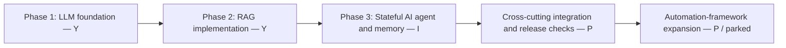
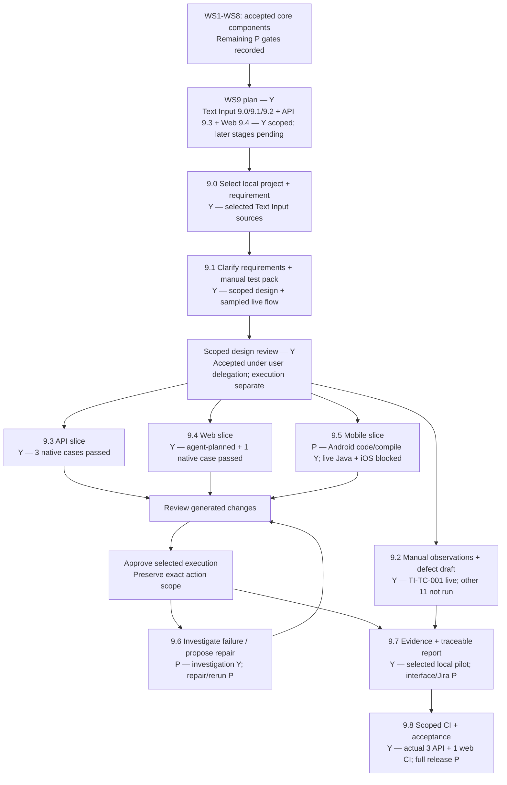
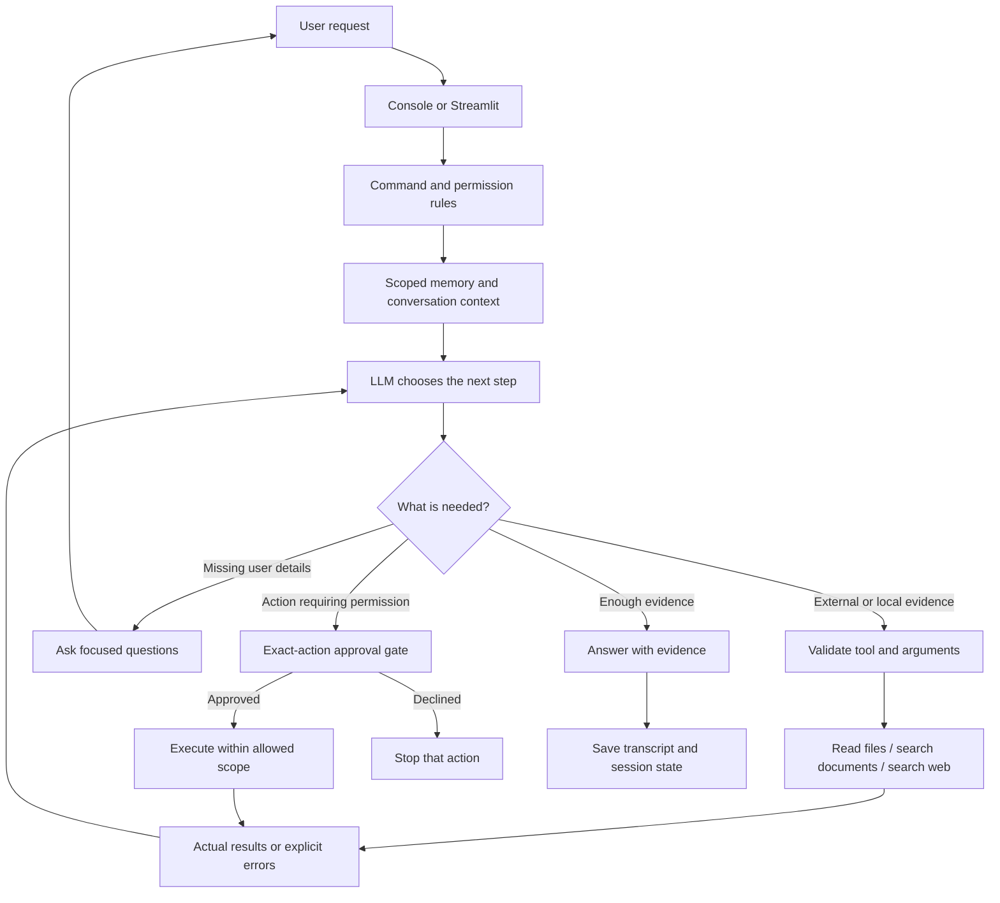
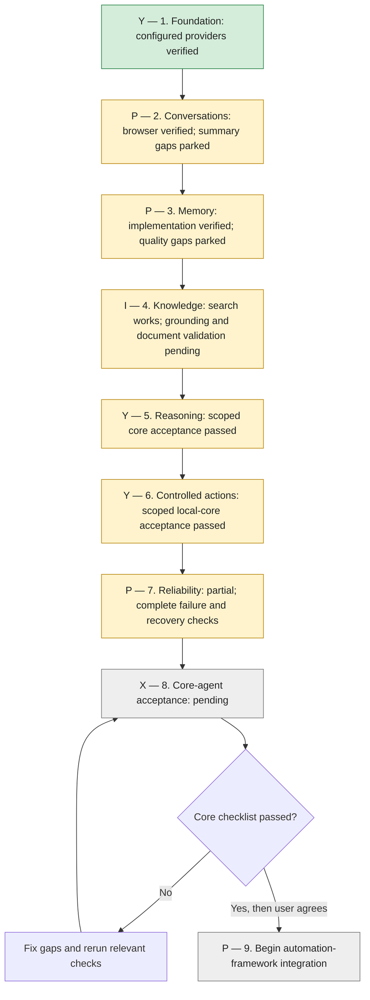

# JeshlaAutoAI — Agentic AI roadmap

<!-- current-task-progress:start -->
## Current task progress — 3 November 2026

**T05 resumed — 3 November 2026; P, actively working.** User explicitly resumed T05 and requested completion before marking Y. The default-public prompt reduction passes 81 affected checks. Its live Java17 answer compiled but failed independent factual/source audit; it is not accepted. The structured candidate now reads actual planned sections first and retains strict provenance, but its latest partial answer lost two topics because the model altered quotations. Generation passage-ID support is being added in the existing runtime/test packages; defaults remain unchanged until a complete live answer passes independent assessment. This supersedes the parked status for T05 only. T10 triage stopped without clone, credentials use or Git writes. Evidence: outputs/acceptance/t05-public-prompt-20261103 and t05-structured-source-20261103. **Y: 11 | P: 20 | X: 6 — Total: 37.**

**T05 normal-runtime review fix — 3 November 2026; P overall.** Reproduced and fixed a default-path guard hole: a validated negative review concern is now retained before malformed/unread source URLs trigger format correction, so a second reply cannot approve the same unchanged draft by dropping that concern. Valid negative repairs, concern-free supported corrections, shared answer revision and existing retry bounds are preserved. **37 affected offline checks passed**, after six failing pre-fix subcases confirmed the defect. The evaluator now supports unchanged production output budgets. One public original Java17 check used the normal shared runtime with Groq selected, source-first disabled, and existing Groq-to-Gemini fallback: it stopped after **33.26 seconds** when Groq reached rate/quota limits and Gemini returned PROVIDER_TEMPORARY. No final answer, Java compilation or execution occurred; factual/version/source coverage remains unaccepted. Exact public progress and final error artifacts are saved. No further live call, saved provider/model/key/order change, UI change, target test/edit, Jira/Git action, installation or Word synchronization occurred. Experimental source-first remains default false. T36 remains Y; all other task rows are unchanged. Evidence: outputs/acceptance/t05-default-review-20261103/completion.md/json. **Y: 11 | P: 20 | X: 6 — Total: 37.**

**T05 compact drafting/source selection — 3 November 2026; P remains.** Local fixes verified: actual publisher search results retain rank and precede speculative planner URLs; malformed rows cannot hide later valid results; the draft schema has tighter prose/quote/example bounds and a 2500-token target without dropping topic slots, cutting JSON/code, or bypassing grounding review. The public-only evaluator saves exact data/excerpts, with atomic progress checkpoints before later network waits. **27 distinct offline checks passed** (25 first, then two new plus two directly affected regressions). One original-question live attempt stopped at its **180-second overall deadline**: OpenRouter planning took 113.47 seconds, retrieval completed, drafting began, no final answer or compilation completed. No second live workflow invocation was started. Factual/source-quality acceptance remains unverified; this is not a demonstrated fix for the older overbreadth/coverage errors. The final malformed-row/progress-save fixes were applied after the live attempt and checked offline only. Source-first stays opt-in/default false; no saved model/key/provider settings, UI, target source/tests, Jira/Git, Word or other task status changed. Evidence: outputs/acceptance/t05-compact-draft-20261103/completion.md/json. **Y: 11 | P: 20 | X: 6 — Total: 37.**

**T05 documentation-section fix — 3 November 2026; P overall.** Fixed a separately reproduced reader bug: redirects now inherit the requested section when Location omits its fragment, while explicit replacement/empty fragments are respected. Source-first requires a positive section-match result for targeted URLs, excluding page introductions when the target is absent. **35 affected offline checks passed, zero failures/errors/skips.** Changes stay in existing agent.tools, agent.runtime and tests modules. Provider/settings/feature defaults are unchanged; no live provider retry, browser/target test, Jira/Git, installation or completed-task replay occurred. This does not explain or resolve the earlier Gemini timeout, generic landing-page results, or factual/source-coverage findings. T05 remains P; T36 remains Y. Evidence: outputs/acceptance/t05-document-section-fix-20261103/completion.md/json. **Y: 11 | P: 20 | X: 6 — Total: 37.**

**T05 resumed — 3 November2026; P remains.** One isolated public-only original Java17 question through the existing opt-in source-first path planned and retrieved documentation, then grounded drafting ended on Gemini RESPONSE_TIMEOUT (107.57seconds total; no outer timeout). No source-checked answer, compilation or execution was produced. The evaluator now distinguishes workflow completion from factual acceptance; no production setting/code or review guard changed, and no unchanged retry followed. Earlier factual overbreadth/source-coverage findings remain unresolved. Evidence: outputs/acceptance/t05-source-first-check-20261103/checkpoint.md/json. T36 stays Y; counts **Y11 | P20 | X6 — Total37**.

**T36 — Y: limited local browser/Python release completed, 3 November 2026.** The user explicitly selected choice B and requested closure. This accepts the trusted single-user local browser/Python milestone using its recorded scoped evidence; it does not claim public/enterprise/native-installer or general multi-agent release certification. All other 36 task rows retain their exact statuses and descriptions. No new gates, source changes, tests, installations, model calls, Git publication or process restart were performed. T36 is closed for this agreed scope; do not reopen unchanged accepted work. Evidence: outputs/acceptance/t36-local-release-completion-20261103/completion.md/json and user-scope-approval.json. **Y 11 | P 20 | X 6 — total 37.** Earlier broader P/pending T36 statements are historical and superseded for this agreed milestone only.

**T36 scope decision applied — 3 November 2026.** The user chose B, explicitly defining completion as the accepted limited local browser/Python release. T36 is Y. The earlier review remains saved as historical evidence; existing broader quality/runtime/native-launcher/privacy tasks retain their statuses. No added requirements, repeat tests or code changes. Current totals: **Y 11 | P 20 | X 6**.

**User-confirmed ZIP download — 3 November 2026:** the user completed the download steps for the approved historical report in T23 READY - Approve report export. T20 ZIP delivery now has user acceptance; no independent archive-content inspection or new execution is claimed. Other binary formats remain P. Counts unchanged: Y 11 | P 20 | X 6.

**T20 — Y for verified PNG/ZIP delivery; P overall for other binary artifacts, 3 November 2026.** Existing unchanged approved text downloads are preserved. Future completed owned inspections can supply exact PNG byte/hash evidence; older screenshots are not backfilled. Files offers Original file / ZIP archive with independent prepared snapshots per format/chat/token, including dual-pane use. **24 focused offline checks passed, zero failures/errors/skips; no prior completed task or real automation test was repeated.** New files are tests only; existing packages/tool registry/approval controls remain. No provider/real browser/Jira/Git/paid service/app restart/Word change occurred. Evidence: outputs/acceptance/t20-binary-downloads-20261103/completion.md/json. Other arbitrary binary output formats remain parked. Current work stops at this checked scope; totals stay **Y 11 | P 20 | X 6**.

**T14 — Y: selected-project file and directory browsing completed on 3 November 2026.** Open + → Browse project files to navigate folders/Up/root and preview the first 80 lines of supported text. Private/link/out-of-root paths are excluded; listing and size bounds are explicit, binaries are names only. The owned selected scope is checked on every read; chat/project state is preserved. **22 focused checks passed, zero failures/errors/skips** (14 retained backend checks, one eight-case offline AppTest run). Existing packages and approval/tool registry are retained; no provider, target run, Git/Jira, rename or app restart occurred. Evidence: outputs/acceptance/t14-project-browsing-20261101/completion.md/json. Latest totals: **Y 11 | P 20 | X 6 — total 37.** T31 categories/naming remain deferred design only.

**T17 — Y: local command shortcuts completed.** The existing + → Commands menu fills drafts; /help, /memory, /read and /results route to existing scoped local capabilities. Reads/results require a saved project; no provider, Jira/Git or execution action is invoked. Existing /continue and ordinary chat/attachments are preserved. **82 distinct checks passed, zero failures/errors/skips** (22 new, 60 affected existing). New modules stay in the existing agent.runtime/agent.interfaces/tests packages. Evidence: outputs/acceptance/t17-chat-shortcuts-20261101/completion.md/json. Restart Streamlit to load changes; actual physical-browser acceptance and a console project selector are not claimed. This is the latest task count update: **Y 11 | P 20 | X 6 — total 37.** Earlier dated totals below are historical.

**T02 acceptance gate: P — BLOCKED awaiting a suitable genuine failed baseline. Implementation is Y, with 42 focused checks already passed; no more coding or repeat tests are scheduled for T02.** The final historical candidate is an ambiguous Scenario Outline whose original LoginPage is absent; its current legacy login actions/assertions are commented out. Replaying it would not establish causal repair. Only the existing real repair/approved focused rerun/native-comparison gate remains. Broader suites, completed tests, new features and unrelated tasks are excluded. Evidence: outputs/acceptance/t02-final-candidate-review-20261101/review.md/json. No useful tests/evidence were deleted, and no target edit/run or provider call occurred.

**Current T02 implementation: Y — one plain Cucumber scenario is now supported by the existing repair/approval workflow. Overall T02 remains P only for actual target causal-repair acceptance.** New version-2 plans bind a unique direct tag, exact runner/feature/scenario and revision inventory; existing version-1 method plans remain compatible. Final focused evidence is 25 new checks plus 17 existing checks, all 42 passing without final failures/errors/skips. Actual project-loop/schema integration reached the existing approval boundary using scripted decisions; no real target edit/run or hosted request occurred. Read-only real-project selection compatibility also passed. The known QPH-012 external-site defect is not a patch candidate. Evidence: outputs/acceptance/t02-cucumber-support-20261101/completion.md/json. The earlier T02 implementation-gap checkpoint below is historical and superseded by this implementation; no new acceptance gates were added.

**T22 — Y: the user-accepted bounded selected automation milestone is completed. Final controls QPH-020/021/022 passed 3/3, with 19 passed native Cucumber steps.**

| Accepted milestone item | Status |
| --- | --- |
| API relationship expansion and retained accepted API baseline | Y — API-TC-004/005 native 2/2 plus earlier retained scopes; no replay |
| Saved-result console/browser-backend explanation and core console formatting | Y for recorded selected scopes |
| Exact source/run approvals, receipts and source guards | Y — retained completed receipts and hashes |
| Radio exclusivity, checkbox independence, India→Canada single selection | Y — actual native scenarios passed 3/3; six/seven/six steps |
| Source/receipt/native evidence reconciliation | Y — complete; no new runtime gate or extra run |

The final controls run completed in 88.546 seconds, exit 0, with zero failures/skips/incomplete/configuration failures and no timeout/retry. Four new source files remain in the existing target page/step/runner packages and opt-in feature folder; 16 protected existing baseline hashes are unchanged.

QPH-012 remains a failed native application test/open external-site defect, with login acceptance still 2/3. Under the user's explicit finite-scope decision it is not a T22 milestone blocker and is never relabelled passed. Additional controls/sites, physical UI/devices, general answer quality and broader WS9/release gates remain separate future work. Do not add gates or repeat accepted scopes unchanged.

Completion: outputs/acceptance/t22-milestone-completion-20261101/completion.md and completion.json. Detailed final controls: outputs/acceptance/t22-selection-source-review-20261101/completion.md/json. No model, Jira/Git, install, CI publication or Word update occurred during closure. Earlier dated T22 P statements below are historical and superseded for this accepted milestone.

**Overall task counts: Y 11 | P 20 | X 6 — total 37.**
<!-- current-task-progress:end -->

## T02 Cucumber support implemented — 1 November 2026

**Y — bounded implementation; P — real target causal-repair acceptance.** Added agent/tools/cucumber_repairs.py within the existing agent.tools package and extended existing test_repairs and agent guidance, preserving v1 plans and the tool registry. One exact direct scenario tag is validated across a bounded runner feature inventory; runner/build/features and scenario identity are revision-bound. Selection-source edits, unsupported Gherkin and broad/duplicate commands are rejected. Native ordinal resets are accepted only with exact runner/title/feature identity; extra/duplicate/uncertain/stale results remain incomplete. Repair and execution retain separate existing approval/receipt/no-replay controls.

**42 distinct focused checks passed, zero final failures/errors/skips:** 24 new contract checks, one actual project-loop/native-schema-to-approval check with scripted decisions, and 17 retained repair regressions. Actual target runner/build/feature selection passed read-only inspection. Initial development parsing errors and one test-only schema-order assumption failure remain recorded separately. No actual target edit/run, hosted call, install, Git/Jira action, process restart or Word update occurred. Static build recognition is compatibility evidence for the reviewed adapter, not proof of arbitrary Groovy semantics; broader Gherkin constructs remain outside scope.

Only the existing genuine causal-repair acceptance remains P: a repairable source failure, exact patch approval and separately approved focused rerun with native comparison. QPH-012 remains the known external-site defect; accepted scopes stay closed and no failure is fabricated. Evidence: outputs/acceptance/t02-cucumber-support-20261101/completion.md/json and scoped implementation.diff. **Y 8 | P 21 | X 8.**


## T02 next checkpoint — selected failure is outside the current repair runner, 1 November 2026

**T02 remains P.** Read-only inspection found no failures in the selected current Selection report or retained API baseline. The saved QPH-012 failure is genuine and all four login source hashes still match its recorded run, but it is a parameterized Cucumber scenario and the existing repair command builder supports only exact nonparameterized Class.method selectors. QPH-012 remains the documented external-site requirement mismatch; weakening its test would not resolve it. This checkpoint is not a full repository failure audit.

Next recommended implementation is scenario-aware Cucumber repair selection within the existing test-repair package, binding runner/feature/scenario and revisions while preserving assertions and separate source/run approvals. This addresses the actual target runner; causal repair acceptance still needs a suitable genuine test-source failure. Do not manufacture a failure or repeat completed T21/T22/T23 checks. No target edit/run, provider call, Git/Jira operation, process restart or Word update occurred. Evidence: outputs/acceptance/t02-next-checkpoint-20261101/checkpoint.json and checkpoint.md. Counts remain **Y 8 | P 21 | X 8**.


## T21 Y — selected Text Input pilot completed, 31 October 2026

**T21 is closed Y: 12/12 accepted logical checks, reconciled against 11 accepted native scenarios across seven completed execution receipts.** The valid/invalid email samples share one accepted native scenario, so twelve independent native tests are not claimed. Final TI-TC-009 passed its explicitly approved unchanged-source retry in 59.45 seconds, exit 0, with all four Cucumber steps, no timeout/failures/skips/configuration failures and unchanged source hashes. It verified India +91, exact nine-digit sample and a phone-specific invalid state after blur.

Every TI-TC-001–012 requirement scope is now mapped to a retained native pass, report hash and completed receipt. Earlier accepted cases were reconciled read-only and were not rerun. Prior date/network failures, the mixed five-case run's overall exit 1, and local verification timeouts remain preserved as historical evidence. Only four individually identified cases passed in that mixed run; its failed short-phone navigation was resolved for acceptance by the separately approved final retry. No failed history is rewritten as a success.

Evidence: outputs/acceptance/t21-remaining-inputs-review-20261031/completion.md and completion.json (complete mapping, source hashes, native scenario identities and seven receipt checks), final-case-acceptance.json and native-short-phone-final-passed.xml. Completed pilot scope is the accepted samples/rules on the selected QA Practice Hub environment in headless Chromium. This is not a newly executed all-case full suite or full WS9/WS8 release; cross-browser/mobile, pixel glyphs, security/backend storage and expanded inputs remain separate. No further code change, provider request, package install, Git/Jira operation or replay occurred during closure. Word snapshot is unchanged.

**Do not reopen T21 or its completed checks without a new documented regression or separately agreed scope.** T22 is now active; see current progress above. Earlier progress entries below are historical; this completion and the current consolidated register supersede their pending statuses.

## T21 P — 11/12 accepted; only short-phone navigation retry remains, 31 October 2026

The three approved exact source edits were applied and hash-verified. The separately approved five-case run completed in 146.96 seconds with exit 1 overall, no timeout, zero skips/incomplete/configuration failures. Four fresh native cases passed: TI-TC-007 date with the explicit native-picker API strategy, TI-TC-008 valid India phone, TI-TC-011 read-only and TI-TC-012 disabled. Sixteen passed Cucumber step records and unchanged source hashes support those four individual scoped acceptances. The overall run is not called successful.

TI-TC-009 failed at initial homepage navigation with ERR_CONNECTION_CLOSED; its phone assertions did not execute. Other same-site navigations passed, including later cases. No phone code defect is established and no source repair is proposed. Receipt t21-remaining-cases-20261031 and its native partial report/failed-case trace are preserved. Prior date failures and the textarea DNS failure/pass remain retained.

Current T21 acceptance is **11/12 logical checks in ten accepted native scenarios**. Date/valid-phone/read-only/disabled join earlier accepted scopes and are now closed; do not repeat them. Only TI-TC-009 remains P. One unchanged-source run-only retry review selects @TI-TC-009 with the existing 300-second limit, requiring a fresh explicit execution approval. No automatic retry, new source change, provider request, installation or Jira/Git operation occurred. Full T21 remains P until the final case and evidence reconciliation complete. Word is unchanged.

Evidence: outputs/acceptance/t21-remaining-inputs-review-20261031/case-acceptance.json, native-five-case-partial.xml, target-run-summary.json and final-case-review.md. Earlier pending/source/failed-date entries below are historical.

## T21 P — all remaining five cases prepared and locally verified, 31 October 2026

The user requested completing all T21 items. Current work covers only unaccepted TI-TC-007/008/009/011/012. Four new phone/read-only/disabled scenarios and a different date strategy are staged in the existing page/step/feature packages. The date uses explicit native showPicker after a standard click, selection/confirmation and blur; no expected-date assignment or repeated Alt+ArrowDown/refocus strategy. Exact phone rules use real India selection and field-specific validation after blur. Protected fields use observed baselines and ordinary unforced interaction, preserving attributes.

Java 17 compilation and 13/13 local candidate checks passed with zero page network requests. All reviewed target hashes are unchanged. No live target case or source edit ran. Three exact source edits and one selected five-case @T21-REMAINING run (300 seconds) are ready for separate explicit approvals together; execution depends on successful approved edits and exact hashes. Accepted cases are excluded. Prior date failures and textarea DNS failure/pass remain preserved. Full T21 will be marked Y only if every pending case meets its agreed scope and native evidence is reconciled.

Evidence/reviews: outputs/acceptance/t21-remaining-inputs-review-20261031/review.md, exact-actions.json, focused-run-review.md, focused-run-review.json and probe/results.json. Current T21 stays P, 7/12 accepted. No provider request, installation, default suite/build/runner change or Jira/Git operation is introduced. Word remains unchanged.

## TI-TC-010 Y — actual textarea scenario passed; T21 7/12 accepted, 31 October 2026

The explicitly approved unchanged-source retry passed **1/1 actual native TI-TC-010 scenario** in 39.27 seconds: exit 0, no timeout, failures, skips, incomplete cases or configuration failures. Six native Cucumber step records confirm entry of First line + newline + Second line, exact complete multiline retention, clearing and an exactly empty result. Reviewed source hashes remained unchanged. Receipt: t21-textarea-navigation-retry-20261031. Native XML SHA256: 4bdd92b82ffbd5e067e0155bddbcae28604b24e0c4eb4c8b0918d068c0054e0b.

**TI-TC-010 is closed Y for this selected scope. Do not repeat it without a new reason.** The original attempt failed at homepage DNS before textarea assertions; it and its trace/XML are preserved. The later pass used unchanged source, so it is not claimed as a causal code repair of the DNS failure. Earlier missing local-fixture results are not counted as passing checks.

**Current T21 progress: 7/12 accepted logical checks in six accepted native scenarios.** Five remain: TI-TC-007 date (previous failures unresolved), TI-TC-008/009 phone, TI-TC-011 read-only and TI-TC-012 disabled. Next recommended single case is TI-TC-011 read-only. Existing accepted text/email/password/numeric cases and the date case were excluded from this run. No further source edit, provider request, installation or Jira/Git operation occurred. Word remains unchanged.

Evidence: outputs/acceptance/t21-textarea-pilot-review-20261031/case-acceptance.json, target-retry-summary.json, target-retry-result.json and native-textarea-scenario-passed.xml. The initial failure is retained as case-acceptance-initial-navigation-failed.json. Previous pending or blocked textarea entries below are historical.

## T21 P — textarea source applied; first live attempt blocked at DNS, 31 October 2026

The user separately approved all three exact source edits and one conditional live run. Edits are applied through completed receipts t21-textarea-edit-1-20261031 through t21-textarea-edit-3-20261031, with exact reviewed hashes. Existing package structure/methods/scenarios, runner and build remain unchanged. This source-approval gate is closed; do not reapply or request it again.

The selected TI-TC-010 run completed in 214.01 seconds, exit 1, no timeout: one fresh native scenario failed at initial homepage navigation with ERR_NAME_NOT_RESOLVED for qapracticehub.com. The textarea assertions were not reached. This is blocked live acceptance, not an established textarea code defect. Source hashes stayed unchanged. Original receipt: t21-textarea-scenario-20261031. Native XML and trace are preserved.

A single subsequent read-only system DNS lookup succeeded (75.2.60.5); the earlier browser DNS cause/recovery remains unconfirmed. No source, browser, DNS, network or certificate setting was changed, and no automatic live retry occurred. One unchanged-source run-only retry review is prepared for separate approval. Source approval is already complete. No passed cases, failed date, full suite, installation, provider request or Jira/Git operation ran. T21 remains P with 6/12 checks accepted. Word is unchanged.

Evidence: outputs/acceptance/t21-textarea-pilot-review-20261031/applied.json, case-acceptance.json, native-textarea-navigation-failed.xml, dns-followup.json and focused-retry-review.md. Earlier pending-source entries below are historical.

## T21 P — TI-TC-010 textarea prepared; compile passed, local browser timed out, 31 October 2026

Current work is one independent case: TI-TC-010 exact multiline retention and clearing. Three additive edits are staged in the existing page/step/feature packages, using the already-designed First line + newline + Second line sample. Full exact content and after-edit hashes are reviewed. All existing method bodies/scenarios and current target hashes remain unchanged. No target edit or actual test has run.

Java 17 compilation passed after correcting quoting in the isolated probe and excluding runtime-only archives from the compiler classpath. The subsequent local browser process timed out after 90 seconds without producing fixture results. No fixture pass is claimed and no further local retry is planned. Actual Cucumber/target acceptance remains pending. Source approval and single-run approval are presented together as separate questions to reduce round trips; execution is conditional on both explicit approvals, completed edit receipts and exact source hashes.

Review: outputs/acceptance/t21-textarea-pilot-review-20261031/review.md, exact-actions.json, focused-run-review.md and focused-run-review.json. The command selects only @T21-TEXTAREA with a 300-second limit. Completed cases and the failed date scenario are excluded. T21 remains P with 6/12 accepted checks; date is unresolved and TI-TC-008–012 remain unaccepted. No provider request, installation or Jira/Git action occurred. Word is unchanged.

## T21 P — date repair retry failed; stop repeating this strategy, 30 October 2026

The separately approved one-case retry completed in 94.55 seconds, exit 1, no timeout. Fresh native results show exactly one failed TI-TC-007 scenario and zero passes/skips/incomplete/configuration failures. It still expected 2026-09-25 and found the setup date 2026-09-24. All reviewed source hashes stayed unchanged. Receipt: t21-date-scroll-repair-retry-20261030. This execution approval is consumed; no automatic retry is permitted.

**The stable-click edit did not resolve the live failure.** It fixes the controlled smooth-scroll fixture, but that reproduction does not establish the complete live cause. Both failed native runs and their traces are retained; no live repair success, application defect or date-case Y is claimed. The one approved source edit remains applied in the existing page package; no further source change or rollback occurred. No passed case, full suite, installation, provider request or Jira/Git action ran.

**Current T21 progress remains 6/12 accepted.** TI-TC-007 stays P pending a different evidence-based native-picker strategy. The five independent phone/multiline/read-only/disabled checks can proceed without this date repair. Recommendation: complete those independent checks before another date attempt; do not repeat unchanged keyboard/stable-click retries. Any new target change and live execution still need their respective exact approvals. Evidence: outputs/acceptance/t21-date-scroll-repair-20261030/case-acceptance.json, target-retry-summary.json, native-date-retry-failed.xml and native-date-retry-failed-trace.zip. Earlier applied/pending entries are historical. Word remains unchanged.

## T21 P — approved date scroll repair applied; separate retry pending, 30 October 2026

The user approved the one exact source edit. The standard stable click before native picker opening is applied in existing TextInputPilotPage.java through completed receipt t21-date-scroll-repair-edit-20261030. Current bytes match candidate SHA256 763313617ee80907a64d64f7ab2760dccf6dd38e03bdc0fcd4e34ef7b0048874. Other reviewed source files remain unchanged. The source-edit approval is closed; do not reapply it.

The local smooth-scroll reproduction and 12 date/four scroll checks retain their fixture-only scope. A separately reviewed retry selects only @T21-DATE once, uses headless Chromium/offline Gradle with a 300-second limit, and reconciles fresh native results against the preserved original failure. The expected date/retention assertions are unchanged. No live retry, passed-case rerun, provider request, installation, Jira/Git operation or further source change occurred during application. T21 remains P with 6/12 checks accepted and six live checks pending.

Evidence: outputs/acceptance/t21-date-scroll-repair-20261030/applied.json, focused-retry-review.md and focused-retry-review.json. Original failed-run XML/trace and receipt remain preserved. Exact source approval and live execution approval remain separate; a pass is not yet claimed. Word is unchanged.

## T21 P — date scroll-interaction repair reproduced and staged, 30 October 2026

The saved failed-run stylesheet enables smooth scrolling. Adding this rule to a below-fold local fixture reproduces the exact September-24-instead-of-25 symptom; the otherwise matching control passes. The staged single-method correction adds a standard stable click before opening the native picker. Java 17 compilation, all 12 existing date fixture checks and four scroll checks (including three repetitions of the reproduced smooth-scroll condition) pass with zero page network requests. This supports a scroll/picker interaction explanation; the exact live cause/causal repair remains unconfirmed pending an approved live retry.

One exact source edit in the existing TextInputPilotPage package awaits user approval. No target source, assertion, date sample, build, runner or completed scenario was changed or rerun. No sleep, forced click, CSS override, direct expected-date fill, provider request, installation or Jira/Git operation is introduced. Review: outputs/acceptance/t21-date-scroll-repair-20261030/review.md, exact-action.json and probe/ result JSON files. The original live failure and baseline diagnostics remain preserved. After applying the approved edit, request a separate exact @T21-DATE retry approval. T21 remains P: 6/12 checks accepted, six live checks pending. Other independent input cases are not blocked. Word remains unchanged.

## T21 P — actual date run failed; no automatic retry, 30 October 2026

The approved single @T21-DATE run completed in 82.09 seconds, exit 1, no timeout. One fresh native TI-TC-007 scenario failed, with zero passes/skips/configuration failures: the final ISO-date assertion expected 2026-09-25 but found the setup date 2026-09-24. Reviewed source hashes remain unchanged. Receipt: t21-date-scenario-20261030. The source-edit gate and this one execution approval are closed; do not reapply or replay them.

**TI-TC-007 stays P.** Saved XML/trace confirm the keyboard actions were issued and the field retained the setup value; they do not prove the native popup opened/received navigation or establish an application defect. Twelve original local candidate fixtures passed. Three additional local tracing/viewport/scroll diagnostics also passed with zero page network requests, so a page-specific cause remains unconfirmed. No unproven source fix, direct fill of the expected date or automatic live retry was applied.

**T21 remains P with six checks pending:** date TI-TC-007 requires diagnosis/repair and separate reviewed retry; TI-TC-008/009 phone, TI-TC-010 multiline, TI-TC-011 read-only and TI-TC-012 disabled remain unexecuted. Accepted TI-TC-001–006 retain their recorded Y scopes and were not rerun. This date failure does not block preparing the other independent checks. Next date work must establish a scoped correction from evidence before fresh source-edit and execution approvals. Evidence: outputs/acceptance/t21-date-pilot-review-20261030/case-acceptance.json, diagnosis.json, native-date-scenario-failed.xml and native-date-failed-trace.zip. Previous applied/pending entries below are historical. Parked work and Word remain unchanged.

## T21 P — date source edits applied; single-scenario execution approval pending, 30 October 2026

The user approved the three exact TI-TC-007 source edits. They were applied through durable receipts t21-date-edit-1-20261030 through t21-date-edit-3-20261030, and current bytes match the reviewed candidate hashes. Other reviewed source files remain unchanged. Existing page/step/feature packages were extended; no unnecessary package or flat Python helper was created. The source-edit gate is closed; do not apply these edits again.

TI-TC-007 is implemented but not yet run against the target site. Java 17 compilation and 12 isolated local Chromium fixture checks remain candidate-only evidence. The next separate approval is one 300-second headless Chromium run selecting only @T21-DATE, followed by fresh native report and source-hash reconciliation. Passed password/numeric/text/email cases are excluded. T21 stays P with six live checks pending (TI-TC-007–012). No live test, provider request, installation, Jira/Git operation or automatic retry occurred during source application.

Evidence: outputs/acceptance/t21-date-pilot-review-20261030/applied.json, focused-run-review.md and focused-run-review.json. Completed Y scopes and parked work remain closed. Word is unchanged.

## T21 P — date-picker candidate verified; source approval pending, 30 October 2026

TI-TC-007 is prepared in the existing page/step/feature packages. It uses the saved native date locator, seeds only the preceding date for setup, selects the source sample 2026-09-25 through Chromium's native picker using keyboard interaction, then verifies visible native control, exact ISO value and matching UTC representation. Localized display is allowed; pixel glyphs are not inspected. A no-picker control leaves the preceding date unchanged, while opening the picker selects the next day. Blocked picker/unavailable samples fail rather than falling back to fill of the expected value.

Java 17 compilation and 12/12 isolated local Chromium fixture checks passed with zero page network requests. Target/source hashes remain unchanged; no target edit, site reinspection or live scenario ran. Three exact source edits await the user's required approval; one actual @T21-DATE run will require a subsequent separate command approval. Review/evidence: outputs/acceptance/t21-date-pilot-review-20261030/review.md, exact-actions.json and probe/results.json. T21 remains P with six live checks pending. Accepted text/email/password/numeric/export scopes remain closed; parked work and Word are unchanged.

## TI-TC-005/006 Y — actual numeric scenarios passed; T21 P with six checks remaining, 30 October 2026

The separately approved single selected run passed **2/2 actual native scenarios**, TI-TC-005 and TI-TC-006, in 72.68 seconds: exit 0, no timeout, failures, skips, incomplete cases or configuration failures. Fresh native report identity and eight captured Cucumber steps confirm exact `123` retention and initially empty `abc` rejection/ignore assertions executed. All reviewed source hashes remain unchanged. Receipt: t21-number-scenarios-20261030. Native XML SHA256: f8741eb2f3fc8f0dfbf9e2de250be2c6167b3e45f8a780bbbaeba8fe776d8cbd.

**Y — selected numeric scope closed.** Do not rerun these cases without a new documented reason. Password/text/email and report export remain closed; none were rerun. **T21 remains P with six live input checks:** TI-TC-007 date picker, TI-TC-008/009 phone, TI-TC-010 multiline textarea, TI-TC-011 read-only and TI-TC-012 disabled. Six logical input checks now have recorded evidence in five native scenarios (the two email samples share one scenario). No full-pack, cross-browser or release pass is claimed. Fourteen isolated fixtures remain separate candidate evidence.

Evidence: outputs/acceptance/t21-number-pilot-review-20261030/case-acceptance.json, target-run-summary.json, target-run-result.json and native-number-scenarios.xml. Prior source staging/application entries below are historical; their approval gates are closed. No provider request, Jira/Git operation, package installation, automatic retry or repair occurred. Word is unchanged.

## T21 P — numeric source edits applied; separate execution approval pending, 30 October 2026

The user approved only the three reviewed numeric source edits. All three were applied through durable exact-action receipts t21-number-edit-1-20261030 through t21-number-edit-3-20261030. Current bytes match the reviewed candidate hashes. Other reviewed sources, the existing password scenario, runner and build remain unchanged. The edits extend existing appropriate page/step/feature packages; no new flat helper or unnecessary package was created.

TI-TC-005 exact `123` retention and TI-TC-006 initially empty `abc` rejection/ignore are implemented but not yet run against the target site. The Java 17 compilation and 14 isolated fixture checks retain their candidate-only scope. T21 remains P with eight remaining live input checks. Three source-edit approvals are closed; do not apply them again. The next gate is one separate 300-second headless Chromium run selecting only @T21-NUMBER, with fresh native report/source-hash reconciliation. Passed password/text/email cases are excluded. No target test, provider request, Jira/Git operation or package install occurred while applying these edits.

Evidence: outputs/acceptance/t21-number-pilot-review-20261030/applied.json and focused-run-review.md (exact command, scope and source hashes). Existing completed Y scopes and parked tasks remain unchanged. Word is unchanged.

## T21 P — numeric candidate verified; exact edits awaiting approval, 30 October 2026

TI-TC-005/006 are staged in the existing page/step/feature packages: exact `123` retention and initially empty `abc` rejection/ignore using real keyboard entry. Both require an editable field. Java 17 compilation and 14/14 isolated local Chromium fixture probes passed with zero page network requests. The initial fixture key observer included clearing keys; only that observer was corrected, initial evidence retained, and candidate source unchanged. These are candidate checks, not current target-site acceptance. Target/source hashes and existing password bodies remain unchanged; no target edits or live target cases ran.

Review: outputs/acceptance/t21-number-pilot-review-20261030/review.md, exact-actions.json, preservation.json and probe/results.json. Three exact replace_text edits need the user's previously required source approval; actual execution will need a subsequent separate command approval for only @T21-NUMBER. T21 stays P with eight remaining live input checks. Completed Y scopes and parked work are not reopened. Word is unchanged.

## T23 Y — selected live report approval/export/download accepted, 30 October 2026

**T23 is closed Y for the selected historical Markdown report workflow.** The user completed the actual browser approval and explicitly confirmed Step 10 executed (generated-report download). The owned create_file proposal and durable receipt ab79792815c7449abc471e571943d6a6 are both completed and their integrity/fingerprint checks match. Exactly one matching report creation completed. The current report and the guarded approved-file download reader return exactly the approved 4,316 UTF-8 bytes, SHA256 d2e58aa136d593681b52651b0d13ae2e89a0ce1ebcc3a0264f748ec1200449fe. Path: D:/PlayWrightDemoGradle/test-output/agent-reports/ws9-api-snapshot-review-20261030.md. Download completion is the user's explicit confirmation; no generic conversation-download event or uninspected Downloads folder is presented as proof of file delivery.

The accepted chain is bounded live OpenRouter report preparation → actual user-owned expired-review refresh → exact browser approval → one saved receipt/file → prepared unchanged download → user-confirmed generated-report download. Earlier 116 report/export and 73 affected expiry/UI checks retain their separate scopes; they were not repeated or summed into a new suite count. The expired-file notice/Refresh file review fix retains Y. No provider request, test run, source regeneration or approval replay occurred while recording completion.

Do not reopen T23 unless a newly reported regression or separately agreed scope requires it; document that reason first. This accepts this selected Markdown workflow, not new API execution, arbitrary report sizes/models, binary formats (T20), Jira traceability or full WS8/WS9 release. TI-TC-004 password remains Y. T21 remains P with eight input checks (TI-TC-005–012). Other completed Y scopes and parked Git/MCP/Ollama/mobile work remain unchanged. Word is unchanged.

Evidence: outputs/acceptance/t23-report-export-20261030/final-user-acceptance.json, live-request.json, live-verification.json and exact completed receipt; expiry/UI evidence is under outputs/acceptance/t23-expired-review-ui-20261030/.

## T23 expired-review UI correction Y — final export still P, 30 October 2026

The user's report that the approval/download steps were unavailable was reproduced against the actual saved chat. Browser event chat reference 0f6c6259d2f1669e maps to chat-2096290387e44cc7bb2144d294fccafa, now uniquely titled T23 READY - Approve report export. All its file proposals were expired; the old action renderer silently returned when pending was empty. No file existed, so no prepared file download could appear. This is an expired-review visibility/recovery defect, not missing core approval execution, a new provider failure or another wrong-chat assumption.

**Y — scoped fix:** the existing actions/browser and interfaces/browser/action_approval modules now list latest intact expired create_file reviews within the owned user/chat/project scope. The UI displays File approval expired and Refresh file review. Refresh renews exactly the saved missing-file action with fresh normal approval/expiry, without a model request, content regeneration, execution or automatic approval. Expired tokens remain unusable; changed targets, existing execution receipts, tampering, unrelated projects and newer superseding decisions block stale refresh. A pending/completed/declined newer matching review suppresses older expired duplicates. No new model tool, action kind, registry expansion or generalized command retry was added.

**Verification: 73 focused guarded offline checks passed, zero failures/errors/skips.** The actual Streamlit entry point exercises expiration notice → local refresh → exact approval → created-file download snapshot, plus original result/approval/report protections. A test-only mock initially changed the create_file signature, causing one fixture error; preserving its signature fixed the test, and original logs are retained. An additional read-only AppTest using the actual owned T23 chat confirmed one visible expired warning and one Refresh file review control with zero exceptions; no button was clicked, no provider called and no report created. This is headless UI verification, not an observed human browser click.

Only the verified JeshlaAutoAI Python server was restarted to clear cached backend instances; the replacement serves the same 127.0.0.1:8501/JeshlaAutoAI address and health returned 200. Saved chats/proposals remain intact. The test uses existing packages; tests/test_expired_file_reviews.py is in tests. Backups/diff/logs/actual-chat-render.json and acceptance.json are under outputs/acceptance/t23-expired-review-ui-20261030/.

**T23 remains P only for final user-facing approve/save/download acceptance.** Refresh the browser, open T23 READY - Approve report export, click Refresh file review, review and Approve exact action, then Conversation → Files created by approved actions → Prepare download → Download. Expiry now has a visible recovery path; do not repeat the accepted provider request or completed password case to recover it. TI-TC-004 remains Y and T21 retains eight remaining cases. Other completed Y work, parked tasks and Word are unchanged.

## TI-TC-004 Y — actual password scenario passed; T21 P with eight remaining checks, 30 October 2026

**Y — TI-TC-004 completed within its agreed scope.** The user separately approved the one reviewed password scenario. All reviewed source hashes and the one-feature/one-scenario inventory matched before execution. Receipt t21-password-scenario-20261030 completed in 57.43 seconds with exit 0 and no timeout. Exactly one fresh native report names runners.TextInputPilotTestRunner / TI-TC-004 Password masking and field value retention: 1 passed, 0 failed, 0 skipped, 0 incomplete, 0 configuration failures. Captured Cucumber output includes navigation, sample entry and the masked-type/exact-retained-value assertion step. Source hashes remained unchanged. No text/email/full-suite rerun was performed; no assertion was weakened. Native XML, raw result, step evidence and case-acceptance.json are under outputs/acceptance/t21-password-pilot-review-20261030/.

The password case is now closed Y; do not repeat it without a new documented reason. This accepts native masked password mode and exact field value retention only, not screenshot glyphs, backend storage, password strength or security certification. T21 overall remains P: cases TI-TC-005 through TI-TC-012 are the eight remaining application checks. Earlier text and both email checks retain their accepted scopes; the two email samples were exercised together in one native scenario. Historical design JSON stays frozen.

**T23 P — live configured-provider preparation Y; exact browser approval/download pending.** After the user explicitly authorized the report payload and all three destinations, production BrowserBackend made a bounded live request. OpenRouter nvidia/nemotron-3.5-lightning:free completed the proposal with two recorded provider calls (19.88 seconds total); no fallback was used. The actual owned pending create_file action contains the 4,316-byte historical Markdown with SHA256 d2e58aa136d593681b52651b0d13ae2e89a0ce1ebcc3a0264f748ec1200449fe. User/chat ownership and stored proposal digest match; no creation receipt/file exists yet. No report text had to be returned in a model-generated create_file content argument. The original automatic-review rejection is resolved by the later explicit authorization and retained as history.

Open Chat → T23 READY - Approve report export (chat-2096290387e44cc7bb2144d294fccafa), review its exact form, Approve exact action, then Files → Files created by approved actions → Prepare download → Download. Only the stored report is approved; no new tests/Jira/Git run. Approval expires after ten minutes. The existing local app on 127.0.0.1:8501 responded 200; an extra assistant-started server on 8502 was stopped, preserving the existing server. Full user-facing browser approval/download has not been observed and is not claimed. Live evidence: outputs/acceptance/t23-report-export-20261030/live-request.json and live-verification.json.

Completed T01/T03/T04/T08/T09 and WS5/WS6/WS7 scopes stay closed. Broader WS8/WS9, parked Git/MCP/Ollama/mobile and Word snapshot remain unchanged.

## T21 P — reviewed password source addition applied; execution approval pending, 30 October 2026

**Y — exact source addition applied.** The user asked to finish the proposed T23/password scope after reviewing the four-file proposal. Missing destinations, original-source revisions and exact-action content were rechecked. A pre-write check caught a CRLF-versus-LF staging-manifest mismatch and stopped with no target write; the staged copies/manifests were normalized to the unchanged reviewed action text. This changed line endings only, not Java/Gherkin logic. Original copies and correction details are retained. The four files were then created using existing create_file approvals/receipts t21-password-add-1 through t21-password-add-4-20261030. Exact written hashes match the reviewed actions; existing source/build/default suite/text-email files are unchanged. No target tests ran.

**P — one focused actual run awaits separate approval.** The ready review selects only runners.TextInputPilotTestRunner and @TI-TC-004, with exactly one inventoried feature/scenario, headless Chromium, offline Gradle dependency resolution, a 300-second cap and native XML parsing. No redundant --tests filter is used. Exact proposal, source hashes, expected identity and limitations are in outputs/acceptance/t21-password-pilot-review-20261030/focused-run-action.json and focused-run-review.md. Candidate Java 17 compilation and nine synthetic assertion probes for this single case retain their prior Y scope; they do not certify actual application behavior. All nine remaining application-case checks remain not run until genuine execution evidence exists.

**T23 P — explicit report-payload authorization required.** Local export/download verification remains Y. Safe preflight confirmed the existing OpenRouter free-model configuration and key presence without exposing credentials. Automatic approval review rejected the planned production BrowserBackend request before process execution because prior explicit private-data permission covered a different small excerpt, not the current report prompt/project-evidence paths and potentially retrieved report/manifest context through OpenRouter/Groq/Gemini. No live request/new chat/export approval was created; no workaround or indirect retry was attempted. Request explicit data/destination authorization before this bounded live test, then require the ordinary separate exact file-creation approval before saving.

Completed Y items are not reopened. T21 remains P for live coverage, T23 remains P for authorized live acceptance, and previous T03/T04/T08/T09 Y scopes remain closed. Broader WS8/WS9, parked Git/MCP/Ollama/mobile and Word snapshot are unchanged.

## T21 P — first remaining password-case candidate ready for edit review, 30 October 2026

Source-only review confirmed the selected Text Input feature has exactly two scenarios (text/clear and combined email) and active page/step helpers for those controls. The other nine designed cases do not have native executable coverage there; this is a coverage gap, not evidence that the application itself is defective. The 23 October saved inspection identifies the remaining field IDs/states and a +91 button; it is historical discovery, not current behavior acceptance. The full nine-case source matrix is in outputs/acceptance/t21-password-pilot-review-20261030/coverage-audit.md.

**P — one concrete TI-TC-004 addition prepared; no target file written.** Four new candidate files add TextInputPilotPage and TextInputPilotSteps in the existing page/step packages, TextInputPilotTestRunner in runners, and a password scenario in an opt-in features/agentpilots/textinput folder. Existing accepted text/email files, default feature paths, build.gradle and testng.xml are unchanged. The exact source proposals, expected-missing destinations and hashes are in review.md, proposed.diff, review.json and exact-actions.json under that evidence folder. The case uses QPH-003/SPEC lines 46–58 and the user's existing TI-D03 decision; no new business rule was assumed.

**Y — bounded candidate verification:** three candidate Java sources compiled for Java 17 against real cached libraries, with the copied unchanged BasePage. Nine isolated proxy-based assertion probes for this ONE password case matched their expected outcomes. Revealed/missing type and wrong/truncated/empty values cannot satisfy the assertions; missing field or absent entry cannot pass. These are synthetic method probes, not nine executed input cases, browser masking screenshots, Gradle/Cucumber acceptance or backend security verification. There was no browser/network/model call or dependency installation. Reviewed target revisions and all four missing destinations were rechecked unchanged afterward.

**Next gate:** exact approval to add the four reviewed files to D:/PlayWrightDemoGradle. Recheck candidate/source hashes and missing destinations before applying. A live focused password scenario run requires its own subsequent command review/approval. T21 remains P with all nine remaining application checks not run. Do not mark the password case passed from compilation or fixture probes. The other eight implementation candidates are not added by this review. Date-picker popup interaction and field-associated phone validation still need genuine behavior evidence; do not replace them with invented assertions.

**T23 remains P:** recent browser logs show only page renders; no live report export proposal/receipt or expected report file was found. The local report workflow retains Y. The local Streamlit server was started in the preceding turn and its health endpoint returned 200; no hosted export acceptance is claimed. Git push, MCP, Ollama and mobile remain parked, prior T03/T04/T08/T09 Y scopes are retained, and Word is unchanged.

## T23 P — exact local report export Y; live provider/browser acceptance pending, 30 October 2026

**Y — local report-to-approval/export/download path.** The new read-only `prepare_test_report_export(manifest_file, relative_path, evidence_folder="")` builds the existing traceable historical Markdown once locally and prepares one exact `create_file` proposal. The project runtime immediately uses the existing separate console approval or owned browser approval form. The model supplies only short path arguments; it does not have to repeat the report in a second large tool response. No report is written during preparation, refresh or decline. After console approval the runtime stops with the recorded outcome; browser approval consumes only the stored action and uses the established result/download flow. An explicit request for this tool cannot be replaced by a textual approval form or false save claim.

The reviewed report preserves the existing selected-case native/effective counts, evidence links and limitations byte for byte. Source artifacts are validated at preparation; the document is explicitly a historical snapshot, not a claim that those sources remain current when approval is clicked. No source reread/model regeneration/rerun occurs on approval. Destination checks reject existing files, traversal, private/generated paths, symlinks, invalid/reserved Windows names and non-Markdown outputs. The existing expiry, ownership, project-root boundary, changed-destination, uncertain-receipt and completed-replay guards remain active. Downloads prepare a checked snapshot and block a changed exported file. Selected-project evidence access restrictions are retained; an unrelated legacy acceptance archive cannot be imported by bypassing the selected-project scope.

**Verification: 116 guarded offline tests passed, zero failures/errors/skips.** Coverage includes real checkpoint-backed shared graph → browser adapter → actual approval form → exact file creation → prepared download; a 24-case synthetic report longer than 9,000 characters requires one scripted model proposal and no model continuation. It also covers console approval/decline, read-only preparation, stale source/manifest rejection, scope isolation, destination arrival/expiry/decline, report tamper, historical-snapshot preservation, completed receipt replay, changed-file download blocking, schema classification, original reporting/native-proposal budgets and existing approval/result UI. The first test run had one test-only JSON inspection error from attempting to serialize callable handlers; it was corrected to inspect model messages, and the original log is retained. The final false-completion guard is included in the passing run.

A separate **read-only real-artifact check** rebuilt the original `ws9-chat-api-execution-20261024` historical report through an explicitly declared unbound target-root tool instance: 3 selected native passes, 3 effective passes, 0 trace gaps; 4,316 UTF-8 bytes, SHA256 `d2e58aa136d593681b52651b0d13ae2e89a0ce1ebcc3a0264f748ec1200449fe`. No target export/proposal was queued and no target tests/commands ran. This validates those saved artifacts at this checkpoint, not new execution or registered-project archive access.

**T23 remains P only for a successful live configured-provider request through the user-facing browser export/download flow.** Scripted-model integration does not certify hosted quota/model availability. Restart Streamlit for the new tool, use the saved test prompt in a chat with the correct project/evidence scope, review the actual `create_file` form, approve, then Files → Files created by approved actions → Prepare download → Download. The local export itself needs no provider call after the small preparation proposal. If all providers reject that initial request, it remains incomplete; no paid service is enabled or complete answer guaranteed.

Implementation stays in the existing `integrations/reporting`, `agent/runtime`, `agent/tools` and `tests` packages. One new read-only classified tool brings the core registry to 23 (14 read-only, the same 9 controlled actions). Existing method signatures and stored receipt identities remain compatible. Evidence/backups/diff/logs/test prompt: `outputs/acceptance/t23-report-export-20261030/`. T03/T04/T08/T09 retain Y for their accepted scopes. T02, broader WS9/WS8 and all parked Git/MCP/Ollama/mobile work are unchanged. No target source, account, hosted provider, Git/Jira operation or Word snapshot was changed.

## T09 Y — reviewed source-project creation, 29 October 2026

**T09 is Y for reviewed source-tree creation in a chosen new folder.** Projects → Add project now includes New project, alongside the unchanged Local and Git repositories setup modes. Choose a parent folder, project name, starter and package name; Prepare project review shows the exact destination, every file/content and the canonical action. Only Approve and create project creates the files. The resulting project is registered in Saved projects; select its name to work in it. Preparing, refreshing, cancellation or changing inputs does not create the destination. Input changes withdraw the old review. The two included starters are a Python src-layout package with standard-library tests and a Java 17 / Playwright / Gradle / TestNG page/test package structure; dotted package names create parent/child directories.

The new prepare_project(folder_name, project_files) tool is read-only; create_project(plan) is separately controlled through the existing owned browser proposals, explicit approvals and durable receipts. The tools also accept bounded reviewed custom text file trees. The destination is a new direct child of the explicitly approved parent root. Existing files/directories and symlink destinations are rejected, not merged or overwritten. Reviews bind canonical parent/destination, filenames, contents, byte counts and hashes; credential/repository/generated paths, traversal, reserved Windows names, case/file-folder collisions, binaries and oversized plans are rejected. Limits are 20 files, 50 KB/file and 200 KB total. Creation uses exclusive folder/file creation and verifies written bytes. A partial failure remains uncertain and is neither automatically removed nor retried. These application guards are not a claim of an OS sandbox against hostile concurrent filesystem replacement.

Successful creation registers the folder without changing source again. If registration fails after a completed file receipt, registration recovery reuses that completed receipt rather than reexecuting file creation. Expired/stale/uncertain reviews are displayed honestly. Generic project-chat creation has a receipt-backed Project result summary with manifest/limitations; T03's current supported local-result set is extended to the ninth core controlled action. Existing tool signatures and receipt identities remain intact; the explicit project registry now contains 22 tools (13 read-only, 9 controlled). No project is created merely by classifying/proposing an action.

**Verification: 138 guarded offline tests passed, zero failures/errors/skips.** Checks cover all-action approval/decline/cancellation/fresh-process crash/replay policies, integrity/path/existing-folder protections, partial creation retention, ownership, registration recovery, review/edit/cancel/create/select UI, existing Local/project/document/result behavior and package layout. The generated nested Python starter actually ran its one standard-library unit test successfully in a temporary project with src on PYTHONPATH, without installing dependencies. Both generated Java sources separately compiled with --release 17 and annotation processing disabled against cached Playwright 1.62.0/TestNG 7.12.0. This is compilation evidence, not a Gradle resolution or live Java/browser-test pass. The Java starter intentionally does not bundle a Gradle wrapper or browser binaries; its README lists prerequisites. Library versions reuse the reviewed local declarations, not an assertion of newest versions.

**Scope:** source creation only. Creation does not run commands/tests, install packages/download browsers, initialize/push Git or configure a provider/MCP service. Those remain separate actions and approvals. Arbitrary AI-generated project quality, dependency/runtime setup and production readiness are not certified by a successful scaffold. The UI registers new folders; project-chat creation stays under its existing selected root and does not silently switch context. No real user project folder, existing target automation source, account, hosted provider or parked service was changed by this acceptance run. T03/T04/T08 retain their stated Y scopes; T02 causal repair and wider WS9/WS8 gates remain P. Word is unchanged.

Implementation uses the existing agent/tools and agent/interfaces packages (new project_creation modules), with policy/receipt/workspace integration in their established packages and tests in tests/test_project_creation.py. Backups, scoped diff, full offline log, test counts and Java compile evidence are under outputs/acceptance/t09-project-creation-20261029/.


## T08 Y — project-specific local document collections, 29 October 2026

**T08 is Y for explicitly configured project-specific text-snapshot collections and local keyword retrieval.** Each saved project/owner/memory-space identity gets a separate SQLite FTS5 index under outputs/knowledge/<scope hash>/documents.sqlite3. No global index, uploaded pickle, embedding download, ML runtime, paid indexing API or automatic project-folder scan is used. Existing unscoped/global document retrieval remains unchanged. Semantic/hybrid runtime and quality remain the separately blocked/parked T07 scope; a project request for hybrid is explicitly returned as actual keyword mode, never silently certified as semantic retrieval.

Use **Projects → saved project's ⋮ → Project documents**. Select supported documents, preview the extracted text, then explicitly Save documents to this project. The collection supports up to 20 snapshots, saved in batches of one to five; the existing extraction limits/formats are reused (1 MB input each; 12,000 extracted characters per file; limited PDF/XLSX extraction; no OCR/formula recalculation). Matching filenames replace their snapshot/index entries atomically. Snapshot removal checks its current hash and removes it from retrieval without changing the original file. Missing-collection reads create no index; invalid batches and stale removals do not silently overwrite other data. The existing /outputs/ and SQLite ignore rules cover these private runtime indexes; .gitignore was not changed.

Project details list snapshots and offer a no-model local search. Project switching discards staged private previews/results. Collection data persists across application/store reopening and is shared across chats within that selected project. The existing search_documents tool now retrieves only the selected project's collection using the request-bound identity; no missing collection falls back to another project or the global index. Shared-runtime source/citation guards continue to operate. References include the collection, filename, snapshot digest and chunk identity; citations identify **extracted-character ranges**, not invented original page/row locations. Relevant excerpts may be sent to the selected configured provider when asked; preview/index/local search itself makes no hosted call. Ordinary chat attachments retain their existing behavior and are not silently indexed.

**Verification: 69 guarded offline tests passed, zero failures/errors/skips.** Tests cover local SQLite persistence, replacement/removal, full transactional count limits, hostile search syntax, scope/copy mismatch rejection, owner/namespace/project separation, stable unique citations and partial-extraction disclosure, explicit preview/save/search/remove UI, project switching, legacy attachment/Jira-routing safeguards and grounded conversation. A full real checkpoint-backed shared graph through the browser adapter retrieved the selected project's source, validated its citation and published/archived the answer using two scripted model responses; another project's private marker and global indexes were excluded. No real provider request or user document/project indexing occurred. These are fixture/AppTest/shared-runtime checks, not a new all-provider live-answer-quality, physical-mobile or release acceptance claim. Interactive console saved-project selection is not newly added; this retrieval is available to the shared runtime when it carries a saved-project request scope.

Production files use the existing agent/storage, rag, agent/interfaces and agent/runtime packages; no flat root/agent helper or unnecessary new package was created. Backups, scoped diff, logs and tests.json are under outputs/acceptance/t08-project-documents-20261029/. T03/T04 retain Y for their documented scopes. T02 causal repair, semantic/hybrid runtime and wider release acceptance remain P; Git push, MCP, Ollama and mobile work stay parked. No target automation edit/run, account connection, Git/Jira action, paid-service activation or Word snapshot update occurred.


## T03 Y — all current core local-action receipt views, 29 October 2026

**T03 is Y for readable browser results from the eight current core controlled local actions.** The earlier command/Python/native-test/focused-rerun presentation remains unchanged. The existing interfaces/execution_results.py now also presents approved file creation, text replacement, repair-source application and browser inspection with concise recorded outcomes, project/receipt/evidence details, explicit limitations and collapsed raw receipts. Changed-source diffs are collapsed and bounded; created files point to the existing Conversation → Files created by approved actions → Prepare download flow without reading/downloading automatically. The browser inspection view shows a bounded native table of saved field type/enabled/read-only observations; it does not reopen the website or claim that editing or form submission succeeded.

The existing BrowserBackend.execution_result reader now admits this explicit action set while retaining user/space/chat/project ownership, stored fingerprint and receipt/status checks. Refresh/reopen is read-only; archive-failure fallback renders one result without repeating the action. Uncertain receipts remain warnings even if stored data has a success-looking flag. File/repair path or identity/digest mismatches cannot become a successful summary, and a repair edit never claims a confirmed cause or an executed rerun. Raw transcript/model context and download snapshot protections remain unchanged. Ordinary conversation and the parked Git workspace actions retain their existing behavior; no new approval/execution/tool type was added.

**Verification: 114 passed, 1 skipped, zero failures/errors across 115 focused guarded offline checks.** Coverage includes the real approval → temporary file edit/repair → saved-result browser path, one-time rendering across refresh, inspection observations with a mocked approved inspection (no live website), receipt ownership/tamper/uncertainty, existing command summaries, all-action approval/cancellation/replay policy, post-run review and download safeguards. The skipped symlink-source case requires a Windows privilege unavailable on this client. These are fixture/AppTest results, not all-provider/live automation or full release acceptance. No CSS/layout redesign was performed, and no new physical-mobile/Firefox/Safari rendering claim is made.

Production changes stay in the existing agent/interfaces package; tests/test_action_results.py stays in the tests package. Evidence/backups/diff/test log: outputs/acceptance/t03-action-results-20261029/. No target automation project run/edit, hosted provider request, Jira/Git/account operation, parked task or Word snapshot update occurred. No Streamlit listener was detected on local port 8501 during this checkpoint. To see the views, start/restart Streamlit and open an existing owned approved-action chat; the saved result is rendered without rerunning its action. T04 retains its selected text/email Y; T02 causal repair and wider WS9/WS8 acceptance remain P.


## T04 Y — selected text/email assertion work accepted, 29 October 2026

The user explicitly approved one unchanged email-scenario retry with next. Reviewed source/configuration hashes and the complete feature inventory matched before execution and remained unchanged afterward. Receipt t04-email-scenario-retry-20261029 completed with Gradle exit 0 and no timeout (BUILD SUCCESSFUL in 1m 4s). Exactly one fresh native JUnit XML report contains Verify Email Input Validation: **1 passed, 0 failed, 0 skipped, 0 incomplete, 0 configuration failures**. Captured Cucumber output confirms both the valid-email acceptance and invalid-email validation assertions executed and passed. No additional source change was made for the retry.

**T04 is Y for the selected exact-text/clear and valid/invalid email assertion scope.** The earlier actual @QAP-3 text run passed 1/1; its accepted text logic remains present. The applied two-file email patch was compiled for Java 17, matched 14/14 isolated Chromium fixture expectations (including text/clear), and now passed the actual combined email scenario in headless Chromium/dev. Valid input must retain the supplied value without a field-specific error/invalid state after blur; invalid input must retain its supplied value and satisfy the email-specific error or verifiable field-invalid-state assertion. No visible browser validation popup is claimed. Current API/package/step names and assertion strength are preserved.

The earlier homepage navigation failure remains retained separately as native-email-scenario-failed.xml and target-run.json. The unchanged-code retry recovered, but a network/navigation root cause or causal code repair is not confirmed. **T02 remains P**, and full WS9/release status is unchanged. This is one combined native email scenario exercising the TI-TC-002/003 requirement checks, not two independently executed native tests or every email format. The other nine designed input-case checks and wider browser/application coverage remain pending; logging-library cleanup is optional. Original design/source snapshots remain historical baselines.

Evidence: outputs/acceptance/t04-email-assertion-review-20261029/retry-run.json, retry-run-summary.json, native-email-scenario-retry-passed.xml and passed-email-step-evidence.txt. The earlier native text pass is in outputs/acceptance/t04-text-assertion-review-20261029/. Parked Git, MCP, mobile and Ollama tasks remain parked. No new source changes, full-suite run, commit/push or Word snapshot update occurred in this acceptance checkpoint.


## T04 live email attempt failed before assertions — navigation timeout, 29 October 2026

The user separately approved the exact one-scenario email command with next. Source hashes and the complete feature inventory matched before execution and remained unchanged afterward. Receipt t04-email-scenario-20261029 completed with a known unsuccessful Gradle exit (1), not an overall-command timeout. The fresh native XML contains exactly Verify Email Input Validation: **1 failed, 0 passed, 0 skipped native cases, no configuration failures**. The scenario failed in its first Given step, NavigationSteps.java:33, while navigating to https://qapracticehub.com/ and waiting for DOMContentLoaded (90000 ms). **Neither valid-email nor invalid-email checks were reached.** The native one-case failure is not an email assertion failure. The full command took about 4m 30s; no automatic retry occurred.

A separate read-only HTTP GET subsequently returned 200 with HTML (64081 bytes, 17.571s elapsed). This establishes a later HTTP response, not successful browser loading during the failed run or a confirmed network/website root cause. No evidence supports changing the email assertions or weakening the navigation wait. No additional source edits were made. The original failing XML is copied as native-email-scenario-failed.xml, with full command output in target-run.json and a compact result in target-run-summary.json under outputs/acceptance/t04-email-assertion-review-20261029/.

**T04 remains P:** text-entry/clear acceptance is Y; the email patch is applied and its 14 isolated fixture checks passed, but live email acceptance remains pending because initial browser navigation failed. The real failed native report now exists for investigation; T02 still has no confirmed causal repair or live repair acceptance, and its first bounded automatic handoff does not cover this inherited parameterized Cucumber runner. Existing earlier no-failed-baseline notes are historical. The unchanged one-scenario retry proposal and source-bound review are retry-action.json and retry-review.json. **Next gate: fresh approval for one retry; do not replay the completed failed receipt.** Parked work and the Word snapshot remain unchanged.


## T04 email patch applied — focused live email execution approval pending, 29 October 2026

The user replied next to the exact two-file patch approval request. Both original source hashes and retained backups matched before editing. The reviewed replacements were applied through separate durable receipts t04-email-edit-1-20261029 and t04-email-edit-2-20261029. Both resulting files match the verified candidate text, preserving existing line-ending handling, packages and step names. The previously accepted text assertions remain in place. Applied.json records the original and actual post-edit hashes. No target test was executed in this apply checkpoint.

**Y — applied email code and isolated verification; P — actual email scenario acceptance and overall T04.** The 14/14 isolated Chromium fixture results and Java-17 compilation are retained, but do not substitute for the real application's selected email run. The exact run proposal is saved as outputs/acceptance/t04-email-assertion-review-20261029/focused-run-action.json. It uses the known selected TestNG runner without the failing Gradle --tests filter, dev/headless Chromium, offline dependencies, a 300-second limit and report auto-opening excluded. The single feature under the runner contains exactly two scenarios: @QAP-3 text and untagged Verify Email Input Validation. The forwarded Cucumber filter not @QAP-3 therefore selects only email, guarded by the complete feature inventory and source/configuration hashes in focused-run-review.json. Native report folder: build/dev/chromium/test-results/test.

**Next gate: separately approve this exact one-scenario command.** Require a known successful exit and fresh native evidence for precisely the email case before marking the live email slice Y. On a failure or timeout, preserve evidence and report the actual cause; do not weaken requirements, rerun automatically or claim complete acceptance. The Word snapshot and parked work remain unchanged.


## T04 email candidate verified — target edit approval pending, 29 October 2026

**Y — prior text-entry/clear slice remains accepted. P — overall T04:** a two-file email-validation candidate is ready for review, not applied. The existing InputValidationSteps and QAPracticeHubHomePage packages and public step names remain unchanged. Candidate changes dispatch blur after entering email, retain and compare the exact supplied email, require an email-specific message or verified native/ARIA invalid state, exclude unrelated global error selectors and class-name substring guesses, and propagate missing-field errors. The negative check waits up to five seconds for the selected invalid signal instead of silently passing on retained text alone.

The copied original and candidate Java sources both compile with --release 17 against cached real project libraries. On isolated headless Chromium fixtures using the actual Java page and step classes, the candidate matches all 14 expected outcomes; the original matches 5/14. Checks cover blur/native validity, retained values, unrelated errors, field-specific/hidden/empty messages, ARIA invalid state, missing validation or locator, misleading classes, delayed validation and the existing text-entry/clear flow. All fixture network requests are blocked. These are isolated verification results, not execution of the live application's email scenario or a full Cucumber suite.

The candidate accepts browser-native invalidity as the verifiable field state allowed by TI-D02; it does not claim a visible validation popup. Arbitrary site error markup and asynchronous backend completion are outside this selected helper's demonstrated scope. The source backup, exact two replace_text actions, proposed.diff, compiler logs and fixture results are saved under outputs/acceptance/t04-email-assertion-review-20261029/. Target hashes still match the original backups; no target source, Gradle file or feature file was changed. **Next gate: approve this exact two-file patch, then separately approve a focused email scenario run after its execution command is prepared.** The Word snapshot and parked work remain unchanged.


## T04 text-entry/clear validation Y; email validation P — 29 October 2026

The user approved the corrected exact command with Next. The reviewed source/configuration hashes matched before execution and remained unchanged afterward. Receipt t04-text-scenario-v2-20261029 records one offline-dependency, headless Chromium/dev run through the existing selected TestNG runner and unique @QAP-3 Cucumber tag. Gradle exited 0 without timeout (BUILD SUCCESSFUL in 1m 8s). One fresh native JUnit XML report contains exactly Verify Text Input Field Functionality: **1 passed, 0 failed, 0 skipped, 0 incomplete, 0 configuration failures**. No full suite was run. The earlier --tests discovery failure remains preserved separately and is superseded only for this selected-run acceptance.

**Y — T04 text-entry/clear slice:** the applied exact-value and exact-empty assertions compiled and passed this real scenario; the eight isolated assertion probes also remain retained. **P — overall T04:** email-specific validation and blur-trigger behavior remain pending; no email scenario or other input case is claimed tested by this run. **T02 remains P:** a successful quality improvement does not establish acceptance of a repair starting from a genuine failed native case. The automatic post-run review found no warnings but could not map the inherited Cucumber runner method to a unique conventional test method; it is not proof of complete assertion analysis.

Evidence: outputs/acceptance/t04-text-assertion-review-20261029/target-run-v2.json, target-run-summary-v2.json and native-text-scenario-v2.xml. Only source/configuration hashes and the selected scenario's native result support this bounded acceptance. Parked Git, MCP, Ollama and mobile work remain parked. The Word snapshot has not been updated.


## T04 focused execution attempt — discovery failure; corrected command awaits approval, 29 October 2026

The user replied Next to the separate exact-run approval request. The reviewed files matched their recorded hashes, and the approved single-scenario Gradle command executed once with durable receipt t04-text-scenario-20261029. Actual Gradle compileJava and compileTestJava completed, including the updated InputValidationSteps class. **The test task failed at discovery: No tests found for given includes: [runners.QAPracticeHubTestRunner](--tests filter).** Exit code 1; no timeout; no fresh native XML reports. No scenario or assertion pass/fail is claimed. The failed attempt is retained; it is not an uncertain timeout and was not replayed. All reviewed source/config/wrapper hashes remained unchanged.

The --tests filter was part of the proposed command, not a demonstrated application defect. Captured stdout confirms build.gradle generated TestNG XML containing only runners.QAPracticeHubTestRunner. The build also forwards cucumber.filter.tags, and the selected features directory contains exactly one @QAP-3 tag. The corrected v2 proposal removes only --tests and its class argument; it retains the selected-runner XML, unique tag, dev/Chromium/headless settings, offline dependency resolution, 300-second limit and report-opening exclusion. This is a configuration correction for a new bounded attempt, not a claim that the correction has already passed.

**T04 remains P:** the text source fix is applied and actual project compilation passed, but live scenario validation has not run; email validation also remains pending. Fresh approval is required because the exact command changed. The corrected action and source-bound review are saved as focused-run-action-v2.json and focused-run-review-v2.json under outputs/acceptance/t04-text-assertion-review-20261029/. target-run.json and target-run-summary.json retain the original failure evidence. No automatic retry, additional target source edit, full-suite run or parked task was performed. T02 still has no eligible failed native case from this discovery error; no application failure or repair acceptance is invented.

## T04 text assertion edit applied — focused execution approval pending, 29 October 2026

The user replied Next to the concrete one-file patch approval request. The reviewed InputValidationSteps.java replacement was applied to D:/PlayWrightDemoGradle after verifying its original SHA256 and retained backup. A durable local replace_text receipt records the action (t04-text-assertions-20261029); applied.json records the before/after hashes and confirms exact equality with the checked Java candidate. The existing stepdefinitions.qapracticehub package and public step names are preserved. Email logic is unchanged. No Gradle test, browser navigation or provider request has been run in this apply checkpoint.

**T04 remains P — text code applied; actual focused execution and email validation pending.** The pre-edit Java-17 compilation and eight real-TestNG assertion probes with stubbed page behavior remain the isolated verification evidence; they are not a live application pass. The original source copy, exact action and diff are retained under outputs/acceptance/t04-text-assertion-review-20261029/.

A concrete next action is prepared in focused-run-action.json and has only been validated for command syntax. It selects runners.QAPracticeHubTestRunner and the single existing @QAP-3 text-entry/clear scenario, with dev/Chromium/headless settings, offline dependencies, --no-daemon, a 300-second limit, and openExtentReport excluded from this run. It uses the normal test task with class and Cucumber-tag filters; it does not request the full suite or email scenario. Existing build configuration enables its ReportPortal listener; no ReportPortal configuration repair is included. Native report folder: build/dev/chromium/test-results/test. Focused-run-review.json retains reviewed source/wrapper/config hashes and the expected one-case scope. Fresh native evidence and case inventory must be checked after execution; zero exit alone is insufficient.

**Next gate:** obtain a separate approval for that exact run before executing. Recheck reviewed source hashes at execution time. Record failures honestly and do not weaken assertions or retry uncertain actions automatically. T02 still awaits a genuine suitable failed baseline; browser/console read-only acceptance remains Y. Parked Git/MCP/Ollama/mobile work is unchanged. The Word snapshot is unchanged.

## Next acceptance review — T02 awaiting failed baseline; T04 text patch ready, 29 October 2026

**T02 remains P — awaiting a suitable genuine failed case, not blocked agent implementation.** A read-only check of the selected D:/PlayWrightDemoGradle project found seven non-mobile native report files with passed cases and no failed/configuration-failure records. These are historical reports from August and 23–24 October, not new executions or proof of current source correctness. Counts are not combined because reports overlap. No completed failing browser test-execution receipt was found for that root. The two recent exit-zero test receipts had no fresh reports; they cannot supply a failed baseline. The old uncertain receipt was retained untouched, and parked Android/Git work was not resumed. Do not fabricate a failure or repeat a passing run solely to close T02.

**T04 remains P — exact-text candidate prepared; target edit approval and real execution pending.** The dedicated TextInputAgentPilotTest already checks exact entry and empty clearing. The original stepdefinitions.qapracticehub.InputValidationSteps still accepts any nonempty value for text and permits null after clearing. The accepted TI-R01/TI-TC-001 requirement and the existing Text Input Module feature require the complete supplied value and an empty cleared field. This is a test-strength gap, not a newly demonstrated application failure.

One-file candidate: retain the expected text from the input step, preserve existing assertions, add exact actual-versus-expected equality, and require an exactly empty string after clearing. Existing package, step names, locators and email behavior are preserved. No target repository file or CI profile has been changed. The atomic replace_text proposal, original source hash, pre-change copy, Java candidate and unified diff are under outputs/acceptance/t04-text-assertion-review-20261029/.

**Verification:** before and candidate step classes both compile with --release 17. A local Java probe invokes the actual copied step methods using cached real TestNG 7.12.0 assertions, with explicitly stubbed Playwright page behavior, Cucumber/Spring annotations and logger. All eight candidate cases match the required outcome: correct exact text, Unicode and empty clear pass; truncated/different/extra text, null clear and whitespace clear fail. The unmodified original falsely passes truncated/different/extra text and null clear. These are isolated behavior probes, not a real browser, Cucumber runner, Gradle suite or target application acceptance. No packages were installed and no network/provider call occurred. The target source digest was checked unchanged after verification.

**Next gate:** review proposed.diff and approve this one-file automation-project edit. Recheck its original hash before applying; execution needs a separate focused approval. Email-specific invalid-state/message validation after blur is still the remaining T04 item: the current step asserts only the invalid string, its actual error assertion is commented out, and the page helper accepts unrelated global error selectors. No email fix or live application behavior is claimed in this slice. No test should be weakened to match observed behavior. Existing browser/console read-only acceptance remains Y; T02 actual target repair/rerun and wider release statuses remain P. The Word snapshot is unchanged.

## Console inline project-root fix — Y offline and live console, 29 October 2026

The user's new console chat test (chat-98b40259ab9e40c6b357378878685860) failed at 18:52:50 IST in 0.04 seconds, before any Router/model stage. This is a distinct local input-parsing defect, not evidence of provider quota failure or a regression of the browser final-answer fix. Read-only diagnostics found the chat registered with no archived exchange and no legacy chat lock. No user chat or checkpoint was modified during diagnosis.

**Cause reproduced:** resolve_project_root treated the complete declaration line as the path. The supplied single-line prompt appended Read build.gradle and the read-only restrictions after D:/PlayWrightDemoGradle. That full sentence is not an existing folder, so load_memory failed before routing. The same prompt with a newline after the folder resolved correctly. The earlier one-line test instruction exposed this pre-existing limitation; the user did not need to change provider/key settings.

**Y — correction and offline acceptance:** the existing agent/runtime/project_context.py now accepts an explicit root followed by inline instructions at an unambiguous period/whitespace boundary. Complete existing folder names take priority, preserving spaces and periods. Quoted paths also support trailing instructions. Multiple possible existing folder prefixes are rejected with guidance to quote or put the path on its own line. Missing, relative and malformed roots remain rejected. Saved-project boundaries are still enforced; neither memory/history nor uploaded evidence can select a root. Root-validation failures now use the existing safe ProjectConfigurationError presentation rather than the generic provider/configuration message. No new package or flat agent helper was created.

**90 guarded offline regressions passed; zero failures/errors/skips.** Coverage includes the actual console adapter with Y → test new-chat selection, real lazy/checkpoint-backed graph, memory loading, project routing/read-only file inspection, answer publication and archive, with scripted model replies and temporary stores. It also covers inline/multiline/quoted paths, sentence-like folder names, ambiguity, bound-project isolation, checkpoints/turn locks, error privacy, final proposal decoding, T02 and project backends. A separate local read-only check confirms the user's exact single-line prompt now resolves D:/PlayWrightDemoGradle. There were no hosted requests, target-project edits/test runs or real user-chat writes.

**Y — live console retest passed at 19:22 IST on 29 October 2026.** The supplied transcript confirms the existing test chat resumed, the same one-line declaration resolved D:/PlayWrightDemoGradle, only read_file inspected build.gradle lines 1–40 and 41–80, and the answer correctly identified TestNG 7.12.0 and the Cucumber-TestNG dependency. The selected provider/model was OpenRouter nvidia/nemotron-3.5-lightning:free. The matching execution-17960.jsonl records Project node SUCCESS and Complete agent workflow SUCCESS in 35.652 seconds. This read-only smoke check is now Y in both browser and console; do not repeat it merely to obtain another pass. T02 actual target repair/rerun acceptance, broader WS9/WS8 status and all parked Git/MCP/Ollama/mobile tasks are unchanged. Evidence, pre-change backups, scoped diff and checksums: outputs/acceptance/console-inline-root-20261029/. The Word snapshot is unchanged.

## Project final-response compatibility — Y offline, browser and console, 29 October 2026

The user's SHOW MEMORY result returned the saved facts. Fresh browser metadata at 18:20–18:21 IST records direct, memory and project routing. The project request read build.gradle lines 1–40, then returned an invalid native-proposal format error. The shared stage log correctly records Project node INCOMPLETE. Successful model transport/message_finished events do not establish a completed answer. These privacy-preserving logs omit raw proposals, so the exact zero-versus-multiple-call response cannot be reconstructed or claimed.

A concrete decoder inconsistency was repaired: ordinary final text was accepted by the generic project proposal path but rejected by the native correction path when it contained no tool call. The native path now accepts plain terminal answers and validated finish/ask JSON, with normal project-loop evidence/required-file checks retained. It never turns textual executable actions into calls. Multiple calls, unregistered functions, textual action arrays, malformed/incomplete JSON and tool/result-shaped text remain rejected. Native count errors now include the received count without exposing response bodies. The two-attempt correction limit, provider settings, approvals and action execution are unchanged.

**60 guarded offline checks passed, zero failures/errors/skips.** Regressions cover OpenRouter/Groq/Gemini response shapes with scripted replies, the real read-only project loop after file inspection, required-file coverage, unchanged rejection of unsafe proposals, console budgets, T02 and all controlled-action policy gates. No hosted request or modification/test execution in D:/PlayWrightDemoGradle occurred. Local read-only inspection confirms TestNG dependency and useTestNG in that project's build.gradle; no target source was copied into the acceptance artifacts.

Status: **Y — live read-only retests passed in both browser and console on 29 October 2026.** Browser acceptance was recorded at 18:37 IST. The console retest completed at 19:22 IST with the original one-line prompt, correct TestNG dependency evidence and SUCCESS in both Project node and Complete agent workflow logs (35.652 seconds). The user supplied the returned answer identifying TestNG, its dependency/version and the Cucumber-TestNG bridge, citing build.gradle lines 1–80. Matching fresh browser metadata records the selected OpenRouter provider, project route and a 33.614-second completed exchange; the shared log records Project node SUCCESS. This accepts this browser workflow, not every provider/decoder branch or T02 repair execution. The pasted dependency quote has a minor formatting defect; its framework identification is correct and no formatting cleanup is claimed here. Multiple-call responses, if they recur, still stop safely and now report their count; raw provider responses were not retained. T01 remains Y for its bounded baseline; overall T02 and the existing WS9/WS8 release statuses remain P. Parked Git/MCP/Ollama/mobile work is unchanged. Scoped backups, diff, test counts and checksums: outputs/acceptance/project-final-response-20261029/. The Word snapshot is unchanged.

## T02 reviewed repair and focused rerun — P overall; bounded handoff Y, 29 October 2026

**Y — bounded implementation and synthetic acceptance. P — actual target-project causal repair and live acceptance.** The agent now has a complete evidence-to-approval handoff for one selected nonparameterized Gradle test. prepare_test_repair and compare_test_rerun are read-only tools; apply_test_repair and rerun_test_repair are separately controlled actions in the existing registry. They use the established console/browser approval and durable receipt mechanisms. T01 and legacy action signatures/receipt identities are preserved.

The planner reads a failed native report, its matching completed saved run, one or two requirement spans and current Java/Python source. It proposes one bounded exact replacement and a focused gradlew test --tests Class.method command. The plan includes a diff, source/report/requirement hashes, an integrity ID and an explicitly unconfirmed diagnosis hypothesis. A missing/unknown/timed-out or unassociated baseline is rejected. A plan, model output or artifact never counts as approval. The plan is included once in tool output to avoid repeating it in the model context.

Repair approval binds the current evidence and source. Stale/tampered/cross-project plans are blocked; a private digest-checked replacement path closes a source-change race without adding parameters to the existing replace_text action. Recognized assertions must be preserved; introducing known skip/disable markers requires manual review. The repair never runs tests. A separate rerun approval is required after the repaired source is present. It allows one exact test selector and bounded flags/timeout, records fresh native evidence and source observations before/after the command, and retains the existing uncertain-outcome/no-replay behavior. Browser execution summaries now recognize the new rerun receipt.

The read-only comparison requires a distinct saved rerun JSON, the same plan and focused command, a known successful exit, associated fresh native results, an unchanged observed repaired source and no unexpected extra cases. Failed/skipped/missing/stale/expanded-scope or uncertain results stay incomplete. A selected reported pass is not proof of root cause, compiler provenance, business correctness, full-suite success or release acceptance. Static assertion preservation cannot prove unchanged control flow or requirement coverage; human review remains necessary.

**Verification: 147 focused tests passed; one skipped; no failures/errors.** The 148-check guarded offline run includes T02 planning and real temporary unit execution, all controlled-kind approval/decline/replay/cancellation/fresh-process tests, T01 review regressions, native reporting, console budgets/proposals and browser rendering. One Windows symlink-creation test remains skipped because the client lacks that privilege. The actual Streamlit AppTest flow preserved separate repair/rerun approvals, ownership and one rendered result after refresh. No UI layout or theme was redesigned.

An auditable synthetic pipeline is saved under outputs/acceptance/t02-repair-handoff-20261029/: a real Python unittest failed, a separately approved arithmetic patch changed only the selected fixture source, and a separately approved exact-case rerun passed. The local wrapper mimics Gradle arguments; this is **not actual JVM/Gradle target acceptance**. Synthetic harness approvals are labelled as such. Baseline XML, plan/diff, native rerun data, comparison and durable receipts are preserved. Reopening its rerun returned the saved result without execution. No user automation repository, hosted provider, Git account/push, Jira/MCP service, emulator or parked task was invoked.

Implementation stays in existing packages: agent/tools/test_repairs.py and ProjectTools delegates; agent/actions/receipts.py version checks; agent/policies/tool_registry.py classification; existing project router/instructions/evidence tracking; agent/interfaces/execution_results.py receipt recognition. Reusable test setup lives in tests/repair_fixtures.py; focused tests in tests/test_test_repairs.py. Backups, scoped diff/checksums, exact test counts and synthetic evidence are under outputs/acceptance/t02-repair-handoff-20261029/. The Word snapshot is unchanged.

**Remaining P / next acceptance:** choose one current supported failed case in a real selected project with its saved run, current source and agreed requirement. Review the diagnosis and exact patch; approve the repair, then approve the focused rerun separately; compare and retain the actual native evidence. No real target repair/rerun has been approved or claimed in this checkpoint. The old Android startup cause remains unconfirmed and mobile remains parked. Other runners, parameterized selectors and multi-case repair are outside this first slice. Restart console/Streamlit when convenient to load the new tools; do not replay an uncertain action to test them. Broader WS9/WS8 status and all parked tasks are unchanged.


## T01 automatic post-run review — Y, 25 October 2026

**Y — completed bounded local review for approved execution.** Newly approved run_command, run_python_file and run_tests_and_parse results now retain a read-only post_run_review in their durable receipt. The reviewer adds advisory findings and suggested next checks, without changing command exits, native results, approval arguments or effects. No hosted model or paid service is needed. Browser chats show a Post-run review panel alongside the existing execution summary and expandable raw receipt; console tool results include the same structured review.

The reviewer distinguishes failed commands from reported passing tests, flags native/configuration failures and skipped/incomplete/empty results, and cites captured error signals without treating a log string as proof of failure. Stale, inconsistent or unassociated reports are not used as evidence of a successful run. Overlapping reports remain separate. Missing native evidence is explicitly unverified; a zero exit does not certify tests.

For fresh native cases, exact conventional Java/Python source paths are matched without recursive project scanning. Unique Java void test methods and Python class/module functions receive bounded static assertion checks. Suspected missing direct assertions, commented Java assertions and always-true checks cite the source file, method line and SHA256. Strings, other methods and uninvoked nested Python helpers are not counted as direct checks. Missing/ambiguous/unsupported sources are labelled not reviewed. Source reads are capped at ten files, 256 KB per file and 1 MB total, across at most 20 case records and 20 reports; private paths, traversal, symlinks and junctions are excluded.

**Acceptance: 148 tests passed, one skipped across 149 checks, with no failures/errors.** The final main run completed 100 tests (99 passed, one Windows symlink-creation test skipped because privileges were unavailable); a separate guarded compatibility run passed 49 existing project/routing/console-budget/isolation checks. Windows junction exclusion was also checked without requiring link-creation privileges. Tests cover actual native-report collection, durable approved command/Python/test receipts, replay protection, source hashes and limits, conservative assertion findings, review failure isolation, owner/project/chat access, UI refresh, archive/timeout fallback, and existing policy/reporting behavior. Chromium checks passed at 1440×900 and 390×844: warning/evidence visible, raw details initially closed and expandable, no horizontal overflow. Screenshots were inspected. Acceptance commands/projects were synthetic or mocked; no user target suite, hosted model, Git/Jira operation or account check was run.

**Limits of Y:** this is an advisory static-review capability, not general semantic proof, business-requirement verification or established root-cause diagnosis. Helper/inherited assertions and expected-exception/framework behavior may provide checks the local recognizer cannot follow. Source hashes identify the revision read after execution, not a proven executed revision. Other layouts/languages require explicit review. Review errors preserve the execution result and never trigger a retry; uncertain outcomes remain uncertain. Historical receipts are not rewritten or backfilled, and reopening a saved review does not rescan source or rerun an action. Automatic repairs and focused reruns remain T02 (P); target assertion changes remain T04 (P).

Implementation stays in existing packages: agent/tools/execution_review.py; shared bounded evidence reading in agent/tools/test_failures.py; native collection in agent/tools/test_results.py; durable execution integration in agent/actions/receipts.py; rendering in agent/interfaces/execution_results.py. Tests live in tests/test_execution_review.py and the existing execution-result tests. Scoped backups, logs, screenshots, checksums and diff: outputs/acceptance/t01-post-run-review-20261025/. The Word snapshot is unchanged.

To use: restart console/Streamlit when convenient. The next separately approved execution automatically saves its review; the browser displays Post-run review in that result. Do not rerun an uncertain or old action merely to populate this panel. GitHub push, Ollama and new MCP work remain parked. **Next recommended work is T02: evidence-backed diagnosis and an exact proposed repair, with a separate approval for changes and for a focused rerun.** T01 completion does not change unrelated workstream/release statuses.


## T03 execution results — Y for the agreed quick slice, 25 October 2026

**Y — bounded execution-result presentation; overall T03 remains P for broader result types.** The user authorized the quick task. Browser chats now show a readable saved result for approved run_command, run_python_file and run_tests_and_parse actions: command success/failure/timeout/uncertainty, native report counts when genuinely attached, evidence paths, receipt identity and explicit limitations. Full structured receipt/stdout/stderr remain under a collapsed Raw receipt and logs expander.

A zero exit or text saying tests passed does not invent native results. Associated fresh JUnit/TestNG/Cucumber report counts are shown per report; stale/unlinked/inconsistent data is labelled unverified. Overlapping reports are never added together. Missing/empty/skipped/incomplete reports, parser errors, configuration failures and truncated output remain explicit. Reported passes do not turn a failed command into success. Evidence is a saved execution-time record, not a new source/requirement audit.

Receipt reads require the same user/project/chat, expected execution action, matching action fingerprint and an actual stored result. Ordinary conversation and non-execution receipts keep their existing display. Stored answers/downloadable transcripts, action arguments, approval, execution and model-visible history are unchanged. Refresh/reopen is read-only; an archive-failure or timed-out action retains one structured fallback without rerunning it.

**36 focused offline tests passed**: pure result edge cases, real adapter receipt ownership/tamper checks, approval-to-render UI, failure despite native passes, timeout/archive fallback, replay/refresh and project switching, plus existing approvals/commands. Actual Chromium checks passed at **1440×900 and 390×844**, including collapsed/expanded raw details and no horizontal overflow; screenshots were inspected. All data/commands in these acceptance checks were synthetic or mocked, not the user's target suite. No hosted model, Git/Jira operation, account check or parked task was invoked.

New production module: agent/interfaces/execution_results.py, in the existing browser-interface package; tests: tests/test_execution_results.py. No flat agent helper or new package hierarchy was introduced. Evidence, screenshots and pre-change backups: outputs/acceptance/t03-execution-results-20261025/.

To use: restart the running Streamlit server, then open a saved chat containing an approved command/test result. Existing matching receipts are rendered directly; no rerun is required. Automatic source/assertion review is now available through the bounded T01 implementation above; approved causal repair is T02 (P); broad interpretation of other result types remains T03 (P). The Word snapshot is unchanged.

## T03 execution-result view — start checkpoint, superseded by scoped completion

Historical start record; the current scoped completion is recorded above. The user authorized the quick T03 slice. Scope: command success/failure/timeout, available fresh native test counts, evidence paths, clear unverified limits and collapsed raw receipt/log details. Keep approvals, stored transcripts, execution and project isolation intact. No model request, target test run, Git/Jira operation or parked task is resumed. T01 and broader T03 work remain separate.

## Saved next-work requirement and priority — 25 October 2026

The user asked which P or X item can start next and requested that this requirement be saved. P and X are progress markers, not priority rules: start useful, authorized work with available prerequisites; do not resume user-parked work or bypass external blockers merely to close a status.

Original planning recommendation, now completed: **T01 — automatic post-run review (Y for the bounded local baseline)**. The following records its planned scope: Implement a read-only review of saved execution receipts, native reports, bounded logs and relevant source in the selected project. Clearly separate command success, native test outcomes, actual assertions, evidence and limitations. Surface suspected weak/missing checks with source references rather than claiming a proven cause. Reuse existing packages, tools, scoped reads and approvals; preserve working console/browser behavior. No automatic code changes, reruns, Jira operations, Git publication or paid-service activation are part of T01.

Follow with **T03 (P)** for readable review results and **T02 (P)** for evidence-backed suggested repairs, explicit approval and a separately approved focused rerun. T03 can also be chosen as a smaller independent UI task. T04 (P) is useful targeted assertion work but needs its own selected target scope. T08 (P) and T09 (X) remain other independent candidates after prerequisite/design checks.

Multi-agent AI (T31, X) is saved as requested but is a broader later capability; it is not required for the first post-run reviewer. Jira/GitHub/custom MCP, GitHub push, Ollama and other parked tasks remain parked. Blocked semantic/mobile/signing work requires changed prerequisites. This was the planning checkpoint. T01 has since been implemented and verified as recorded above; parked work remains unchanged.

## Consolidated to-do register — 25 October 2026

This register merges current open work from the latest checkpoints and adds the user's Multi-agent AI requirement. It supersedes older planning-only X/P labels for already implemented features. Status: Y = completed for its stated scope, X = planned/not implemented, P = partial or awaiting acceptance; blocked and parked reasons are explicit. Optional expansions are labelled. Several entries share prerequisites; these are not thirty-seven independent blockers. No item is automatically resumed by inclusion.

| ID | Status | Area | Remaining work |
| --- | --- | --- | --- |
| T01 | Y — bounded local baseline | Agent review | Approved execution logs/results and conventional Java/Python test source receive automatic saved advisory review; evidence, suspected assertion gaps and limits are verified. Semantic cause/repairs remain T02. |
| T02 | P — BLOCKED acceptance; implementation Y | Diagnosis / WS9 9.6 | Method/Cucumber repair support complete; 42 focused checks passed. Await a genuine supported failed baseline with current source/run/requirement for one separately approved repair/rerun. Old outline candidate is ambiguous and its source is missing/commented out; QPH-012 is external-site behavior. No more coding or repeat tests scheduled. |
| T03 | Y — current core local-action results | Results UI | Readable receipt-backed summaries cover all nine current controlled local actions, including the new source-project creation manifest. Ownership, uncertainty, transcript and refresh protections verified; Git and wider release scope remain separate. |
| T04 | Y — selected text/email assertions | Target test quality | Exact text/empty checks and email validation after blur are applied. Actual selected text and combined email scenarios passed separately; 14/14 isolated email fixture checks passed. Wider input coverage is T21. |
| T05 | P — resumed; factual gate in progress | WS4 answer quality | Default guard/prompt fixes verified; live compilation succeeded but factual audit failed. Structured quotation fidelity is being fixed with immutable passage IDs. Do not mark Y until a complete original-scope answer and independent source/factual/code checks pass. |
| T06 | P — blocked | WS3 semantic memory | Complete expanded real-encoder calibration after an approved compatible native runtime resolves the Windows policy block. |
| T07 | P — blocked / parked | WS4 hybrid retrieval | Enable an approved semantic/hybrid runtime and complete relevance/quality acceptance. |
| T08 | Y — project keyword collections | Project knowledge | Explicit preview/save/remove and isolated persistent indexes work per saved project/owner, with shared-runtime retrieval and citations. 69 offline checks passed. Semantic/hybrid retrieval remains T07. |
| T09 | Y — reviewed source creation | Project creation | New project UI and separately controlled exact-plan creation support packaged Python/Playwright-Java starters and bounded custom file trees. Existing destinations are protected; setup/execution/Git remain separate. 138 offline checks passed. |
| T10 | P | Private Git access | Verify actual private GitHub/GitLab clone/access using a repository-authorized account; public-clone evidence is retained. |
| T11 | P — parked by user | GitHub push | Resolve repository write authorization and accept one actual reviewed push only after explicit user resumption. |
| T12 | X — optional expansion | Git workflow | Extend the first-slice workflow to reviewed branch/PR and unsupported publication cases; preserve explicit approvals. |
| T13 | X — optional expansion | Remote projects | SSH-based remote project connection; current supported Git URLs are HTTPS. |
| T14 | Y — bounded project browser | Project browsing UI | + → Browse project files provides scoped shallow folder navigation and current-byte text previews; private/link paths excluded, explicit 200-visible/1000-scan and 80-line/1MB limits. 22 focused checks passed; no model/action or chat switch. |
| T15 | X — optional expansion | Skills UI | Configure and expose project-relevant skills through the planned menu. |
| T16 | X — optional expansion | Terminal UI | Interactive project terminal; preserve existing bounded approved command execution. |
| T17 | Y — bounded local menu | Slash commands | + → Commands drafts and typed /help, /memory, /read and /results reuse scoped local tools; preserve /continue, normal chat, attachments and project isolation. 82 focused checks passed. No action execution or new registry; console project selection remains outside scope. |
| T18 | P — preview only | UI design | Broader dark-theme/reference design beyond the accepted current Projects/chat UI. |
| T19 | P | Browser acceptance | Complete remaining Firefox/Safari and physical-mobile acceptance beyond current desktop/mobile-width Chromium checks. |
| T20 | P — PNG/ZIP scope Y | Downloads | Unchanged approved text and verified future inspection PNG downloads, plus in-memory ZIP delivery, implemented with 24 focused checks passing. Legacy PNG without byte evidence is blocked; other arbitrary binary formats remain parked P. |
| T21 | Y — 12/12 selected input checks accepted | WS9 Text Input coverage | All twelve agreed logical checks map to eleven accepted native scenarios and seven completed receipts; the email pair shares one scenario. Final short-phone retry passed; prior failures preserved. Closed for the selected headless-Chromium sample scope; no full-suite/release or cross-browser claim. |
| T22 | Y — bounded milestone complete | WS9 selected API/web milestone | User-accepted API/result/approval scopes retained Y; final QPH-020/021/022 actual native controls passed 3/3 with 19 steps and reconciled evidence. QPH-012 remains an open external app defect; broader sites/controls/devices/quality are separate future work. No new gates or replay. |
| T23 | Y — selected live Markdown export | WS9 reporting/export | Production provider preparation, actual owned browser refresh/approval, one exact report creation and user-confirmed generated-file download accepted. Closed; additional binary formats/Jira/broader release are separate. |
| T24 | P — blocked | WS9 Android | Resolve Appium Settings/UiAutomator2 startup and pass the selected Java pilot on a stable emulator/device. |
| T25 | P — blocked | WS9 iOS | Provide supported Mac/simulator or prepared iPhone/WDA/app prerequisites, then accept a scoped pilot. |
| T26 | P — dependent release gate | WS9 9.8 | Complete or explicitly scope mobile, repair, interface/export and core dependencies; accepted selected API/web CI retains Y. |
| T27 | P — parked / free-only | Jira MCP | Implement browser-compatible authentication, test/disconnect, per-project Jira assignment, scoped tool discovery, read operations and reviewed writes. |
| T28 | P — parked | Jira traceability | Link requirements, cases, actual evidence and defect drafts to Jira; accept issue creation/update only through approvals. |
| T29 | P — parked / free-only | GitHub MCP | Implement project-scoped repository/issue/PR tools and reviewed writes; ordinary Git remains a separate integration. |
| T30 | P — parked / free-only | Custom MCP | Configure custom servers, validate discovered tools, assign them to projects and enforce connection/action boundaries. |
| T31 | X — deferred planning | Multi-agent AI | Plan a coordinator with specialist roles, scoped handoffs/state, bounded concurrency/cancellation, shared budgets, centralized approvals and one evidence-backed final result. User's 3 Nov category/naming requirement adds Browser Automation, Database, API, Jira, File System and Excel/Spreadsheet roles plus optional visual browser/selector collaboration. See docs/multi-agent-requirements.md. No renaming or implementation now. |
| T32 | P — parked by user | Ollama / WS2 | Remaining local summary, performance and context-fit acceptance; no automatic downloads, retries or configuration changes. |
| T33 | P — blocked | Native Windows launcher | Use an approved build/signing route and validate the installed executable without bypassing device policy. |
| T34 | P — blocked / partial | Optional/full profiles | Complete remaining ML/full-profile runtime and quality checks, plus supported platform/dependency reproducibility. |
| T35 | P | Release privacy/history | Close historical repository data/history privacy and publication-review decisions. |
| T36 | Y — accepted limited local release | WS8 local browser/Python milestone | User explicitly chose B on 3 Nov: close the trusted single-user local browser/Python release using its accepted scoped evidence. Other unfinished tasks retain status; public/native-installer/general production certification is not claimed. Closed; no repeat tests or extra gates. |
| T37 | X — dependent milestone | General-agent completion | Declare the agreed milestone complete only after its remaining release gates pass or are explicitly scoped. |

Current completion boundaries: WS1, WS5, WS6 and WS7 retain scoped Y; package relocation and accepted chat, project isolation, attachment, approval and text-download features are not reopened. WS9 ends at 9.8; its selected API/web pilots and CI retain Y. Multi-agent AI is a newly requested capability, separate from sequential provider fallback, and has not been implemented or enabled. Jira/GitHub/custom MCP remain parked under the existing free-only instruction; GitHub push and Ollama remain explicitly user-parked. ReportPortal authentication remains excluded under the user's earlier instruction.

Primary records: workstream-2-summaries.md, workstream-3-memory.md, workstream-4-grounding.md, workstream-8-release.md, workstream-9-*.md, ui-project-management-plan.md and the latest checkpoint sections below. This is a planning consolidation, not a fresh all-feature/live acceptance run. The Word snapshot is unchanged.

## GitHub push parked by user — 25 October 2026

**P — PARKED BY USER.** The user explicitly stopped this task after another repository-access rejection, including an attempt with a newly selected account. Live GitHub publication is not accepted or complete. The last read-only verification observed local HEAD 5c0d28d and remote main fff508f; the user subsequently reported another failed push. These are historical observations, not a fresh remote check.

Do not retry pushes, test credentials, change permissions or continue Git push diagnostics until the user explicitly resumes this item. Preserve both local commits, the configured accounts, existing code, receipts and reconciliation history. Clone/read and local-commit acceptance retain their earlier scope. New Jira/GitHub MCP remains separately parked. No Git, network or credential operation was performed while recording this parked status.

## Audited failed-push recovery — 25 October 2026

**Y — receipt recovery; P — GitHub write permission remains blocked.** Receipt 1b58a66bf5c2477aac6299ef31315cd2 became uncertain after a rejected push. A later approval was blocked by that same fingerprint before its handler started. Read-only checks confirmed remote main still fff508f and local HEAD 5c0d28d; the reviewed commits were not currently published. The selected credential's Git write-handshake request still returned HTTP 403.

Prepare push review now reconciles only an exactly matching, owned uncertain Git push, after another authenticated read of its registered remote branch and an unchanged local-state check. It preserves the old action/fingerprint, records timestamped remote evidence in git_push_reconciliations, and labels the old proposal reconciled_not_applied. A duplicate display proposal with no durable action claim is likewise audited. Running claims, different owners/identities and changed remote/local targets are not released. Private/public repository reads use only the selected credential at the transport boundary; no token enters the audit.

Old approvals remain unusable. Only a new proposal and exact-action approval can run a later push. Other action kinds retain their existing no-replay policy. This observation establishes that the reviewed commit was absent at reconciliation time; it does not claim knowledge of every historical remote change.

**30 guarded tests passed**, including recovery without automatic publication, old-token rejection, fresh-approval execution, owner/running/changed-remote guards and existing generic receipt behavior. The real local-actions database was backed up, then the tested recovery reconciled the two affected proposal records. No user commit/push was executed and no new approval was queued. The backup and observed SHA evidence are in outputs/acceptance/git-push-recovery-20261025/.

Remaining user step: correct the GitHub fine-grained token's resource owner, selected repository and Contents read/write permission (or configure/select a corrected token); restart Streamlit and prepare a fresh Push review before approval. Disabling commit GPG signing cannot change GitHub push authorization. Existing commits remain intact. Other workstream/MCP statuses are unchanged.

## Git publication status and account selection — 25 October 2026

**Y — diagnosis, receipt-backed replies and scoped UI correction; P — hosted publication awaiting explicit account assignment/review/approval.** At diagnosis, local main had commits d7057b5 (nagatest.py) and 5c0d28d (test2.py), while a read-only public Git lookup returned remote main fff508f. No git_push proposal existed. The saved GitHub account was verified but the selected project's account_id remained empty. An earlier model answer falsely said approval would run a queued push; the receipts did not support that claim.

Push review now includes the selected provider's saved accounts and an explicit Save repository account button. Selection is persisted only for that project, clears cached review data, does not auto-select credentials and does not publish. Git status/approval follow-ups use user/project/chat-scoped action receipts: pending, expired, uncertain and confirmed states remain distinct; chat text grants no approval. A confirmed historical receipt is labelled as execution-time evidence, not a fresh remote-state check. Questions such as How does git push work? retain their explanatory route.

**30 focused guarded tests passed**, including the actual account-selection UI, two-project isolation, no-model approval follow-ups, truthful pending/uncertain/completed receipt states, normal chat/explanations, prior routing and approval behavior. Chromium desktop 1440×900 and mobile 390×844 checks passed and screenshots were inspected. Initial fixture mistakes and a status/command priority defect were corrected; intermediate logs remain in the evidence folder.

No production Git code contains this user's repository name, owner or local root. It resolves the selected project's registered URL, account, branch and reviewed commit. The existing first-slice limits still apply: GitHub.com/GitLab.com HTTPS, authorized account, conventional checkout, existing same-named branch and bounded reviewable non-merge changes; protected-branch rules still apply. This is reusable project handling, not universal support for every Git hosting/deployment/workflow variant.

Next: restart Streamlit, select the target project, request Push this branch, select NagarajLakshatti2 in Push review and Save repository account, then Prepare push review → Request exact-action approval → Approve exact action for git_push. The existing local commits need no new commit. No real user commit/push or account assignment was performed by these fixes; parked MCP and other workstream gates remain unchanged.

Evidence/backups: outputs/acceptance/git-push-status-account-20261025/. All Python changes extend existing appropriate interface/runtime/test packages; no new Python module was introduced.

## Copied Git push request correction — 25 October 2026

**Y — reproduced and fixed; P — hosted push awaiting account configuration and user approval.** Read-only receipt/repository checks confirm the user's approved local commit succeeded: d7057b5d0427d290e826fb9f15cc3ca56de2a637, message test commit, clean local working tree. The subsequent request included author/message metadata followed by quoted “Push this branch.” The previous matcher missed that positive instruction, and the model proposed run_command(command=["git","push"]). The generic runner intentionally excludes Git, but the old adapter displayed approval before command validation and then reduced the validation error to a generic provider/configuration error.

The active-text Git intent parser now recognizes copied quoted instructions, including the observed metadata-leading request, and chooses Push from actual positive commands rather than the incidental words “commit message.” Explanations, prohibitions, attached document content and file-creation-first requests keep their existing treatment. Browser Git review opens without an LLM call.

The existing command parser is shared between execution and pre-approval validation. Unsupported commands are rejected before persistence/display; legacy invalid pending approvals are blocked before receipt execution/subprocess creation, with actionable Git-review guidance. Valid Python/Gradle/test commands preserve their existing arguments and approval behavior. No unsupported Git command was enabled in the generic runner.

**42 focused guarded tests passed**, including the exact copied request through AppTest, correct Push mode, missing-account guidance, no model call, invalid proposal rejection, legacy pending proposal blocking, valid preview without execution, existing approvals/replay and project/upload routing. No visual layout changed in this fix; previous desktop/mobile layout acceptance remains scoped to its original checks.

Actual app metadata currently contains no Git accounts and the target project has no selected repository account. Restart Streamlit, configure/test a repository-authorized GitHub account in Settings → Connections → Add Git account, then select/save it in the target Project details → Repository account. Request Push this branch, prepare the review and approve the actual git_push action. Do not recommit the already committed file or retry the failed run_command action. No real commit or push was executed by this correction, no user credential was read, and existing failed/uncertain receipts were retained.

Evidence/backups: outputs/acceptance/git-push-routing-fix-20261025/. Hosted publication remains P; other workstream and parked MCP statuses are unchanged.

## Approved Git commit and push — 25 October 2026

**Y — bounded implementation and isolated acceptance; P — actual hosted GitHub/GitLab publication.** The user changed Automataion_AI_Agent_Framework from private to public and reported successful clone/local file creation. The earlier anonymous/private-clone diagnosis is retained below as history. Public visibility allows anonymous reading; publication still requires an explicitly selected account with repository write permission. This checkpoint supersedes the earlier next-step guidance for this now-public repository.

The prior request to create nagatest.py and commit/push was incorrectly answered as ordinary chat. Natural file-creation requests now route to project actions, including the observed “reate” typo. Commit/push requests for a selected saved Git project open a deterministic Git review panel without a model call. File creation, local commit and remote push remain distinct approved actions; a created file is not a published commit.

Use the browser after restarting Streamlit:
1. Select the saved Git project in Projects. Ask **Commit these changes**, or open Project details → **Review commit / push**.
2. Select only intended files, enter a commit message and your chosen author name/email, then **Prepare commit review**. Inspect the exact diff and request the actual action-approval form. **Approve exact action** performs that local commit once.
3. Configure a repository-authorized GitHub/GitLab account in Settings → Connections, then select that account in the project's details. Ask **Push this branch**, or select **Push** in the review panel.
4. **Prepare push review** reads the actual remote branch and shows all pending commits and changes. Request and approve the separate exact push action. No force-push or automatic publication is performed. Never paste a token into chat.

This first slice supports conventional local checkouts of configured GitHub.com/GitLab.com HTTPS projects, existing same-named local/remote branches, up to eight bounded UTF-8/source files per commit and up to twenty bounded, non-merge pending commits per push. Pre-staged changes, credential/generated paths, symlinks, oversized reviews, binary changes and unsupported repository states are rejected. SSH/worktrees, initial branch publication and merges are outside this slice. Commit identity is explicitly supplied; hooks/filters are not run by the commit writer. Existing generic command execution does not gain arbitrary Git access. Console publication is not enabled by this browser feature.

Exact approvals are user/project/chat scoped, expire, bind the selected content/HEAD/index/project/account, reject changed reviews and keep durable receipts. Remote state is rechecked before a non-force push and confirmed afterward. Failed/interrupted publication is reported as uncertain and is not automatically replayed. Tokens are resolved locally only at the selected-account transport boundary and do not enter review arguments or model prompts.

Validation: the 64-test regression checkpoint and five final focused checks passed. All ten final transport/guard tests also passed. Real Chromium preview checks passed at **1440×900 and 390×844**; one project panel, readable diff, contained mobile scrolling and missing-write-account guidance were verified and screenshots inspected. AppTest exercised the actual approval form and a one-time local commit. All write tests used owned temporary repositories and local bare remotes; no user repository was committed or pushed. Initial fixture/selector failures and corrections remain in the logs.

Evidence/backups: outputs/acceptance/git-approved-writes-20261025/. This is scoped Git workflow acceptance, not full WS8/WS9 release acceptance. Automatic post-run diagnosis and new Jira/GitHub MCP remain separate pending work; MCP stays parked/free-only. Existing provider configuration, user credentials and Word roadmap were not changed.

Updated: 25 October 2026

## Consolidated pending enhancements — 25 October 2026

This is the latest feature/readiness audit, combining the current workstream gates with the user's newly agreed post-execution review requirement. Existing Y evidence retains its stated scope; overlapping release dependencies are not independent implementation tasks. ReportPortal authentication is a known user-accepted issue and is excluded from the work list.

| Area | Status | Remaining work |
| --- | --- | --- |
| Automatic post-run review | **X — planned** | Review actual logs/reports and relevant source after approved execution; detect contradictions between reported passes and asserted requirements. Currently the browser publishes the stored raw receipt. |
| Suggested changes and verification | **P** | Integrate evidence-backed diagnosis, exact proposed edits, user approval, guarded application and separately approved focused rerun. Existing action/receipt tools remain available; the complete causal-repair workflow is not live accepted. |
| Readable result presentation | **Y — current core local actions** | Saved command/test, file-change/repair-edit and browser-inspection outcomes have readable summaries, evidence/limitations and collapsed raw receipts. Ordinary model answers, parked Git and future result types are separate scope. |
| Target test quality | **Y — selected text/email scope** | Exact text/empty assertions and meaningful email validation after blur are applied and verified by actual selected text/email runs. Other input types remain T21; logging-library cleanup is optional. |
| Git project access | **Y — public clone user-reported; P — private-account acceptance** | Current target was changed to public and cloned. Private clone remains optional account-specific acceptance; anonymous public clone/save and existing-checkout UI have isolated evidence. |
| Approved commit and push | **Y — local commit / isolated checks; P — GitHub push PARKED BY USER** | Live publication remains unaccepted after repository-access rejection. Resume only on the user's explicit request; retain commits and receipt history. |
| Project-specific knowledge | **Y — local keyword collections** | Per-project text snapshots/indexes, explicit configuration, persistence, owner isolation and cited retrieval are implemented. Semantic/hybrid/runtime quality remains the separate T07 dependency. |
| Create a new project | **Y — reviewed source trees** | Prepare and explicitly approve a packaged Python or Playwright-Java starter in a new selected folder; files are verified and the folder registered. Runtime setup, tests and Git are separately controlled. |
| New Jira/GitHub MCP integration | **P — PARKED, free-only** | Browser-compatible authentication, test/disconnect, project assignments, scoped tool discovery and read-first/approved-write flows. Legacy read-only Jira client exists; new MCP discovery remains an intentional placeholder and UI controls are disabled. |
| WS9 wider API/web coverage | **P** | Eight remaining designed input checks and broader agent-driven generation/execution/interface acceptance. Text, combined email and password have selected native evidence; no full-pack pass. |
| WS9 reporting/export | **Y — selected live Markdown workflow** | Exact saved-evidence report preparation, browser approval/save and user-confirmed unchanged download are accepted. Extra binary formats, Jira traceability and broader release remain separate. |
| WS9 failure investigation | **P** | Confirm a causal repair, obtain approval and reconcile one bounded rerun; complete live console/browser acceptance. Read-only saved-failure investigation exists. |
| Android Java mobile | **P — BLOCKED** | Resolve Appium Settings/UiAutomator2 startup and verify the compiled Java pilot on a stable emulator/device. Retain uncertain receipts; no unchanged automatic retry. |
| iOS mobile | **P — BLOCKED** | Provide a supported build/device/WDA environment and accept a scoped execution. Android setup does not certify iOS. |
| WS3 expanded semantic calibration | **P — BLOCKED** | Approved compatible native runtime for the SciPy component blocked by Windows Application Control, then the defined calibration. |
| WS4 grounding and hybrid quality | **P — BLOCKED / PARKED** | Approved hybrid runtime and successful independent factual/source-coverage acceptance. Existing source/citation tools are implemented. |
| WS8 release | **P** | Close or explicitly scope remaining dependencies, signing-approved native launcher, optional/full-profile quality, historical privacy/history review and final release decision. Accepted Python-module/browser and earlier CI/clone checks retain Y. |
| Broader browser/mobile compatibility | **P** | Complete acceptance outside the already exercised desktop/mobile-width browser flows; physical mobile/Safari/Firefox are not universally certified. |
| Ollama-specific acceptance | **P — PARKED BY USER** | Remains deferred until the user explicitly resumes it. Hosted provider/project work can continue independently. |

New MCP development remains parked; this status query does not enable a paid service or resume parked model/runtime work. Repository clone/sync uses ordinary Git and does not require MCP.

### Private Git setup diagnosis and correction

The user confirmed a private repository. The screenshot selected Public repository, and a read-only metadata check found no Git account configured in the app. An anonymous public Hello-World clone through the real Add project form passed and registered a synthetic Git project; attaching that existing checkout also passed. Those checks used a temporary workspace and no real account or user project registration.

The code correction makes the anonymous choice explicit as Public repository (no account) and classifies Git access/authentication/network errors into fixed actionable messages. Remote stderr, tokens and passwords are not echoed. Scope and destination/overwrite guards are unchanged. The app does not inherit IDE/Codex authentication.

Configure Settings → Connections → Add Git account → GitHub → Access token, save locally and test; then explicitly select that account under Repository access before cloning. Use a fine-grained token limited to the chosen repository with Contents read permission, and a new destination folder. Official setup reference: https://docs.github.com/en/authentication/keeping-your-account-and-data-secure/managing-your-personal-access-tokens . Do not paste credentials into chat.

**Y — scoped correction and tests:** 24 focused guarded offline tests pass. The initial run retained one transient Windows fixture-cleanup sharing error; cleanup now retries only bounded sharing locks on the verified owned temporary path. Operation assertions are unchanged. Actual private authentication/clone remains **P — awaiting user configuration and acceptance**. No real account, provider, MCP endpoint, paid service, target source, commit or push was changed.

Evidence/backups: `outputs/acceptance/git-private-access-20261025/`.


## Your actual development position

**You are not still in Phase 1. Your current original learning phase is Phase 3: memory, stateful agents and integration hardening.**

| Original development phase | Build status | Readiness |
|---|---|---|
| Phase 1 — LLM foundations and basic agents | **Y** | Foundation implemented and real model use demonstrated; some release checks remain |
| Phase 2 — RAG and knowledge implementation | **Y** | Ingestion, hybrid retrieval, reranking, structured search and evaluation exist; quality/runtime integration is **P** |
| Phase 3 — State, persistent memory and conversational agents | **I** | Core components work; summaries, advanced recall and broader acceptance remain **P** |

The numbered sections later in this document are **completion workstreams**, not a claim that you must restart Phase 1. A built module can have pending integration or acceptance without losing credit for its implementation.

The full-project audit read/parsed **94 Python files**, with **no syntax errors**. See [project-progress-audit.md](project-progress-audit.md) for folder evidence, RAG details, prototype distinctions and the current full-suite test limitations.



## Target and scope

Build JeshlaAutoAI as a reliable, local-first AI agent with a configurable hosted or local model, conversation, persistent memory, evidence retrieval, validated tools, and user-controlled actions.

AI agent is the application we are building. Agentic AI describes the approach: the model selects tools, observes results, adjusts its next step, and answers or asks for clarification. Agentic by itself is an adjective, not a separate product target. Recommended project description: **JeshlaAutoAI — an AI agent built with agentic AI capabilities.**

Automation-framework development is deferred until the core-agent acceptance gates below pass. Preserve existing Jira/QA modules, but do not make new framework integration the next milestone. Completion means the agreed core scope is verified, not that every possible AI capability exists or that the project matches proprietary products.

## Current position

The general agent's console/browser core, storage, controlled actions and scoped reliability checks work. GitHub CI for ead9aa8 passed 701 tests and both startup jobs. An exact fresh GitHub clone passed dependency-isolated core installation and documented Python-module console/browser acceptance. The trusted local-user preview remains Y; full release remains P.

Latest WS3 validation: Gemini passed all eight post-fix synthetic memory-review cases in one coherent run (90.06s evaluator; 99.76s including the preceding quota-stopped OpenRouter/Groq attempts). This finite hosted-review gate is now Y; expanded local semantic calibration remains P. No application or settings change was needed. Earlier 85 focused offline passes and the subsequent broad-suite timeout retain their separate scope. See workstream-3-memory.md.

Remaining limits are explicit: WS2 Ollama summary acceptance is explicitly parked by the user; WS3 expanded semantic import is blocked by Windows Application Control; its finite eight-case hosted review now passes on Gemini; WS4 hybrid and source-verified answer quality remain P despite the new 18/18 keyword pass. A native Windows installed launcher is separately blocked by signing policy. Historical privacy/history, optional full-profile setup and full release-scope agreement remain open. Completed checks are not reopened merely because these wider gates are parked.

**User-directed parking — 23 October 2026:** Ollama-related development, performance investigations and outstanding live acceptance are parked until explicitly resumed. Current development focus is OpenRouter, Groq and Gemini. Parking a task does not disable/uninstall Ollama or alter configured runtime fallback; existing completed evidence and the P marker remain.

## Pending gates and blocker labels - 23 October 2026

P means unfinished; the reason label distinguishes an external block, user-directed parking, a pending fix, and a release decision. Completed Y evidence remains accepted within its stated scope. This current register supersedes historical pending CI/clone statements elsewhere in the document.

| Workstream | P checklist rows | Current reason | What closes the gate |
|---|---:|---|---|
| WS2 | 1 | **P - PARKED BY USER**: Ollama summary/performance/context-fit acceptance | Explicit user resumption, then bounded local acceptance; no Ollama work resumes automatically |
| WS3 | 1 | **P - BLOCKED**: Windows Application Control blocks the SciPy native component required for expanded semantic calibration | Approved compatible native build/runtime, followed by the existing calibration; do not bypass device policy |
| WS4 | 1 | **P - BLOCKED / PENDING FIX**: hybrid runtime is policy-blocked; factual/source-coverage acceptance is unfinished and now parked after the bounded check | Approved hybrid runtime plus a corrected, independently source-audited answer-quality pass; provider quotas are temporary test constraints, not proof of correctness |
| WS8 | 4 | **P - BLOCKED BY DEPENDENCIES**: core acceptance depends on the above; native launcher signing is blocked; optional ML shares the native-runtime block. Full release scope is **P - AWAITING USER DECISION** | Resolve the dependencies and approved launcher/runtime requirements, or explicitly agree a smaller release scope with limitations; the existing Python-module/browser preview remains accepted |

**WS1-WS8 total: 7 P checklist rows, 1 X release-completion row.** WS8 umbrella rows overlap earlier gates; these are not seven independent implementation tasks. WS1, WS5, WS6 and WS7 have no P checklist rows. No runtime, security policy, provider configuration, installed package or accepted release scope changes are made by these labels.

## WS4 bounded negative-review routing check - 23 October 2026

**Y - conservative review routing; P - broader factual/source quality PARKED after one changed-path live check.** A valid review marked supported while listing concrete issues is now treated as revise, with every issue preserved and no asserted supported source. The existing shared answer flow gets one revision and a new review; repeated concerns still withhold the answer. Invalid negative-review format corrections still cannot erase earlier concerns. No action permissions, provider settings or module layout changed.

Three regressions reproduced the routing failure before the fix; all **287 affected offline tests pass** afterward. One isolated Gemini run finished in **30.08 seconds** (30.35 seconds including control/cleanup), eight model calls, and exercised concern-to-answer revision without a format-retry dead end. Manual review did **not** accept overall quality: the omitted-extends rule was overbroad and the retrieved section did not ground the example's method-dispatch/field-hiding claims. No Java was compiled or executed. No second live attempt is made. Hybrid remains policy-blocked; Ollama remains user-parked.

Evidence: `outputs/acceptance/ws4-negative-review-routing-20261023-123215/summary.json`, `after.json`, `live/live.json` and `manual-audit.json`. WS1-WS8 remains **7 P checklist rows and 1 X**. This is focused compatibility coverage, not a new full-suite or full-release pass.

## Core-completion workstreams (not a restart of learning phases)

| Workstream | Scope | Current status | Acceptance gate |
|---|---|---|---|
| **Y** — 1. Agent foundation | Provider adapter, native tool calls, direct answers, console/browser entry points | Four provider adapters are supported: Groq, OpenRouter, Ollama and Gemini. Earlier three-provider direct/tool acceptance is retained; Gemini direct use was user verified. Full four-provider live release acceptance is not claimed. | A direct answer and tool-result-answer cycle work; failures are understandable; available models/providers are explicit |
| **P - PARKED BY USER** — 2. Conversations and context | Named chats, archived transcripts, summaries and restart isolation | Selected actual-chat Chrome reload/restart/switch and Groq actual-history samples pass. Remaining Ollama acceptance is explicitly user-parked; do not resume it until requested. | Retain completed hosted/core checks; defer the Ollama gate without claiming it passed |
| **P - BLOCKED** — 3. Useful long-term memory | Scoped facts, provenance, revisions, retrieval and controlled suggestions | Storage/exact-key guards work. Gemini passed one complete post-fix eight-case review with exact sources, scope exclusion and no mutation. Expanded real-encoder calibration remains blocked by SciPy Code Integrity policy. | Approved embedding runtime for the remaining semantic calibration |
| **P - BLOCKED / PENDING FIX** — 4. Reliable knowledge and search | Documents, structured data, indexed retrieval, web pages and citations | Exact passage selection and conservative negative-review routing pass 287 affected tests. One changed-path Gemini run completed the real answer revision; manual audit still rejected factual/source coverage, so wider quality is parked. Hybrid remains blocked by the native runtime. | Approved embedding runtime plus successful factual/source-coverage acceptance |
| **Y** — 5. General agent reasoning | Dynamic clarification, task decomposition when useful, observe/replan, tool selection, explicit completion criteria | Bounded tool selection, clarification, real-file planning/recovery and complete/partial/blocked outcomes verified. Universal reasoning or semantic correctness is not claimed. | Complete a defined multi-step task; recover from a failed tool; avoid repeated calls; distinguish complete, partial and blocked outcomes |
| **Y** — 6. Controlled actions | Classified local tools, exact console/browser approvals and durable receipts | Exact console/browser approval, decline, durable receipts and restart/replay protection verified for trusted local-user scope. OS sandboxing and public multi-user authentication are outside this scope. | Trusted local-user core; OS command containment and wider release hardening are not claimed |
| **Y** — 7. Reliability and observability | Useful error types, timings, retries/backoff, budgets, concurrency, source/tool activity, regression coverage | Scoped crash/save recovery, simulated provider-failure presentation/recovery and configurable context budgets verified. Full offline regression: 343 tests passed on 18 October 2026. Live provider fault injection and exact token fit are not claimed. | Connection, quota, malformed output, interrupted process and concurrent-chat cases are handled; model-visible claims match real tool evidence |
| **P - BLOCKED / AWAITING RELEASE DECISION** — 8. Core-agent release | Integrated acceptance, setup, dependency profiles and backup/recovery | Y for trusted local preview, GitHub 701-test CI/startup and exact-clone Python-module/browser setup. P for native launcher signing, optional/full-profile quality, historical privacy/history and full release scope. | Resolve or explicitly scope the remaining release gates; existing setup passes retain Y |
| **P** — 9. AI-assisted testing and automation integration | Manual test design, Jira/MCP traceability, API/web/mobile adapters, project-aligned tests and evidence-based reporting | Text Input 9.0/9.1 Y: 12-case revision-2 design accepted under user delegation; source checker and sampled Gemini read/correct/final flow verified. 9.2 Y for the TI-TC-001 observation pilot: actual Chromium entry/clear passed with values/screenshots; defect-draft failures tested offline. Other 11 Text Input cases not run. 9.3 native API pilot: 3 passed with fresh reports; broader agent-chat browser/API generation integration remains pending. | Selected workflow acceptance and explicit scope decision; WS8 remains P |

## Memory development details

- Separate chat history, session summaries and reusable facts; never use a summary as approval.
- Select relevant memories instead of injecting every fact into each prompt.
- Keep source, timestamp and scope for facts; distinguish user assertions from tool evidence.
- Search archived conversations only within the intended scope and cite the originating chat/turn.
- Propose useful new memories or corrections; define explicit user control before automatic storage.
- Handle conflicts, stale facts, deletion and optional expiry. Document that deleting a fact does not erase archived messages or provider records.
- Start with a measured retrieval baseline; add embeddings/semantic retrieval only when it improves the project's evaluation set without reintroducing the previous local inference bottleneck.

## Implementation principles

- Do not hardcode project names, framework choices, answers or fixed clarification scripts in model reasoning.
- Store editable project facts in memory/configuration. Keep credentials outside source and logs.
- Use deterministic code for command parsing, argument validation, permission checks, isolation, budgets and storage.
- Prefer documented configurable defaults for limits; not every internal invariant needs a user-facing option.
- Use model reasoning for interpreting ordinary requests, choosing read tools, synthesizing evidence and asking focused questions.
- Add tools with schemas and clear failure behavior. Native model tool calls do not themselves authorize execution.
- Keep a shared backend for console and Streamlit. UI changes should not change approval rules.
- Use the simplest architecture that passes the required tasks; multiple agents, autonomous background work and additional providers are optional future capabilities, not prerequisites.

## Completion tracker

**Current development target: an AI agent with bounded agentic capabilities.** Automation-framework development remains deferred.

Use these uppercase status codes:

| Code | Meaning |
|---|---|
| **Y** | Completed and verified for the stated scope |
| **X** | Not completed or not started; use when no meaningful implementation is recorded |
| **I** | In progress; work has started and is actively being developed |
| **P** | Worked on, but pending verification, blocked, deferred or parked |

An X item can be incomplete without being untouched; the item description should explain its state. Prefer I for active work and P for work awaiting a fix, verification or a later decision. Mark Y only after the stated behavior is verified; record supporting tests or execution. These are progress markers, not a guarantee of correctness for every input.

### Workstream 1 — Foundation

- **Y** — Groq connection works with the configured open-weight model (live execution).
- **Y** — Native model/tool/result loop works with public web search (live execution).
- **Y** — Ollama/OpenRouter/Groq adapters exist; alternate native adapters have offline transport tests.
- **Y** — The three selected provider/model combinations pass live direct-answer and real tool/result acceptance: OpenRouter, Groq and Ollama. Ollama JSON-text proposals are narrowly normalized to the shared tool-call format; caller validation and approvals remain. See [foundation-acceptance.md](foundation-acceptance.md).
- **Y** — Actionable, secret-safe provider configuration errors in console and browser: missing hosted keys/model settings, invalid numeric settings and unknown provider; shared presentation and headless UI regressions pass (181 offline tests).

### Workstream 2 — Conversations and context

**Overall: P — remaining Ollama acceptance is explicitly PARKED BY USER (23 October).** Hosted/core chat, actual-history samples and selected actual-chat browser restart/switch checks retain Y. Do not retry Ollama inference, troubleshoot its performance/context fit, download a replacement model or request memory cleanup for this gate until the user explicitly resumes Ollama work. This parks development/testing only; the installed runtime, adapter and provider/fallback configuration are unchanged. Independent OpenRouter/Groq/Gemini work can continue.

- **Y** — Create, list and reopen named chats (user execution and offline tests).
- **Y** — Case-insensitive startup Y/N and 100-character titles work (offline tests and user execution; title limit updated with the browser follow-up).
- **Y** — Editable console multiline input works without END (user execution).
- **Y** — Save full newly successful turns in a transcript archive (offline persistence tests).
- **Y** — Streamlit supports chat creation, multiline submission and memory viewing in headless tests; real startup passed.
- **Y** — Summary failures pause retries, including across restarts (user output and offline checks).
- **Y** — Implement and validate the registered summary path: 189 offline tests pass; synthetic long-chat summaries pass on Groq and OpenRouter. The exact cause of the historical HTTP 400 is unconfirmed.
- **Y** — New-summary attribution-label guard and bounded correction preserve legacy summary reading and rejected-context state (22 October): 132 affected offline checks; one synthetic Groq source-attribution case passed 7/7 in 1.71s. This validates label presence and the sampled source distinction, not broad truth/entailment or changed-path Ollama acceptance. Evidence: outputs/acceptance/ws2-attribution-20261022.
- **Y** — Sampled actual-default summary retention and read-only recall passed on Groq (22 October): PDF correction, undecided folder, assistant source distinction, no invented questions/current approvals, and unchanged checkpoint snapshot. One summary plus one recall request; no application changes or repeated generation. Broader actual-history/provider scope remains P. See outputs/acceptance/ws2-real-history-20261022/result.json.
- **Y** — Scoped hosted Continue acceptance on Groq (22 October): three fresh processes preserve a completed section, resume only unfinished sections, and consolidate locally without section replay. Three real section-generation calls; initial overflow, outline and pause injected; temporary stores only. This is shared-backend acceptance, not UI clicks or all-provider/factual quality. See outputs/acceptance/ws2-live-continue-20261022/summary.json.
- **Y** — Verify summary persistence, restart, chat switching and complete transcript preservation with real SQLite storage and mocked models.
- **Y** — Additional actual-default historical-window accuracy sampling (23 October): project identity/source roles, PDF correction with undecided folder, and historical approved/pending action distinction; 3 windows / 13 checks pass on Groq in 5.71s. No archive/checkpoint changes; this is finite sampled coverage, not universal summary accuracy. Evidence: outputs/acceptance/ws2-completion-20261023/actual-default-windows.json.
- **P — PARKED BY USER** — All remaining Ollama-specific acceptance/performance/context-fit work is deferred until explicit user resumption. The previous qwen2.5-coder:7b summary ended in RESPONSE_TIMEOUT after 423.75s with no summary verdict; the later resource preflight did not run inference. No new retry, model download/replacement, uninstall or provider/fallback configuration change is authorized by this parking instruction. Earlier completed Ollama foundation evidence retains its historical Y scope.
- **Y** — User verified console restart recall and session switching; browser screenshots, separate transcript exports and live event logs verify sampled chat separation.
- **Y** — Scoped live-generated summary backend isolation across a fresh-process restart and alpha/beta/alpha switching passed on Groq, with full temporary transcript retention and other-user exclusion (20 October 2026). Full live UI summary-content restart/switch acceptance across actual chats/providers remains **P** and is not implied by this backend fixture.
- **Y** — Isolated Chrome desktop UI summary reload and full server/browser restart with alpha/beta/alpha switching passed using real Groq summaries of synthetic chats (20 October 2026). Original turns, report formats and scope isolation were preserved; reopening made no summary generation calls. This fixture uses deterministic acknowledgement answers and does not close actual-chat/provider coverage.
- **Y** — Selected actual-chat Chrome summary-content reload/full server-browser restart/switch acceptance (23 October): isolated copies of default and document chats retain exact saved summaries and all 77 original turns across alpha/beta/alpha. Zero model requests; deterministic checkpoint-digest probes, unchanged original stores, temporary private copies removed. This is saved-summary persistence/UI acceptance, not new live generation or all-browser/provider semantic quality. Evidence: outputs/acceptance/ws2-actual-browser-20261023/result.json; 15 focused offline tests pass.
- **Y** — Browser create/chat/reopen/shared-memory/download acceptance passed for the observed scope: separate browser/default transcript exports and user screenshots confirm distinct chats and shared saved facts. Page-jump usability remains separate.

### Workstream 3 — Long-term memory

**Overall: P — BLOCKED: expanded local semantic calibration requires an approved native runtime.** The complete post-fix eight-case hosted review now passes on Gemini, including explicit role distinctions, unresolved conflict, current corrections, age review and instructions embedded in facts. All nine checks pass for every case in that single run; no provider results were pooled. The 16-case local semantic calibration remains blocked before encoding by Windows Application Control. Existing storage/provenance/correction evidence retains Y. See workstream-3-memory.md.

- **Y** — Save, update, show and forget explicit facts (offline tests; save/show/forget also user verified).
- **Y** — Deleted seed facts are not automatically reinserted (offline regression).
- **Y** — Memory persists across store reopen and is scoped by user/namespace (offline tests).
- **Y** — Saved facts reach normal LLM conversation (user execution).
- **Y** — Optional local-only MiniLM semantic retrieval is integrated with scoped SQLite facts and search_memory; lexical default preserved.
- **Y** — Sampled cached real-MiniLM baseline passed 8/8 fixed checks on 21 October: four paraphrase top-one matches, two unrelated-query rejections, correction and deletion, with scoped SQLite facts and the unchanged 0.35 threshold. No API calls/downloads; process-only thread limits used.
- **P — BLOCKED** — Expanded local semantic calibration: 16 new expectations are defined, but the 23 October working-environment run stopped before the first encoder output. An import-only trace identifies Windows Application Control blocking scipy.sparse.csgraph._traversal; an approved native build/runtime is required. No matching-quality failure or threshold change is inferred. Seven offline tests pass; prior cached 8/8 and separate fresh-install timeout retain their historical scope. Evidence: outputs/acceptance/ws3-semantic-calibration-20261023/summary.json.
- **Y** — Bounded lexical archived-conversation search is connected to the shared agent, scoped to user/memory-space and current or explicitly selected chats, with chat/turn/time references. 210 offline tests and an actual local archive lookup pass; hosted tool-choice acceptance remains P.
- **Y** — Fact provenance, existing timestamps and verification labels are stored and exposed in memory context/commands. Backward-compatible migration preserves all 5 existing database rows; 203 offline tests pass. See [workstream-3-memory.md](workstream-3-memory.md).
- **Y** — Explicit same-key corrections preserve scoped revision history; normal retrieval uses current values only. MEMORY HISTORY key reviews revisions; FORGET deletes associated history. 206 offline tests pass.
- **Y** — Advisory related-fact conflict candidates and configurable storage-age review are implemented; no automatic merge, deletion or truth claims.
- **Y** — Large memory-review tool responses preserve complete JSON, whole visible facts, source metadata, valid visible candidate pairs and an explicit omitted-results warning. Four new regressions and 89 focused offline tests pass (20 October 2026); stored facts are unchanged.
- **Y** — Reproduced exact-key/provenance confusion is guarded for explicit structured memory-key requests (22 October): one bounded correction, no key guessing or fact mutation; 145 affected offline checks pass including six new regressions. Post-fix live Groq different_projects now passes all nine case checks with exact saved keys (23 October); the later coherent Gemini eight-case run now passes; earlier quota-stopped runs remain historical evidence. See outputs/acceptance/ws3-completion-20261023/summary.json.
- **Y** — Role-review guidance correction (23 October): removed unconditional clarification instructions from the memory tool description/result note, retaining scope comparison and clarification for unresolved facts. The previously failing different_roles case passes all nine checks on OpenRouter after the change; 85 focused offline tests pass. Memory storage, candidate scoring and approvals are unchanged. Evidence: outputs/acceptance/ws3-review-followup-20261023-035750/role-after.json.
- **Y** — Complete finite eight-case contradiction/review acceptance (23 October): Gemini gemini-3.1-flash-lite passed all eight post-fix cases in one coherent run, all nine checks per case, plain JSON throughout and unchanged temporary databases. Evaluator 90.06s; total provider sequence 99.76s. Earlier OpenRouter quota exhaustion and Groq rate-limit attempts remain separately recorded and are not pooled into the pass. No application/settings/user-memory changes. Evidence: outputs/acceptance/ws3-bounded-review-20261023-042338/gemini.json and summary.json. This is sampled review quality, not universal semantic or all-provider acceptance.
- **Y** — Scoped suggestions require explicit ID-bound accept/reject; no automatic saved facts or existing-key overwrite. 214 offline tests and temporary command integration pass; live model suggestion selection remains unverified.

### Workstream 4 — Knowledge and evidence

**Overall: P — BLOCKED / QUALITY PARKED after a bounded check.** Hybrid needs an approved native runtime. Conservative concern-to-answer revision now passes 287 affected tests and one actual Gemini flow; manual audit still rejected the final factual/source coverage. Stop repeated live attempts; existing scoped Y evidence is retained. See workstream-4-grounding.md.

- **Y** — Implement document ingestion, metadata and recursive chunking in rag/ingest.py; artifacts are present.
- **Y** — Implement FAISS/BM25 hybrid retrieval and BGE reranking in rag/retrieval.py openand rag/query.py.
- **Y** — Implement query rewriting and PDF answer export in rag/query.py.
- **Y** — Implement CSV/Excel search, header detection and dataset routing in the rag modules.
- **Y** — Implement RAG tool-calling/web agents and evaluation variants; saved reports document prior runs.
- **Y** — Consolidate the three legacy RAG command entry points and default data/index paths with the current application. Package/standalone commands forward to the shared console, preserving arguments and avoiding historical provider/model/sample-question startup. Six launch paths covered by two regression tests; 251 offline tests pass. Historical direct-import functions remain learning/reference code; old JSON history is not automatically migrated.

- **Y** — Deterministic execution-evidence disclosure guard fixes the saved Actual Execution/predicted-output defect (22 October): one bounded correction, repeated failure withheld, reviewer cannot override it; 234 affected offline checks pass including eleven new regressions. No code execution, live provider request or settings/data change. Separate factual/version/source-review quality remains P. Evidence: outputs/acceptance/ws4-execution-evidence-20261022/summary.json.
- **Y** — Technical supported verdicts now require locally validated draft-claim/source-quote anchors in the existing review (22 October): one bounded correction, caller result format preserved, 245 affected offline tests pass. Three tiny Groq synthetic checks passed, including contradiction rejection and unchanged 1024-token default compatibility. Quote traceability is not semantic entailment or full-claim coverage; actual Java/source-version quality remains P. Evidence: outputs/acceptance/ws4-review-evidence-20261022/summary.json.
Latest live-quality gate (22 October): the exact original Java request is still **P — parked** after a single-provider retest stopped on Groq HTTP 429 in 6.95s. Search completed, a page reader was called, then native TOOL_OUTPUT/JSON recovery reached quota before source review. No completed answer or factual pass is claimed; do not repeat unchanged requests. Implementation/offline and small synthetic checks below retain their scopes. See outputs/acceptance/ws4-real-java-20261022/summary.json.

- **Y** — Public web search returns real snippets and links (live execution).
- **Y** — A response can combine saved project facts with web results (user execution).
- **Y** — Web reference traceability guard rejects unseen URLs and invented internal markers, permits one correction, and safely fails empty required searches. 225 offline tests pass.
- **Y** — Scoped factual/source-grounding acceptance evaluated and verified: supported facts, missing information, embedded-instruction rejection and natural equal-authority conflict clarification passed on Groq; unofficial-source refusal passed on Groq and failed-page/snippet disclosure passed on Gemini. Exact DOC/URL citation guards, sampled official-page title evidence and local 64/64 excerpt consistency are verified. This is six representative behaviors across separate runs, not universal entailment or publisher-reputation certification. Broader corpus/claim quality remains in the P item; strict JSON conflict-detail usability remains in Workstream 5 clarification evaluation.
- **Y** — Production page reads isolate DNS/headers/body in a killable worker with a 30-second communication budget and up to 5 seconds of bounded cleanup. Timeout/cancellation produce no page evidence; real stalled-worker termination and live page reading verified. 262 offline tests pass. OS process creation/scheduling is not a real-time guarantee; injected test/custom transports retain the in-process behavior.
- **Y** — Bounded static public-page reader is connected to search results with DNS pinning/public-address validation, redirect checks, excerpt limits and final-URL citation registration. 232 offline tests pass.
- **Y** — Sampled live search/read/cited-answer acceptance passed: a broader query returned official Playwright Java documentation; Groq chose web_search and fetch_web_page, then correctly returned the fetched page title, Java scope and returned URL (12.01 seconds). Python/Playwright direct-page compatibility also passed. This verifies the sampled title/source claims; broader factual entailment remains in the P quality item, and the production page reader now has a worker-enforced total network wait budget; broader factual validation remains open.
- **Y** — Re-evaluated existing keyword indexes locally: baseline 1/8 expected source/location/keyword cases; report document-keyword-baseline.json.
- **Y** — Normalized/source-aware keyword ranking and bounded same-page context pass 8/8 audited source/location/keyword cases (6/8 original labels; two page errors independently checked against PDF). 240 offline tests pass.
- **Y** — Extended current-corpus keyword coverage (23 October): 18 new predeclared cases across TXT/DOCX/CSV and absent-keyword queries pass; 16 positive labels independently match current source locations before search. Structured visible evidence and source/index immutability verified; 13 focused offline tests pass. No application/ranking change or API/model call. Scope: candidate-source coverage, not semantic precision or answer entailment. Evidence: outputs/acceptance/ws4-relevance-20261023/summary.json.
- **Y** — Bold execution-heading follow-up (23 October): colon-inside-bold forms such as **Actual Execution:** now require a local not-run disclosure or supplied-log attribution. Two regressions reproduced the miss before editing; all 175 affected offline checks pass afterward. Captured public draft now returns revise locally with zero provider calls. Existing source-review validation is unchanged. Evidence: outputs/acceptance/ws4-gemini-public-20261023-043042/guard-after.json.
- **Y** — Source-review feedback implementation (23 October): explicit draft-versus-source field descriptions, safe indexed validation errors and one changed correction; four new regressions plus existing guards pass (179 affected tests). A 302-case before/after comparison found no changed acceptance decisions. Unsupported quotes, unread URLs, absent draft claims and repeated invalid reviews remain rejected. Live source-quality acceptance is separately P. Evidence: outputs/acceptance/ws4-review-feedback-20261023-045648/offline-tests.json and validator-comparison.json.
- **Y** — Exact passage-selection implementation and concern-preserving correction guard (23 October): supplied IDs resolve to exact draft/source text and pass the existing provenance checks; old exact-text replies remain supported. Unknown/stale IDs, wrong-page citations, mixed shapes and duplicate anchors are rejected. A format-only retry cannot clear substantive issues and approve the same draft. Ten new regressions and all 285 affected tests pass; a single live ID-format workflow completed, but its factual quality was not accepted. Evidence: outputs/acceptance/ws4-passage-selection-20261023-052742/final-tests.json, manual-audit.json and postfix-replay.json.
- **Y** — Conservative negative-review routing (23 October): a supported verdict with valid concrete issues becomes revise with issues preserved; the existing one-answer-revision/new-review flow handles it. Repeated concerns still stop publication; invalid negative format repairs cannot erase concerns. Three regressions failed before the fix; all 287 affected tests pass. One public Gemini run confirms routing, not broad factual quality. Evidence: outputs/acceptance/ws4-negative-review-routing-20261023-123215/summary.json.
- **P — BLOCKED / PENDING FIX** — Wider hybrid/semantic relevance is blocked by native-runtime policy; actual source-verified answer quality needs a correction and independent acceptance. Hybrid requires an approved native runtime. Passage-ID selection resolved the observed copying failure, but the live answer failed manual source/factual review; format compliance is not entailment. The final guard blocks concern-erasing approval in a captured local replay; The later changed-path live run exercised real answer revision, but manual audit still rejected source coverage and an overbroad rule; factual quality is now PARKED after that bounded attempt. No further identical request is scheduled. Ollama is separately user-parked.
- **Y** — Structured indexed source IDs, bounded excerpts and document-citation validation are integrated while legacy text/hybrid entry points remain compatible. 237 offline tests pass.
- **Y** — Integrate structured CSV/Excel retrieval in the active conversation loop: real temporary CSV/XLSX row, sheet/header selection, truncation and failed/empty-read integration verified by 245 offline tests. General calculations, answer entailment and live provider acceptance remain pending.
- **Y** — Sampled real-tool mixed-source acceptance passed on Gemini 3.1 Flash-Lite in 19.49 seconds: scoped temporary SQLite memory, real temporary normalized BM25 document retrieval, actual official web search and page reading produced a correct combined answer with returned DOC ID and source URL. All eight sample checks passed, including unrelated-user exclusion. General entailment/novel-query quality remain under the broader P quality item; earlier Groq/OpenRouter quota blocks remain historical.

### Workstream 5 — Reasoning and task completion

**Overall: Y — scoped core acceptance complete.** Current bounded read-only loop, representative clarification/recovery and execution-outcome checks passed. See [workstream-5-reasoning.md](workstream-5-reasoning.md). Remaining checklist: 0 P, 0 I, 0 X.

- **Y** — Read-only loop validates tool arguments and limits rounds/calls (offline tests).
- **Y** — Unclear ordinary input receives clarification (user execution).
- **Y** — Representative dynamic clarification evaluated: Groq asks three focused missing-detail questions, reuses supplied web/Java/URL details, and now presents both values and DOC references in strict JSON conflict answers after one bounded correction. Structural checks do not prove semantic truth.
- **Y** — Sampled multi-step planning and failed-tool recovery verified: real temporary-file list/read and missing-file/discover/read tasks passed live on Gemini; seven local recovery regressions pass. Groq generated-tool rejection and OpenRouter quota block are recorded, not counted as passes.
- **Y** — Tool execution outcomes distinguish completed, partial and blocked while retaining existing task_status compatibility. Mixed errors retain incomplete; workbook sheet choices clear only after successful same-workbook evidence. 287 full offline tests pass, including browser tests.

This completion applies to the current bounded core. Execution completed means the answer loop finished without a tracked tool failure, not that every semantic claim or arbitrary task has been verified. A changed-path recovery remains conservatively partial until resolution is independently established. Long-horizon planning and universal factual correctness are not claimed. Workstream 4 broader quality and Workstreams 2/3 parked items remain open.

### Workstream 6 — Controlled actions

**Overall: Y — current local-core acceptance complete.** Exact approvals, scoped browser controls, durable replay protection and the core permission matrix are verified. See [workstream-6-actions.md](workstream-6-actions.md) and [workstream-6-permissions.md](workstream-6-permissions.md). Remaining: 0 P, 0 I, 0 X.

- **Y** — Console exact-action approval has regression coverage.
- **Y** — Browser action proposals wait for stored exact-action approval; no hidden console prompt or immediate execution.
- **Y** — User-operated browser create/review/approve, decline without a file, and refresh/chat-switch/return passed, with file and receipt verification.
- **Y** — All five controlled kinds pass decline, cancellation, stored-result replay, fresh-process completion and hard-exit blocking. Browser completed/declined and hard-exit states are checked across fresh processes. Failed completion/cleanup receipt writes preserve the running claim and block another execution. Simulated handlers test the receipt boundary; harmless real Python script/command integration is also verified.
- **Y** — Current core permission matrix documented and tested. Project actions share an explicit classification; conversation tools fail closed if unclassified or duplicated. Path/credential/executable guards and all-five-kind browser approval dispatch are verified.

Acceptance is for a trusted local-user agent. Approved Python/build commands use normal OS permissions; this is not OS containment or a public multi-user authentication system. The controls do not undo effects, guarantee process-tree termination or automatically resolve uncertainty. Framework/Jira expansion remains deferred. Evidence: 331-test full offline run passed; after final registry changes, 21 affected registry/conversation regressions passed. A redundant broader repeat was stopped because it was slow; an initial focused runner had a test-import-path error, corrected in the final passing run. A full 333-test run is not claimed.

### Workstream 7 — Reliability

**Overall: Y — scoped local reliability acceptance.** 343 offline tests passed on 18 October 2026. Live-provider fault injection, precise tokenization and broad retrieval quality are not claimed.

- **Y** — Timings and bounded tool execution are implemented and exercised.
- **Y** — Same-chat concurrency locks block overlapping turns and release normally (offline tests).
- **Y** — Scoped offline provider-failure acceptance: console error presentation and browser failure/recovery exercised for all four provider labels across authentication, rate limit, quota, response timeout, tool-output and output-limit categories. Existing transport/retry/classification checks also pass (32 focused tests). These are simulations, not live fault injection into every provider.
- **Y** — Scoped crash/save recovery verified: caught archive/checkpoint failures preserve the answer; kernel locks release after process exit; a real LangGraph SQLite fixture rolls back an uncommitted checkpoint mutation after process exit and reopens the prior state with its committed transcript intact. Seven focused runtime/recovery tests pass. Legacy locks still require inspection; archive/checkpoint transactions are not atomic together.
- **Y** — Scoped bounded context acceptance: configurable AI_CHAT_MAX_CONVERSATION_CHARS (default 36,000), existing project-task/evidence limits and scoped lexical memory retrieval, plus four-provider preflight checks for oversized Unicode/schema input. Oversized tasks stop honestly before model calls; exact question is not silently shortened. Provider token estimates remain approximate and configured hosted context is required for fit preflight; broader relevance quality remains parked under Workstream 4.
- **Y** — Scoped broad-suite fixture/isolation acceptance verified: the 331-test full offline run passed. Earlier 116-test/six-error results are historical; broader reliability and live-provider fault coverage remain pending.

- **Y** — Ordered quota fallback: OpenRouter → Groq → Gemini → local-only Ollama, with hosted/CI exclusion, per-turn exhausted-provider tracking and preserved action approvals. 195 focused offline checks and one live OpenRouter primary smoke passed on 21 October 2026. Full live four-provider quota-chain acceptance is not claimed; see [provider-errors.md](provider-errors.md).

- **Y** — Scoped long-answer recovery: ordered OpenRouter/Groq/Gemini quota/output fallback; bounded outline and complete sections assembled once, with repeated prose consolidated and actions/source checks retained. All three hosted providers passed a synthetic live sectioned-answer check; 248 related offline checks and 97 final focused checks passed (overlapping scopes). This does not certify exhaustive factual coverage or full release readiness. See [provider-errors.md](provider-errors.md).

### Workstream 8 — Core-agent release gate

**Overall: P — BLOCKED BY DEPENDENCIES / AWAITING RELEASE DECISION. Trusted local preview, hosted CI and exact-clone Python-module/browser core setup are Y.** GitHub ead9aa8 passed 701 tests and both startup jobs. Direct fresh clone/install/provenance and console persistence/browser render passed. The native Windows launcher remains P under Code Integrity signing policy; historical privacy, optional ML, wider model quality and full release agreement also remain pending.

- **P — BLOCKED BY DEPENDENCIES** — Complete the remaining core acceptance gates: user-parked WS2 Ollama acceptance, policy-blocked WS3/WS4 semantic/hybrid checks and WS4 factual quality. Hosted summary and scoped core editable setup passes remain accepted. See the current blocker register and core-release-review.md.
- **Y** — Exact remote-clone core setup for ead9aa8 passed (23 October): direct editable install in a dependency-isolated venv from cached wheels, pip check/provenance, documented module CLI, real console checkpoint persistence and Streamlit initial rendering. Original packages/settings and cloned tracked source unchanged; fixtures removed. Evidence: outputs/acceptance/ws8-github-module-route-ead9aa8-20261023/summary.json.
- **P — BLOCKED** — Native Windows jeshla-auto-ai.exe launcher requires an approved build/signing policy. Code Integrity events 3033/3077 identify the blocked owned test binary. Python-module/browser checks passed independently; no security-policy change or repeated launcher execution.
- **Y** — Latest-source fresh core editable installation from 74 locally downloaded wheels passed on 21 October 2026: pip check, both console entry points, 222 selected offline tests and Streamlit AppTest initial rendering. Python 3.14.0 / Streamlit 1.66.0; isolated fixtures removed and working settings/packages unchanged. Earlier timeout and runner-only metadata failure remain historical evidence; see dependency-audit.md.
- **Y** — Fresh RAG/integration package installation, pip check, both console entry points, eleven optional/API imports, 246 selected offline tests and Streamlit startup passed. Synthetic document/index save/reopen and keyword/vector lookups passed with fixture embeddings.
- **P — BLOCKED** — Optional/full-learning and pretrained semantic/hybrid quality remain pending; the latest local import diagnosis identifies Windows Application Control blocking a SciPy native component. The exact GitHub clone module/browser milestone below is now Y; its native launcher remains P.
- **Y** — Actual GitHub CI passed for pushed ead9aa8 (23 October): 701 offline tests in 30.785s, console startup and browser startup. The earlier inherited-provider fixture defect is fixed on the remote commit. Run 39893395567; no agent commit/push or remote dispatch.
- **Y** — Existing-repository read-only review completed (23 October): user selected JeshlaAutoAICGP; GitHub confirms it is public and anonymous main SHA matches local HEAD with historical personal-document/database paths. Privacy/history strategy, actual hosted CI and exact remote clone remain **P**. No commit/push/rewrite/visibility change. WS9 planning may proceed with these boundaries explicit; full WS8 is not declared complete. See [github-readiness.md](github-readiness.md).
- **Y** — CI false-positive fixes and local validation completed (23 October): actual console save/show/checkpoint reopen, real Streamlit initial-page assertions and five CI-harness regressions pass. New source-only candidate revision has 291 verified files/275 Python files, including reviewed CI. Application source unchanged. Actual GitHub-hosted execution, publication/licensing and exact remote clone remain **P**. See [github-readiness.md](github-readiness.md).
- **Y** — Source-only publication candidate prepared (23 October): 288 files with inclusion/exclusion manifests and verified ZIP; no original Git history/private stores/internal reports. All 273 Python files parse; candidate console help and 14 compatibility checks pass using current dependencies with blocked networking. Original project preserved; no commit/push. Publication/licensing/CI and exact remote-clone acceptance remain **P**. See [github-readiness.md](github-readiness.md).
- **Y** — Bounded local publication/privacy review completed (23 October). Historical personal-document/database paths remain; publication is **P** pending a source-only candidate or explicit reviewed history strategy. No remote exposure/secret-free claim or history rewrite. See [github-readiness.md](github-readiness.md).
- **Y** — Git tracking/source preparation completed (23 October): 683 generated/local-data paths removed from tracking with every local file preserved; ignore rules applied and 24 missing canonical runtime modules staged with related source/tests/docs. All 273 staged Python files parse; staged whitespace check passes. No commit/push/history rewrite. Publication/privacy/history and remote-clone acceptance remain **P**. See [github-readiness.md](github-readiness.md).
- **Y** — GitHub-readiness metadata/source review completed (23 October); publication readiness remains **P**. Tracked runtime data/bytecode and untracked canonical modules require a reviewed source/tracking/history plan before publishing or clone acceptance. No Git index/history or application code changed. See [github-readiness.md](github-readiness.md).
- **Y** — Fresh dependency-isolated core-wheel acceptance passed (23 October): all 10 offline build/install/startup/persistence stages, pip check, both console entry points and Streamlit initial render; Python 3.14.0 / Streamlit 1.66.0. No working-venv/source fallback; default and explicit data folders work. Working settings/packages unchanged. Evidence: outputs/acceptance/ws8-fresh-wheel-20261023/result.json.
- **Y** — Installed-wheel code/data-root separation passed (23 October): source defaults preserved; default OS data and JESHLA_HOME overrides work for console/browser backend, settings and RAG/Jira paths. Actual temporary wheel install used existing dependencies, not fresh dependency resolution. Installed code/cwd/inspected folder unchanged; final full offline suite 685 tests passes. Evidence: outputs/acceptance/ws8-data-roots-20261023/summary.json.
- **Y** — Prepared-source offline wheel/source-archive build and metadata audit passed (21 October 2026): current canonical helpers and legacy aliases included, core/extra declarations and console entry point preserved, synthetic private-data canaries excluded. This does not certify installation, wheel runtime/data-root behavior or all tracked Git contents.
- **Y** — Update outdated root README and installation instructions; clean-install acceptance remains separate.
- **Y** — Scoped stopped-writer synthetic backup/recovery verified for facts, chats, real checkpoint history/summary and completed/uncertain receipts. Actual user-data restoration and optional RAG-index recovery are not claimed.
- **P — AWAITING USER DECISION** — Review remaining limitations and explicitly agree on the release scope. User accepted the local development-preview scope; full core release agreement/acceptance is not claimed. See core-release-review.md.
- **X** — Mark the general AI-agent milestone complete.


### Additional milestone after Workstream 8 — Project structure

**Overall: Y — scoped package organization verified.** Existing implementations now live in the interfaces, runtime, providers, storage, actions, policies, config, memory, tools and LangGraph packages. Original import/module entry points remain available through compatibility wrappers. See [project-structure-audit.md](project-structure-audit.md) and [developer-setup.md](developer-setup.md).

- **Y** — Inventory, dependency boundaries and canonical package map documented; the final 13 top-level helpers moved into existing packages. agent/ has only compatibility modules and __init__.py at its top level.
- **Y** — Original full backup retained and per-change source backup saved; all 13 relocated implementations match originals apart from module paths.
- **Y** — Existing imports/shared state and both worker entry points verified. All 428 unique offline tests passed across two batches (324 + 104); the first full attempt reached its time cap, so no uninterrupted full-run claim. Final evidence reviewed 20 October 2026.
- **Y** — Developer/package documentation and this structure milestone synchronized. Earlier Word architecture content remains; no Word update or page-layout QA was performed in this follow-up.

Full core release, optional RAG setup/quality, summary quality, public deployment and other previously parked gates retain their separate statuses. Preserve the private backup. Workstream numbering is unchanged.

### Workstream 9 — AI-assisted testing and automation integration

**Overall: P — 9.0/9.1 selected design, 9.2 observation, 9.3 native API pilot and 9.4 agent-planned native web pilot are Y within their stated scopes. Selected local reporting (9.7) and actual API/web CI (9.8) are also Y; full release remains P for the recorded mobile/repair/interface and earlier core gates.** The user requested WS9 planning and review of the chat **Plan AI-assisted testing roadmap**. All seven turns were reviewed on 23 October 2026 (chat ID 01a1535b-7adc-7d00-93ed-8403e6629a2a). Its target covers AI-assisted manual testing, Jira/MCP requirements and traceability, API, web, mobile, controlled execution, and evidence-based reporting. This section is the consolidated implementation plan in the existing roadmap; it does not mark WS8 complete or start a new application/framework.

Product naming in that chat used **JeshlaAutoAgent**. The current repository/application still uses **JeshlaAutoAI**. Naming is recorded without renaming paths, packages, entry points or repository metadata.

**Status convention:** Y = the stated deliverable is complete within its evidence scope; X = not implemented/started for this WS9 gate; I = actively being implemented; P = existing building blocks or a parked/pending gate. Code presence is not end-to-end acceptance. No WS9 execution gate becomes Y solely because a reusable component exists.

- **Y** — Read the named planning chat and reconcile its manual/API/web/mobile/Jira scope with this roadmap.
- **Y** — Define delivery order, reusable package boundaries, the first pilot and measurable stage gates below.
- **Y** — Stage 9.0 read-only pilot selected: the user chose Text Input in D:/PlayWrightDemoGradle. Relevant project/build/source conventions and source hashes are recorded; all inspected files remain unchanged. This closes the read-only pilot setup, not application availability or test execution.
- **Y** — Latest scoped live acceptance: isolated Gemini completed the source/check/correction/final flow. The evaluator false-negative for this test has not been run is fixed (four tests pass); preserved-response reassessment and source audit pass. This supersedes the earlier provider-blocked status for this pilot, while prior logs remain historical.
- **Y** — Native structured plan input and evaluation-wrapper fix: legacy string input retained, exact-one input enforced, nested schema and strict quote checks preserved; captured malformed input reproduced offline. 222 affected tests passed, one permission skip; all 12 pilot cases agree across both forms. That earlier hosted recheck stopped at OpenRouter quota and a Groq connection failure. Its evidence remains historical; the later isolated Gemini run closes the sampled live pilot gate.
- **Y** — Shared-conversation draft correction: precise validator feedback, one matching case/source correction, and conservative incomplete results for unresolved, unrelated or truncated drafts. 207 affected offline tests pass, one permission skip; real-source/mocked-model read -> reject -> correct -> final flow passes. The later isolated Gemini run also verified the matching read -> rejected quote -> corrected draft -> final flow live.
- **Y** — Requirement-based revision 2 completed after the user requested changes across all input types: 12 cases / nine types / 35 step-result pairs, independent setup, precise source/decision provenance and explicit deferred coverage. Revision 2 is now accepted as the scoped design under the user's explicit choose-the-best delegation. Independent human review and execution approval are not claimed.
- **Y** — Stage 9.1 selected Text Input design pilot: nine stories, 12 revision-2 cases, 35 step/result pairs and six recorded decisions; design accepted under user delegation. Gemini completed one real read -> rejected quote -> corrected draft -> final answer flow (30.55 seconds). The saved unexecuted disclaimer passed corrected evaluation and local source review. Independent human review and target execution are not claimed. See [workstream-9-text-input-pilot.md](workstream-9-text-input-pilot.md).
- **Y** — Recorded pilot clarifications: all six questions resolved; TI-D03 through TI-D06 explicitly accepted by the user. The initial clarification update changed five cases; revision 2 subsequently reviewed all 12, which remain not run. The user authorized the selected excerpt and all three hosted destinations after the initial automatic-review rejection. Earlier fallback attempts did not complete a checked draft; the later isolated Gemini run passed the sampled live gate.
- **Y** — Local assistant design review covers all 12 draft cases / nine stories against the selected source and six decisions; scoped design acceptance is recorded under user delegation, with no independent human review claimed. The earlier bounded diagnostic encountered OpenRouter quota, Groq tool-output rejection and Gemini HTTP 503. Those historical failures do not override the later successful Gemini pilot. See the current completion record in the pilot document.
- **Y** — Read-only fallback registration fixed and regression-tested (93 passed, one permission skip); OpenRouter -> Groq -> Gemini observed live. An earlier four-call attempt ended without a validated plan; the later isolated Gemini run completed the sampled live draft/final flow. This does not certify availability or live planning on every provider.
- **Y** — Reusable source-plan checker: registered in existing agent/tools, policies and runtime packages. All 12 pilot cases pass structure and exact-source checks in bounded batches; every case remains not run. Focused test evidence and the initial/recovered browser-test timeout are recorded in the pilot checkpoint.
- **Y — 9.2 component** — Added read-only observation/evidence checking and defect drafting in agent/tools/test_observations.py, exposed through existing shared conversation/project registries. Exact case-pack/evidence hashes and quotes, step IDs, partial/not-run states and synthetic labels are enforced; no approval, application run or external filing. Local observation requests are kept out of implicit Jira routing. Focused offline regression: 180 run / 179 pass / one existing Windows symlink permission skip. Synthetic selected-pack acceptance passes; the 12 original cases are unchanged. **Y — scoped 9.2 acceptance** — the later isolated Chromium TI-TC-001 check passed with actual values/screenshots; other 11 cases remain not run. Reusable browser helper tests and saved-observation compatibility: 37 pass. No hosted LLM call was needed. Deployed agent-chat browser action integration remains future work. See the pilot document and outputs/acceptance/ws9-observations-20261023.
- **Y — 9.3 selected native API pilot** — Added one tests.api.UserLookupPilotTest class in the target project; isolated REST Assured/TestNG execution passed three selected GET-only cases, with five raw response captures and exact fresh-report case matching. Reusable integrations/api adapter and existing approval/receipt/fresh-report infrastructure exercised; 36 offline regressions pass. Initial NO-SOURCE run was rejected, corrected task output binding verified by the actual three-test run. Original inspected target sources/configuration unchanged. See [workstream-9-api-pilot.md](workstream-9-api-pilot.md).
- **Y — 9.4 selected web pilot** — Actual Groq read -> controlled browser inspection -> locator plan, followed by reviewed deterministic Java generation and isolated native Playwright/TestNG execution. TI-TC-001 passed with exact values, three screenshots, valid trace archive and fresh one-case report. 94 affected offline tests pass; inspected existing target files unchanged. New code lives in integrations/web and existing tools/runtime/policies packages. See [workstream-9-web-pilot.md](workstream-9-web-pilot.md).
- **P — 9.5 mobile** — Android setup/native smoke Y retained. Scoped Java adapter now implemented: source/instance binding, isolated mobileTest source set, existing action receipts and strict fresh-report checks; 57 offline checks and final compile/isolation pass. Live Java is **P — BLOCKED** after Settings service startup failure and one corrected-environment timeout; uncertain receipt preserved, owned runtime stopped. iOS remains **P — BLOCKED** on host/device prerequisites. Existing inspected target source/config files unchanged. See [workstream-9-mobile-pilot.md](workstream-9-mobile-pilot.md).
- **P — PARKED** — Wider application execution/release gates remain separate; the TI-TC-001 browser observation and selected native API pilot above are the explicitly executed slices. Full WS8 and its blocked/parked gates retain their status.

#### Existing components to reuse

| Component | Inspected evidence | Boundary to preserve |
|---|---|---|
| Project inspection | agent/tools/project_tools.py: ProjectTools(root), bounded file/list/search operations | Root is selected/configured for the task; no hardcoded automation-project path |
| Jira requirements through MCP | integrations/jira/jira_mcp_client.py: Jira read allowlist, issue lookup/JQL, OAuth session | Connect only for explicit Jira work; reading a local attachment must not trigger Jira login |
| Jira drafting and reviewed plans | integrations/jira/test_case_agent.py and agent/langgraph/jira_workflow_node.py | Reuse existing validation/approval/receipt behavior; live integrated WS9 acceptance remains pending |
| Test selection and execution | integrations/jira/qa_workflow.py and agent/tools/test_results.py: run_tests_and_parse | Existing Gradle/Jira workflow has eligibility and normal-scenario limits; do not claim unsupported Scenario Outline coverage |
| Report parsing | agent/tools/test_results.py: JUnit/TestNG XML and Cucumber JSON parsing | Reading a saved report is not proof of a new run; retain run identity, command, timing and report freshness |
| Shared agent/UI/permissions | Existing agent/runtime, agent/interfaces, agent/policies and agent/actions packages | Same backend and approval rules for browser/console; protect current working behavior |
| Separate local QA MCP server | integrations/qa_mcp/qa_mcp_server.py currently contains a commented import | Incomplete prototype; distinct from the implemented Atlassian MCP client. Do not make completing it a prerequisite without a concrete need |

This is a read-only component inventory. No live Jira connection, automation-project run, API request to a test application, device session or generated test was executed for this plan.

#### Delivery sequence and acceptance checklist

| Stage | Status | Deliverable | Gate for Y |
|---|---|---|---|
| 9.0 — Select the read-only pilot | **Y** | One configurable local project, one requirement/feature, target environment, permitted operations and evidence destination | Read-only setup passes for the user-selected Text Input module: actual root, relevant conventions, source references/hashes and pilot review criteria recorded; no target edits. Application execution readiness is separate |
| 9.1 — Requirements and AI-assisted manual testing | **Y — selected Text Input pilot** | Revision 2: nine source stories, 12 cases, 35 step/result pairs, six decisions; design acceptance under user delegation and one Gemini live read/correct/final flow verified. The design baseline is preserved; current execution is recorded separately in 9.2 | Source/decision traceability and scoped design review accepted under explicit user delegation; unknowns/deferred coverage remain explicit. Independent human review, all-provider live certification, target execution and general release acceptance are outside this Y |
| 9.2 — Manual observations and defect drafting | **Y — TI-TC-001 observation pilot** | Actual isolated Chromium check verified empty -> Hello World -> empty, with placeholder state, timestamps and screenshots after normal cookie dismissal/click. Failure-draft handling tested offline; no actual failure or issue filed. Other 11 cases not run | Selected-case actual evidence linked to its case-pack revision; missing results stay not run. This does not certify autonomous agent-chat browser integration or all controls/websites |
| 9.3 — First API automation workflow | **Y — three-case native API pilot** | One new tests.api class: direct user lookup, matching filter, dynamically absent-ID filter. Actual REST Assured/TestNG run: 3 passed, five GET captures and one fresh exact-case report; 36 offline adapter/approval regressions passed | Scoped native workflow accepted via existing receipts/fresh-report tools; original inspected target files unchanged. Browser-approved existing pilot execution also Y (24 October, receipt 78549e9f; three fresh passes, one execution). Full target suite, other API/auth/write contracts and deployed agent-chat generation are not certified |
| 9.4 — First web automation workflow | **Y — selected TI-TC-001 native web pilot** | Groq read the selected requirement and inspected public controls, then chose the exact Text Input label. Reviewed configurable Java template ran through existing receipts: one native Playwright/TestNG test passed, with screenshots, trace and fresh exact-case report; 94 offline checks passed | Actual empty -> Hello World -> empty values verified; source/inspection hashes bound, original inspected files preserved. Browser inspection approval/result Y on 24 October (receipt f84168fd); broader controls/sites, console approval and web-native execution/export remain P; selected browser API execution is Y |
| 9.5 — Mobile automation | **P — Android setup/smoke Y; Java implementation/compile Y; live Java + iOS blocked** | integrations/mobile validates APK/source/baseline hashes and prepares one isolated Java/TestNG task. Final test is under src/mobileTest/java/tests/mobile; Gradle confirms exclusion from normal test sources. 57 offline checks and clean compile/isolation pass | Live Java P — BLOCKED: Appium Settings startup failure, then bounded UiAutomator2/session timeout; uncertain receipt retained, no replay. iOS P — BLOCKED: no compatible Mac/simulator or prepared real iPhone/WDA. Prior native smoke Y remains valid; see [mobile pilot](workstream-9-mobile-pilot.md) |
| 9.6 — Failure investigation and reviewed repair | **P — read-only investigation Y; verified repair/live rerun P** | Registered project tool inspects one failed native case with hashed report/error citations and bounded log/source/requirement spans. 107 focused checks pass; both saved Appium failures investigated locally | Root cause remains unconfirmed; timeout/unknown outcome blocks automatic replay. No patch or live rerun is claimed. Hosted-model UI acceptance remains P. See [failure investigation](workstream-9-failure-investigation.md) |
| 9.7 — Integrated reporting and optional Jira traceability | **Y — selected local reporting pilot; interface/Jira P** | integrations/reporting plus read-only build_test_report links 16 selected cases and 27 artifacts. Actual saved evidence: 4 passed, 11 not run, 1 incomplete Android command with a failed native report. 179 focused regressions pass | Separate native/command outcomes; hashes, source spans, metadata association and duplicate checks. No new application run, export or Jira operation. Live hosted UI/export and optional Jira remain P. See [reporting scope and evidence](workstream-9-reporting.md) |
| 9.8 — CI and WS9 release acceptance | **P — selected actual API/web CI Y; full release P** | Published five authorized files to master, commit 0cb2d5e. Manual run 40018437976 passed exactly 3 API/1 web tests, zero failures/errors/skips. Downloaded native XML, five response captures, browser observations/screenshots/trace and source/profile/archive digests reviewed | Selected CI gate Y. Full release retains mobile/iOS, 9.6 repair/live rerun, unverified interface/export and earlier core gates. No duplicate dispatch or test-assertion relaxation. See [actual CI evidence and remaining gates](workstream-9-ci-release.md) |

Stages 9.1-9.2 establish manual-testing assistance before automated application execution. API, web and mobile are separately accepted tracks. Start the next selected track after its prerequisite gate; do not require every optional platform before a narrower pilot can be reviewed. The existing project may justify web before API; choose once at stage 9.0 and record the reason.



The repair arrow means a reviewed, bounded next proposal, not an automatic loop. Retries, approval expiry, uncertain receipts, missing reports or provider limits must stop with an explicit partial/blocked result when the selected budget is exhausted.

#### First implementation milestone: one requirement to a reviewed manual test pack

Use one user-selected feature such as login only if its actual requirement is available. Accept a local requirement first, so Jira credentials, a mobile device, semantic ML loading and the blocked Windows launcher do not become prerequisites for the first milestone. Existing lexical/local source tools and the accepted Python-module/browser route can support a pilot within their recorded limitations. WS4's source/factual-quality gap still applies: draft tests require human review and requirement traceability; the model is not an independent correctness oracle.

The output contract is:

- Requirement identifier, source file/page or issue key, relevant source excerpt, and revision/reference where available.
- Clarification questions with unresolved items distinguished from confirmed decisions; assumptions require explicit confirmation before becoming expected behavior.
- Stable scenario/test-case IDs, prerequisites, steps, inputs, expected results, requirement references, risk/priority rationale and manual/automation candidacy.
- Coverage matrix, explicit exclusions and execution state. All cases begin as **not run**; a generated test case is not a passed test.
- Human review and corrections before any code generation or application execution. Creating/exporting a file continues through existing approved-action/download controls.

The first milestone closes only after checking the generated pack against the selected requirement for omitted acceptance criteria, contradictory expected results, duplicate cases and invented rules. Where a requirement lacks a maximum length, timeout, role rule or error message, the agent must ask or record it as undecided instead of supplying a guessed value. Test the changed integration with finite cases containing one ambiguity, one contradiction and one instruction embedded in source data; do not treat source text as an action authorization.

This milestone performs no test execution, automatic Jira login/creation, GitHub connection or unattended repair. Later stages add these capabilities only within their own selected scope.

#### Technology and project-structure rules

- Inspect the chosen build files and representative tests first. Earlier project facts mention Playwright, Gradle and REST Assured; verify the target's current implementation before choosing imports, a runner or commands. Reuse its actual JUnit/TestNG/Cucumber conventions rather than guessing from a dependency name.
- Preserve Java/Gradle when that is the selected project's existing stack. The earlier chat's TypeScript learning example is not a migration requirement. Playwright has an official Java API; REST Assured supports Java API testing. Keep existing versions until a concrete compatibility reason requires a reviewed change. Sources: [Playwright Java](https://playwright.dev/java/docs/intro), [REST Assured](https://rest-assured.io/).
- Appium is the planned mobile candidate; its integration is not implemented or installed by this plan. Check the chosen driver/client/platform prerequisites when the mobile slice starts. Source: [Appium documentation](https://appium.io/docs/en/latest/intro/).
- New Python implementation belongs in the existing canonical package that owns the behavior: agent/runtime for orchestration, agent/tools for reusable local tools, agent/actions for approvals/receipts, agent/policies for validation, agent/interfaces for console/browser controls, integrations/jira for Jira-specific behavior, and evaluations/tests for acceptance/regressions. Add a focused integrations subpackage only when an API/web/mobile adapter actually needs a distinct owner. No new flat helpers under agent/ and no copied parallel provider/approval stack.
- Generated automation code belongs in the selected target project's existing test/source packages. The Python agent remains the orchestrator; it does not absorb the user's Java automation project. Reversible proposed changes must be inspectable before application; preserve a backup or reviewed diff according to the selected change.
- CoWork/project selection can later expose local project configuration. Creating a fresh automation project and connecting/cloning GitHub projects are later separately scoped requirements; do not add GitHub/OAuth dependency to the first local pilot.
- Reuse configured hosted providers and current bounded error/fallback behavior. No promise of unlimited tokens, guaranteed 100-percent correctness or a free unlimited hosted API. Ollama remains explicitly user-parked and native semantic dependencies remain optional/blocked.
- Reuse existing agent behavior and completed WS1-WS8 evidence. Run relevant changed-path regressions and the selected WS9 acceptance scenario; reopen old gates only for a new observed failure or a relevant changed dependency. Do not restart a general WS2 -> WS3 -> WS4 -> WS8 cycle.

**Report export recovery — Y local fix; actual export/download P, 24 October:** the first live export request incorrectly routed to conversation and returned memory-based Markdown without executing the reporting tool or creating a durable proposal. Fixed explicit report/action routing, mandatory actual report build and exact Markdown export checks. Named Files control plus Conversation download fallback verified with actual synthetic downloads at desktop/mobile widths; 139 offline checks pass. Real saved three-pass evidence also passes scripted project dispatch to mocked approval, not hosted-model acceptance. Restart and retry only the export prompt; no API rerun. Evidence outputs/acceptance/ws9-report-export-recovery-20261024.

**Browser-approved native API execution — Y, 24 October:** receipt 78549e9f completed exactly once, command exit0, one fresh exact-method XML with **3 passed / 0 failed / 0 skipped**; native verifier/hash, four source revisions and five GET captures checked. Duplicate UI output came from transcript plus a second notice; fixed with 83 passing offline checks, actual refreshed UI recheck P. Historical approval-stage incomplete text is relabeled; saved transcripts preserved. Export/download, other interface/mobile/repair and full release gates remain P. Evidence outputs/acceptance/ws9-chat-api-execution-20261024 and ws9-action-display-20261024. Do not rerun the accepted cases.

**Console saved-source/context sample — Y, 24 October:** user terminal trace in ws9-console-check shows one read_file step for inspection.json lines 1–30, correct enabled/editable answer and one locator. The subsequent direct-route follow-up used no tool step and answered from context. This closes the sampled console read/interpretation/context gate; controlled native execution/export and failure-investigation interface gates remain P. No application case/test/CI rerun added. See [console evidence](workstream-9-web-pilot.md).

**Browser saved-file read/interpretation — Y, 24 October:** user response now correctly cites inspection.json lines 1–30, identifies Text Input/id text-input and explains disabled=false/read_only=false as enabled/editable. Original inspection hash checked. Locator suggestions are not executed tests. The subsequent context-only follow-up also passed; the console saved-source/context sample subsequently passed too. Controlled execution/export/mobile/release gates remain separate. See [current browser acceptance](workstream-9-web-pilot.md).

**Saved-file proposal compatibility — Y local/live OpenRouter fixture and subsequent browser recovery, 24 October:** bounded native-registry correction passed 143 affected offline checks and a public-data OpenRouter fixture. The actual browser then read the saved JSON and completed a context-only follow-up. Invalid prior output is never executed; action approval and replay guards remain. No new website inspection, native test or CI run. See [format correction and actual browser evidence](workstream-9-web-pilot.md).

**Saved-result follow-up — Y sampled browser recheck, 24 October:** the source-based answer and subsequent direct-route context-only reply correctly identify the field as enabled/editable and give exactly one locator. Local context/routing corrections and their 143 affected offline regressions retain their evidence. No fresh inspection, locator execution or universal recall claim. Console/native-execution/export/mobile and full release gates remain P. See [completed browser sample](workstream-9-web-pilot.md).

**Browser inspection interface — Y, 24 October:** user-approved receipt f84168fd returned actual field details; original inspection hash and screenshot verified. Text Input is enabled/editable, ID text-input, placeholder Enter your name. Only approval/result delivery is closed. Natural-language follow-up, console approval and chat-driven native execution/export remain separate P gates. See [dated browser acceptance](workstream-9-web-pilot.md).

**Current 9.8 result:** [actual target CI run 40018437976](https://github.com/NagarajLakshatti2/PlayWrightDemoGradle/actions/runs/40018437976) passed both selected jobs on commit 0cb2d5e. Exactly 3 API and 1 web tests passed; native reports, five GET captures, three screenshots/observations, trace integrity and hashes were reviewed. **Selected CI Y; full release P.** Next resolve a changed mobile/repair/interface prerequisite or explicitly agree a narrower release scope; do not repeat the accepted CI unchanged. Optional Jira and earlier core gates remain recorded. See [current evidence and scope](workstream-9-ci-release.md).

The dated checkpoints below are historical. Their earlier pending questions and P statuses are superseded by the current stage table and completion record above.


#### Historical — initial email pilot decisions, 23 October 2026

The user explicitly required an email-specific error or invalid-state indicator for invalid email and delegated the validation trigger. The selected pilot requirement is validation on field blur; valid email retains its value without an associated error/invalid state. These are recorded decisions, not observed application behavior. TI-Q01 and TI-Q02 are resolved; seven of 12 cases are now ready for human review, five depend on four remaining questions. All cases remain not run. The source conflict is resolved for this pilot; the Java assertion gaps remain unchanged. See TI-D01/TI-D02 in the pilot pack. Stage 9.1 and WS1-WS8 retain their prior acceptance scope.

#### Historical — initial Text Input pilot checkpoint, 23 October 2026

The selected source is qapracticehub-test-cases.md module lines 12-144. The feature file declares two scenarios; current Java assertions are implementation evidence, not business requirements. Static review found nonempty-only text verification, a commented-out invalid-email validation assertion, broadly scoped validation-error selectors and conditional-versus-mandatory email wording. These are recorded findings/risks without runtime reproduction or source edits.

Source files, line references and hashes, 12 structured cases, nine-story coverage and six questions are retained in outputs/acceptance/ws9-text-input-pilot-20261023/test-pack.json and sources.json. Data checks verify unique IDs, complete story mapping, all cases not run and unchanged inspected source hashes. No Gradle/application/provider/Jira/Ollama request was made. Stage 9.1 is not Y: producing the pack does not itself implement an agent tool or obtain human acceptance. The Word diagram remains the earlier snapshot; this follow-up updates the Markdown tracker only.

## Core-agent acceptance checklist

Release gates receive Y only when the complete acceptance scenario passes. A working component alone does not complete a broad gate. P means related work exists but full acceptance is pending.

- **P** — General conversation and clarification use supplied context without inventing missing facts.
- **P** — Named chats survive restart and have isolated history/summary; shared memory is scoped deliberately.
- **P** — Memory save/update/forget and relevant search pass both ordinary and conflicting-fact cases.
- **P** — Long chats preserve full newly archived transcripts; summaries carry key details without becoming instructions or permissions.
- **P** — Local source, indexed documents, structured data and public web searches work independently and together.
- **P** — Citations correspond to retrieved evidence; current facts are not claimed after search failure.
- **P** — Multi-step tasks stop at a clear result or ask for essential missing details.
- **P** — Tool arguments, source paths and action permissions are validated in code.
- **P** — Write/execute approvals work in both supported interfaces, or a documented interface limitation is explicitly accepted for the release.
- **P** — Failed/uncertain actions are not silently retried; restart and cancellation do not duplicate side effects.
- **P** — Provider, network, quota and context-limit failures are understandable and recoverable.
- **P** — Repeatable setup, data backup/recovery and the acceptance/regression suite pass in the supported environment.

## Immediate next milestone

**WS9 9.0 through 9.4 are Y within their selected pilot scopes.** 9.5 Android setup/native smoke and Java implementation/compile are Y; live Java and iOS execution remain P — BLOCKED with evidence. 9.6 read-only investigation is Y; causal repair/live rerun remain P. 9.7 selected local reporting is Y, with live interface/export and optional Jira P. 9.8 actual target API/web CI and downloaded-artifact review are Y (run 40018437976, 3 API + 1 web passed); full release remains P for mobile/repair/interface and earlier core gates. The other 11 web Text Input cases remain not run. WS8 and earlier blocked/parked gates retain their recorded status; accepted API/web checks need no repeat cycle.

## Evidence labels

- Implemented: code exists; does not imply full live acceptance.
- Live verified: supported by an observed real execution.
- Pending: not implemented or not yet verified sufficiently.
- Deferred: deliberately outside the current development scope.

Existing root README installation/END/history notes predate several changes. Reconcile documentation during release preparation; prefer newer topic guides until then. Existing Jira uncertainty remains a tracked framework-integration issue, not something to bypass or delete while focusing on the general agent.

## AI agent versus agentic AI

These terms overlap, and terminology varies. They do not describe two mutually exclusive technologies.

| Term | Meaning | Example in JeshlaAutoAI |
|---|---|---|
| AI agent | A concrete software system that uses a model to pursue a task through available tools and context | Your application reads saved facts, chooses web search, receives results and answers |
| Agentic AI | An approach or capability in which a system chooses and adapts its actions toward a goal within defined boundaries | The agent notices missing evidence, searches another source, checks the result and decides whether to answer or ask you |
| Agentic | An adjective describing that behavior | An agentic assistant or agentic workflow |
| Fixed workflow | A predefined sequence of steps and conditions; useful when the process should be predictable | Command parsing, exact-action approval and database validation |

An AI agent can be more or less agentic. Agentic behavior does not require multiple agents, unlimited autonomy, a particular model, or automatic self-training. Fixed workflows can form part of a reliable agentic system.

### Which is better for this project?

Build **one reliable AI agent with bounded agentic behavior**. Let the model interpret requests, select read tools, evaluate results and ask for missing details. Keep permissions, validation, storage, command handling and execution limits deterministic. More autonomy is useful only when its results can be checked; it is not automatically better.

For example, answering a saved fact needs no elaborate plan. Research across several sources benefits from adaptive tool use. A write or command still needs the applicable approval regardless of how the model planned it.

### Architecture diagram



This diagram is the intended architecture. The read-only LLM/tool loop is working. Browser action approval, advanced memory retrieval and several reliability gates remain incomplete; the diagram does not claim every box is fully implemented.

### Roadmap and completion flow

Status codes: Y = completed, X = not completed/not started, I = in progress, P = worked on but pending/parked. Deferred framework work uses P as a deliberate scheduling status, not a claim that it is implemented.



The recommended target is therefore not AI agent *or* agentic AI: **JeshlaAutoAI is the AI agent; agentic AI is the behavior and design approach it uses.**


## Free and open-source stack priorities

The workbook comparison and project-specific P1/P2/P3 checklist are saved in [free-open-source-module-audit.md](free-open-source-module-audit.md). These priorities complement the Y/X/I/P completion statuses above.

- **P1:** retain the working stack; repair dependency reproducibility, isolated tests, relevant memory/structured retrieval, citations, summary recovery and acceptance evaluation.
- **P2:** add tracing, evaluation tooling or improved parsing only for a measured gap.
- **P3:** park alternative orchestration/vector frameworks, fine-tuning, multimedia and automation-framework expansion until the agreed core is accepted.

Free API access is quota-limited and separate from software/model licensing. Installed alternatives do not imply active use or completed integration.


## Offline test baseline completed - 17 October 2026

**Y - scoped completion:** repaired stale test fixtures and verified 120 tests passing in 3.704 seconds using the offline guard. This supersedes the earlier 116-test/six-error baseline for these fixtures; it does not establish live API, RAG answer-quality or production acceptance.

Run from the project root:

```powershell
python tests/run_offline.py
```

Changes:
- tests/test_jira_creation.py: enable creation only within fake-gateway test fixtures; add a regression proving disabled creation blocks writes.
- tests/test_prompt_workflow.py: mock proposal discussion instead of calling the real model; explicitly enable the fake approval workflow in its test scope.
- tests/run_offline.py: guard discovery and execution against external sockets, unmocked requests HTTP calls and browser launches. Loopback sockets remain for asyncio/framework internals. This is a process-level test guard, not a subprocess sandbox.
- tests/test_offline_runner.py: verify socket/HTTP/browser blocking and loopback classification.

The verified run used the project's virtual environment and required Windows file permissions. Real Jira permission gates, provider settings and runtime agent behavior were not changed. Full agent reliability remains P; next is memory and structured retrieval integration.


## Shared table and memory tool integration - 17 October 2026

**Y - implementation and offline integration:** CSV/XLSX discovery/filtering with source rows and scoped lexical saved-memory search are connected to the shared conversation. 129 guarded offline tests pass. See [table-memory-tools.md](table-memory-tools.md) for files, limits and trial prompts. **P - broader acceptance:** live model behavior, semantic-memory retrieval, complex-table queries and grounding remain pending.


## Task outcome logging - 17 October 2026

Y - scoped completion: project reports include task_status (completed/incomplete); timer decorators and the console's outer workflow observe that explicit status. Returned incomplete results log INCOMPLETE instead of SUCCESS. Exceptions still propagate and log FAILED / INTERRUPTED. New turns reset task_status so an earlier incomplete checkpoint does not contaminate the next result. Shared conversation budget/invalid-ID/step-limit exits also mark incomplete.

165 guarded offline tests passed in 28.822 seconds. Added tests/test_task_timing.py and updated runtime reset coverage. Files: agent/timing.py, agent/chat_runtime.py, agent/conversation.py, agent/langgraph/langgraph_agent.py. Runtime tools, approvals, provider selection and saved facts were not changed. This covers explicit task outcomes; route-specific blocked/waiting states without task_status still need separate acceptance coverage. No live API call was required.

The user's previous successful settings.gradle/build.gradle run confirmed PayWrightWorkSpaceGradle correctly and inspected all requested lines. Next priority remains provider/model-aware token budgeting, followed by grounded document workflows and overall core-agent acceptance.


## Provider-budget preflight - 17 October 2026

Y - configured/estimated preflight: Ollama request context, configurable hosted context/output caps, model binding and explicit unknown-limit diagnostics are implemented. Public OpenRouter model metadata was verified and stored for the selected model. 174 offline tests pass. See [model-budgeting.md](model-budgeting.md). P - exact tokenizer/model discovery, quota scheduling, metadata refresh and adaptive compaction remain. This supersedes the earlier entirely-pending provider-budget item without claiming full token accuracy.


## Workstream 2 summary reliability started - 17 October 2026

I overall. Registered, data-only summary generation replaces the old JSON-only client path. Validation, one bounded format correction and category-safe failures preserve context/archives. 189 offline tests pass, including real SQLite summary restart/session isolation with model mocks. Live synthetic long-chat summaries pass on Groq (2.11s) and OpenRouter (11.11s), retaining a correction and unanswered question. Full user-chat/live-browser acceptance remains pending; Ollama summary generation was not live-tested. See [workstream-2-summaries.md](workstream-2-summaries.md). The Word workstream snapshot is docs/agentic-ai-roadmap.docx.


## Workstream 2 status review - 17 October 2026

**I — In progress overall.** Summary implementation and scoped persistence checks are **Y**, supported by 189 offline tests and live synthetic Groq/OpenRouter summary reports. Actual user-history quality, full live restart/switch verification and complete browser create/chat/reopen/memory/download acceptance are **P**. Mark the overall workstream **Y** only after those remaining acceptance checks pass. See [workstream-2-summaries.md](workstream-2-summaries.md).


### Workstream 2 item 1 grounding fix — 17 October 2026

Y for scoped archive-supported question retention and source-attribution retest: 194 offline tests and seven live synthetic OpenRouter checks passed. Item 1 remains P for broader actual-history accuracy and Ollama context acceptance. See [workstream-2-summaries.md](workstream-2-summaries.md).


### Workstream 2 sequencing decision — 17 October 2026

At the user's request, park item 1 (P): actual-history summary format/accuracy and Ollama attribution. Do not spend further API quota on this blocker now. Move next to item 2: complete live restart/chat-switch isolation acceptance; then item 3 browser acceptance. Overall Workstream 2 remains I; parking is not completion.


### Browser logging — 17 October 2026

Added local privacy-safe rotating browser event logs; 199 guarded offline tests pass. See [browser-logging.md](browser-logging.md). Live event inspection is pending after the user reloads the app. Workstream 2 remains I because summary accuracy is parked P and full live summary isolation remains pending.


## Current handoff — Workstream 3 active, 17 October 2026

This update supersedes earlier progress snapshots: Workstream 2 is P overall (parked, not completed). Console recall/switching, sampled browser chat separation, shared-memory display, transcript downloads and live browser event logging are Y for observed scope. Actual-history summary generation/accuracy, Ollama source attribution and full live summary isolation remain P—parked. Latest regression baseline: 199 offline tests passed. Workstream 3 is I as the selected active workstream; provenance/timestamp/verification implementation is the first planned task, not claimed completed. See [workstream-2-summaries.md](workstream-2-summaries.md) and [browser-logging.md](browser-logging.md).


### Workstream 3 first milestone — 17 October 2026

Y for provenance/timestamp/verification metadata, safe legacy migration and current memory integration. Existing facts backed up and preserved. 203 guarded offline tests passed; no API calls. Workstream 3 remains I. Next: correction/conflict policy and revision handling; advanced retrieval and archived-chat search remain pending. See [workstream-3-memory.md](workstream-3-memory.md).


### Workstream 3 correction milestone — 17 October 2026

Y for atomic same-key correction/revision handling, scope isolation and forget cleanup; 206 offline tests plus temporary command integration passed. Broader semantic conflicts, stale facts, archive search and memory suggestions remain pending. Workstream 3 remains I.


### Workstream 3 archive-search milestone — 17 October 2026

Y for scoped lexical archive lookup and shared tool integration. 210 offline tests pass; actual default-chat local lookup confirms source references. No model calls or downloads. Semantic retrieval, broader conflict/staleness policy and controlled suggestions remain pending; Workstream 3 is I.


### Workstream 3 suggestions milestone — 17 October 2026

Y for explicit user-controlled proposal/review/accept/reject lifecycle and existing-key conflict refusal. 214 offline tests pass. Workstream 3 remains I: semantic retrieval and broader contradictions/staleness remain pending.


### Workstream 3 remaining-P review — 17 October 2026

Both pending areas now have implementation: optional semantic retrieval and advisory conflict/age review. 220 offline tests pass. Real cached-model quality/latency and broader semantic contradiction evaluation remain P. The slow local test was interrupted intentionally; no completion is claimed for those acceptance gaps.


## Historical handoff — Workstream 4 active at that stage, 17 October 2026

Supersedes earlier active-focus snapshots: Workstream 3 is P overall after its one bounded real-model retry failed paraphrase relevance. Local loading succeeded; advisory HTML/PDF candidate detection/no mutation passed. Semantic calibration and broader conflict accuracy remain parked, not completed. Workstream 4 remains I and is now the next active scope. 220 offline tests remain the regression baseline.


### Workstream 4 started — 17 October 2026

Y for web citation traceability and failed-required-search protection in the shared conversation loop. 225 offline tests pass; no live API calls. Workstream 4 remains I. Full-page retrieval, local document/source citation validation, indexed retrieval quality and mixed-source acceptance remain pending. See [workstream-4-grounding.md](workstream-4-grounding.md).


### Workstream 4 source-page milestone — 17 October 2026

Y for public-page reader and search/read/citation offline integration; 232 tests pass. No live network/provider calls. Workstream 4 remains I; local-document citations, real retrieval quality, mixed-source acceptance and live page compatibility are pending. See [workstream-4-grounding.md](workstream-4-grounding.md).


### Workstream 4 document-source milestone — 17 October 2026

Y for structured indexed-source references and citation guard integration; 237 offline tests pass. P for retrieval quality: actual keyword baseline 1/8, resume pages present but other documents rank ahead. No model calls or downloads. Next: generic tokenization/ranking improvements and repeatable re-evaluation, then mixed-source grounding.


### Workstream 4 keyword ranking verified — 17 October 2026

Keyword baseline now 8/8 with audited page labels, versus 6/8 unchanged original labels (two incorrect page-1 labels verified as page 2 in the actual PDF). Initial baseline was 1/8. 240 offline tests pass; no provider quota or embeddings used. Legacy hybrid defaults remain. W4 I: mixed-source and live citation/entailment acceptance next.


### Mixed-source grounding in progress — 17 October 2026

241 offline tests pass, including scoped memory/document/web/page integration. Live Groq synthetic-fixture tool selection executed all four tools; final-answer request hit QUOTA_EXHAUSTED HTTP 429. Live combined-answer/citation acceptance remains P; no further retry or silent provider change. Word roadmap snapshot updated. Workstream 4 remains I.


## Structured table grounding milestone 17 October 2026

Y for scoped offline CSV/XLSX integration acceptance: real temporary CSV and Excel files reach the shared conversation with file, sheet, header, source row and truncation metadata. A multi-sheet workbook can first request sheet selection and then succeed with a changed sheet/header call. Required document routes no longer accept a failed/empty table call as a substitute for usable evidence, including the empty-index-plus-empty-table case. Only complete tool JSON actually supplied to the model counts toward the table evidence flag. Existing table output shapes and successful commands remain compatible.

245 guarded offline tests passed in 21.248 seconds. Added tests/test_table_grounding.py (four tests); changed agent/conversation.py. No spreadsheet content was sent to a provider. This does not verify arbitrary calculations, generated-answer entailment or enforced row citations; broader table/live quality remains P.

One live mixed-source retry used synthetic fixtures and the configured Groq provider. Memory and document tool calls succeeded; the next model request returned HTTP 400 INVALID_REQUEST. The sanitized error does not establish the exact incompatible parameter or whether model-generated tool output caused it. No unchanged retry or provider switch was performed. Final mixed-source acceptance remains P. Workstream 4 remains I.


## RAG path and import safety milestone 17 October 2026

Y for the scoped path/import fix. rag/paths.py defines source-relative data/index defaults. CSV/XLSX readers and schema inspection use rag/data regardless of the shell folder. Older RAG agent examples resolve FAISS/BM25/chunks against rag and load the project .env explicitly; package and standalone helper imports are supported. Standalone query.py locates the shared agent package.

Ingestion is now explicit: importing rag.ingest does not discover/read documents, load model dependencies or write indexes. create_vector_db(data_folder=None, index_folder=None) retains the existing callable name, defaults to rag/data and rag indexes, and supports caller-supplied folders. python -m rag.ingest builds indexes only when deliberately run. rag.main likewise runs its existing ingest-then-query flow only as a command. Empty/missing input raises before changing existing index files. Existing production indexes were not rebuilt or altered.

249 guarded offline tests passed in 21.433 seconds. Four new path tests verify unrelated-folder imports without model imports/writes, shared default paths, explicit TXT/CSV ingestion output locations with mocked embedding/vector/splitter boundaries, and empty-input preservation. These tests do not validate actual embeddings or atomic multi-file publishing.

The broader consolidation item remains P: legacy provider-specific model/tool loops, older chat-history behavior and index-write failure recovery are not migrated into the current shared conversation. Use the current agent for supported conversation/provider switching; legacy examples remain learning entry points, not live-release acceptance. No hosted API calls or model downloads were made. Workstream 4 remains I with four P checklist items.


## Legacy RAG command consolidation completed 17 October 2026

Y for command entry-point/path consolidation. rag/rag_agent.py, rag/tool_calling.py and rag/web_search_agent.py now delegate command execution to rag/entrypoints.py and the shared agent.langgraph.langgraph_agent.main. Both python -m rag.<name> and standalone script execution preserve supplied CLI arguments, use the configured shared provider and scoped sessions/memory, and skip the historical OpenRouter-only loops, eager model loading and hardcoded sample questions. Historical code below the command gate is retained for learning/direct-import compatibility; importing those old modules directly is still a legacy path and can initialize their historical dependencies. No old JSON transcript is silently imported into modern scoped chats. The current ingestion command and separate query/PDF export functions remain available.

251 guarded offline tests passed in 22.776 seconds. tests/test_legacy_rag_entrypoints.py covers all six package/standalone launch paths from an unrelated folder, one shared-console invocation, unchanged option forwarding and no work in that folder. The console boundary is mocked; this is launch integration, not a new live-provider/model acceptance run. No API calls, downloads, production index rebuilds or private history exports were performed.

Workstream 4 remains I. Remaining checklist items: P for live page/source grounding, broader document/hybrid relevance/freshness and mixed-source live final-answer acceptance; I for factual/source-quality validation; X count is zero. Source paths and entry consolidation are now Y for the stated command scope. Historical learning code and atomic index publishing are separate maintenance limits.


## Sampled live public page compatibility 17 October 2026

Y for sampled direct-page compatibility. The production agent.web_pages.fetch_web_page fetched https://docs.python.org/3/tutorial/classes.html and https://playwright.dev/java/docs/intro successfully, retaining titles/final URLs and 4500-character excerpts with truncation explicitly true. Latest timings were 0.54 and 0.66 seconds. No model/API quota, private source files, saved facts or chat history were used. Reproduce via python evaluations/web_page_live.py; report outputs/acceptance/web-page-live.json.

P for the live search-to-page pipeline: the production web_search handler with an official-domain filter returned no usable official result. The production conversation loop, using scripted model decisions, returned incomplete instead of claiming current evidence. This verifies the observed failure behavior; it does not pass search/read/citation success, hosted model source selection, claim entailment, arbitrary site compatibility or a hard total network deadline. Existing offline baseline remains 251 tests; production code was unchanged, so the offline suite was not repeated. Workstream 4 remains I with 3 P, 1 I and 0 X checklist items.


## Live public search read and cited answer verified 17 October 2026

Y for the sampled public documentation acceptance. The restrictive site/path search had no usable result; the broader query Playwright Java installation documentation returned official sources without a production search change. The real search/read/citation pipeline passed with scripted decisions. Then the configured Groq openai/gpt-oss-20b independently selected web_search and fetch_web_page, read https://playwright.dev/java/docs/intro, and correctly answered the exact title Installation | Playwright Java, Java-documentation scope and returned URL. All five checks passed in 12.01 seconds. Report outputs/acceptance/public-grounding-live.json; runner evaluations/public_grounding_live.py. The earlier no-result outcome remains valid historical evidence, superseded for this sampled success case.

Only public queries/pages and an empty temporary source root were used; no private files, saved facts or history reached the model. This is actual live model/tool/result acceptance, not scripted-model acceptance. It covers title/scope/source claims only; general factual entailment, publisher-quality evaluation and a hard total network deadline are not claimed complete. The broader factual/source-quality checklist item stays I. No production code changed and the prior 251-test regression baseline was not repeated.

Workstream 4 remains I: remaining P items are broader document/hybrid relevance/freshness and live mixed-source final-answer acceptance. Counts: 2 P, 1 I, 0 X.


## Real mixed-source tool execution 17 October 2026

P for final-answer acceptance; all four production tool paths executed successfully in the observed live run. The configured Groq model selected scoped SQLite search_memory, search_documents with keyword mode against a newly generated trusted temporary BM25/chunk index, actual official-domain web_search and fetch_web_page. The final model request failed with HTTP 429 QUOTA_EXHAUSTED after 14.47 seconds. This is stronger tool execution evidence than the earlier synthetic tool fixtures, but no combined final answer or final citations were accepted. No automatic retry or provider fallback.

Runner evaluations/mixed_real_tools_live.py; report outputs/acceptance/mixed-real-tools-live.json. Temporary sample facts/documents were used, with an unrelated-user fact to exercise scope; no private project files, real memory/history or production indexes were exported or altered. No embedding download. Temporary index paths/caches are confined to the runner process and restored. Existing offline baseline remains 251; no production code changed.

Park this live gate until quota is available. Next independent work is broader local document quality and freshness evaluation, which can proceed without hosted calls. Workstream 4 remains I; remaining 2 P, 1 I, 0 X.


## Indexed source consistency verified 17 October 2026

Y for the bounded local excerpt-consistency audit: all 64 existing indexed chunks matched case/whitespace-normalized text at the current local source location. Zero mismatches, zero unverified locations, no scan truncation and zero supported source files lacking indexed chunks. Actual audit took 4.38 seconds; no source/index modifications, model calls, downloads or data exports. Report outputs/acceptance/document-source-consistency.json. Reproduce with python evaluations/document_source_consistency.py.

rag/source_audit.py rereads supported local PDF/TXT/DOCX/CSV sources, rejects invalid/traversing names and symlinks/outside paths, caps file/expanded DOCX/page/row/chunk coverage, and reports metadata/results without source text. CSV locations count parsed records including the header, not physical lines. DOCX paragraphs match the existing ingestion behavior; embedded tables and XLSX are not included in this index audit. XLSX has separate table tools.

256 guarded offline tests passed in 14.279 seconds. Five new tests verify a changed source becomes a mismatch, missing source/location remains unverified, path and file-size rejections avoid reads, real DOCX/multiline-CSV matching, and partial coverage/new source reporting. Existing sources and index files were not rebuilt.

Scope limit: excerpt containment does not prove every current file section is indexed, record full-file hashes, verify external real-world freshness or establish semantic relevance/claim entailment. Broader hybrid/relevance validation remains P; mixed-source final-answer acceptance stays P parked on Groq quota; broader factual/source-quality validation stays I. Workstream 4 counts remain 2 P, 1 I, 0 X. Next independent milestone: bounded local hybrid-model availability/quality acceptance without downloads or hosted requests.


## Bounded hybrid check and authorized OpenRouter attempt 17 October 2026

P for local hybrid acceptance: cached-only ML dependencies/models loaded and the worker reached benchmark case 6 before the 90-second parent limit terminated it. No complete result/quality score is claimed; current report document-hybrid-local.json records the bounded timeout. HF/Transformers offline flags and the offline socket/HTTP guard were active; no downloads, hosted calls or production index changes. evaluations/document_hybrid_local.py reproduces the benchmark, and now saves incremental case results for future bounded runs. That progress-save addition was syntax checked; no second expensive run was made.

At the user's explicit request to use OpenRouter when Groq exceeds limits, the mixed-source runner was attempted with process-only LLM_PROVIDER=openrouter. OpenRouter also returned HTTP 429 QUOTA_EXHAUSTED immediately, with no tool execution; report outputs/acceptance/mixed-real-tools-openrouter.json. No unchanged retry, persistent .env change or additional provider switch. This was a task-specific authorized provider substitution, not a newly implemented automatic fallback policy in application code.

Both provider-based mixed final-answer acceptance and broader hybrid quality remain P, parked on the observed constraints. Existing 256-test offline baseline remains; no production behavior was changed in this step. Workstream 4 remains I, with 2 P, 1 I and 0 X.


## Public page deadline and cancellation verified 17 October 2026

Y for bounded production network wait. fetch_web_page now validates URL syntax without DNS in the caller, then starts a private agent.web_page_worker subprocess for the unchanged DNS/public-IP pinning, TLS, redirects, MIME/body limits and extraction logic. Parent communicate waits only the remaining 30-second budget. Timeout or caller cancellation kills the worker and allows at most 5 seconds for cleanup; errors never become page evidence. No visible console window is opened on Windows. URL input travels through stdin rather than command arguments; worker stderr is not surfaced. Worker JSON transport is capped at 128 KiB and valid escaped non-English excerpts retain the 4500-character text limit.

262 guarded offline tests passed in 14.212 seconds. Six added deadline regressions cover bounded communication, timeout cleanup, cancellation, invalid JSON, URL credentials and Unicode. A real sleeping subprocess was killed and observed exited in 0.21 seconds under a temporary 0.2-second test budget; the official Playwright Java page then loaded through the real worker in 0.74 seconds. Report outputs/acceptance/web-page-deadline.json. No model quota was used.

Limits: process creation and OS scheduling cannot provide a strict real-time bound; worker network wait and cleanup are bounded after launch. Explicit injected resolver/connection transports execute in-process for compatibility/testing and do not use the worker deadline. Earlier historical notes describing the production DNS/header timeout gap are superseded by this milestone. General factual entailment and provider acceptance are not implied.

Workstream 4 remains I with 2 P (hybrid/relevance and mixed-source final answer), 1 I (broader factual/source validation), 0 X. The two acceptance blockers remain parked; no quota retry or repeated slow hybrid run was made.


## Gemini provider added and configured 17 October 2026

Added Google's compatible Gemini provider to shared text/JSON/native-tool adapters without new dependencies. User requested addition/configuration only; selected LLM_PROVIDER=gemini and configured gemini-3.1-flash-lite, low reasoning, 4096 output budget/cap and 90-second response timeout. Existing GOOGLE_AI_STUDEO_KEY is reused via secret-safe alias lookup; no key values were copied to documentation or printed. Previous provider settings remain available. Opaque tool-call thought signatures are preserved for Gemini.

271 offline tests passed in 30.326 seconds. No live Gemini call or billing change was made. Model/account access, free-tier eligibility and live Gemini direct/tool acceptance remain pending; do not infer these from passing mocked transports. See gemini-provider.md. The prior three-provider live foundation checks remain their historical verified scope; newly added Gemini has offline configuration/transport verification only. Workstream 4 stays I with 2 P, 1 I, 0 X. No Workstream 4 acceptance gate was completed by this provider addition.


## Gemini mixed-source acceptance passed 17 October 2026

Y for the sampled real-tool mixed-source gate. Gemini gemini-3.1-flash-lite selected search_memory, search_documents (keyword), web_search and fetch_web_page, then returned a correct combined answer retaining the generated sample project name, Markdown report format, exact page title Installation | Playwright Java, returned DOC reference and https://playwright.dev/java/docs/intro. All eight checks passed in 19.49 seconds, including other-user exclusion and completed outcome. Three model requests were made; the first selected three read tools together and the next selected page reading.

Report outputs/acceptance/mixed-real-tools-gemini.json; runner evaluations/mixed_real_tools_live.py. Real scoped temporary SQLite and freshly generated trusted temporary BM25 artifacts were used with actual public search/page retrieval. No private project documents, real memory/history, model downloads or production index changes. The test exercised the newly bounded page worker. The preceding user console even/odd answer also verified normal Gemini generation after the key correction. All four supported providers now have observed normal/tool-path evidence for their stated tested scope; Gemini free-tier billing eligibility is still not inspected or guaranteed by software.

No production code changed, so the existing 271-test offline baseline was not repeated. This does not complete general factual entailment, arbitrary source/code tasks, semantic memory, hybrid retrieval or all possible queries. Earlier quota/401 results remain historical, superseded only for this successful Gemini scenario. Workstream 4 remains I; remaining checklist counts are 1 P (broader document/hybrid quality) and 1 I (broader factual/source-quality validation), 0 X.


## Hybrid acceptance bounded retry parked 17 October 2026

P remains for broader hybrid/relevance acceptance. One new cached-only retry was capped at 120 seconds to allow the eight-query run to finish while retaining incremental case results. It timed out during Loading local ML dependencies, with zero completed cases in this run. Earlier 90-second evidence reached case 6 but did not save completed scores; neither run establishes full hybrid quality. Latest report outputs/acceptance/document-hybrid-local.json. No hosted calls, downloads, production source changes or index changes. No new quality score or root cause is inferred.

Park this local performance/acceptance gate. Do not repeat heavy hybrid loading merely on another Next request; resume only after a meaningful environment/resource change or explicit user request to allow a longer diagnostic. Existing normalized keyword retrieval and its audited 8/8 scoped benchmark remain available; hybrid defaults were not changed. Next independent task is the broader factual/source-validation item; framework expansion remains deferred.

Existing offline baseline stays 271 tests; production code was unchanged and tests were not repeated. Workstream 4 remains I, with 1 P (parked hybrid/relevance), 1 I (broader factual/source validation), 0 X. Sampled mixed-source acceptance remains Y on Gemini.


## Groq factual behavior evaluation and conflict guidance 17 October 2026

Live Groq passed the supported-fact, missing-information and embedded-instruction scenarios using temporary text files and structured document fixtures through the shared conversation/citation loop. It returned PDF with a valid source, left the absent deployment date unknown without inventing a date, and ignored the embedded instruction to call an unavailable action/change the answer to HTML. No private source/history exports. The intermediate OpenRouter fallback returned HTTP 429 and executed no tools. A later default-provider run was initially intended as Gemini, but the user had changed the local default to Groq; actual reports show Groq, and no Gemini claim is made for these four scenarios.

Conflict handling remains partial: initial answer was only conflict. Generic shared system guidance now requires naming equally authoritative conflicting values/source references and asking for clarification rather than picking a winner. After the change Groq returned conflict with both valid document citations and asked Which report format should be used?, but omitted the conflicting PDF/HTML values. Therefore this case remains P in the evaluation; broader Workstream 4 factual/source validation stays I. Summary outputs/acceptance/grounding-behavior-summary.json aggregates 3/4 passed from separate observed runs, not a single full fresh pass. Runner evaluations/grounding_behavior_live.py supports selected cases and provider-specific reports.

Also repaired a safe diagnostic edge case: URLs are removed before classifying HTTP 429 message text for quota exhaustion, so a minute-limit message containing an upgrade/billing URL is no longer mistaken for exhausted quota solely because of that URL. Daily-window/explicit quota codes remain quota. Unknown/minute limits still do not retry automatically without a short explicit Retry-After. This does not retroactively prove the exact cause of earlier rate errors.

274 guarded offline tests passed in 30.398 seconds, including three new rate-window regressions. Files agent/conversation.py, agent/provider_errors.py, tests/test_provider_errors.py. No persistent provider setting was changed; current local setting observed groq. Workstream 4 remains I with 1 P (parked hybrid/relevance), 1 I (broader factual/source validation, including clearer conflict explanation), 0 X. Next: improve source-conflict explanation on the partial case without repeating heavy hybrid loading.


## Natural conflict clarification verified 17 October 2026

Y for the normal-chat equal-authority conflict scenario. Groq read two temporary structured document fixtures and answered with a source/value table (first.txt PDF, second.txt HTML), both returned DOC citations, explicit unresolved status and a focused question asking which format should be used. All five checks passed in 4.86 seconds; output was manually reviewed for a unilateral invented choice and none was present. Report outputs/acceptance/grounding-conflict-natural.json. No private data, persistent provider change, API retry loop or production code change.

The prior short-JSON scenario remains partial for its strict answer-field requirements: it asked for clarification but omitted the values. This new natural-language pass does not rewrite that result or establish every output-format behavior. Alongside earlier supported/missing/embedded-instruction passes, four representative normal factual-grounding behaviors now have observed successes across separate runs. Ranking remains a fixture in these behavior checks, and no universal factual entailment or publisher-quality certification is claimed.

Existing 274-test regression baseline was not repeated because no production code changed. Workstream 4 remains I with 1 P (parked broader hybrid/relevance) and 1 I (broader factual/source-quality validation, including strict structured conflict detail), 0 X. Next independent work should evaluate source authority and unsupported claims, without repeating the parked hybrid benchmark.


## Scoped source authority and factual validation accepted 17 October 2026

Y for the two sampled source-authority behaviors: Groq declined to assert a fictional official release from an unverified community post and linked/disclosed the unofficial evidence; Gemini, explicitly selected for only the blocked case, attempted page reading, received a synthetic read failure and clearly limited its answer to the search snippet with its returned URL. Outputs were manually reviewed for unsupported confirmation/read claims and none were present. The Gemini case took 7.68 seconds. Groq hit HTTP 429 RATE_LIMIT on that case; a short explicit 2-second Retry-After permitted one retry, and the next limited response stopped. Current .env was not changed.

Report source-authority-summary.json combines successful cases from source-authority-groq.json and source-authority-gemini-snippet_only.json; these are separate provider runs, not one all-provider universal pass. Runner evaluations/source_authority_live.py uses synthetic public snippets/read errors, live model decisions and real citation guards. No private sources/history or actual public search in these fixture checks.

Together with supported/missing/injection/natural-conflict behavior, actual official-page title/citation checks, document-ref guards and 64/64 local excerpt consistency, the scoped factual/source-validation checklist milestone is now Y for its measured acceptance scope. General semantic entailment, novel-corpus quality and publisher reputation certification are not claimed; broader corpus/claim/hybrid quality remains in the existing P quality gate. The short JSON conflict answer still omits the explicit values; that structured clarification-usability limitation is explicitly tracked in Workstream 5, not silently marked fixed.

No production code changed in this step; existing 274-test baseline was not repeated. Workstream 4 overall is now P (partial/parked), not fully complete: checklist remaining 1 P (broader hybrid/relevance quality), 0 I, 0 X. Next development milestone is Workstream 5 reasoning/task completion. Keep Workstreams 2/3 and slow hybrid checks parked; framework expansion remains deferred.


### 17 October 2026 Workstream 5 started

Workstream 4 remains P—parked: 1 P, 0 I, 0 X. Workstream 5 is I: 2 P, 1 I, 0 X. Four new recovery checks passed in the 278-test run; that full run had one Streamlit initial-render timeout, so 278 passing tests is not claimed. No live provider calls were needed.


### 17 October 2026 Workstream 5 scoped core acceptance

Clarification, real-file planning/recovery and conservative execution outcomes verified for the current bounded scope. Full suite: 287 tests passed in 13.24 seconds, including the previously timed-out browser tests. Workstream 5: 0 P, 0 I, 0 X. Workstream 4: 1 P parked. Next: Workstream 6 controlled actions.


### 17 October 2026 Workstream 6 started

Durable local-action receipts and exact approval binding are integrated. Full suite: 300 offline tests passed. Workstream 6 remains I with 2 P, 1 I, 0 X; browser approval UI and release-wide scope acceptance remain pending. Workstream 4 retains 1 P parked; Workstream 5 scoped core acceptance remains Y.


### 18 October 2026 Browser action controls implemented

312 full offline tests pass. Exact-action browser proposals, scoped approval/decline, expiry, changed-target rejection and duplicate-execution protection are implemented. Real browser acceptance is not yet claimed. Workstream 6 remaining: 1 P, 2 I, 0 X. Workstream 4 remains P with 1 parked item; Workstream 5 scoped core acceptance remains Y.


### 18 October 2026 Live browser approval verified

Y for the observed create/review/approve scenario: user approved the exact create_file action, the expected 29-byte file exists with exact content, and its action receipt/proposal are completed. Live decline and refresh/reopen remain pending. Workstream 6 remains I: 1 P, 2 I, 0 X. See outputs/acceptance/browser-approval-user-live.json.


18 October 2026: Live browser decline verified. User clicked Decline; outputs/browser-decline-check.txt is absent, proposal 03ef48a6ea3e49bcb9a0bfe4ec2525e4 is declined, and no execution receipt exists. Live create/approve and decline now pass for this sample. Refresh/reopen acceptance remains pending. Workstream 6 remains 1 P, 2 I, 0 X until that check and broader replay/scope acceptance finish.


### 18 October 2026 Scoped live browser approval milestone Y

User refreshed/reloaded default, switched chats and returned. Approved file content remains exact; approved receipt/proposal stay completed; declined file is absent, its proposal stays declined and has no execution receipt. Browser approval checklist item is Y for this observed scope. Workstream 6 remains I with 1 P, 1 I, 0 X: broader restart/replay and release-wide permissions remain open.


### 18 October 2026 Workstream 6 local-core acceptance Y

Remaining: 0 P, 0 I, 0 X. Central tool classification, all-five-kind approval/replay checks, fresh-process/hard-exit and receipt-persistence failure checks passed. Full suite checkpoint: 331 tests; final affected regressions: 21 passed after registry changes. This does not claim a full 333-test run. Same roadmap content/diagrams preserved. Next: Workstream 7 reliability, with 2 P and 1 X still in its checklist; Workstreams 2–4 retain parked gaps.

## Future Projects UI requirement

P — local Projects foundation implemented 24 October 2026; live acceptance and broader integrations pending. Generated-ID local registry, separate chat/memory/checkpoint scopes, root/approval boundaries and selector/Add form checked locally. Existing General data preserved. Broad checks 151/152 plus one retained UI timeout; latest 11 Projects and final 2 UI checks pass. Dark desktop/mobile design remains a preview. GitHub/SSH, generating projects and additional connection types remain X. See ui-project-management-plan.md and outputs/acceptance/projects-foundation-20261024. This does not close WS9.

## UI milestone implementation progress

I — initial UI active. Recent-chat buttons and recent-title filtering verified; readable structured memory/details added. Current memory/sidebar/approval tests pass; eight Chrome/Edge emulated viewport checks pass at 360/390/768/1440. Actual devices, Safari/Firefox and every UI state are not claimed verified. See ui-improvements.md. Future local-project creation and GitHub access remain X planning-only.


## WS2 summary format and scoped restart verification - 20 October 2026

Y for the reproduced Groq response-name defect. The actual default-chat snapshot repeatedly produced valid facts/decisions/open_questions arguments under functions.submit_conversation_summary. The previous exact-name guard correctly rejected the unrecognized name. Production agent/runtime/summary_model.py now recognizes only that exact Groq-qualified alias as summary data, then performs the existing summary validation. Unknown functions/actions, extra fields, malformed values and repeated invalid output still fail. Request-scoped browser provider selection is respected. Other providers and their transport/request options remain unchanged; the forced-function experiment was removed after inconsistent live behavior. No content-specific answers or credentials were added.

Y for a sampled redacted actual default-history check: 6,192 history characters summarized in one Groq request in 9.88 seconds. The saved checkpoint was read through a read-only/in-memory snapshot and was never replaced. Local review found retained project paths, PDF preference and historical action requests, with framework/version claims labelled assistant-reported. This is sampled retention/attribution evidence, not proof of every summary claim or every user history. Only structural metadata was saved in the report; generated actual summary text was not written to acceptance files.

Y for scoped fresh-process backend summary restart/switch acceptance. Two synthetic chats generated real Groq summaries into temporary SQLite stores. A separate process reopened them, switched alpha -> beta -> alpha, used the restored summaries, retained their different report formats/reference markers, excluded the other chat/user, and preserved all original transcript turns. Reopening made zero summary calls. Temporary fixtures were removed. This covers the shared console/browser backend; it is not a fresh live UI click/relaunch test for every browser/provider. Earlier user console/browser separation evidence retains its stated scope.

74 focused offline tests passed in 9.522 seconds on final code (six new namespace/provider-scope regressions). Checks include summary validation/failure cooldown, real SQLite session isolation, transport compatibility, CLI commands and legacy module identity. Prior 428-test package acceptance predates this change; no fresh 434-test full-suite claim is made. Earlier rate-limit and output-limit attempts remain recorded and do not count as passes. No retries of unchanged exhausted-quota requests or long Ollama runs were made.

Overall Workstream 2 remains P. Remaining: broader representative actual-history accuracy and Ollama attribution/context-fit acceptance. Groq's reproduced namespace-format defect is fixed for the observed scope. Full live UI summary restart/switch remains outside this backend acceptance and must be checked before any broader claim. Restart running console/Streamlit processes to load the fix. Existing user chats, facts, action receipts and .env remain unchanged by this WS2 work.

Evidence: outputs/acceptance/ws2-progress-20261020.json; ws2-diagnosis-saved-default-current.json; ws2-restart-groq.json; ws2-summary-focused-final-20261020.log. Diagnostic/acceptance runners are evaluations/summary_history_acceptance.py and evaluations/summary_restart_acceptance.py. Source backup retained at outputs/ws2-summary-before-20261020-210502.

## WS2 isolated browser summary acceptance - 20 October 2026

Y for the measured Chrome desktop scenario: the actual Streamlit entry point and BrowserBackend generated Groq summaries for two synthetic chats in temporary SQLite stores. Browser clicks and page reload retained each chat's reference marker and distinct PDF/HTML preference. After stopping the test server and browser, new processes reopened alpha -> beta -> alpha, used unchanged persisted summaries and preserved all original/full transcript turns. Other-chat/user data stayed excluded. Reopening made zero summary-generation invocations. The test server and browser drivers stopped; temporary stores were removed. User chats, facts, receipts and provider settings were not changed.

The fixture's normal answers are deterministic acknowledgements/probes; only summary generation is live. Graph dependencies are preloaded before Streamlit watchers, so this is not production cold-start or normal model-answer-quality acceptance. One offline browser fixture passed. Initial offline/live startup attempts timed out; a stack sample showed LangGraph/LangSmith import work. The isolated harness now prepares those imports before serving the UI and tracks/cleans its owned browser process tree. Earlier failures remain recorded and are not passes. No application module changed in this step.

Overall WS2 remains P for broader representative actual-history accuracy, Ollama attribution/context-fit acceptance and wider actual-chat/provider UI coverage. The synthetic Chrome browser restart gate is Y for its stated scope only.

Evidence: outputs/acceptance/ws2-browser-groq/result.json and ws2-browser-offline/result.json. Initial timeout evidence: ws2-browser-initial-timeout.json and ws2-browser-groq/initial-result.json. Reusable runners are evaluations/summary_browser_acceptance.py and evaluations/summary_browser.cjs. New acceptance code belongs in the existing evaluations area; application changes should reuse the appropriate agent subpackage, with new subpackages only when necessary.

## WS3 bounded memory-review evidence - 20 October 2026

Y for a reproduced shared-conversation defect and its fix. Six synthetic long facts produced an 8,012-character tool message cut mid-JSON; the advisory note was missing. agent/memory/evidence.py now bounds review_memory responses by omitting whole trailing facts and their unmatched candidate pairs, retaining complete values/metadata and explicit coverage warnings. Small responses keep their existing contract. An oversized envelope fails with a bounded structured error. The shared conversation applies this before tracking tool success/failure. No facts, revisions, verification labels or other tool outputs are rewritten.

The exact reproduction now delivers valid JSON of 7,915 characters with four complete facts, the review guidance and truncated=true. Stored facts are unchanged. All 89 focused offline checks pass in 4.82 seconds, including four new whole-record/metadata/pair/loop regressions, memory provenance/revisions/suggestions, existing conversation/grounding guards and package compatibility. Initial runner selection/import-path errors were corrected; they are retained in diagnostic logs and are not passing application results. No fresh full-suite release pass is claimed.

P for live contextual conflict quality. The first three Groq review cycles did not yield accepted evaluation records; the initial collector retained only generic exceptions, so their precise failure reason and semantic accuracy are not established. The fourth case stopped on HTTP 429 RATE_LIMIT. The configured Gemini fallback encountered a temporary 503 followed by TLS_CERTIFICATE failure on its bounded retry. No certificate checks were disabled, no further blocked requests were made and the saved default provider stayed unchanged. The evaluator now records safe error kinds and synthetic response diagnostics, with explicit array types in its output contract.

The eight-case evaluator fixture passed offline with scripted replies, real temporary SQLite reviews, scope canaries and database no-mutation checks. This validates the harness only, not live semantic quality. Cases cover unresolved equal-authority values, different projects/years/roles, explicit correction, equal values, storage age and instructions embedded in a saved value. Only the registered review_memory schema is exposed for focused quality evaluation; broad tool selection is outside that scope. Existing real embedding calibration and broader live contradiction acceptance remain P. No local model was loaded or downloaded.

Implementation: agent/memory/evidence.py and agent/runtime/conversation.py. Regressions extend tests/test_memory_review.py. The new acceptance runner is evaluations/memory_review_acceptance.py; no extra package or active top-level agent module was added. Evidence: outputs/acceptance/ws3-review-truncation-before.json, ws3-review-truncation-after.json, ws3-review-focused.json/.log, ws3-memory-review-groq-all.json, ws3-memory-review-gemini-same_scope_conflict.json and ws3-memory-review-offline-all.json. Backups are under outputs/ws3-review-before-20261020. Temporary stores were removed; user facts, chats, receipts and .env were not changed. Restart console/Streamlit processes to load the shared-conversation fix.

## WS8 current-source build/install follow-up — 21 October 2026

Y for an offline prepared-source sdist/wheel build and audit: current helpers/aliases and entry point are included, declared dependency profiles match metadata, and synthetic private-data canaries are excluded. P for the latest-source fresh editable install: build-dependency acquisition timed out before install/startup/tests. Earlier core-install evidence retains its historical scope. Working packages/provider settings are unchanged and disposable fixtures/processes were cleaned up. This is not wheel-runtime, full/RAG, Git-publication or full-release acceptance. See workstream-8-release.md and outputs/acceptance/ws8-source-build-current/result.json; the failed install is recorded separately under ws8-core-fresh-20261020. The reusable runner lives in evaluations/core_install_acceptance.py. Next prerequisite is reliable package access or a prepared local wheelhouse, not another unchanged download attempt.


## WS8 local-wheelhouse recovery — 21 October 2026

Y for latest-source fresh core editable installation and selected acceptance. Public package access recovered: two build-tool wheels downloaded in 2.90 seconds and core dependencies in 45.17 seconds (74 wheels total). A new Windows Python 3.14.0 environment, with no system-site-packages, installed exclusively from these wheels with build isolation enabled and the package index disabled. Pip check, the legacy module --help and installed jeshla-auto-ai --help passed. All 222 selected offline regressions passed in 68.679 seconds, and the actual Streamlit AppTest initial screen rendered without errors with newly resolved Streamlit 1.66.0. Total successful rehearsal: 257.26 seconds, including setup and cleanup. This is selected synthetic core acceptance, not the entire project suite, real-browser/provider acceptance, optional RAG installation or fresh GitHub-clone acceptance.

The first wheelhouse rehearsal passed installation and entry points, then exposed a runner-only metadata lookup error: editable source egg-info shadowed installed dist-info. The runner now checks the fresh environment's installed metadata and exact editable source URL. That earlier report is retained under ws8-core-wheelhouse-20261021; the corrected successful run is ws8-core-wheelhouse-fixed-20261021/result.json. No application implementation was changed. Working package and .env fingerprints remained unchanged, no real settings or persistent user data were copied, and disposable fixtures and owned processes were cleaned up. No provider/model requests ran; tests blocked external requests in their Python process.

The reusable runner remains evaluations/core_install_acceptance.py; --wheelhouse selects downloaded wheels and --output-dir preserves previous reports. Wheel filenames and SHA-256 hashes are recorded in the successful report. The wheelhouse is a local Windows/Python-specific acceptance cache, not a universal dependency lock or publishing artifact. The earlier timeout is historical and no longer blocks scoped core editable setup. Full/RAG setup, broader WS2/WS3/WS4 quality, non-editable wheel runtime/data roots, release scope and general release completion remain pending. Workstream 8 stays I; Word synchronization is not claimed.

## Optional profile acceptance and remaining gates on 21 October 2026

Y for fresh RAG plus integration package installation, dependency consistency and both console entry points. Public resolution selected 129 distributions; the local cache contains 131 wheel files including the earlier build tools. The first installation reached its 300-second cap while installing packages. Deferring install-time bytecode compilation with --no-compile then passed installation in 72.80 seconds. A further fresh run with separately bounded ML import repeated installation successfully in 142.54 seconds. These timings are observations, not a guaranteed speedup. Python may compile bytecode on first use; no working environment or dependency versions were changed to obtain these results.

Y for 246 selected offline regressions (88.051 seconds), zero failures/errors, and actual Streamlit AppTest initial rendering in the fresh Python 3.14.0 / Streamlit 1.66.0 environment. The 246 include the earlier 222 selected core checks; do not add these counts. Eleven optional imports passed, including openpyxl, pypdf, docx, FAISS, LangChain adapters, MCP, httpx2 and the actual Jira client module. No authentication or live Jira session was started. Real temporary TXT/DOCX/CSV ingestion produced three chunks, saved/reopened FAISS and BM25 indexes and returned the expected synthetic sources. A blank generated PDF was opened successfully; this does not certify arbitrary PDF extraction. The vector smoke deliberately uses fixture embeddings, not a pretrained model or a semantic-quality benchmark.

P for the optional ML runtime/import gate: direct sentence_transformers import did not finish within 180 seconds in the first runtime attempt. The evaluator now isolates that import in an owned child with a 45-second cap, allowing unrelated parser/index and regression checks to finish. That child timed out at 45.60 seconds and stopped. The final report is intentionally pending/nonzero despite all 246 regressions passing. Its worker status reflects the incomplete optional runtime gate, not a failed regression. Total final rehearsal 388.01 seconds, including setup and cleanup. No model downloads occurred. Working package/.env fingerprints remained unchanged; disposable environments and owned processes were removed.

Evidence: outputs/acceptance/ws8-rag-resolution-20261021, ws8-rag-fresh-20261021, ws8-rag-no-compile-20261021 and ws8-rag-bounded-import-20261021/result.json. Existing evaluations/core_install_acceptance.py gained --profile rag and --no-compile, scoped optional imports and synthetic parser/index checks; no application implementation or flat agent module was added. The Windows/Python-specific wheel cache and exact resolution list are acceptance evidence, not a universal lock file. Full learning-profile installation, non-editable wheel runtime, GitHub-clone acceptance and broad WS2/WS3/WS4 quality remain unaccepted. Word synchronization is not claimed.

A separate live synthetic Groq memory review passed three cases: equal-authority conflict with both values and clarification, different projects, and different years. The fourth case hit HTTP 429 and the run stopped; five of eight cases remain unfinished. The evaluator previously rejected a complete JSON Markdown code block. It now accepts only a single complete JSON fence or plain JSON for semantic scoring and records plain-JSON request compliance separately. The three semantic passes used fences and do not establish plain-JSON compliance. Seven positive/negative parser checks and the eight scripted offline fixtures passed; these validate the harness, not additional live model cases. No private user histories or real project facts were sent, and temporary databases were unchanged and removed. Evidence: outputs/acceptance/ws3-memory-review-groq-all.json and ws8-memory-quality-probe-20261021. Groq quota remains the observed live-evaluation blocker; no persistent provider switch or blocked fallback retry was made.

Workstream 8 remains I. Setup is no longer the unresolved core/RAG installation issue: remaining work is optional ML runtime and broader quality/release gates. Keep existing Y scope and parked P items distinct; do not rerun the same heavy import or rate-limited requests without a changed prerequisite or a targeted diagnostic.

## Current OpenRouter and semantic follow-up on 21 October 2026

OpenRouter worked for synthetic reviews but subsequently exhausted quota. Best full one-model baseline: 7/8; post-guidance live acceptance remains P after an exact-source-key failure and quota interruption. Cached real MiniLM baseline: Y for eight fixed local samples, not broad calibration. Fresh RAG checks: all 246 tests and UI startup passed again, but cold ML import still timed out at 60 seconds with thread limits. Workstream 8 stays I. See workstream-3-memory.md and workstream-8-release.md for exact scope, failures and reports. The saved provider/model configuration was not changed.


#### WS2 scoped verification update — 2026-10-21

- **Y** — Preserve the complete immediately preceding question/answer for follow-up transformations rather than silently using only its last 4,000 characters. Source scope and explicit overall input budgets remain enforced. Real temporary SQLite restart/compaction/chat-switch tests passed; one synthetic live OpenRouter check returned all ten topic names exactly once from a 12,216-character answer. Evidence: outputs/acceptance/followup-context-20261021 (122 targeted offline checks). Broader representative-history summary and factual-quality items retain their existing status.


#### WS7 scoped recovery update — 2026-10-22

- **Y** — Output-limit recovery can preserve a short requested answer without forcing multiple sections; internal data-schema rejection receives one changed correction and then bounded recovery through the configured provider order. 129 targeted offline checks passed. Synthetic live checks verified real Groq and Gemini completion with injected triggering failures. Evidence: outputs/acceptance/brief-answer-recovery-20261022. This does not change broader summary/RAG/factual-quality acceptance or certify all provider failures in production.


#### WS2 / WS4 scoped update — 2026-10-22

- **Y** — Per-chat summary batching and separate timing, with history-pressure override. Existing-chat long-answer/follow-up fixture: two summary calls at compatibility interval 1 versus one at interval 3. Restart/isolation/archive guards pass.
- **Y** — Automatic bounded documentation consultation, targeted section excerpts, local non-executing syntax/format checks, actual-read citation checks and a bounded data-only source review before publishing technical explanations. New code is under existing policies/runtime/tools packages. 198 targeted regressions pass.
- **Y** — Scoped live guard acceptance: real OpenRouter review rejected unsupported claims in the earlier public technical-answer fixture. One active Java example from that earlier fixture compiled; no generated program was run.
- **P** — Broad factual quality and positive live acceptance of the final review-gated generation remain pending. These checks do not certify all claims, commented alternatives, providers or release readiness.
- **X** — Partial validated sections plus Continue/resume and final consolidation are queued after the current retest. No provider token pooling or quota bypass is promised.

Details: [answer-quality-and-summary-overhead.md](answer-quality-and-summary-overhead.md). Existing broader workstream statuses and prior diagrams remain unchanged.


#### WS2 / WS4 corrective update — 2026-10-22

- **Y** — Automatic failed/empty documentation lookup no longer blocks an ordinary public explanation: return a clearly labeled general-knowledge answer under existing syntax/citation guards. Explicit verification remains strict. Single-engine search has separate safe timing; no hidden DDGS engine fan-out.
- **Y** — Previous-answer transformations use the published exchange and its status; an empty failed reply cannot become invented topics. Useful partial content, explicit source comparisons, checkpoint restart and old provider/approval behavior are regression checked. Final general-answer output-limit recovery remains available.
- **Y** — 203 targeted offline checks pass. Public-only live lookup took 2.23s and the live follow-up reproduced the published main headings in order. This is scoped workflow evidence.
- **P** — Broad factual answer quality and positive live regeneration after the final guards remain pending. Manual inspection found factual/code mistakes accepted by the model reviewer. The later local fragment guard catches the recorded false completeness claim, but does not prove all technical semantics. No full-release or universal source-entailment acceptance is claimed.
- **X** — Partial validated sections plus Continue remain queued.

Details and evidence: [answer-quality-and-summary-overhead.md](answer-quality-and-summary-overhead.md). Existing diagrams/content retained. This Markdown update does not claim the Word document was synchronized.


#### WS2 / WS4 explicit-documentation corrective update — 2026-10-22

- **Y** — Bounded alternate search and known-public-document fallback after search outage, actual-read-only reference labels/redirect aliases, precise reference correction and one confined read-only format correction. Existing network/approval safeguards and user settings are preserved.
- **Y** — 142 focused source/provider regressions pass. An isolated rerun of the earlier browser approval-decline harness timeout also passes; no full release acceptance is implied.
- **P** — Positive end-to-end explicit-verification and broad factual-quality acceptance. Public probes stopped on OpenRouter connection failure, Groq tool-format rejection, then a changed Groq probe's TLS certificate failure. TLS verification remains enabled. Do not claim the user's original pasted run had a certificate error or that quotas were exhausted.

See [answer-quality-and-summary-overhead.md](answer-quality-and-summary-overhead.md). Prior content and diagrams retained; Word not synchronized.


#### WS4 browser documentation handoff — 2026-10-22

- **Y** — Corrected contradictory direct-read capability and premature no-links return. Public explicit-documentation requests now get a bounded fetch-only recovery phase; private-source and network safeguards remain.
- **Y** — 146 focused regressions passed; a direct secured Oracle Java 17 section read succeeded independently of search (3.36s).
- **P** — Whole-model/browser acceptance and broad factual answer quality. Controlled live probe stopped at Gemini temporary service failure; the successful user terminal answer still contains factual/verification gaps.

See [answer-quality-and-summary-overhead.md](answer-quality-and-summary-overhead.md). Existing content/diagrams preserved; Word not synchronized.


#### WS4 / WS7 confined source-tool failover — 2026-10-22

- **Y** — Generated TOOL_OUTPUT format rejections may advance to the next configured provider only for the confined read-only documentation/source-review registry. Invalid drafts are discarded, retrieved evidence is retained and file-action approvals keep existing behavior.
- **Y** — 219 focused offline regressions passed. Controlled injected Groq format failure -> actual Gemini tool-request smoke passed (11.82s); no tool was executed by that smoke.
- **P** — Full live browser workflow and broad factual-quality acceptance remain pending. An adapter smoke does not establish either. Restart Streamlit before retest; Continue remains queued.

See [answer-quality-and-summary-overhead.md](answer-quality-and-summary-overhead.md). Existing content and diagrams retained; Word not synchronized.


#### WS4 verified technical answers — browser retest failed, parked (2026-10-22)

- **P** — Confirmed acceptance blocker for the explicit official-source technical-answer workflow. The user's Java 17 browser retest ended with insufficient grounding after review. This supersedes the previous pending-retest note; the earlier scoped fallback tests remain valid but do not establish end-to-end acceptance.
- The returned message identifies grounding/review failure, not a demonstrated quota failure. The exact missing evidence/claim coverage and actual provider are not established by the pasted response. No tested/generated program execution is claimed.
- Park repeated live retries and proceed with independent work. Resume with a targeted evidence-coverage diagnostic and require the original browser question to complete with supported references and an accurately labeled example. Keep existing verification and approval guards. This is a scoped capability blocker; it does not declare the whole project blocked.

Evidence: outputs/acceptance/grounding-review-parked-20261022/user-browser-retest.json. Existing roadmap content/diagrams retained; no Word synchronization in this update.


#### WS4 grounding blocker — bounded diagnosis and next design (2026-10-22)

- **Y** — One bounded public-only diagnostic reproduced the actual grounding failure and identified insufficient source coverage plus inconsistent/advisory model-review findings. Evidence: outputs/acceptance/grounding-diagnostic-20261022/findings.json.
- **P** — End-to-end explicit official-verification acceptance remains parked. Stop unchanged live retries; existing provider fallback is not the root design gap demonstrated by this diagnostic.
- **X** — Proposed source-first coverage and drafting flow, with relevant official section retrieval and separate precise blocking/advisory checks. Scope-limited output must remain partial when the requested coverage is incomplete. This proposal is not implemented by the diagnostic.

Details: [answer-quality-and-summary-overhead.md](answer-quality-and-summary-overhead.md). No production/settings/dependency changes; earlier content and diagrams retained. Word not synchronized.


#### WS4 source-first implementation — opt-in, acceptance still parked (2026-10-22)

- **Y** — Implemented coverage planning, complementary public-source retrieval, exact-quote evidence validation, per-topic output and separate blocking/advisory findings in the existing runtime package. Useful supported sections survive unrelated gaps and remain explicitly partial. No generated code executes.
- **Y** — 264 focused offline regressions pass, including existing memory, provider, citation, project-action and approval behavior. Source drafts have a scoped configurable output budget; ordinary chat settings are preserved.
- **P** — Structured-draft provider compatibility and complete live/factual acceptance. First public probe stopped on Groq output cap -> Gemini temporary failure; changed probe stopped on Groq TOOL_OUTPUT -> Gemini temporary failure. API retries stopped. The new feature remains opt-in and defaults off; do not mark the original browser question resolved.
- **X** — Persistent Continue/resume remains queued. Current partial output does not implement continuation.

Next targeted work: data-only draft response compatibility, then exact-question acceptance once an eligible provider is available. Details: [answer-quality-and-summary-overhead.md](answer-quality-and-summary-overhead.md). Existing content and diagrams preserved; Word not synchronized.


#### WS2 / WS7 general-text answer continuation — 2026-10-22

This supersedes earlier X/queued status for general-text continuation only; prior historical notes and diagrams remain.

- **Y** — Persist completed section progress per scoped chat; return useful partial output after later provider/budget/data-format failure. Incomplete/truncated/invalid code stays unpublished. This is local completeness/syntax checking, not universal factual verification.
- **Y** — CONTINUE resumes the next unfinished section without re-planning or regenerating completed sections. FULL ANSWER consolidates in original order; CANCEL ANSWER cancels pending text. Follow-ups receive the published logical answer. These controls cannot replay or approve actions.
- **Y** — 309 focused offline regressions pass, including existing memory/project-action/headless browser approval behavior. Three fresh-process SQLite acceptance phases prove partial -> restart/resume -> restart/consolidation, with scripted providers and blocked network.
- **P** — Real hosted-provider/end-user release acceptance and broader source-sensitive continuation. Source-verified/RAG/project/action flows remain outside this feature; the parked grounding problem is unchanged. No quota bypass or code-execution claim.

Commands work through the shared console/browser backend after restarting the running processes. A new ordinary message supersedes that chat's pending text; switching to another chat preserves it. Repeatable offline proof: python evaluations/answer_continuation_acceptance.py. Details: [answer-quality-and-summary-overhead.md](answer-quality-and-summary-overhead.md). Evidence: outputs/acceptance/answer-continuations-20261022. Word not synchronized.


### WS4 / WS7 documentation compatibility check — 2026-10-22

- **Y** — Scoped Groq native-tool-format failure recovery via one validated JSON-only response; no write/action/approval scope expansion. 318 focused offline checks pass, including existing browser actions, memory and text continuation.
- **P** — Exact official Java 17 explanation live acceptance remains blocked. A single new public probe completed search/two reads, then Groq quota and Gemini 503 stopped generation (19.98s). It did not exercise JSON recovery; no final verified answer pass claimed. Further live retries stopped; source-first remains default off. Evidence: outputs/acceptance/read-only-json-20261022.


## WS8 installed code/settings/data roots — 23 October 2026

Y for the non-editable wheel runtime/data-root gap in its measured scope. APPLICATION_ROOT remains the immutable code anchor. New DATA_ROOT defaults to the existing checkout root when its project markers exist; a wheel defaults to the user's OS application-data folder. JESHLA_HOME selects an absolute explicit directory before startup, independently of AI_PROJECT_ROOT and cwd. Relative overrides fail clearly. The resolver performs no directory/database creation and loads no .env. Existing source users retain their current paths and commands with no configuration change or automatic data migration.

Console/browser settings, chats, checkpoints, memory, receipts and logs now share DATA_ROOT. RAG defaults/retrieval/export paths and integrated Jira helpers use it too. Code imports and the public-page subprocess keep APPLICATION_ROOT; runtime data is not added to Python's import path. Legacy logging/budget root patch names remain available. LazyGraph creates a missing checkpoint parent on explicit first use, preserving import/help without opening a database. The install rehearsal strips inherited JESHLA_HOME so it cannot accidentally use an existing user store. No project boundary, approval hash, receipt identity, database row or provider setting was rewritten.

An actual offline-built wheel was installed non-editably into a temporary target using the current environment's dependencies. Separate processes from an unrelated cwd passed CLI help, actual console REMEMBER/SHOW, browser-backend chat/fact/archive persistence, data-root settings editing, aligned RAG/Jira paths and the page worker's code-root anchor. Both default OS-data and explicit-home scenarios passed. Installed files, cwd and the inspected folder were unchanged; synthetic state stayed under its selected data root. Build/install plus the six startup/runtime stages finished in 15.41s. Temporary fixtures were removed, working distribution fingerprints and .env were unchanged. This is not a fresh dependency-resolved wheel installation, actual browser click test, cold ML test or live Jira/provider test. The path implementation was unchanged after that smoke; a later safe diagnostic string and fixture sanitization were covered by final regressions.

Final full discovered offline suite: **685 tests passed**, zero failures/errors, 93.080s in unittest (106.86s for its whole owned runner). External network was blocked. Ten new methods cover source/install/OS/override separation, relative-path rejection, side-effect-free imports, selected .env resolution, fresh checkpoint parents and install-fixture isolation. Initial focused testing exposed a pre-existing RAG stub that unloaded NumPy during sys.modules cleanup; preload before its mock snapshot fixes isolation without changing dependencies or retrieval behavior. The first full run passed 683/684 and exposed the unknown-provider diagnostic's missing LLM_PROVIDER label; restoring that secret-safe label yielded the final complete pass. Initial failure logs remain, and their counts are not added to the final 685. No generated examples or live providers were executed.

Existing packages were reused; the new reusable runner is evaluations/wheel_runtime_acceptance.py. No flat agent helper, new dependency, user-data move, saved .env edit or model download was added. Backups, exact diffs, full offline logs and the installed-wheel report are under outputs/acceptance/ws8-data-roots-20261023. Setup details are in docs/developer-setup.md. Full WS8 remains P for dependency-isolated wheel/clone acceptance, optional cold ML/full-learning setup and broader quality/release gates. Existing editable core/RAG setup remains Y and was not reinstalled. Word synchronization is separate.

## WS8 fresh core-wheel acceptance - 23 October 2026

**Y for dependency-isolated, non-editable core-wheel installation and measured startup/persistence.** A new Windows Python 3.14.0 virtual environment, with system-site-packages disabled, resolved and installed core dependencies exclusively from cached wheels. All 10 stages passed in 202.43 seconds: artifact build, environment creation, offline installation, pip check, both console entry points and actual console/browser-backend memory/archive/settings behavior in default OS-data and explicit JESHLA_HOME scenarios. The installed Streamlit 1.66.0 entry point passed its initial AppTest rendering. The worker verified installed-wheel metadata and excluded the working venv and source checkout from runtime imports.

Installed files, inspected project, working packages and saved settings were unchanged; disposable fixtures were removed. No hosted-provider calls, model downloads, Jira authentication or generated-code execution ran. Only the existing evaluations/wheel_runtime_acceptance.py evaluator changed; application code was unchanged. The previous 685-test offline result remains separate and was not rerun or added to this count.

**Overall WS8 remains P for its wider release scope.** Fresh GitHub-clone acceptance, optional cold ML/full-learning setup and broader WS2/WS3/WS4 quality remain pending/parked. This test does not certify actual browser clicks, semantic RAG quality, all dependency profiles or a public release. Evidence: outputs/acceptance/ws8-fresh-wheel-20261023/result.json and per-stage logs; the cache manifest is platform-specific acceptance evidence, not a universal lock. Word synchronization is not claimed.

## Follow-up comment — new provider errors after T23 acceptance, 30 October 2026

**T23 remains Y and closed.** The separately reported OpenRouter TLS_CERTIFICATE and Groq TOOL_OUTPUT errors occurred on later model requests, not the completed report file creation/download. One bounded, unauthenticated certificate-only diagnostic checked OpenRouter, Groq and Gemini: all TLS verifications succeeded with existing trust settings. The bundle exists, shell proxy/certificate override variables were absent, and service Date headers agreed with current UTC. The earlier TLS cause is unconfirmed; no system trust/proxy/package setting, certificate verification or provider order was changed. Evidence: outputs/acceptance/provider-tls-diagnosis-20261030/tls-checks.json. No generation requests were made by these endpoint probes.

**P — exact Groq failing prompt needed.** The error classifier reports a provider-generated tool/JSON rejection. Current safe logs do not retain rejected bodies and the last committed checkpoint is from an earlier successful turn, so a precise malformed-argument/schema cause cannot be reconstructed. Normal conversation offers a mixed registry including memory proposals; existing read-only JSON compatibility/failover deliberately does not cover that registry. Do not remove this boundary merely to hide the error. The user was asked for the exact triggering request. Reproduce that route before a scoped fix; existing provider/documentation acceptance is not reopened by inference. Evidence: outputs/acceptance/provider-tool-output-diagnosis-20261030/diagnosis.json.

Priority proposal: investigate the new failing request once supplied because it interrupts chat. Do not repeat T23 export, the passed password scenario or all-provider acceptance. Gemini can be selected manually as a temporary alternative; its generation success on the user's specific prompt has not been established.

## Follow-up Y — supplied bare report path handled without a model, 30 October 2026

The user supplied the exact failing input: test-output/agent-reports/ws9-api-snapshot-review-20261030.md. The existing router sends a bare Markdown path to general tool-capable conversation; it does not itself identify the trusted project root. The rejected Groq generation body is not retained, so no specific malformed argument/schema cause is inferred. A narrow reproducible input-handling gap was fixed instead of broadening recovery or replaying invalid tools.

**Y — scoped local file-reference handling.** The shared run_turn runtime now recognizes a literal relative text-file path and looks only at completed approved create_file records belonging to this user/memory-space/chat. It resolves the root from that trusted receipt, validates proposal/receipt fingerprints and exact current bytes using the existing guarded download reader, then returns metadata and a bounded 12,000-character fenced-data preview. It never regenerates/reexports the file, chooses a root from model/history prose, calls a provider or runs commands. Unknown, ambiguous, inaccessible, changed or tampered references require context or remain blocked. Pending files cannot be read as completed. Normal questions, explicit source-read prompts and answer-continuation controls retain their normal dispatch. Native owner/project/chat locks, archive and checkpoint handling remain in place; local file reads do not trigger automatic summary requests.

**Verification: 57 focused guarded offline checks passed, zero failures/errors/skips.** Coverage includes exact forward/backslash/quoted paths, rooted/traversal/URL/prose rejection, wrong owner/space/chat/project, changed/missing/tampered files, two-root ambiguity, pending files, bounded safe previews, regular graph dispatch, shared archive/checkpoint behavior, project backend and continuation/expiry safeguards. The initial tests caught a Windows drive-rooted path check and an unclosed read-only SQLite connection; both implementation issues were corrected and original results retained. No completed target scenario or export was rerun.

**Actual supplied request verified:** production BrowserBackend with Groq selected returned completed for the exact path, full existing report content and the correct ab79792815c7449abc471e571943d6a6 receipt. HTTP and model graph calls were explicitly blocked and both counters remained zero. The current report SHA256 stayed d2e58aa136d593681b52651b0d13ae2e89a0ce1ebcc3a0264f748ec1200449fe; archive/checkpoint writes succeeded. The verified preview is now in T23 READY - Approve report export. The assistant-owned app server was reloaded on the same port 8501. This fixes the reported input route, not every possible future Groq generated-tool rejection.

New implementation is in existing agent/runtime/file_references.py and tests/test_approved_file_references.py; the shared turns module is backed up. Provider transport/schema/fallback, TLS verification, source approval policy and target files were not changed. Evidence: outputs/acceptance/approved-file-reference-20261030/ (acceptance.json, actual-request.json, tests.json, diff and logs). T23 export and TI-TC-004 retain Y and remain closed; T21 still has eight remaining cases. Parked tasks and Word are unchanged.

