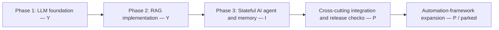
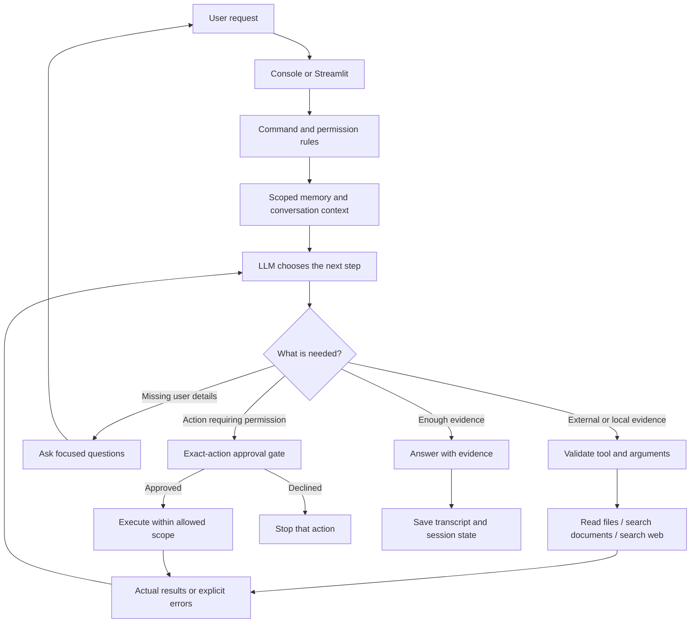
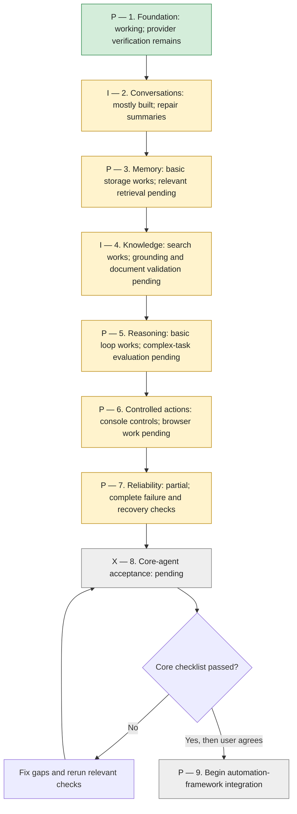

# JeshlaAutoAI — Agentic AI roadmap

Updated: 17 October 2026

## Your actual development position

**You are not still in Phase 1. Your current original learning phase is Phase 3: memory, stateful agents and integration hardening.**

| Original development phase | Build status | Readiness |
|---|---|---|
| Phase 1 — LLM foundations and basic agents | **Y** | Foundation implemented and real model use demonstrated; some release checks remain |
| Phase 2 — RAG and knowledge implementation | **Y** | Ingestion, hybrid retrieval, reranking, structured search and evaluation exist; quality/runtime integration is **P** |
| Phase 3 — State, persistent memory and conversational agents | **I** | Core components work; summaries, advanced recall and broader acceptance remain **P** |

The numbered sections later in this document are **completion workstreams**, not a claim that you must restart Phase 1. A built module can have pending integration or acceptance without losing credit for its implementation.

The full-project audit read/parsed **94 Python files**, with **no syntax errors**. See [project-progress-audit.md](project-progress-audit.md) for folder evidence, RAG details, prototype distinctions and the current full-suite test limitations.



## Target and scope

Build JeshlaAutoAI as a reliable, local-first AI agent with a configurable hosted or local model, conversation, persistent memory, evidence retrieval, validated tools, and user-controlled actions.

AI agent is the application we are building. Agentic AI describes the approach: the model selects tools, observes results, adjusts its next step, and answers or asks for clarification. Agentic by itself is an adjective, not a separate product target. Recommended project description: **JeshlaAutoAI — an AI agent built with agentic AI capabilities.**

Automation-framework development is deferred until the core-agent acceptance gates below pass. Preserve existing Jira/QA modules, but do not make new framework integration the next milestone. Completion means the agreed core scope is verified, not that every possible AI capability exists or that the project matches proprietary products.

## Current position

Phase 1 foundations and Phase 2 RAG implementation already exist. Phase 3 integration and hardening is the current focus. The conversational foundation works: Groq, native tool calls, local memory commands, named chats, transcript archiving and editable terminal input have been exercised. Streamlit is implemented and passed headless UI and startup checks; a complete user browser acceptance pass is still needed. Web search works, but citations and factual grounding need improvement. Automatic summaries are implemented but real history produced Groq HTTP 400 errors; cooldown prevents immediate repeated retries but is not a root-cause fix. Document retrieval and advanced memory search require verification and development.

## Core-completion workstreams (not a restart of learning phases)

| Workstream | Scope | Current status | Acceptance gate |
|---|---|---|---|
| **P** — 1. Agent foundation | Provider adapter, native tool calls, direct answers, console/browser entry points | Implemented; Groq live verified, alternate providers simulated | A direct answer and tool-result-answer cycle work; failures are understandable; available models/providers are explicit |
| **I** — 2. Conversations and context | New/open/list chats, titles, transcript archive, session-specific summaries, editing and cancellation | Most implemented; summaries need repair; browser live acceptance pending | Restart restores each chat; switching never mixes history; full new turns remain archived; summarization succeeds or safely degrades |
| **P** — 3. Useful long-term memory | Save/update/show/forget, relevant retrieval, user/project scope, provenance, conflict handling, archived-chat search | Basic storage works; advanced retrieval and management pending | Retrieve relevant facts from a larger collection; keep unrelated scopes isolated; corrections supersede stale facts; explain where a fact came from |
| **I** — 4. Reliable knowledge and search | Indexed documents, structured data, public web sources, full-page evidence, citations, combined answers | Web snippets work; document quality and source grounding pending | Answer a mixed local/public query with verified source links; no invented citations; missing evidence produces clarification |
| **P** — 5. General agent reasoning | Dynamic clarification, task decomposition when useful, observe/replan, tool selection, explicit completion criteria | Native read-only loop works; complex-task behavior needs evaluation | Complete a defined multi-step task; recover from a failed tool; avoid repeated calls; distinguish complete, partial and blocked outcomes |
| **P** — 6. Controlled actions | Read/write/execute permissions, exact-action approval, browser approval UI, resumable task state, input validation | Existing console approval controls; browser local actions currently declined | No write/command without required approval; approved arguments are bound to the reviewed action; restart/cancel cannot replay completed actions |
| **P** — 7. Reliability and observability | Useful error types, timings, retries/backoff, budgets, concurrency, source/tool activity, regression coverage | Timings, limits, chat locks and several regressions implemented | Connection, quota, malformed output, interrupted process and concurrent-chat cases are handled; model-visible claims match real tool evidence |
| **X** — 8. Core-agent release | Integrated acceptance suite, setup guide, repeatable installation, dependency cleanup, configuration and backup/recovery | Pending | The complete core-agent checklist passes in console and browser, with known limits documented |
| **P** — 9. Automation-framework integration | Connect the completed agent to requirements, test design, UI inspection, code generation and execution/reporting | DEFERRED | Begin only after Workstream 8 acceptance and user decision to move to framework work |

## Memory development details

- Separate chat history, session summaries and reusable facts; never use a summary as approval.
- Select relevant memories instead of injecting every fact into each prompt.
- Keep source, timestamp and scope for facts; distinguish user assertions from tool evidence.
- Search archived conversations only within the intended scope and cite the originating chat/turn.
- Propose useful new memories or corrections; define explicit user control before automatic storage.
- Handle conflicts, stale facts, deletion and optional expiry. Document that deleting a fact does not erase archived messages or provider records.
- Start with a measured retrieval baseline; add embeddings/semantic retrieval only when it improves the project's evaluation set without reintroducing the previous local inference bottleneck.

## Implementation principles

- Do not hardcode project names, framework choices, answers or fixed clarification scripts in model reasoning.
- Store editable project facts in memory/configuration. Keep credentials outside source and logs.
- Use deterministic code for command parsing, argument validation, permission checks, isolation, budgets and storage.
- Prefer documented configurable defaults for limits; not every internal invariant needs a user-facing option.
- Use model reasoning for interpreting ordinary requests, choosing read tools, synthesizing evidence and asking focused questions.
- Add tools with schemas and clear failure behavior. Native model tool calls do not themselves authorize execution.
- Keep a shared backend for console and Streamlit. UI changes should not change approval rules.
- Use the simplest architecture that passes the required tasks; multiple agents, autonomous background work and additional providers are optional future capabilities, not prerequisites.

## Completion tracker

**Current development target: an AI agent with bounded agentic capabilities.** Automation-framework development remains deferred.

Use these uppercase status codes:

| Code | Meaning |
|---|---|
| **Y** | Completed and verified for the stated scope |
| **X** | Not completed or not started; use when no meaningful implementation is recorded |
| **I** | In progress; work has started and is actively being developed |
| **P** | Worked on, but pending verification, blocked, deferred or parked |

An X item can be incomplete without being untouched; the item description should explain its state. Prefer I for active work and P for work awaiting a fix, verification or a later decision. Mark Y only after the stated behavior is verified; record supporting tests or execution. These are progress markers, not a guarantee of correctness for every input.

### Workstream 1 — Foundation

- **Y** — Groq connection works with the configured open-weight model (live execution).
- **Y** — Native model/tool/result loop works with public web search (live execution).
- **Y** — Ollama/OpenRouter/Groq adapters exist; alternate native adapters have offline transport tests.
- **P** — Verify every provider/model combination selected for release against live acceptance cases.
- **P** — Verify configuration failures display actionable, secret-safe messages in both interfaces.

### Workstream 2 — Conversations and context

- **Y** — Create, list and reopen named chats (user execution and offline tests).
- **Y** — Case-insensitive startup Y/N and 80-character titles work (offline tests and user execution).
- **Y** — Editable console multiline input works without END (user execution).
- **Y** — Save full newly successful turns in a transcript archive (offline persistence tests).
- **Y** — Streamlit supports chat creation, multiline submission and memory viewing in headless tests; real startup passed.
- **Y** — Summary failures pause retries, including across restarts (user output and offline checks).
- **I** — Resolve automatic-summary HTTP 400 failures on representative long chats.
- **P** — Verify summary content and session isolation through a complete live restart/switch test.
- **P** — Complete live browser acceptance: create, chat, reopen, shared memory and transcript download.

### Workstream 3 — Long-term memory

- **Y** — Save, update, show and forget explicit facts (offline tests; save/show/forget also user verified).
- **Y** — Deleted seed facts are not automatically reinserted (offline regression).
- **Y** — Memory persists across store reopen and is scoped by user/namespace (offline tests).
- **Y** — Saved facts reach normal LLM conversation (user execution).
- **P** — Integrate the existing embedding-memory example with relevant retrieval for the current SQLite/native-tool agent; semantic-search code already exists.
- **X** — Search archived conversations within the requested scope.
- **X** — Track source, timestamp and verification status for facts.
- **X** — Handle contradictory, corrected and stale facts with explicit policy.
- **X** — Define and test user-controlled suggestions for new memories.

### Workstream 4 — Knowledge and evidence

- **Y** — Implement document ingestion, metadata and recursive chunking in rag/ingest.py; artifacts are present.
- **Y** — Implement FAISS/BM25 hybrid retrieval and BGE reranking in rag/retrieval.py and rag/query.py.
- **Y** — Implement query rewriting and PDF answer export in rag/query.py.
- **Y** — Implement CSV/Excel search, header detection and dataset routing in the rag modules.
- **Y** — Implement RAG tool-calling/web agents and evaluation variants; saved reports document prior runs.
- **P** — Consolidate older provider-specific RAG entry points and working-directory-sensitive imports/paths with the current application.

- **Y** — Public web search returns real snippets and links (live execution).
- **Y** — A response can combine saved project facts with web results (user execution).
- **I** — Validate citations against evidence; remove invented reference markers.
- **X** — Read relevant source pages for detailed factual claims.
- **P** — Re-evaluate indexed document retrieval in the current environment.
- **P** — Integrate and test structured CSV/Excel retrieval in the active conversation loop.
- **X** — Pass a mixed memory/document/source/web task with traceable, accurate evidence.

### Workstream 5 — Reasoning and task completion

- **Y** — Read-only loop validates tool arguments and limits rounds/calls (offline tests).
- **Y** — Unclear ordinary input receives clarification (user execution).
- **P** — Evaluate dynamic clarification on a representative question set.
- **P** — Evaluate multi-step planning, failed-tool recovery and re-planning.
- **P** — Verify completed/partial/blocked outcomes reflect actual evidence.

### Workstream 6 — Controlled actions

- **Y** — Console exact-action approval has regression coverage.
- **Y** — Browser local-action policy does not fall back to hidden console approval (implementation and scoped-policy test).
- **P** — Add and verify exact-action browser approvals, or explicitly accept the console-only limitation for the release.
- **P** — Verify restart, cancellation and uncertain outcomes cannot replay completed side effects.
- **P** — Validate action scope and permissions across all tools supported in the core release.

### Workstream 7 — Reliability

- **Y** — Timings and bounded tool execution are implemented and exercised.
- **Y** — Same-chat concurrency locks block overlapping turns and release normally (offline tests).
- **P** — Exercise provider/network/quota/truncation failures through each supported interface.
- **X** — Document and test stale-lock recovery, archive failures and interrupted checkpoints.
- **P** — Complete context budgeting and relevant-evidence selection for larger tasks.
- **P** — Repair broad-suite isolation and older Jira fixtures, then rerun acceptance. The current broad discovery reports 6 errors out of 116 tests.

### Workstream 8 — Core-agent release gate

- **X** — Pass every core-agent acceptance item below.
- **X** — Verify clean installation using the documented dependencies and configuration.
- **X** — Update outdated root README and installation instructions.
- **X** — Document and verify backup/recovery of facts, chats, summaries and checkpoints.
- **X** — Review remaining limitations and explicitly agree on the release scope.
- **X** — Mark the general AI-agent milestone complete.

### Workstream 9 — Deferred automation-framework work

- **P** — Begin only after the core-agent release gate passes and the user chooses to proceed.
- **P** — Create a separate framework-integration roadmap at that time.

## Core-agent acceptance checklist

Release gates receive Y only when the complete acceptance scenario passes. A working component alone does not complete a broad gate. P means related work exists but full acceptance is pending.

- **P** — General conversation and clarification use supplied context without inventing missing facts.
- **P** — Named chats survive restart and have isolated history/summary; shared memory is scoped deliberately.
- **P** — Memory save/update/forget and relevant search pass both ordinary and conflicting-fact cases.
- **P** — Long chats preserve full newly archived transcripts; summaries carry key details without becoming instructions or permissions.
- **P** — Local source, indexed documents, structured data and public web searches work independently and together.
- **P** — Citations correspond to retrieved evidence; current facts are not claimed after search failure.
- **P** — Multi-step tasks stop at a clear result or ask for essential missing details.
- **P** — Tool arguments, source paths and action permissions are validated in code.
- **P** — Write/execute approvals work in both supported interfaces, or a documented interface limitation is explicitly accepted for the release.
- **P** — Failed/uncertain actions are not silently retried; restart and cancellation do not duplicate side effects.
- **P** — Provider, network, quota and context-limit failures are understandable and recoverable.
- **P** — Repeatable setup, data backup/recovery and the acceptance/regression suite pass in the supported environment.

## Immediate next milestone

**Continue Phase 3 integration: repair summaries and test isolation, then validate source grounding and existing RAG/structured-data connections.** The visible summary HTTP 400 and invented citation/Gradle-plugin claim are known gaps. Resolve them before adding more autonomous capabilities. Then complete relevant memory/archive retrieval and re-evaluate document/structured-data search.

## Evidence labels

- Implemented: code exists; does not imply full live acceptance.
- Live verified: supported by an observed real execution.
- Pending: not implemented or not yet verified sufficiently.
- Deferred: deliberately outside the current development scope.

Existing root README installation/END/history notes predate several changes. Reconcile documentation during release preparation; prefer newer topic guides until then. Existing Jira uncertainty remains a tracked framework-integration issue, not something to bypass or delete while focusing on the general agent.

## AI agent versus agentic AI

These terms overlap, and terminology varies. They do not describe two mutually exclusive technologies.

| Term | Meaning | Example in JeshlaAutoAI |
|---|---|---|
| AI agent | A concrete software system that uses a model to pursue a task through available tools and context | Your application reads saved facts, chooses web search, receives results and answers |
| Agentic AI | An approach or capability in which a system chooses and adapts its actions toward a goal within defined boundaries | The agent notices missing evidence, searches another source, checks the result and decides whether to answer or ask you |
| Agentic | An adjective describing that behavior | An agentic assistant or agentic workflow |
| Fixed workflow | A predefined sequence of steps and conditions; useful when the process should be predictable | Command parsing, exact-action approval and database validation |

An AI agent can be more or less agentic. Agentic behavior does not require multiple agents, unlimited autonomy, a particular model, or automatic self-training. Fixed workflows can form part of a reliable agentic system.

### Which is better for this project?

Build **one reliable AI agent with bounded agentic behavior**. Let the model interpret requests, select read tools, evaluate results and ask for missing details. Keep permissions, validation, storage, command handling and execution limits deterministic. More autonomy is useful only when its results can be checked; it is not automatically better.

For example, answering a saved fact needs no elaborate plan. Research across several sources benefits from adaptive tool use. A write or command still needs the applicable approval regardless of how the model planned it.

### Architecture diagram



This diagram is the intended architecture. The read-only LLM/tool loop is working. Browser action approval, advanced memory retrieval and several reliability gates remain incomplete; the diagram does not claim every box is fully implemented.

### Roadmap and completion flow

Status codes: Y = completed, X = not completed/not started, I = in progress, P = worked on but pending/parked. Deferred framework work uses P as a deliberate scheduling status, not a claim that it is implemented.



The recommended target is therefore not AI agent *or* agentic AI: **JeshlaAutoAI is the AI agent; agentic AI is the behavior and design approach it uses.**


## Free and open-source stack priorities

The workbook comparison and project-specific P1/P2/P3 checklist are saved in [free-open-source-module-audit.md](free-open-source-module-audit.md). These priorities complement the Y/X/I/P completion statuses above.

- **P1:** retain the working stack; repair dependency reproducibility, isolated tests, relevant memory/structured retrieval, citations, summary recovery and acceptance evaluation.
- **P2:** add tracing, evaluation tooling or improved parsing only for a measured gap.
- **P3:** park alternative orchestration/vector frameworks, fine-tuning, multimedia and automation-framework expansion until the agreed core is accepted.

Free API access is quota-limited and separate from software/model licensing. Installed alternatives do not imply active use or completed integration.


## Offline test baseline completed - 17 October 2026

**Y - scoped completion:** repaired stale test fixtures and verified 120 tests passing in 3.704 seconds using the offline guard. This supersedes the earlier 116-test/six-error baseline for these fixtures; it does not establish live API, RAG answer-quality or production acceptance.

Run from the project root:

```powershell
python tests/run_offline.py
```

Changes:
- tests/test_jira_creation.py: enable creation only within fake-gateway test fixtures; add a regression proving disabled creation blocks writes.
- tests/test_prompt_workflow.py: mock proposal discussion instead of calling the real model; explicitly enable the fake approval workflow in its test scope.
- tests/run_offline.py: guard discovery and execution against external sockets, unmocked requests HTTP calls and browser launches. Loopback sockets remain for asyncio/framework internals. This is a process-level test guard, not a subprocess sandbox.
- tests/test_offline_runner.py: verify socket/HTTP/browser blocking and loopback classification.

The verified run used the project's virtual environment and required Windows file permissions. Real Jira permission gates, provider settings and runtime agent behavior were not changed. Full agent reliability remains P; next is memory and structured retrieval integration.


## Shared table and memory tool integration - 17 October 2026

**Y - implementation and offline integration:** CSV/XLSX discovery/filtering with source rows and scoped lexical saved-memory search are connected to the shared conversation. 129 guarded offline tests pass. See [table-memory-tools.md](table-memory-tools.md) for files, limits and trial prompts. **P - broader acceptance:** live model behavior, semantic-memory retrieval, complex-table queries and grounding remain pending.
