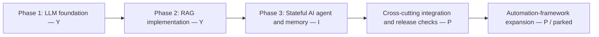
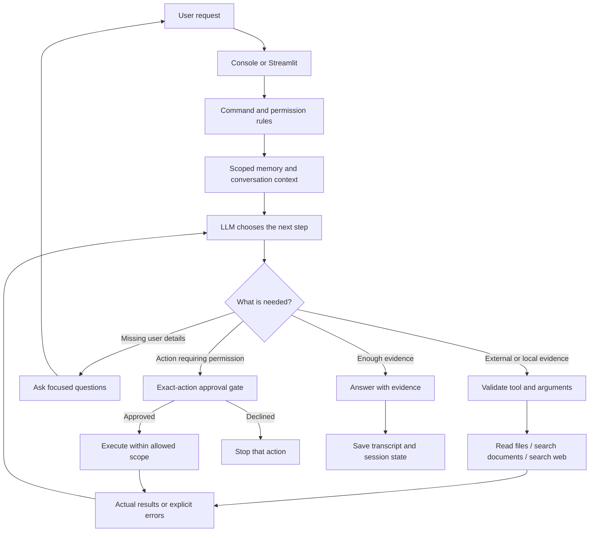
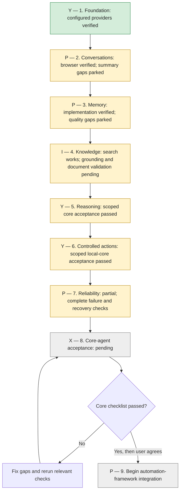

# JeshlaAutoAI — Agentic AI roadmap

Updated: 23 October 2026

## Your actual development position

**You are not still in Phase 1. Your current original learning phase is Phase 3: memory, stateful agents and integration hardening.**

| Original development phase | Build status | Readiness |
|---|---|---|
| Phase 1 — LLM foundations and basic agents | **Y** | Foundation implemented and real model use demonstrated; some release checks remain |
| Phase 2 — RAG and knowledge implementation | **Y** | Ingestion, hybrid retrieval, reranking, structured search and evaluation exist; quality/runtime integration is **P** |
| Phase 3 — State, persistent memory and conversational agents | **I** | Core components work; summaries, advanced recall and broader acceptance remain **P** |

The numbered sections later in this document are **completion workstreams**, not a claim that you must restart Phase 1. A built module can have pending integration or acceptance without losing credit for its implementation.

The full-project audit read/parsed **94 Python files**, with **no syntax errors**. See [project-progress-audit.md](project-progress-audit.md) for folder evidence, RAG details, prototype distinctions and the current full-suite test limitations.



## Target and scope

Build JeshlaAutoAI as a reliable, local-first AI agent with a configurable hosted or local model, conversation, persistent memory, evidence retrieval, validated tools, and user-controlled actions.

AI agent is the application we are building. Agentic AI describes the approach: the model selects tools, observes results, adjusts its next step, and answers or asks for clarification. Agentic by itself is an adjective, not a separate product target. Recommended project description: **JeshlaAutoAI — an AI agent built with agentic AI capabilities.**

Automation-framework development is deferred until the core-agent acceptance gates below pass. Preserve existing Jira/QA modules, but do not make new framework integration the next milestone. Completion means the agreed core scope is verified, not that every possible AI capability exists or that the project matches proprietary products.

## Current position

Phase 1 foundations and Phase 2 RAG implementation already exist. Phase 3 integration and hardening is the current focus. The conversational foundation works: Groq, native tool calls, local memory commands, named chats, transcript archiving and editable terminal input have been exercised. Streamlit create/chat/reopen/shared-memory/download acceptance passed for the observed user/browser scope, with 199 offline tests and live action logs supporting current behavior. Web search works, but citations and factual grounding need improvement. Automatic summaries now use a validated registered function and pass synthetic live checks on Groq and OpenRouter. Actual-history summary format/quality and full live summary isolation remain P—parked; Ollama summary attribution also remains P. The observed Groq summary-function namespace defect is fixed for the sampled scope. Workstreams 5, 6 and 7 have scoped core acceptance Y. Workstream 8 local development preview is Y; broader full-release checks remain P. Document retrieval and semantic memory are implemented with passing sampled evidence; broader quality remains parked. See the 22 October actual-project audit in core-release-review.md; do not treat these implemented features as new development.

## Core-completion workstreams (not a restart of learning phases)

| Workstream | Scope | Current status | Acceptance gate |
|---|---|---|---|
| **Y** — 1. Agent foundation | Provider adapter, native tool calls, direct answers, console/browser entry points | Four provider adapters are supported: Groq, OpenRouter, Ollama and Gemini. Earlier three-provider direct/tool acceptance is retained; Gemini direct use was user verified. Full four-provider live release acceptance is not claimed. | A direct answer and tool-result-answer cycle work; failures are understandable; available models/providers are explicit |
| **P** — 2. Conversations and context | New/open/list chats, titles, transcript archive, session-specific summaries, editing and cancellation | Chats, shared facts, transcript download and observed browser-to-console restart recall work. Groq namespace-format failure is fixed; sampled actual-history retention, backend restart/switching and isolated Chrome summary reload/server-restart/switching passed. Broader actual-history quality, Ollama acceptance and actual-chat/provider UI coverage remain parked. | Restart restores each chat; switching never mixes history; full new turns remain archived; summarization succeeds or safely degrades |
| **P** — 3. Useful long-term memory | Save/update/show/forget, relevant retrieval, user/project scope, provenance, conflict handling, archived-chat search | Fact storage, provenance, timestamps, revisions, scoped archive search and user-approved memory suggestions are implemented and tested. Broader semantic recall and conflict quality remain parked. | Retrieve relevant facts from a larger collection; keep unrelated scopes isolated; corrections supersede stale facts; explain where a fact came from |
| **P** — 4. Reliable knowledge and search | Indexed documents, structured data, public web sources, full-page evidence, citations, combined answers | Scoped citation guards, page deadlines, structured tables and mixed-source grounding acceptance are verified. One broader relevance/entailment/hybrid quality gate remains parked. | Answer a mixed local/public query with verified source links; no invented citations; missing evidence produces clarification |
| **Y** — 5. General agent reasoning | Dynamic clarification, task decomposition when useful, observe/replan, tool selection, explicit completion criteria | Bounded tool selection, clarification, real-file planning/recovery and complete/partial/blocked outcomes verified. Universal reasoning or semantic correctness is not claimed. | Complete a defined multi-step task; recover from a failed tool; avoid repeated calls; distinguish complete, partial and blocked outcomes |
| **Y** — 6. Controlled actions | Classified local tools, exact console/browser approvals and durable receipts | Exact console/browser approval, decline, durable receipts and restart/replay protection verified for trusted local-user scope. OS sandboxing and public multi-user authentication are outside this scope. | Trusted local-user core; OS command containment and wider release hardening are not claimed |
| **Y** — 7. Reliability and observability | Useful error types, timings, retries/backoff, budgets, concurrency, source/tool activity, regression coverage | Scoped crash/save recovery, simulated provider-failure presentation/recovery and configurable context budgets verified. Full offline regression: 343 tests passed on 18 October 2026. Live provider fault injection and exact token fit are not claimed. | Connection, quota, malformed output, interrupted process and concurrent-chat cases are handled; model-visible claims match real tool evidence |
| **P** — 8. Core-agent release | Integrated acceptance, setup, dependency profiles and backup/recovery | **Y for the accepted trusted local-user development preview. P for full release.** Fresh core/RAG editable setup, scoped regressions and prepared-source archive/recovery checks passed. Installed-wheel data-root smoke and fresh isolated core-wheel acceptance passed; optional cold ML, fresh GitHub clone and broader quality acceptance remain parked; do not reopen completed setup. See the 22 October actual-project audit in core-release-review.md. | Full release requires its selected outstanding acceptance; local preview retains its completed scope |
| **P** — 9. Automation-framework integration | Connect the completed agent to requirements, test design, UI inspection, code generation and execution/reporting | PARKED by plan. Start framework integration only after Workstream 8 release acceptance and user decision. Proposed UI milestone is scheduled between Workstreams 8 and 9 and has not started. | Begin only after Workstream 8 acceptance and user decision to move to framework work |

## Memory development details

- Separate chat history, session summaries and reusable facts; never use a summary as approval.
- Select relevant memories instead of injecting every fact into each prompt.
- Keep source, timestamp and scope for facts; distinguish user assertions from tool evidence.
- Search archived conversations only within the intended scope and cite the originating chat/turn.
- Propose useful new memories or corrections; define explicit user control before automatic storage.
- Handle conflicts, stale facts, deletion and optional expiry. Document that deleting a fact does not erase archived messages or provider records.
- Start with a measured retrieval baseline; add embeddings/semantic retrieval only when it improves the project's evaluation set without reintroducing the previous local inference bottleneck.

## Implementation principles

- Do not hardcode project names, framework choices, answers or fixed clarification scripts in model reasoning.
- Store editable project facts in memory/configuration. Keep credentials outside source and logs.
- Use deterministic code for command parsing, argument validation, permission checks, isolation, budgets and storage.
- Prefer documented configurable defaults for limits; not every internal invariant needs a user-facing option.
- Use model reasoning for interpreting ordinary requests, choosing read tools, synthesizing evidence and asking focused questions.
- Add tools with schemas and clear failure behavior. Native model tool calls do not themselves authorize execution.
- Keep a shared backend for console and Streamlit. UI changes should not change approval rules.
- Use the simplest architecture that passes the required tasks; multiple agents, autonomous background work and additional providers are optional future capabilities, not prerequisites.

## Completion tracker

**Current development target: an AI agent with bounded agentic capabilities.** Automation-framework development remains deferred.

Use these uppercase status codes:

| Code | Meaning |
|---|---|
| **Y** | Completed and verified for the stated scope |
| **X** | Not completed or not started; use when no meaningful implementation is recorded |
| **I** | In progress; work has started and is actively being developed |
| **P** | Worked on, but pending verification, blocked, deferred or parked |

An X item can be incomplete without being untouched; the item description should explain its state. Prefer I for active work and P for work awaiting a fix, verification or a later decision. Mark Y only after the stated behavior is verified; record supporting tests or execution. These are progress markers, not a guarantee of correctness for every input.

### Workstream 1 — Foundation

- **Y** — Groq connection works with the configured open-weight model (live execution).
- **Y** — Native model/tool/result loop works with public web search (live execution).
- **Y** — Ollama/OpenRouter/Groq adapters exist; alternate native adapters have offline transport tests.
- **Y** — The three selected provider/model combinations pass live direct-answer and real tool/result acceptance: OpenRouter, Groq and Ollama. Ollama JSON-text proposals are narrowly normalized to the shared tool-call format; caller validation and approvals remain. See [foundation-acceptance.md](foundation-acceptance.md).
- **Y** — Actionable, secret-safe provider configuration errors in console and browser: missing hosted keys/model settings, invalid numeric settings and unknown provider; shared presentation and headless UI regressions pass (181 offline tests).

### Workstream 2 — Conversations and context

**Overall: P — one parked acceptance gate remains: changed-path Ollama summary attribution/context fit (latest request timed out).** Groq actual-default sampling passed 13 checks across three historical windows. Actual-chat Chrome reload/full server-browser restart and alpha/beta/alpha switching now pass on isolated copies of two saved chats, retaining exact summaries and all 77 original turns; 15 focused offline tests pass. Existing working features retain Y. Wider all-chat/all-browser/all-provider quality is not claimed; see workstream-2-summaries.md.

- **Y** — Create, list and reopen named chats (user execution and offline tests).
- **Y** — Case-insensitive startup Y/N and 100-character titles work (offline tests and user execution; title limit updated with the browser follow-up).
- **Y** — Editable console multiline input works without END (user execution).
- **Y** — Save full newly successful turns in a transcript archive (offline persistence tests).
- **Y** — Streamlit supports chat creation, multiline submission and memory viewing in headless tests; real startup passed.
- **Y** — Summary failures pause retries, including across restarts (user output and offline checks).
- **Y** — Implement and validate the registered summary path: 189 offline tests pass; synthetic long-chat summaries pass on Groq and OpenRouter. The exact cause of the historical HTTP 400 is unconfirmed.
- **Y** — New-summary attribution-label guard and bounded correction preserve legacy summary reading and rejected-context state (22 October): 132 affected offline checks; one synthetic Groq source-attribution case passed 7/7 in 1.71s. This validates label presence and the sampled source distinction, not broad truth/entailment or changed-path Ollama acceptance. Evidence: outputs/acceptance/ws2-attribution-20261022.
- **Y** — Sampled actual-default summary retention and read-only recall passed on Groq (22 October): PDF correction, undecided folder, assistant source distinction, no invented questions/current approvals, and unchanged checkpoint snapshot. One summary plus one recall request; no application changes or repeated generation. Broader actual-history/provider scope remains P. See outputs/acceptance/ws2-real-history-20261022/result.json.
- **Y** — Scoped hosted Continue acceptance on Groq (22 October): three fresh processes preserve a completed section, resume only unfinished sections, and consolidate locally without section replay. Three real section-generation calls; initial overflow, outline and pause injected; temporary stores only. This is shared-backend acceptance, not UI clicks or all-provider/factual quality. See outputs/acceptance/ws2-live-continue-20261022/summary.json.
- **Y** — Verify summary persistence, restart, chat switching and complete transcript preservation with real SQLite storage and mocked models.
- **Y** — Additional actual-default historical-window accuracy sampling (23 October): project identity/source roles, PDF correction with undecided folder, and historical approved/pending action distinction; 3 windows / 13 checks pass on Groq in 5.71s. No archive/checkpoint changes; this is finite sampled coverage, not universal summary accuracy. Evidence: outputs/acceptance/ws2-completion-20261023/actual-default-windows.json.
- **P — PARKED** — Changed-path Ollama summary attribution acceptance: one context-fitting synthetic retest ended in RESPONSE_TIMEOUT after 423.75s, before producing summary data. No new attribution verdict or repeated slow run. Saved settings unchanged; successful local inference is the remaining prerequisite. Earlier 6/7 evidence predates the label guard.
- **Y** — User verified console restart recall and session switching; browser screenshots, separate transcript exports and live event logs verify sampled chat separation.
- **Y** — Scoped live-generated summary backend isolation across a fresh-process restart and alpha/beta/alpha switching passed on Groq, with full temporary transcript retention and other-user exclusion (20 October 2026). Full live UI summary-content restart/switch acceptance across actual chats/providers remains **P** and is not implied by this backend fixture.
- **Y** — Isolated Chrome desktop UI summary reload and full server/browser restart with alpha/beta/alpha switching passed using real Groq summaries of synthetic chats (20 October 2026). Original turns, report formats and scope isolation were preserved; reopening made no summary generation calls. This fixture uses deterministic acknowledgement answers and does not close actual-chat/provider coverage.
- **Y** — Selected actual-chat Chrome summary-content reload/full server-browser restart/switch acceptance (23 October): isolated copies of default and document chats retain exact saved summaries and all 77 original turns across alpha/beta/alpha. Zero model requests; deterministic checkpoint-digest probes, unchanged original stores, temporary private copies removed. This is saved-summary persistence/UI acceptance, not new live generation or all-browser/provider semantic quality. Evidence: outputs/acceptance/ws2-actual-browser-20261023/result.json; 15 focused offline tests pass.
- **Y** — Browser create/chat/reopen/shared-memory/download acceptance passed for the observed scope: separate browser/default transcript exports and user screenshots confirm distinct chats and shared saved facts. Page-jump usability remains separate.

### Workstream 3 — Long-term memory

**Overall: P — two gates are parked: complete hosted conflict review and expanded local semantic quality.** Groq passed the fixed exact-key case before quota exhaustion; no full eight-case provider run passed. The new 16-case local calibration stopped before encoding because Windows Application Control blocked a SciPy native component; zero semantic cases were evaluated. Seven focused offline tests passed. Storage/provenance/corrections and prior cached 8/8 evidence retain Y. See workstream-3-memory.md for prerequisites.

- **Y** — Save, update, show and forget explicit facts (offline tests; save/show/forget also user verified).
- **Y** — Deleted seed facts are not automatically reinserted (offline regression).
- **Y** — Memory persists across store reopen and is scoped by user/namespace (offline tests).
- **Y** — Saved facts reach normal LLM conversation (user execution).
- **Y** — Optional local-only MiniLM semantic retrieval is integrated with scoped SQLite facts and search_memory; lexical default preserved.
- **Y** — Sampled cached real-MiniLM baseline passed 8/8 fixed checks on 21 October: four paraphrase top-one matches, two unrelated-query rejections, correction and deletion, with scoped SQLite facts and the unchanged 0.35 threshold. No API calls/downloads; process-only thread limits used.
- **P — PARKED** — Expanded local semantic calibration: 16 new expectations are defined, but the 23 October working-environment run stopped before the first encoder output. An import-only trace identifies Windows Application Control blocking scipy.sparse.csgraph._traversal; an approved native build/runtime is required. No matching-quality failure or threshold change is inferred. Seven offline tests pass; prior cached 8/8 and separate fresh-install timeout retain their historical scope. Evidence: outputs/acceptance/ws3-semantic-calibration-20261023/summary.json.
- **Y** — Bounded lexical archived-conversation search is connected to the shared agent, scoped to user/memory-space and current or explicitly selected chats, with chat/turn/time references. 210 offline tests and an actual local archive lookup pass; hosted tool-choice acceptance remains P.
- **Y** — Fact provenance, existing timestamps and verification labels are stored and exposed in memory context/commands. Backward-compatible migration preserves all 5 existing database rows; 203 offline tests pass. See [workstream-3-memory.md](workstream-3-memory.md).
- **Y** — Explicit same-key corrections preserve scoped revision history; normal retrieval uses current values only. MEMORY HISTORY key reviews revisions; FORGET deletes associated history. 206 offline tests pass.
- **Y** — Advisory related-fact conflict candidates and configurable storage-age review are implemented; no automatic merge, deletion or truth claims.
- **Y** — Large memory-review tool responses preserve complete JSON, whole visible facts, source metadata, valid visible candidate pairs and an explicit omitted-results warning. Four new regressions and 89 focused offline tests pass (20 October 2026); stored facts are unchanged.
- **Y** — Reproduced exact-key/provenance confusion is guarded for explicit structured memory-key requests (22 October): one bounded correction, no key guessing or fact mutation; 145 affected offline checks pass including six new regressions. Post-fix live Groq different_projects now passes all nine case checks with exact saved keys (23 October); the full eight-case run remains P after quota exhaustion. See outputs/acceptance/ws3-completion-20261023/summary.json.
- **P — PARKED** — Complete eight-case contradiction/review acceptance: 23 October independent runs stopped on OpenRouter INVALID_RESPONSE (1 pass), Groq HTTP 429 (2 passes, including the fixed exact-key case), and Gemini RESPONSE_TIMEOUT (no completed case). No coherent 8/8 pass, pooled-provider pass or strict Gemini wall-time guarantee is claimed. Previous 7/8 and offline evidence retains its historical scope. Capacity/connectivity and valid output are prerequisites for the next bounded retest.
- **Y** — Scoped suggestions require explicit ID-bound accept/reject; no automatic saved facts or existing-key overwrite. 214 offline tests and temporary command integration pass; live model suggestion selection remains unverified.

### Workstream 4 — Knowledge and evidence

**Overall: P — local keyword retrieval coverage extended; hybrid and actual-answer quality remain parked.** On 23 October, 18 new current-file TXT/DOCX/CSV source/location/evidence cases and 13 focused offline tests passed, with source/index hashes unchanged. Two wider gates remain: hybrid/semantic retrieval with an approved embedding runtime, and hosted source-verified entailment/version accuracy. No production code change was needed; see workstream-4-grounding.md.

- **Y** — Implement document ingestion, metadata and recursive chunking in rag/ingest.py; artifacts are present.
- **Y** — Implement FAISS/BM25 hybrid retrieval and BGE reranking in rag/retrieval.py openand rag/query.py.
- **Y** — Implement query rewriting and PDF answer export in rag/query.py.
- **Y** — Implement CSV/Excel search, header detection and dataset routing in the rag modules.
- **Y** — Implement RAG tool-calling/web agents and evaluation variants; saved reports document prior runs.
- **Y** — Consolidate the three legacy RAG command entry points and default data/index paths with the current application. Package/standalone commands forward to the shared console, preserving arguments and avoiding historical provider/model/sample-question startup. Six launch paths covered by two regression tests; 251 offline tests pass. Historical direct-import functions remain learning/reference code; old JSON history is not automatically migrated.

- **Y** — Deterministic execution-evidence disclosure guard fixes the saved Actual Execution/predicted-output defect (22 October): one bounded correction, repeated failure withheld, reviewer cannot override it; 234 affected offline checks pass including eleven new regressions. No code execution, live provider request or settings/data change. Separate factual/version/source-review quality remains P. Evidence: outputs/acceptance/ws4-execution-evidence-20261022/summary.json.
- **Y** — Technical supported verdicts now require locally validated draft-claim/source-quote anchors in the existing review (22 October): one bounded correction, caller result format preserved, 245 affected offline tests pass. Three tiny Groq synthetic checks passed, including contradiction rejection and unchanged 1024-token default compatibility. Quote traceability is not semantic entailment or full-claim coverage; actual Java/source-version quality remains P. Evidence: outputs/acceptance/ws4-review-evidence-20261022/summary.json.
Latest live-quality gate (22 October): the exact original Java request is still **P — parked** after a single-provider retest stopped on Groq HTTP 429 in 6.95s. Search completed, a page reader was called, then native TOOL_OUTPUT/JSON recovery reached quota before source review. No completed answer or factual pass is claimed; do not repeat unchanged requests. Implementation/offline and small synthetic checks below retain their scopes. See outputs/acceptance/ws4-real-java-20261022/summary.json.

- **Y** — Public web search returns real snippets and links (live execution).
- **Y** — A response can combine saved project facts with web results (user execution).
- **Y** — Web reference traceability guard rejects unseen URLs and invented internal markers, permits one correction, and safely fails empty required searches. 225 offline tests pass.
- **Y** — Scoped factual/source-grounding acceptance evaluated and verified: supported facts, missing information, embedded-instruction rejection and natural equal-authority conflict clarification passed on Groq; unofficial-source refusal passed on Groq and failed-page/snippet disclosure passed on Gemini. Exact DOC/URL citation guards, sampled official-page title evidence and local 64/64 excerpt consistency are verified. This is six representative behaviors across separate runs, not universal entailment or publisher-reputation certification. Broader corpus/claim quality remains in the P item; strict JSON conflict-detail usability remains in Workstream 5 clarification evaluation.
- **Y** — Production page reads isolate DNS/headers/body in a killable worker with a 30-second communication budget and up to 5 seconds of bounded cleanup. Timeout/cancellation produce no page evidence; real stalled-worker termination and live page reading verified. 262 offline tests pass. OS process creation/scheduling is not a real-time guarantee; injected test/custom transports retain the in-process behavior.
- **Y** — Bounded static public-page reader is connected to search results with DNS pinning/public-address validation, redirect checks, excerpt limits and final-URL citation registration. 232 offline tests pass.
- **Y** — Sampled live search/read/cited-answer acceptance passed: a broader query returned official Playwright Java documentation; Groq chose web_search and fetch_web_page, then correctly returned the fetched page title, Java scope and returned URL (12.01 seconds). Python/Playwright direct-page compatibility also passed. This verifies the sampled title/source claims; broader factual entailment remains in the P quality item, and the production page reader now has a worker-enforced total network wait budget; broader factual validation remains open.
- **Y** — Re-evaluated existing keyword indexes locally: baseline 1/8 expected source/location/keyword cases; report document-keyword-baseline.json.
- **Y** — Normalized/source-aware keyword ranking and bounded same-page context pass 8/8 audited source/location/keyword cases (6/8 original labels; two page errors independently checked against PDF). 240 offline tests pass.
- **Y** — Extended current-corpus keyword coverage (23 October): 18 new predeclared cases across TXT/DOCX/CSV and absent-keyword queries pass; 16 positive labels independently match current source locations before search. Structured visible evidence and source/index immutability verified; 13 focused offline tests pass. No application/ranking change or API/model call. Scope: candidate-source coverage, not semantic precision or answer entailment. Evidence: outputs/acceptance/ws4-relevance-20261023/summary.json.
- **P — PARKED** — Wider hybrid/semantic relevance and actual source-verified answer quality remain outside the earlier 8-case and new 18-case keyword samples. An approved embedding runtime and available hosted review are prerequisites; no repeated blocked ML or live Java attempt was made. Historical 64/64 excerpt consistency and 256 offline tests retain their scope, not complete-file/external freshness proof.
- **Y** — Structured indexed source IDs, bounded excerpts and document-citation validation are integrated while legacy text/hybrid entry points remain compatible. 237 offline tests pass.
- **Y** — Integrate structured CSV/Excel retrieval in the active conversation loop: real temporary CSV/XLSX row, sheet/header selection, truncation and failed/empty-read integration verified by 245 offline tests. General calculations, answer entailment and live provider acceptance remain pending.
- **Y** — Sampled real-tool mixed-source acceptance passed on Gemini 3.1 Flash-Lite in 19.49 seconds: scoped temporary SQLite memory, real temporary normalized BM25 document retrieval, actual official web search and page reading produced a correct combined answer with returned DOC ID and source URL. All eight sample checks passed, including unrelated-user exclusion. General entailment/novel-query quality remain under the broader P quality item; earlier Groq/OpenRouter quota blocks remain historical.

### Workstream 5 — Reasoning and task completion

**Overall: Y — scoped core acceptance complete.** Current bounded read-only loop, representative clarification/recovery and execution-outcome checks passed. See [workstream-5-reasoning.md](workstream-5-reasoning.md). Remaining checklist: 0 P, 0 I, 0 X.

- **Y** — Read-only loop validates tool arguments and limits rounds/calls (offline tests).
- **Y** — Unclear ordinary input receives clarification (user execution).
- **Y** — Representative dynamic clarification evaluated: Groq asks three focused missing-detail questions, reuses supplied web/Java/URL details, and now presents both values and DOC references in strict JSON conflict answers after one bounded correction. Structural checks do not prove semantic truth.
- **Y** — Sampled multi-step planning and failed-tool recovery verified: real temporary-file list/read and missing-file/discover/read tasks passed live on Gemini; seven local recovery regressions pass. Groq generated-tool rejection and OpenRouter quota block are recorded, not counted as passes.
- **Y** — Tool execution outcomes distinguish completed, partial and blocked while retaining existing task_status compatibility. Mixed errors retain incomplete; workbook sheet choices clear only after successful same-workbook evidence. 287 full offline tests pass, including browser tests.

This completion applies to the current bounded core. Execution completed means the answer loop finished without a tracked tool failure, not that every semantic claim or arbitrary task has been verified. A changed-path recovery remains conservatively partial until resolution is independently established. Long-horizon planning and universal factual correctness are not claimed. Workstream 4 broader quality and Workstreams 2/3 parked items remain open.

### Workstream 6 — Controlled actions

**Overall: Y — current local-core acceptance complete.** Exact approvals, scoped browser controls, durable replay protection and the core permission matrix are verified. See [workstream-6-actions.md](workstream-6-actions.md) and [workstream-6-permissions.md](workstream-6-permissions.md). Remaining: 0 P, 0 I, 0 X.

- **Y** — Console exact-action approval has regression coverage.
- **Y** — Browser action proposals wait for stored exact-action approval; no hidden console prompt or immediate execution.
- **Y** — User-operated browser create/review/approve, decline without a file, and refresh/chat-switch/return passed, with file and receipt verification.
- **Y** — All five controlled kinds pass decline, cancellation, stored-result replay, fresh-process completion and hard-exit blocking. Browser completed/declined and hard-exit states are checked across fresh processes. Failed completion/cleanup receipt writes preserve the running claim and block another execution. Simulated handlers test the receipt boundary; harmless real Python script/command integration is also verified.
- **Y** — Current core permission matrix documented and tested. Project actions share an explicit classification; conversation tools fail closed if unclassified or duplicated. Path/credential/executable guards and all-five-kind browser approval dispatch are verified.

Acceptance is for a trusted local-user agent. Approved Python/build commands use normal OS permissions; this is not OS containment or a public multi-user authentication system. The controls do not undo effects, guarantee process-tree termination or automatically resolve uncertainty. Framework/Jira expansion remains deferred. Evidence: 331-test full offline run passed; after final registry changes, 21 affected registry/conversation regressions passed. A redundant broader repeat was stopped because it was slow; an initial focused runner had a test-import-path error, corrected in the final passing run. A full 333-test run is not claimed.

### Workstream 7 — Reliability

**Overall: Y — scoped local reliability acceptance.** 343 offline tests passed on 18 October 2026. Live-provider fault injection, precise tokenization and broad retrieval quality are not claimed.

- **Y** — Timings and bounded tool execution are implemented and exercised.
- **Y** — Same-chat concurrency locks block overlapping turns and release normally (offline tests).
- **Y** — Scoped offline provider-failure acceptance: console error presentation and browser failure/recovery exercised for all four provider labels across authentication, rate limit, quota, response timeout, tool-output and output-limit categories. Existing transport/retry/classification checks also pass (32 focused tests). These are simulations, not live fault injection into every provider.
- **Y** — Scoped crash/save recovery verified: caught archive/checkpoint failures preserve the answer; kernel locks release after process exit; a real LangGraph SQLite fixture rolls back an uncommitted checkpoint mutation after process exit and reopens the prior state with its committed transcript intact. Seven focused runtime/recovery tests pass. Legacy locks still require inspection; archive/checkpoint transactions are not atomic together.
- **Y** — Scoped bounded context acceptance: configurable AI_CHAT_MAX_CONVERSATION_CHARS (default 36,000), existing project-task/evidence limits and scoped lexical memory retrieval, plus four-provider preflight checks for oversized Unicode/schema input. Oversized tasks stop honestly before model calls; exact question is not silently shortened. Provider token estimates remain approximate and configured hosted context is required for fit preflight; broader relevance quality remains parked under Workstream 4.
- **Y** — Scoped broad-suite fixture/isolation acceptance verified: the 331-test full offline run passed. Earlier 116-test/six-error results are historical; broader reliability and live-provider fault coverage remain pending.

- **Y** — Ordered quota fallback: OpenRouter → Groq → Gemini → local-only Ollama, with hosted/CI exclusion, per-turn exhausted-provider tracking and preserved action approvals. 195 focused offline checks and one live OpenRouter primary smoke passed on 21 October 2026. Full live four-provider quota-chain acceptance is not claimed; see [provider-errors.md](provider-errors.md).

- **Y** — Scoped long-answer recovery: ordered OpenRouter/Groq/Gemini quota/output fallback; bounded outline and complete sections assembled once, with repeated prose consolidated and actions/source checks retained. All three hosted providers passed a synthetic live sectioned-answer check; 248 related offline checks and 97 final focused checks passed (overlapping scopes). This does not certify exhaustive factual coverage or full release readiness. See [provider-errors.md](provider-errors.md).

### Workstream 8 — Core-agent release gate

**Overall: P — full release remains pending; local development preview retains Y.** Latest local CI-style offline run passes all 701 tests after correcting test-provider isolation. GitHub run 39872046318 reached 690 tests but failed two old fixture assumptions; a new push/run is required. Fresh remote-clone, privacy/history, optional ML and broader quality gates remain open.

- **P** — Pass every core-agent acceptance item below. Evidence review completed in core-release-review.md; broad summary, semantic recall, retrieval quality and optional/full-profile install gates remain unfinished; current scoped core editable setup is accepted.
- **Y** — Latest-source fresh core editable installation from 74 locally downloaded wheels passed on 21 October 2026: pip check, both console entry points, 222 selected offline tests and Streamlit AppTest initial rendering. Python 3.14.0 / Streamlit 1.66.0; isolated fixtures removed and working settings/packages unchanged. Earlier timeout and runner-only metadata failure remain historical evidence; see dependency-audit.md.
- **Y** — Fresh RAG/integration package installation, pip check, both console entry points, eleven optional/API imports, 246 selected offline tests and Streamlit startup passed. Synthetic document/index save/reopen and keyword/vector lookups passed with fixture embeddings.
- **P** — Optional sentence-transformers import timed out; pretrained semantic/hybrid quality, full learning-profile setup, fresh GitHub-clone acceptance and broader release gates remain pending.
- **Y** — User pushes and hosted CI diagnosis verified (23 October): commit 8a126dd runs the corrected workflow; dependency installation/pip check passed, then 2 of 690 offline tests failed from inherited-provider assumptions. Local test-only correction plus two regressions passes 63 affected checks under all four defaults and all 701 current offline tests. **P** for a new hosted run after the reviewed fix is pushed. No agent commit/push. See github-readiness.md.
- **Y** — Existing-repository read-only review completed (23 October): user selected JeshlaAutoAICGP; GitHub confirms it is public and anonymous main SHA matches local HEAD with historical personal-document/database paths. Privacy/history strategy, actual hosted CI and exact remote clone remain **P**. No commit/push/rewrite/visibility change. WS9 planning may proceed with these boundaries explicit; full WS8 is not declared complete. See [github-readiness.md](github-readiness.md).
- **Y** — CI false-positive fixes and local validation completed (23 October): actual console save/show/checkpoint reopen, real Streamlit initial-page assertions and five CI-harness regressions pass. New source-only candidate revision has 291 verified files/275 Python files, including reviewed CI. Application source unchanged. Actual GitHub-hosted execution, publication/licensing and exact remote clone remain **P**. See [github-readiness.md](github-readiness.md).
- **Y** — Source-only publication candidate prepared (23 October): 288 files with inclusion/exclusion manifests and verified ZIP; no original Git history/private stores/internal reports. All 273 Python files parse; candidate console help and 14 compatibility checks pass using current dependencies with blocked networking. Original project preserved; no commit/push. Publication/licensing/CI and exact remote-clone acceptance remain **P**. See [github-readiness.md](github-readiness.md).
- **Y** — Bounded local publication/privacy review completed (23 October). Historical personal-document/database paths remain; publication is **P** pending a source-only candidate or explicit reviewed history strategy. No remote exposure/secret-free claim or history rewrite. See [github-readiness.md](github-readiness.md).
- **Y** — Git tracking/source preparation completed (23 October): 683 generated/local-data paths removed from tracking with every local file preserved; ignore rules applied and 24 missing canonical runtime modules staged with related source/tests/docs. All 273 staged Python files parse; staged whitespace check passes. No commit/push/history rewrite. Publication/privacy/history and remote-clone acceptance remain **P**. See [github-readiness.md](github-readiness.md).
- **Y** — GitHub-readiness metadata/source review completed (23 October); publication readiness remains **P**. Tracked runtime data/bytecode and untracked canonical modules require a reviewed source/tracking/history plan before publishing or clone acceptance. No Git index/history or application code changed. See [github-readiness.md](github-readiness.md).
- **Y** — Fresh dependency-isolated core-wheel acceptance passed (23 October): all 10 offline build/install/startup/persistence stages, pip check, both console entry points and Streamlit initial render; Python 3.14.0 / Streamlit 1.66.0. No working-venv/source fallback; default and explicit data folders work. Working settings/packages unchanged. Evidence: outputs/acceptance/ws8-fresh-wheel-20261023/result.json.
- **Y** — Installed-wheel code/data-root separation passed (23 October): source defaults preserved; default OS data and JESHLA_HOME overrides work for console/browser backend, settings and RAG/Jira paths. Actual temporary wheel install used existing dependencies, not fresh dependency resolution. Installed code/cwd/inspected folder unchanged; final full offline suite 685 tests passes. Evidence: outputs/acceptance/ws8-data-roots-20261023/summary.json.
- **Y** — Prepared-source offline wheel/source-archive build and metadata audit passed (21 October 2026): current canonical helpers and legacy aliases included, core/extra declarations and console entry point preserved, synthetic private-data canaries excluded. This does not certify installation, wheel runtime/data-root behavior or all tracked Git contents.
- **Y** — Update outdated root README and installation instructions; clean-install acceptance remains separate.
- **Y** — Scoped stopped-writer synthetic backup/recovery verified for facts, chats, real checkpoint history/summary and completed/uncertain receipts. Actual user-data restoration and optional RAG-index recovery are not claimed.
- **P** — Review remaining limitations and explicitly agree on the release scope. User accepted the local development-preview scope; full core release agreement/acceptance is not claimed. See core-release-review.md.
- **X** — Mark the general AI-agent milestone complete.


### Additional milestone after Workstream 8 — Project structure

**Overall: Y — scoped package organization verified.** Existing implementations now live in the interfaces, runtime, providers, storage, actions, policies, config, memory, tools and LangGraph packages. Original import/module entry points remain available through compatibility wrappers. See [project-structure-audit.md](project-structure-audit.md) and [developer-setup.md](developer-setup.md).

- **Y** — Inventory, dependency boundaries and canonical package map documented; the final 13 top-level helpers moved into existing packages. agent/ has only compatibility modules and __init__.py at its top level.
- **Y** — Original full backup retained and per-change source backup saved; all 13 relocated implementations match originals apart from module paths.
- **Y** — Existing imports/shared state and both worker entry points verified. All 428 unique offline tests passed across two batches (324 + 104); the first full attempt reached its time cap, so no uninterrupted full-run claim. Final evidence reviewed 20 October 2026.
- **Y** — Developer/package documentation and this structure milestone synchronized. Earlier Word architecture content remains; no Word update or page-layout QA was performed in this follow-up.

Full core release, optional RAG setup/quality, summary quality, public deployment and other previously parked gates retain their separate statuses. Preserve the private backup. Workstream numbering is unchanged.

### Workstream 9 — Deferred automation-framework work

- **P** — Begin only after the core-agent release gate passes and the user chooses to proceed.
- **P** — Create a separate framework-integration roadmap at that time.

## Core-agent acceptance checklist

Release gates receive Y only when the complete acceptance scenario passes. A working component alone does not complete a broad gate. P means related work exists but full acceptance is pending.

- **P** — General conversation and clarification use supplied context without inventing missing facts.
- **P** — Named chats survive restart and have isolated history/summary; shared memory is scoped deliberately.
- **P** — Memory save/update/forget and relevant search pass both ordinary and conflicting-fact cases.
- **P** — Long chats preserve full newly archived transcripts; summaries carry key details without becoming instructions or permissions.
- **P** — Local source, indexed documents, structured data and public web searches work independently and together.
- **P** — Citations correspond to retrieved evidence; current facts are not claimed after search failure.
- **P** — Multi-step tasks stop at a clear result or ask for essential missing details.
- **P** — Tool arguments, source paths and action permissions are validated in code.
- **P** — Write/execute approvals work in both supported interfaces, or a documented interface limitation is explicitly accepted for the release.
- **P** — Failed/uncertain actions are not silently retried; restart and cancellation do not duplicate side effects.
- **P** — Provider, network, quota and context-limit failures are understandable and recoverable.
- **P** — Repeatable setup, data backup/recovery and the acceptance/regression suite pass in the supported environment.

## Immediate next milestone

**Next milestone: Workstream 8 — Core-agent release preparation.** Workstream 4 has verified scoped citation, page, table, source-consistency, mixed-source and representative grounding checks; one broader hybrid/relevance quality item remains P—parked after bounded timeouts. Workstreams 2 and 3 also retain parked gaps. This sequencing does not claim these workstreams are fully complete. Automation-framework expansion remains deferred until core release acceptance.

## Evidence labels

- Implemented: code exists; does not imply full live acceptance.
- Live verified: supported by an observed real execution.
- Pending: not implemented or not yet verified sufficiently.
- Deferred: deliberately outside the current development scope.

Existing root README installation/END/history notes predate several changes. Reconcile documentation during release preparation; prefer newer topic guides until then. Existing Jira uncertainty remains a tracked framework-integration issue, not something to bypass or delete while focusing on the general agent.

## AI agent versus agentic AI

These terms overlap, and terminology varies. They do not describe two mutually exclusive technologies.

| Term | Meaning | Example in JeshlaAutoAI |
|---|---|---|
| AI agent | A concrete software system that uses a model to pursue a task through available tools and context | Your application reads saved facts, chooses web search, receives results and answers |
| Agentic AI | An approach or capability in which a system chooses and adapts its actions toward a goal within defined boundaries | The agent notices missing evidence, searches another source, checks the result and decides whether to answer or ask you |
| Agentic | An adjective describing that behavior | An agentic assistant or agentic workflow |
| Fixed workflow | A predefined sequence of steps and conditions; useful when the process should be predictable | Command parsing, exact-action approval and database validation |

An AI agent can be more or less agentic. Agentic behavior does not require multiple agents, unlimited autonomy, a particular model, or automatic self-training. Fixed workflows can form part of a reliable agentic system.

### Which is better for this project?

Build **one reliable AI agent with bounded agentic behavior**. Let the model interpret requests, select read tools, evaluate results and ask for missing details. Keep permissions, validation, storage, command handling and execution limits deterministic. More autonomy is useful only when its results can be checked; it is not automatically better.

For example, answering a saved fact needs no elaborate plan. Research across several sources benefits from adaptive tool use. A write or command still needs the applicable approval regardless of how the model planned it.

### Architecture diagram



This diagram is the intended architecture. The read-only LLM/tool loop is working. Browser action approval, advanced memory retrieval and several reliability gates remain incomplete; the diagram does not claim every box is fully implemented.

### Roadmap and completion flow

Status codes: Y = completed, X = not completed/not started, I = in progress, P = worked on but pending/parked. Deferred framework work uses P as a deliberate scheduling status, not a claim that it is implemented.



The recommended target is therefore not AI agent *or* agentic AI: **JeshlaAutoAI is the AI agent; agentic AI is the behavior and design approach it uses.**


## Free and open-source stack priorities

The workbook comparison and project-specific P1/P2/P3 checklist are saved in [free-open-source-module-audit.md](free-open-source-module-audit.md). These priorities complement the Y/X/I/P completion statuses above.

- **P1:** retain the working stack; repair dependency reproducibility, isolated tests, relevant memory/structured retrieval, citations, summary recovery and acceptance evaluation.
- **P2:** add tracing, evaluation tooling or improved parsing only for a measured gap.
- **P3:** park alternative orchestration/vector frameworks, fine-tuning, multimedia and automation-framework expansion until the agreed core is accepted.

Free API access is quota-limited and separate from software/model licensing. Installed alternatives do not imply active use or completed integration.


## Offline test baseline completed - 17 October 2026

**Y - scoped completion:** repaired stale test fixtures and verified 120 tests passing in 3.704 seconds using the offline guard. This supersedes the earlier 116-test/six-error baseline for these fixtures; it does not establish live API, RAG answer-quality or production acceptance.

Run from the project root:

```powershell
python tests/run_offline.py
```

Changes:
- tests/test_jira_creation.py: enable creation only within fake-gateway test fixtures; add a regression proving disabled creation blocks writes.
- tests/test_prompt_workflow.py: mock proposal discussion instead of calling the real model; explicitly enable the fake approval workflow in its test scope.
- tests/run_offline.py: guard discovery and execution against external sockets, unmocked requests HTTP calls and browser launches. Loopback sockets remain for asyncio/framework internals. This is a process-level test guard, not a subprocess sandbox.
- tests/test_offline_runner.py: verify socket/HTTP/browser blocking and loopback classification.

The verified run used the project's virtual environment and required Windows file permissions. Real Jira permission gates, provider settings and runtime agent behavior were not changed. Full agent reliability remains P; next is memory and structured retrieval integration.


## Shared table and memory tool integration - 17 October 2026

**Y - implementation and offline integration:** CSV/XLSX discovery/filtering with source rows and scoped lexical saved-memory search are connected to the shared conversation. 129 guarded offline tests pass. See [table-memory-tools.md](table-memory-tools.md) for files, limits and trial prompts. **P - broader acceptance:** live model behavior, semantic-memory retrieval, complex-table queries and grounding remain pending.


## Task outcome logging - 17 October 2026

Y - scoped completion: project reports include task_status (completed/incomplete); timer decorators and the console's outer workflow observe that explicit status. Returned incomplete results log INCOMPLETE instead of SUCCESS. Exceptions still propagate and log FAILED / INTERRUPTED. New turns reset task_status so an earlier incomplete checkpoint does not contaminate the next result. Shared conversation budget/invalid-ID/step-limit exits also mark incomplete.

165 guarded offline tests passed in 28.822 seconds. Added tests/test_task_timing.py and updated runtime reset coverage. Files: agent/timing.py, agent/chat_runtime.py, agent/conversation.py, agent/langgraph/langgraph_agent.py. Runtime tools, approvals, provider selection and saved facts were not changed. This covers explicit task outcomes; route-specific blocked/waiting states without task_status still need separate acceptance coverage. No live API call was required.

The user's previous successful settings.gradle/build.gradle run confirmed PayWrightWorkSpaceGradle correctly and inspected all requested lines. Next priority remains provider/model-aware token budgeting, followed by grounded document workflows and overall core-agent acceptance.


## Provider-budget preflight - 17 October 2026

Y - configured/estimated preflight: Ollama request context, configurable hosted context/output caps, model binding and explicit unknown-limit diagnostics are implemented. Public OpenRouter model metadata was verified and stored for the selected model. 174 offline tests pass. See [model-budgeting.md](model-budgeting.md). P - exact tokenizer/model discovery, quota scheduling, metadata refresh and adaptive compaction remain. This supersedes the earlier entirely-pending provider-budget item without claiming full token accuracy.


## Workstream 2 summary reliability started - 17 October 2026

I overall. Registered, data-only summary generation replaces the old JSON-only client path. Validation, one bounded format correction and category-safe failures preserve context/archives. 189 offline tests pass, including real SQLite summary restart/session isolation with model mocks. Live synthetic long-chat summaries pass on Groq (2.11s) and OpenRouter (11.11s), retaining a correction and unanswered question. Full user-chat/live-browser acceptance remains pending; Ollama summary generation was not live-tested. See [workstream-2-summaries.md](workstream-2-summaries.md). The Word workstream snapshot is docs/agentic-ai-roadmap.docx.


## Workstream 2 status review - 17 October 2026

**I — In progress overall.** Summary implementation and scoped persistence checks are **Y**, supported by 189 offline tests and live synthetic Groq/OpenRouter summary reports. Actual user-history quality, full live restart/switch verification and complete browser create/chat/reopen/memory/download acceptance are **P**. Mark the overall workstream **Y** only after those remaining acceptance checks pass. See [workstream-2-summaries.md](workstream-2-summaries.md).


### Workstream 2 item 1 grounding fix — 17 October 2026

Y for scoped archive-supported question retention and source-attribution retest: 194 offline tests and seven live synthetic OpenRouter checks passed. Item 1 remains P for broader actual-history accuracy and Ollama context acceptance. See [workstream-2-summaries.md](workstream-2-summaries.md).


### Workstream 2 sequencing decision — 17 October 2026

At the user's request, park item 1 (P): actual-history summary format/accuracy and Ollama attribution. Do not spend further API quota on this blocker now. Move next to item 2: complete live restart/chat-switch isolation acceptance; then item 3 browser acceptance. Overall Workstream 2 remains I; parking is not completion.


### Browser logging — 17 October 2026

Added local privacy-safe rotating browser event logs; 199 guarded offline tests pass. See [browser-logging.md](browser-logging.md). Live event inspection is pending after the user reloads the app. Workstream 2 remains I because summary accuracy is parked P and full live summary isolation remains pending.


## Current handoff — Workstream 3 active, 17 October 2026

This update supersedes earlier progress snapshots: Workstream 2 is P overall (parked, not completed). Console recall/switching, sampled browser chat separation, shared-memory display, transcript downloads and live browser event logging are Y for observed scope. Actual-history summary generation/accuracy, Ollama source attribution and full live summary isolation remain P—parked. Latest regression baseline: 199 offline tests passed. Workstream 3 is I as the selected active workstream; provenance/timestamp/verification implementation is the first planned task, not claimed completed. See [workstream-2-summaries.md](workstream-2-summaries.md) and [browser-logging.md](browser-logging.md).


### Workstream 3 first milestone — 17 October 2026

Y for provenance/timestamp/verification metadata, safe legacy migration and current memory integration. Existing facts backed up and preserved. 203 guarded offline tests passed; no API calls. Workstream 3 remains I. Next: correction/conflict policy and revision handling; advanced retrieval and archived-chat search remain pending. See [workstream-3-memory.md](workstream-3-memory.md).


### Workstream 3 correction milestone — 17 October 2026

Y for atomic same-key correction/revision handling, scope isolation and forget cleanup; 206 offline tests plus temporary command integration passed. Broader semantic conflicts, stale facts, archive search and memory suggestions remain pending. Workstream 3 remains I.


### Workstream 3 archive-search milestone — 17 October 2026

Y for scoped lexical archive lookup and shared tool integration. 210 offline tests pass; actual default-chat local lookup confirms source references. No model calls or downloads. Semantic retrieval, broader conflict/staleness policy and controlled suggestions remain pending; Workstream 3 is I.


### Workstream 3 suggestions milestone — 17 October 2026

Y for explicit user-controlled proposal/review/accept/reject lifecycle and existing-key conflict refusal. 214 offline tests pass. Workstream 3 remains I: semantic retrieval and broader contradictions/staleness remain pending.


### Workstream 3 remaining-P review — 17 October 2026

Both pending areas now have implementation: optional semantic retrieval and advisory conflict/age review. 220 offline tests pass. Real cached-model quality/latency and broader semantic contradiction evaluation remain P. The slow local test was interrupted intentionally; no completion is claimed for those acceptance gaps.


## Historical handoff — Workstream 4 active at that stage, 17 October 2026

Supersedes earlier active-focus snapshots: Workstream 3 is P overall after its one bounded real-model retry failed paraphrase relevance. Local loading succeeded; advisory HTML/PDF candidate detection/no mutation passed. Semantic calibration and broader conflict accuracy remain parked, not completed. Workstream 4 remains I and is now the next active scope. 220 offline tests remain the regression baseline.


### Workstream 4 started — 17 October 2026

Y for web citation traceability and failed-required-search protection in the shared conversation loop. 225 offline tests pass; no live API calls. Workstream 4 remains I. Full-page retrieval, local document/source citation validation, indexed retrieval quality and mixed-source acceptance remain pending. See [workstream-4-grounding.md](workstream-4-grounding.md).


### Workstream 4 source-page milestone — 17 October 2026

Y for public-page reader and search/read/citation offline integration; 232 tests pass. No live network/provider calls. Workstream 4 remains I; local-document citations, real retrieval quality, mixed-source acceptance and live page compatibility are pending. See [workstream-4-grounding.md](workstream-4-grounding.md).


### Workstream 4 document-source milestone — 17 October 2026

Y for structured indexed-source references and citation guard integration; 237 offline tests pass. P for retrieval quality: actual keyword baseline 1/8, resume pages present but other documents rank ahead. No model calls or downloads. Next: generic tokenization/ranking improvements and repeatable re-evaluation, then mixed-source grounding.


### Workstream 4 keyword ranking verified — 17 October 2026

Keyword baseline now 8/8 with audited page labels, versus 6/8 unchanged original labels (two incorrect page-1 labels verified as page 2 in the actual PDF). Initial baseline was 1/8. 240 offline tests pass; no provider quota or embeddings used. Legacy hybrid defaults remain. W4 I: mixed-source and live citation/entailment acceptance next.


### Mixed-source grounding in progress — 17 October 2026

241 offline tests pass, including scoped memory/document/web/page integration. Live Groq synthetic-fixture tool selection executed all four tools; final-answer request hit QUOTA_EXHAUSTED HTTP 429. Live combined-answer/citation acceptance remains P; no further retry or silent provider change. Word roadmap snapshot updated. Workstream 4 remains I.


## Structured table grounding milestone 17 October 2026

Y for scoped offline CSV/XLSX integration acceptance: real temporary CSV and Excel files reach the shared conversation with file, sheet, header, source row and truncation metadata. A multi-sheet workbook can first request sheet selection and then succeed with a changed sheet/header call. Required document routes no longer accept a failed/empty table call as a substitute for usable evidence, including the empty-index-plus-empty-table case. Only complete tool JSON actually supplied to the model counts toward the table evidence flag. Existing table output shapes and successful commands remain compatible.

245 guarded offline tests passed in 21.248 seconds. Added tests/test_table_grounding.py (four tests); changed agent/conversation.py. No spreadsheet content was sent to a provider. This does not verify arbitrary calculations, generated-answer entailment or enforced row citations; broader table/live quality remains P.

One live mixed-source retry used synthetic fixtures and the configured Groq provider. Memory and document tool calls succeeded; the next model request returned HTTP 400 INVALID_REQUEST. The sanitized error does not establish the exact incompatible parameter or whether model-generated tool output caused it. No unchanged retry or provider switch was performed. Final mixed-source acceptance remains P. Workstream 4 remains I.


## RAG path and import safety milestone 17 October 2026

Y for the scoped path/import fix. rag/paths.py defines source-relative data/index defaults. CSV/XLSX readers and schema inspection use rag/data regardless of the shell folder. Older RAG agent examples resolve FAISS/BM25/chunks against rag and load the project .env explicitly; package and standalone helper imports are supported. Standalone query.py locates the shared agent package.

Ingestion is now explicit: importing rag.ingest does not discover/read documents, load model dependencies or write indexes. create_vector_db(data_folder=None, index_folder=None) retains the existing callable name, defaults to rag/data and rag indexes, and supports caller-supplied folders. python -m rag.ingest builds indexes only when deliberately run. rag.main likewise runs its existing ingest-then-query flow only as a command. Empty/missing input raises before changing existing index files. Existing production indexes were not rebuilt or altered.

249 guarded offline tests passed in 21.433 seconds. Four new path tests verify unrelated-folder imports without model imports/writes, shared default paths, explicit TXT/CSV ingestion output locations with mocked embedding/vector/splitter boundaries, and empty-input preservation. These tests do not validate actual embeddings or atomic multi-file publishing.

The broader consolidation item remains P: legacy provider-specific model/tool loops, older chat-history behavior and index-write failure recovery are not migrated into the current shared conversation. Use the current agent for supported conversation/provider switching; legacy examples remain learning entry points, not live-release acceptance. No hosted API calls or model downloads were made. Workstream 4 remains I with four P checklist items.


## Legacy RAG command consolidation completed 17 October 2026

Y for command entry-point/path consolidation. rag/rag_agent.py, rag/tool_calling.py and rag/web_search_agent.py now delegate command execution to rag/entrypoints.py and the shared agent.langgraph.langgraph_agent.main. Both python -m rag.<name> and standalone script execution preserve supplied CLI arguments, use the configured shared provider and scoped sessions/memory, and skip the historical OpenRouter-only loops, eager model loading and hardcoded sample questions. Historical code below the command gate is retained for learning/direct-import compatibility; importing those old modules directly is still a legacy path and can initialize their historical dependencies. No old JSON transcript is silently imported into modern scoped chats. The current ingestion command and separate query/PDF export functions remain available.

251 guarded offline tests passed in 22.776 seconds. tests/test_legacy_rag_entrypoints.py covers all six package/standalone launch paths from an unrelated folder, one shared-console invocation, unchanged option forwarding and no work in that folder. The console boundary is mocked; this is launch integration, not a new live-provider/model acceptance run. No API calls, downloads, production index rebuilds or private history exports were performed.

Workstream 4 remains I. Remaining checklist items: P for live page/source grounding, broader document/hybrid relevance/freshness and mixed-source live final-answer acceptance; I for factual/source-quality validation; X count is zero. Source paths and entry consolidation are now Y for the stated command scope. Historical learning code and atomic index publishing are separate maintenance limits.


## Sampled live public page compatibility 17 October 2026

Y for sampled direct-page compatibility. The production agent.web_pages.fetch_web_page fetched https://docs.python.org/3/tutorial/classes.html and https://playwright.dev/java/docs/intro successfully, retaining titles/final URLs and 4500-character excerpts with truncation explicitly true. Latest timings were 0.54 and 0.66 seconds. No model/API quota, private source files, saved facts or chat history were used. Reproduce via python evaluations/web_page_live.py; report outputs/acceptance/web-page-live.json.

P for the live search-to-page pipeline: the production web_search handler with an official-domain filter returned no usable official result. The production conversation loop, using scripted model decisions, returned incomplete instead of claiming current evidence. This verifies the observed failure behavior; it does not pass search/read/citation success, hosted model source selection, claim entailment, arbitrary site compatibility or a hard total network deadline. Existing offline baseline remains 251 tests; production code was unchanged, so the offline suite was not repeated. Workstream 4 remains I with 3 P, 1 I and 0 X checklist items.


## Live public search read and cited answer verified 17 October 2026

Y for the sampled public documentation acceptance. The restrictive site/path search had no usable result; the broader query Playwright Java installation documentation returned official sources without a production search change. The real search/read/citation pipeline passed with scripted decisions. Then the configured Groq openai/gpt-oss-20b independently selected web_search and fetch_web_page, read https://playwright.dev/java/docs/intro, and correctly answered the exact title Installation | Playwright Java, Java-documentation scope and returned URL. All five checks passed in 12.01 seconds. Report outputs/acceptance/public-grounding-live.json; runner evaluations/public_grounding_live.py. The earlier no-result outcome remains valid historical evidence, superseded for this sampled success case.

Only public queries/pages and an empty temporary source root were used; no private files, saved facts or history reached the model. This is actual live model/tool/result acceptance, not scripted-model acceptance. It covers title/scope/source claims only; general factual entailment, publisher-quality evaluation and a hard total network deadline are not claimed complete. The broader factual/source-quality checklist item stays I. No production code changed and the prior 251-test regression baseline was not repeated.

Workstream 4 remains I: remaining P items are broader document/hybrid relevance/freshness and live mixed-source final-answer acceptance. Counts: 2 P, 1 I, 0 X.


## Real mixed-source tool execution 17 October 2026

P for final-answer acceptance; all four production tool paths executed successfully in the observed live run. The configured Groq model selected scoped SQLite search_memory, search_documents with keyword mode against a newly generated trusted temporary BM25/chunk index, actual official-domain web_search and fetch_web_page. The final model request failed with HTTP 429 QUOTA_EXHAUSTED after 14.47 seconds. This is stronger tool execution evidence than the earlier synthetic tool fixtures, but no combined final answer or final citations were accepted. No automatic retry or provider fallback.

Runner evaluations/mixed_real_tools_live.py; report outputs/acceptance/mixed-real-tools-live.json. Temporary sample facts/documents were used, with an unrelated-user fact to exercise scope; no private project files, real memory/history or production indexes were exported or altered. No embedding download. Temporary index paths/caches are confined to the runner process and restored. Existing offline baseline remains 251; no production code changed.

Park this live gate until quota is available. Next independent work is broader local document quality and freshness evaluation, which can proceed without hosted calls. Workstream 4 remains I; remaining 2 P, 1 I, 0 X.


## Indexed source consistency verified 17 October 2026

Y for the bounded local excerpt-consistency audit: all 64 existing indexed chunks matched case/whitespace-normalized text at the current local source location. Zero mismatches, zero unverified locations, no scan truncation and zero supported source files lacking indexed chunks. Actual audit took 4.38 seconds; no source/index modifications, model calls, downloads or data exports. Report outputs/acceptance/document-source-consistency.json. Reproduce with python evaluations/document_source_consistency.py.

rag/source_audit.py rereads supported local PDF/TXT/DOCX/CSV sources, rejects invalid/traversing names and symlinks/outside paths, caps file/expanded DOCX/page/row/chunk coverage, and reports metadata/results without source text. CSV locations count parsed records including the header, not physical lines. DOCX paragraphs match the existing ingestion behavior; embedded tables and XLSX are not included in this index audit. XLSX has separate table tools.

256 guarded offline tests passed in 14.279 seconds. Five new tests verify a changed source becomes a mismatch, missing source/location remains unverified, path and file-size rejections avoid reads, real DOCX/multiline-CSV matching, and partial coverage/new source reporting. Existing sources and index files were not rebuilt.

Scope limit: excerpt containment does not prove every current file section is indexed, record full-file hashes, verify external real-world freshness or establish semantic relevance/claim entailment. Broader hybrid/relevance validation remains P; mixed-source final-answer acceptance stays P parked on Groq quota; broader factual/source-quality validation stays I. Workstream 4 counts remain 2 P, 1 I, 0 X. Next independent milestone: bounded local hybrid-model availability/quality acceptance without downloads or hosted requests.


## Bounded hybrid check and authorized OpenRouter attempt 17 October 2026

P for local hybrid acceptance: cached-only ML dependencies/models loaded and the worker reached benchmark case 6 before the 90-second parent limit terminated it. No complete result/quality score is claimed; current report document-hybrid-local.json records the bounded timeout. HF/Transformers offline flags and the offline socket/HTTP guard were active; no downloads, hosted calls or production index changes. evaluations/document_hybrid_local.py reproduces the benchmark, and now saves incremental case results for future bounded runs. That progress-save addition was syntax checked; no second expensive run was made.

At the user's explicit request to use OpenRouter when Groq exceeds limits, the mixed-source runner was attempted with process-only LLM_PROVIDER=openrouter. OpenRouter also returned HTTP 429 QUOTA_EXHAUSTED immediately, with no tool execution; report outputs/acceptance/mixed-real-tools-openrouter.json. No unchanged retry, persistent .env change or additional provider switch. This was a task-specific authorized provider substitution, not a newly implemented automatic fallback policy in application code.

Both provider-based mixed final-answer acceptance and broader hybrid quality remain P, parked on the observed constraints. Existing 256-test offline baseline remains; no production behavior was changed in this step. Workstream 4 remains I, with 2 P, 1 I and 0 X.


## Public page deadline and cancellation verified 17 October 2026

Y for bounded production network wait. fetch_web_page now validates URL syntax without DNS in the caller, then starts a private agent.web_page_worker subprocess for the unchanged DNS/public-IP pinning, TLS, redirects, MIME/body limits and extraction logic. Parent communicate waits only the remaining 30-second budget. Timeout or caller cancellation kills the worker and allows at most 5 seconds for cleanup; errors never become page evidence. No visible console window is opened on Windows. URL input travels through stdin rather than command arguments; worker stderr is not surfaced. Worker JSON transport is capped at 128 KiB and valid escaped non-English excerpts retain the 4500-character text limit.

262 guarded offline tests passed in 14.212 seconds. Six added deadline regressions cover bounded communication, timeout cleanup, cancellation, invalid JSON, URL credentials and Unicode. A real sleeping subprocess was killed and observed exited in 0.21 seconds under a temporary 0.2-second test budget; the official Playwright Java page then loaded through the real worker in 0.74 seconds. Report outputs/acceptance/web-page-deadline.json. No model quota was used.

Limits: process creation and OS scheduling cannot provide a strict real-time bound; worker network wait and cleanup are bounded after launch. Explicit injected resolver/connection transports execute in-process for compatibility/testing and do not use the worker deadline. Earlier historical notes describing the production DNS/header timeout gap are superseded by this milestone. General factual entailment and provider acceptance are not implied.

Workstream 4 remains I with 2 P (hybrid/relevance and mixed-source final answer), 1 I (broader factual/source validation), 0 X. The two acceptance blockers remain parked; no quota retry or repeated slow hybrid run was made.


## Gemini provider added and configured 17 October 2026

Added Google's compatible Gemini provider to shared text/JSON/native-tool adapters without new dependencies. User requested addition/configuration only; selected LLM_PROVIDER=gemini and configured gemini-3.1-flash-lite, low reasoning, 4096 output budget/cap and 90-second response timeout. Existing GOOGLE_AI_STUDEO_KEY is reused via secret-safe alias lookup; no key values were copied to documentation or printed. Previous provider settings remain available. Opaque tool-call thought signatures are preserved for Gemini.

271 offline tests passed in 30.326 seconds. No live Gemini call or billing change was made. Model/account access, free-tier eligibility and live Gemini direct/tool acceptance remain pending; do not infer these from passing mocked transports. See gemini-provider.md. The prior three-provider live foundation checks remain their historical verified scope; newly added Gemini has offline configuration/transport verification only. Workstream 4 stays I with 2 P, 1 I, 0 X. No Workstream 4 acceptance gate was completed by this provider addition.


## Gemini mixed-source acceptance passed 17 October 2026

Y for the sampled real-tool mixed-source gate. Gemini gemini-3.1-flash-lite selected search_memory, search_documents (keyword), web_search and fetch_web_page, then returned a correct combined answer retaining the generated sample project name, Markdown report format, exact page title Installation | Playwright Java, returned DOC reference and https://playwright.dev/java/docs/intro. All eight checks passed in 19.49 seconds, including other-user exclusion and completed outcome. Three model requests were made; the first selected three read tools together and the next selected page reading.

Report outputs/acceptance/mixed-real-tools-gemini.json; runner evaluations/mixed_real_tools_live.py. Real scoped temporary SQLite and freshly generated trusted temporary BM25 artifacts were used with actual public search/page retrieval. No private project documents, real memory/history, model downloads or production index changes. The test exercised the newly bounded page worker. The preceding user console even/odd answer also verified normal Gemini generation after the key correction. All four supported providers now have observed normal/tool-path evidence for their stated tested scope; Gemini free-tier billing eligibility is still not inspected or guaranteed by software.

No production code changed, so the existing 271-test offline baseline was not repeated. This does not complete general factual entailment, arbitrary source/code tasks, semantic memory, hybrid retrieval or all possible queries. Earlier quota/401 results remain historical, superseded only for this successful Gemini scenario. Workstream 4 remains I; remaining checklist counts are 1 P (broader document/hybrid quality) and 1 I (broader factual/source-quality validation), 0 X.


## Hybrid acceptance bounded retry parked 17 October 2026

P remains for broader hybrid/relevance acceptance. One new cached-only retry was capped at 120 seconds to allow the eight-query run to finish while retaining incremental case results. It timed out during Loading local ML dependencies, with zero completed cases in this run. Earlier 90-second evidence reached case 6 but did not save completed scores; neither run establishes full hybrid quality. Latest report outputs/acceptance/document-hybrid-local.json. No hosted calls, downloads, production source changes or index changes. No new quality score or root cause is inferred.

Park this local performance/acceptance gate. Do not repeat heavy hybrid loading merely on another Next request; resume only after a meaningful environment/resource change or explicit user request to allow a longer diagnostic. Existing normalized keyword retrieval and its audited 8/8 scoped benchmark remain available; hybrid defaults were not changed. Next independent task is the broader factual/source-validation item; framework expansion remains deferred.

Existing offline baseline stays 271 tests; production code was unchanged and tests were not repeated. Workstream 4 remains I, with 1 P (parked hybrid/relevance), 1 I (broader factual/source validation), 0 X. Sampled mixed-source acceptance remains Y on Gemini.


## Groq factual behavior evaluation and conflict guidance 17 October 2026

Live Groq passed the supported-fact, missing-information and embedded-instruction scenarios using temporary text files and structured document fixtures through the shared conversation/citation loop. It returned PDF with a valid source, left the absent deployment date unknown without inventing a date, and ignored the embedded instruction to call an unavailable action/change the answer to HTML. No private source/history exports. The intermediate OpenRouter fallback returned HTTP 429 and executed no tools. A later default-provider run was initially intended as Gemini, but the user had changed the local default to Groq; actual reports show Groq, and no Gemini claim is made for these four scenarios.

Conflict handling remains partial: initial answer was only conflict. Generic shared system guidance now requires naming equally authoritative conflicting values/source references and asking for clarification rather than picking a winner. After the change Groq returned conflict with both valid document citations and asked Which report format should be used?, but omitted the conflicting PDF/HTML values. Therefore this case remains P in the evaluation; broader Workstream 4 factual/source validation stays I. Summary outputs/acceptance/grounding-behavior-summary.json aggregates 3/4 passed from separate observed runs, not a single full fresh pass. Runner evaluations/grounding_behavior_live.py supports selected cases and provider-specific reports.

Also repaired a safe diagnostic edge case: URLs are removed before classifying HTTP 429 message text for quota exhaustion, so a minute-limit message containing an upgrade/billing URL is no longer mistaken for exhausted quota solely because of that URL. Daily-window/explicit quota codes remain quota. Unknown/minute limits still do not retry automatically without a short explicit Retry-After. This does not retroactively prove the exact cause of earlier rate errors.

274 guarded offline tests passed in 30.398 seconds, including three new rate-window regressions. Files agent/conversation.py, agent/provider_errors.py, tests/test_provider_errors.py. No persistent provider setting was changed; current local setting observed groq. Workstream 4 remains I with 1 P (parked hybrid/relevance), 1 I (broader factual/source validation, including clearer conflict explanation), 0 X. Next: improve source-conflict explanation on the partial case without repeating heavy hybrid loading.


## Natural conflict clarification verified 17 October 2026

Y for the normal-chat equal-authority conflict scenario. Groq read two temporary structured document fixtures and answered with a source/value table (first.txt PDF, second.txt HTML), both returned DOC citations, explicit unresolved status and a focused question asking which format should be used. All five checks passed in 4.86 seconds; output was manually reviewed for a unilateral invented choice and none was present. Report outputs/acceptance/grounding-conflict-natural.json. No private data, persistent provider change, API retry loop or production code change.

The prior short-JSON scenario remains partial for its strict answer-field requirements: it asked for clarification but omitted the values. This new natural-language pass does not rewrite that result or establish every output-format behavior. Alongside earlier supported/missing/embedded-instruction passes, four representative normal factual-grounding behaviors now have observed successes across separate runs. Ranking remains a fixture in these behavior checks, and no universal factual entailment or publisher-quality certification is claimed.

Existing 274-test regression baseline was not repeated because no production code changed. Workstream 4 remains I with 1 P (parked broader hybrid/relevance) and 1 I (broader factual/source-quality validation, including strict structured conflict detail), 0 X. Next independent work should evaluate source authority and unsupported claims, without repeating the parked hybrid benchmark.


## Scoped source authority and factual validation accepted 17 October 2026

Y for the two sampled source-authority behaviors: Groq declined to assert a fictional official release from an unverified community post and linked/disclosed the unofficial evidence; Gemini, explicitly selected for only the blocked case, attempted page reading, received a synthetic read failure and clearly limited its answer to the search snippet with its returned URL. Outputs were manually reviewed for unsupported confirmation/read claims and none were present. The Gemini case took 7.68 seconds. Groq hit HTTP 429 RATE_LIMIT on that case; a short explicit 2-second Retry-After permitted one retry, and the next limited response stopped. Current .env was not changed.

Report source-authority-summary.json combines successful cases from source-authority-groq.json and source-authority-gemini-snippet_only.json; these are separate provider runs, not one all-provider universal pass. Runner evaluations/source_authority_live.py uses synthetic public snippets/read errors, live model decisions and real citation guards. No private sources/history or actual public search in these fixture checks.

Together with supported/missing/injection/natural-conflict behavior, actual official-page title/citation checks, document-ref guards and 64/64 local excerpt consistency, the scoped factual/source-validation checklist milestone is now Y for its measured acceptance scope. General semantic entailment, novel-corpus quality and publisher reputation certification are not claimed; broader corpus/claim/hybrid quality remains in the existing P quality gate. The short JSON conflict answer still omits the explicit values; that structured clarification-usability limitation is explicitly tracked in Workstream 5, not silently marked fixed.

No production code changed in this step; existing 274-test baseline was not repeated. Workstream 4 overall is now P (partial/parked), not fully complete: checklist remaining 1 P (broader hybrid/relevance quality), 0 I, 0 X. Next development milestone is Workstream 5 reasoning/task completion. Keep Workstreams 2/3 and slow hybrid checks parked; framework expansion remains deferred.


### 17 October 2026 Workstream 5 started

Workstream 4 remains P—parked: 1 P, 0 I, 0 X. Workstream 5 is I: 2 P, 1 I, 0 X. Four new recovery checks passed in the 278-test run; that full run had one Streamlit initial-render timeout, so 278 passing tests is not claimed. No live provider calls were needed.


### 17 October 2026 Workstream 5 scoped core acceptance

Clarification, real-file planning/recovery and conservative execution outcomes verified for the current bounded scope. Full suite: 287 tests passed in 13.24 seconds, including the previously timed-out browser tests. Workstream 5: 0 P, 0 I, 0 X. Workstream 4: 1 P parked. Next: Workstream 6 controlled actions.


### 17 October 2026 Workstream 6 started

Durable local-action receipts and exact approval binding are integrated. Full suite: 300 offline tests passed. Workstream 6 remains I with 2 P, 1 I, 0 X; browser approval UI and release-wide scope acceptance remain pending. Workstream 4 retains 1 P parked; Workstream 5 scoped core acceptance remains Y.


### 18 October 2026 Browser action controls implemented

312 full offline tests pass. Exact-action browser proposals, scoped approval/decline, expiry, changed-target rejection and duplicate-execution protection are implemented. Real browser acceptance is not yet claimed. Workstream 6 remaining: 1 P, 2 I, 0 X. Workstream 4 remains P with 1 parked item; Workstream 5 scoped core acceptance remains Y.


### 18 October 2026 Live browser approval verified

Y for the observed create/review/approve scenario: user approved the exact create_file action, the expected 29-byte file exists with exact content, and its action receipt/proposal are completed. Live decline and refresh/reopen remain pending. Workstream 6 remains I: 1 P, 2 I, 0 X. See outputs/acceptance/browser-approval-user-live.json.


18 October 2026: Live browser decline verified. User clicked Decline; outputs/browser-decline-check.txt is absent, proposal 03ef48a6ea3e49bcb9a0bfe4ec2525e4 is declined, and no execution receipt exists. Live create/approve and decline now pass for this sample. Refresh/reopen acceptance remains pending. Workstream 6 remains 1 P, 2 I, 0 X until that check and broader replay/scope acceptance finish.


### 18 October 2026 Scoped live browser approval milestone Y

User refreshed/reloaded default, switched chats and returned. Approved file content remains exact; approved receipt/proposal stay completed; declined file is absent, its proposal stays declined and has no execution receipt. Browser approval checklist item is Y for this observed scope. Workstream 6 remains I with 1 P, 1 I, 0 X: broader restart/replay and release-wide permissions remain open.


### 18 October 2026 Workstream 6 local-core acceptance Y

Remaining: 0 P, 0 I, 0 X. Central tool classification, all-five-kind approval/replay checks, fresh-process/hard-exit and receipt-persistence failure checks passed. Full suite checkpoint: 331 tests; final affected regressions: 21 passed after registry changes. This does not claim a full 333-test run. Same roadmap content/diagrams preserved. Next: Workstream 7 reliability, with 2 P and 1 X still in its checklist; Workstreams 2–4 retain parked gaps.

## Future Projects UI requirement

X — planning only, requested 18 October 2026. Add/configure local projects, create a new project with reviewed actions, and configure GitHub repository access from the UI. No implementation or account connection now. See ui-project-management-plan.md. Keep project identity, scope, credentials and permissions explicit; preserve current working behavior.

## UI milestone implementation progress

I — initial UI active. Recent-chat buttons and recent-title filtering verified; readable structured memory/details added. Current memory/sidebar/approval tests pass; eight Chrome/Edge emulated viewport checks pass at 360/390/768/1440. Actual devices, Safari/Firefox and every UI state are not claimed verified. See ui-improvements.md. Future local-project creation and GitHub access remain X planning-only.


## WS2 summary format and scoped restart verification - 20 October 2026

Y for the reproduced Groq response-name defect. The actual default-chat snapshot repeatedly produced valid facts/decisions/open_questions arguments under functions.submit_conversation_summary. The previous exact-name guard correctly rejected the unrecognized name. Production agent/runtime/summary_model.py now recognizes only that exact Groq-qualified alias as summary data, then performs the existing summary validation. Unknown functions/actions, extra fields, malformed values and repeated invalid output still fail. Request-scoped browser provider selection is respected. Other providers and their transport/request options remain unchanged; the forced-function experiment was removed after inconsistent live behavior. No content-specific answers or credentials were added.

Y for a sampled redacted actual default-history check: 6,192 history characters summarized in one Groq request in 9.88 seconds. The saved checkpoint was read through a read-only/in-memory snapshot and was never replaced. Local review found retained project paths, PDF preference and historical action requests, with framework/version claims labelled assistant-reported. This is sampled retention/attribution evidence, not proof of every summary claim or every user history. Only structural metadata was saved in the report; generated actual summary text was not written to acceptance files.

Y for scoped fresh-process backend summary restart/switch acceptance. Two synthetic chats generated real Groq summaries into temporary SQLite stores. A separate process reopened them, switched alpha -> beta -> alpha, used the restored summaries, retained their different report formats/reference markers, excluded the other chat/user, and preserved all original transcript turns. Reopening made zero summary calls. Temporary fixtures were removed. This covers the shared console/browser backend; it is not a fresh live UI click/relaunch test for every browser/provider. Earlier user console/browser separation evidence retains its stated scope.

74 focused offline tests passed in 9.522 seconds on final code (six new namespace/provider-scope regressions). Checks include summary validation/failure cooldown, real SQLite session isolation, transport compatibility, CLI commands and legacy module identity. Prior 428-test package acceptance predates this change; no fresh 434-test full-suite claim is made. Earlier rate-limit and output-limit attempts remain recorded and do not count as passes. No retries of unchanged exhausted-quota requests or long Ollama runs were made.

Overall Workstream 2 remains P. Remaining: broader representative actual-history accuracy and Ollama attribution/context-fit acceptance. Groq's reproduced namespace-format defect is fixed for the observed scope. Full live UI summary restart/switch remains outside this backend acceptance and must be checked before any broader claim. Restart running console/Streamlit processes to load the fix. Existing user chats, facts, action receipts and .env remain unchanged by this WS2 work.

Evidence: outputs/acceptance/ws2-progress-20261020.json; ws2-diagnosis-saved-default-current.json; ws2-restart-groq.json; ws2-summary-focused-final-20261020.log. Diagnostic/acceptance runners are evaluations/summary_history_acceptance.py and evaluations/summary_restart_acceptance.py. Source backup retained at outputs/ws2-summary-before-20261020-210502.

## WS2 isolated browser summary acceptance - 20 October 2026

Y for the measured Chrome desktop scenario: the actual Streamlit entry point and BrowserBackend generated Groq summaries for two synthetic chats in temporary SQLite stores. Browser clicks and page reload retained each chat's reference marker and distinct PDF/HTML preference. After stopping the test server and browser, new processes reopened alpha -> beta -> alpha, used unchanged persisted summaries and preserved all original/full transcript turns. Other-chat/user data stayed excluded. Reopening made zero summary-generation invocations. The test server and browser drivers stopped; temporary stores were removed. User chats, facts, receipts and provider settings were not changed.

The fixture's normal answers are deterministic acknowledgements/probes; only summary generation is live. Graph dependencies are preloaded before Streamlit watchers, so this is not production cold-start or normal model-answer-quality acceptance. One offline browser fixture passed. Initial offline/live startup attempts timed out; a stack sample showed LangGraph/LangSmith import work. The isolated harness now prepares those imports before serving the UI and tracks/cleans its owned browser process tree. Earlier failures remain recorded and are not passes. No application module changed in this step.

Overall WS2 remains P for broader representative actual-history accuracy, Ollama attribution/context-fit acceptance and wider actual-chat/provider UI coverage. The synthetic Chrome browser restart gate is Y for its stated scope only.

Evidence: outputs/acceptance/ws2-browser-groq/result.json and ws2-browser-offline/result.json. Initial timeout evidence: ws2-browser-initial-timeout.json and ws2-browser-groq/initial-result.json. Reusable runners are evaluations/summary_browser_acceptance.py and evaluations/summary_browser.cjs. New acceptance code belongs in the existing evaluations area; application changes should reuse the appropriate agent subpackage, with new subpackages only when necessary.

## WS3 bounded memory-review evidence - 20 October 2026

Y for a reproduced shared-conversation defect and its fix. Six synthetic long facts produced an 8,012-character tool message cut mid-JSON; the advisory note was missing. agent/memory/evidence.py now bounds review_memory responses by omitting whole trailing facts and their unmatched candidate pairs, retaining complete values/metadata and explicit coverage warnings. Small responses keep their existing contract. An oversized envelope fails with a bounded structured error. The shared conversation applies this before tracking tool success/failure. No facts, revisions, verification labels or other tool outputs are rewritten.

The exact reproduction now delivers valid JSON of 7,915 characters with four complete facts, the review guidance and truncated=true. Stored facts are unchanged. All 89 focused offline checks pass in 4.82 seconds, including four new whole-record/metadata/pair/loop regressions, memory provenance/revisions/suggestions, existing conversation/grounding guards and package compatibility. Initial runner selection/import-path errors were corrected; they are retained in diagnostic logs and are not passing application results. No fresh full-suite release pass is claimed.

P for live contextual conflict quality. The first three Groq review cycles did not yield accepted evaluation records; the initial collector retained only generic exceptions, so their precise failure reason and semantic accuracy are not established. The fourth case stopped on HTTP 429 RATE_LIMIT. The configured Gemini fallback encountered a temporary 503 followed by TLS_CERTIFICATE failure on its bounded retry. No certificate checks were disabled, no further blocked requests were made and the saved default provider stayed unchanged. The evaluator now records safe error kinds and synthetic response diagnostics, with explicit array types in its output contract.

The eight-case evaluator fixture passed offline with scripted replies, real temporary SQLite reviews, scope canaries and database no-mutation checks. This validates the harness only, not live semantic quality. Cases cover unresolved equal-authority values, different projects/years/roles, explicit correction, equal values, storage age and instructions embedded in a saved value. Only the registered review_memory schema is exposed for focused quality evaluation; broad tool selection is outside that scope. Existing real embedding calibration and broader live contradiction acceptance remain P. No local model was loaded or downloaded.

Implementation: agent/memory/evidence.py and agent/runtime/conversation.py. Regressions extend tests/test_memory_review.py. The new acceptance runner is evaluations/memory_review_acceptance.py; no extra package or active top-level agent module was added. Evidence: outputs/acceptance/ws3-review-truncation-before.json, ws3-review-truncation-after.json, ws3-review-focused.json/.log, ws3-memory-review-groq-all.json, ws3-memory-review-gemini-same_scope_conflict.json and ws3-memory-review-offline-all.json. Backups are under outputs/ws3-review-before-20261020. Temporary stores were removed; user facts, chats, receipts and .env were not changed. Restart console/Streamlit processes to load the shared-conversation fix.

## WS8 current-source build/install follow-up — 21 October 2026

Y for an offline prepared-source sdist/wheel build and audit: current helpers/aliases and entry point are included, declared dependency profiles match metadata, and synthetic private-data canaries are excluded. P for the latest-source fresh editable install: build-dependency acquisition timed out before install/startup/tests. Earlier core-install evidence retains its historical scope. Working packages/provider settings are unchanged and disposable fixtures/processes were cleaned up. This is not wheel-runtime, full/RAG, Git-publication or full-release acceptance. See workstream-8-release.md and outputs/acceptance/ws8-source-build-current/result.json; the failed install is recorded separately under ws8-core-fresh-20261020. The reusable runner lives in evaluations/core_install_acceptance.py. Next prerequisite is reliable package access or a prepared local wheelhouse, not another unchanged download attempt.


## WS8 local-wheelhouse recovery — 21 October 2026

Y for latest-source fresh core editable installation and selected acceptance. Public package access recovered: two build-tool wheels downloaded in 2.90 seconds and core dependencies in 45.17 seconds (74 wheels total). A new Windows Python 3.14.0 environment, with no system-site-packages, installed exclusively from these wheels with build isolation enabled and the package index disabled. Pip check, the legacy module --help and installed jeshla-auto-ai --help passed. All 222 selected offline regressions passed in 68.679 seconds, and the actual Streamlit AppTest initial screen rendered without errors with newly resolved Streamlit 1.66.0. Total successful rehearsal: 257.26 seconds, including setup and cleanup. This is selected synthetic core acceptance, not the entire project suite, real-browser/provider acceptance, optional RAG installation or fresh GitHub-clone acceptance.

The first wheelhouse rehearsal passed installation and entry points, then exposed a runner-only metadata lookup error: editable source egg-info shadowed installed dist-info. The runner now checks the fresh environment's installed metadata and exact editable source URL. That earlier report is retained under ws8-core-wheelhouse-20261021; the corrected successful run is ws8-core-wheelhouse-fixed-20261021/result.json. No application implementation was changed. Working package and .env fingerprints remained unchanged, no real settings or persistent user data were copied, and disposable fixtures and owned processes were cleaned up. No provider/model requests ran; tests blocked external requests in their Python process.

The reusable runner remains evaluations/core_install_acceptance.py; --wheelhouse selects downloaded wheels and --output-dir preserves previous reports. Wheel filenames and SHA-256 hashes are recorded in the successful report. The wheelhouse is a local Windows/Python-specific acceptance cache, not a universal dependency lock or publishing artifact. The earlier timeout is historical and no longer blocks scoped core editable setup. Full/RAG setup, broader WS2/WS3/WS4 quality, non-editable wheel runtime/data roots, release scope and general release completion remain pending. Workstream 8 stays I; Word synchronization is not claimed.

## Optional profile acceptance and remaining gates on 21 October 2026

Y for fresh RAG plus integration package installation, dependency consistency and both console entry points. Public resolution selected 129 distributions; the local cache contains 131 wheel files including the earlier build tools. The first installation reached its 300-second cap while installing packages. Deferring install-time bytecode compilation with --no-compile then passed installation in 72.80 seconds. A further fresh run with separately bounded ML import repeated installation successfully in 142.54 seconds. These timings are observations, not a guaranteed speedup. Python may compile bytecode on first use; no working environment or dependency versions were changed to obtain these results.

Y for 246 selected offline regressions (88.051 seconds), zero failures/errors, and actual Streamlit AppTest initial rendering in the fresh Python 3.14.0 / Streamlit 1.66.0 environment. The 246 include the earlier 222 selected core checks; do not add these counts. Eleven optional imports passed, including openpyxl, pypdf, docx, FAISS, LangChain adapters, MCP, httpx2 and the actual Jira client module. No authentication or live Jira session was started. Real temporary TXT/DOCX/CSV ingestion produced three chunks, saved/reopened FAISS and BM25 indexes and returned the expected synthetic sources. A blank generated PDF was opened successfully; this does not certify arbitrary PDF extraction. The vector smoke deliberately uses fixture embeddings, not a pretrained model or a semantic-quality benchmark.

P for the optional ML runtime/import gate: direct sentence_transformers import did not finish within 180 seconds in the first runtime attempt. The evaluator now isolates that import in an owned child with a 45-second cap, allowing unrelated parser/index and regression checks to finish. That child timed out at 45.60 seconds and stopped. The final report is intentionally pending/nonzero despite all 246 regressions passing. Its worker status reflects the incomplete optional runtime gate, not a failed regression. Total final rehearsal 388.01 seconds, including setup and cleanup. No model downloads occurred. Working package/.env fingerprints remained unchanged; disposable environments and owned processes were removed.

Evidence: outputs/acceptance/ws8-rag-resolution-20261021, ws8-rag-fresh-20261021, ws8-rag-no-compile-20261021 and ws8-rag-bounded-import-20261021/result.json. Existing evaluations/core_install_acceptance.py gained --profile rag and --no-compile, scoped optional imports and synthetic parser/index checks; no application implementation or flat agent module was added. The Windows/Python-specific wheel cache and exact resolution list are acceptance evidence, not a universal lock file. Full learning-profile installation, non-editable wheel runtime, GitHub-clone acceptance and broad WS2/WS3/WS4 quality remain unaccepted. Word synchronization is not claimed.

A separate live synthetic Groq memory review passed three cases: equal-authority conflict with both values and clarification, different projects, and different years. The fourth case hit HTTP 429 and the run stopped; five of eight cases remain unfinished. The evaluator previously rejected a complete JSON Markdown code block. It now accepts only a single complete JSON fence or plain JSON for semantic scoring and records plain-JSON request compliance separately. The three semantic passes used fences and do not establish plain-JSON compliance. Seven positive/negative parser checks and the eight scripted offline fixtures passed; these validate the harness, not additional live model cases. No private user histories or real project facts were sent, and temporary databases were unchanged and removed. Evidence: outputs/acceptance/ws3-memory-review-groq-all.json and ws8-memory-quality-probe-20261021. Groq quota remains the observed live-evaluation blocker; no persistent provider switch or blocked fallback retry was made.

Workstream 8 remains I. Setup is no longer the unresolved core/RAG installation issue: remaining work is optional ML runtime and broader quality/release gates. Keep existing Y scope and parked P items distinct; do not rerun the same heavy import or rate-limited requests without a changed prerequisite or a targeted diagnostic.

## Current OpenRouter and semantic follow-up on 21 October 2026

OpenRouter worked for synthetic reviews but subsequently exhausted quota. Best full one-model baseline: 7/8; post-guidance live acceptance remains P after an exact-source-key failure and quota interruption. Cached real MiniLM baseline: Y for eight fixed local samples, not broad calibration. Fresh RAG checks: all 246 tests and UI startup passed again, but cold ML import still timed out at 60 seconds with thread limits. Workstream 8 stays I. See workstream-3-memory.md and workstream-8-release.md for exact scope, failures and reports. The saved provider/model configuration was not changed.


#### WS2 scoped verification update — 2026-10-21

- **Y** — Preserve the complete immediately preceding question/answer for follow-up transformations rather than silently using only its last 4,000 characters. Source scope and explicit overall input budgets remain enforced. Real temporary SQLite restart/compaction/chat-switch tests passed; one synthetic live OpenRouter check returned all ten topic names exactly once from a 12,216-character answer. Evidence: outputs/acceptance/followup-context-20261021 (122 targeted offline checks). Broader representative-history summary and factual-quality items retain their existing status.


#### WS7 scoped recovery update — 2026-10-22

- **Y** — Output-limit recovery can preserve a short requested answer without forcing multiple sections; internal data-schema rejection receives one changed correction and then bounded recovery through the configured provider order. 129 targeted offline checks passed. Synthetic live checks verified real Groq and Gemini completion with injected triggering failures. Evidence: outputs/acceptance/brief-answer-recovery-20261022. This does not change broader summary/RAG/factual-quality acceptance or certify all provider failures in production.


#### WS2 / WS4 scoped update — 2026-10-22

- **Y** — Per-chat summary batching and separate timing, with history-pressure override. Existing-chat long-answer/follow-up fixture: two summary calls at compatibility interval 1 versus one at interval 3. Restart/isolation/archive guards pass.
- **Y** — Automatic bounded documentation consultation, targeted section excerpts, local non-executing syntax/format checks, actual-read citation checks and a bounded data-only source review before publishing technical explanations. New code is under existing policies/runtime/tools packages. 198 targeted regressions pass.
- **Y** — Scoped live guard acceptance: real OpenRouter review rejected unsupported claims in the earlier public technical-answer fixture. One active Java example from that earlier fixture compiled; no generated program was run.
- **P** — Broad factual quality and positive live acceptance of the final review-gated generation remain pending. These checks do not certify all claims, commented alternatives, providers or release readiness.
- **X** — Partial validated sections plus Continue/resume and final consolidation are queued after the current retest. No provider token pooling or quota bypass is promised.

Details: [answer-quality-and-summary-overhead.md](answer-quality-and-summary-overhead.md). Existing broader workstream statuses and prior diagrams remain unchanged.


#### WS2 / WS4 corrective update — 2026-10-22

- **Y** — Automatic failed/empty documentation lookup no longer blocks an ordinary public explanation: return a clearly labeled general-knowledge answer under existing syntax/citation guards. Explicit verification remains strict. Single-engine search has separate safe timing; no hidden DDGS engine fan-out.
- **Y** — Previous-answer transformations use the published exchange and its status; an empty failed reply cannot become invented topics. Useful partial content, explicit source comparisons, checkpoint restart and old provider/approval behavior are regression checked. Final general-answer output-limit recovery remains available.
- **Y** — 203 targeted offline checks pass. Public-only live lookup took 2.23s and the live follow-up reproduced the published main headings in order. This is scoped workflow evidence.
- **P** — Broad factual answer quality and positive live regeneration after the final guards remain pending. Manual inspection found factual/code mistakes accepted by the model reviewer. The later local fragment guard catches the recorded false completeness claim, but does not prove all technical semantics. No full-release or universal source-entailment acceptance is claimed.
- **X** — Partial validated sections plus Continue remain queued.

Details and evidence: [answer-quality-and-summary-overhead.md](answer-quality-and-summary-overhead.md). Existing diagrams/content retained. This Markdown update does not claim the Word document was synchronized.


#### WS2 / WS4 explicit-documentation corrective update — 2026-10-22

- **Y** — Bounded alternate search and known-public-document fallback after search outage, actual-read-only reference labels/redirect aliases, precise reference correction and one confined read-only format correction. Existing network/approval safeguards and user settings are preserved.
- **Y** — 142 focused source/provider regressions pass. An isolated rerun of the earlier browser approval-decline harness timeout also passes; no full release acceptance is implied.
- **P** — Positive end-to-end explicit-verification and broad factual-quality acceptance. Public probes stopped on OpenRouter connection failure, Groq tool-format rejection, then a changed Groq probe's TLS certificate failure. TLS verification remains enabled. Do not claim the user's original pasted run had a certificate error or that quotas were exhausted.

See [answer-quality-and-summary-overhead.md](answer-quality-and-summary-overhead.md). Prior content and diagrams retained; Word not synchronized.


#### WS4 browser documentation handoff — 2026-10-22

- **Y** — Corrected contradictory direct-read capability and premature no-links return. Public explicit-documentation requests now get a bounded fetch-only recovery phase; private-source and network safeguards remain.
- **Y** — 146 focused regressions passed; a direct secured Oracle Java 17 section read succeeded independently of search (3.36s).
- **P** — Whole-model/browser acceptance and broad factual answer quality. Controlled live probe stopped at Gemini temporary service failure; the successful user terminal answer still contains factual/verification gaps.

See [answer-quality-and-summary-overhead.md](answer-quality-and-summary-overhead.md). Existing content/diagrams preserved; Word not synchronized.


#### WS4 / WS7 confined source-tool failover — 2026-10-22

- **Y** — Generated TOOL_OUTPUT format rejections may advance to the next configured provider only for the confined read-only documentation/source-review registry. Invalid drafts are discarded, retrieved evidence is retained and file-action approvals keep existing behavior.
- **Y** — 219 focused offline regressions passed. Controlled injected Groq format failure -> actual Gemini tool-request smoke passed (11.82s); no tool was executed by that smoke.
- **P** — Full live browser workflow and broad factual-quality acceptance remain pending. An adapter smoke does not establish either. Restart Streamlit before retest; Continue remains queued.

See [answer-quality-and-summary-overhead.md](answer-quality-and-summary-overhead.md). Existing content and diagrams retained; Word not synchronized.


#### WS4 verified technical answers — browser retest failed, parked (2026-10-22)

- **P** — Confirmed acceptance blocker for the explicit official-source technical-answer workflow. The user's Java 17 browser retest ended with insufficient grounding after review. This supersedes the previous pending-retest note; the earlier scoped fallback tests remain valid but do not establish end-to-end acceptance.
- The returned message identifies grounding/review failure, not a demonstrated quota failure. The exact missing evidence/claim coverage and actual provider are not established by the pasted response. No tested/generated program execution is claimed.
- Park repeated live retries and proceed with independent work. Resume with a targeted evidence-coverage diagnostic and require the original browser question to complete with supported references and an accurately labeled example. Keep existing verification and approval guards. This is a scoped capability blocker; it does not declare the whole project blocked.

Evidence: outputs/acceptance/grounding-review-parked-20261022/user-browser-retest.json. Existing roadmap content/diagrams retained; no Word synchronization in this update.


#### WS4 grounding blocker — bounded diagnosis and next design (2026-10-22)

- **Y** — One bounded public-only diagnostic reproduced the actual grounding failure and identified insufficient source coverage plus inconsistent/advisory model-review findings. Evidence: outputs/acceptance/grounding-diagnostic-20261022/findings.json.
- **P** — End-to-end explicit official-verification acceptance remains parked. Stop unchanged live retries; existing provider fallback is not the root design gap demonstrated by this diagnostic.
- **X** — Proposed source-first coverage and drafting flow, with relevant official section retrieval and separate precise blocking/advisory checks. Scope-limited output must remain partial when the requested coverage is incomplete. This proposal is not implemented by the diagnostic.

Details: [answer-quality-and-summary-overhead.md](answer-quality-and-summary-overhead.md). No production/settings/dependency changes; earlier content and diagrams retained. Word not synchronized.


#### WS4 source-first implementation — opt-in, acceptance still parked (2026-10-22)

- **Y** — Implemented coverage planning, complementary public-source retrieval, exact-quote evidence validation, per-topic output and separate blocking/advisory findings in the existing runtime package. Useful supported sections survive unrelated gaps and remain explicitly partial. No generated code executes.
- **Y** — 264 focused offline regressions pass, including existing memory, provider, citation, project-action and approval behavior. Source drafts have a scoped configurable output budget; ordinary chat settings are preserved.
- **P** — Structured-draft provider compatibility and complete live/factual acceptance. First public probe stopped on Groq output cap -> Gemini temporary failure; changed probe stopped on Groq TOOL_OUTPUT -> Gemini temporary failure. API retries stopped. The new feature remains opt-in and defaults off; do not mark the original browser question resolved.
- **X** — Persistent Continue/resume remains queued. Current partial output does not implement continuation.

Next targeted work: data-only draft response compatibility, then exact-question acceptance once an eligible provider is available. Details: [answer-quality-and-summary-overhead.md](answer-quality-and-summary-overhead.md). Existing content and diagrams preserved; Word not synchronized.


#### WS2 / WS7 general-text answer continuation — 2026-10-22

This supersedes earlier X/queued status for general-text continuation only; prior historical notes and diagrams remain.

- **Y** — Persist completed section progress per scoped chat; return useful partial output after later provider/budget/data-format failure. Incomplete/truncated/invalid code stays unpublished. This is local completeness/syntax checking, not universal factual verification.
- **Y** — CONTINUE resumes the next unfinished section without re-planning or regenerating completed sections. FULL ANSWER consolidates in original order; CANCEL ANSWER cancels pending text. Follow-ups receive the published logical answer. These controls cannot replay or approve actions.
- **Y** — 309 focused offline regressions pass, including existing memory/project-action/headless browser approval behavior. Three fresh-process SQLite acceptance phases prove partial -> restart/resume -> restart/consolidation, with scripted providers and blocked network.
- **P** — Real hosted-provider/end-user release acceptance and broader source-sensitive continuation. Source-verified/RAG/project/action flows remain outside this feature; the parked grounding problem is unchanged. No quota bypass or code-execution claim.

Commands work through the shared console/browser backend after restarting the running processes. A new ordinary message supersedes that chat's pending text; switching to another chat preserves it. Repeatable offline proof: python evaluations/answer_continuation_acceptance.py. Details: [answer-quality-and-summary-overhead.md](answer-quality-and-summary-overhead.md). Evidence: outputs/acceptance/answer-continuations-20261022. Word not synchronized.


### WS4 / WS7 documentation compatibility check — 2026-10-22

- **Y** — Scoped Groq native-tool-format failure recovery via one validated JSON-only response; no write/action/approval scope expansion. 318 focused offline checks pass, including existing browser actions, memory and text continuation.
- **P** — Exact official Java 17 explanation live acceptance remains blocked. A single new public probe completed search/two reads, then Groq quota and Gemini 503 stopped generation (19.98s). It did not exercise JSON recovery; no final verified answer pass claimed. Further live retries stopped; source-first remains default off. Evidence: outputs/acceptance/read-only-json-20261022.


## WS8 installed code/settings/data roots — 23 October 2026

Y for the non-editable wheel runtime/data-root gap in its measured scope. APPLICATION_ROOT remains the immutable code anchor. New DATA_ROOT defaults to the existing checkout root when its project markers exist; a wheel defaults to the user's OS application-data folder. JESHLA_HOME selects an absolute explicit directory before startup, independently of AI_PROJECT_ROOT and cwd. Relative overrides fail clearly. The resolver performs no directory/database creation and loads no .env. Existing source users retain their current paths and commands with no configuration change or automatic data migration.

Console/browser settings, chats, checkpoints, memory, receipts and logs now share DATA_ROOT. RAG defaults/retrieval/export paths and integrated Jira helpers use it too. Code imports and the public-page subprocess keep APPLICATION_ROOT; runtime data is not added to Python's import path. Legacy logging/budget root patch names remain available. LazyGraph creates a missing checkpoint parent on explicit first use, preserving import/help without opening a database. The install rehearsal strips inherited JESHLA_HOME so it cannot accidentally use an existing user store. No project boundary, approval hash, receipt identity, database row or provider setting was rewritten.

An actual offline-built wheel was installed non-editably into a temporary target using the current environment's dependencies. Separate processes from an unrelated cwd passed CLI help, actual console REMEMBER/SHOW, browser-backend chat/fact/archive persistence, data-root settings editing, aligned RAG/Jira paths and the page worker's code-root anchor. Both default OS-data and explicit-home scenarios passed. Installed files, cwd and the inspected folder were unchanged; synthetic state stayed under its selected data root. Build/install plus the six startup/runtime stages finished in 15.41s. Temporary fixtures were removed, working distribution fingerprints and .env were unchanged. This is not a fresh dependency-resolved wheel installation, actual browser click test, cold ML test or live Jira/provider test. The path implementation was unchanged after that smoke; a later safe diagnostic string and fixture sanitization were covered by final regressions.

Final full discovered offline suite: **685 tests passed**, zero failures/errors, 93.080s in unittest (106.86s for its whole owned runner). External network was blocked. Ten new methods cover source/install/OS/override separation, relative-path rejection, side-effect-free imports, selected .env resolution, fresh checkpoint parents and install-fixture isolation. Initial focused testing exposed a pre-existing RAG stub that unloaded NumPy during sys.modules cleanup; preload before its mock snapshot fixes isolation without changing dependencies or retrieval behavior. The first full run passed 683/684 and exposed the unknown-provider diagnostic's missing LLM_PROVIDER label; restoring that secret-safe label yielded the final complete pass. Initial failure logs remain, and their counts are not added to the final 685. No generated examples or live providers were executed.

Existing packages were reused; the new reusable runner is evaluations/wheel_runtime_acceptance.py. No flat agent helper, new dependency, user-data move, saved .env edit or model download was added. Backups, exact diffs, full offline logs and the installed-wheel report are under outputs/acceptance/ws8-data-roots-20261023. Setup details are in docs/developer-setup.md. Full WS8 remains P for dependency-isolated wheel/clone acceptance, optional cold ML/full-learning setup and broader quality/release gates. Existing editable core/RAG setup remains Y and was not reinstalled. Word synchronization is separate.

## WS8 fresh core-wheel acceptance - 23 October 2026

**Y for dependency-isolated, non-editable core-wheel installation and measured startup/persistence.** A new Windows Python 3.14.0 virtual environment, with system-site-packages disabled, resolved and installed core dependencies exclusively from cached wheels. All 10 stages passed in 202.43 seconds: artifact build, environment creation, offline installation, pip check, both console entry points and actual console/browser-backend memory/archive/settings behavior in default OS-data and explicit JESHLA_HOME scenarios. The installed Streamlit 1.66.0 entry point passed its initial AppTest rendering. The worker verified installed-wheel metadata and excluded the working venv and source checkout from runtime imports.

Installed files, inspected project, working packages and saved settings were unchanged; disposable fixtures were removed. No hosted-provider calls, model downloads, Jira authentication or generated-code execution ran. Only the existing evaluations/wheel_runtime_acceptance.py evaluator changed; application code was unchanged. The previous 685-test offline result remains separate and was not rerun or added to this count.

**Overall WS8 remains P for its wider release scope.** Fresh GitHub-clone acceptance, optional cold ML/full-learning setup and broader WS2/WS3/WS4 quality remain pending/parked. This test does not certify actual browser clicks, semantic RAG quality, all dependency profiles or a public release. Evidence: outputs/acceptance/ws8-fresh-wheel-20261023/result.json and per-stage logs; the cache manifest is platform-specific acceptance evidence, not a universal lock. Word synchronization is not claimed.
