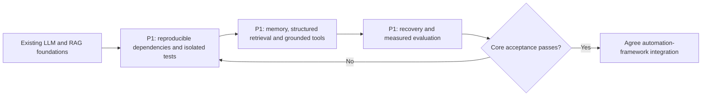

# JeshlaAutoAI: free and open-source module audit

Reviewed: 17 October 2026. Source: the latest Desktop workbook, all seven sheets, read after Excel was closed. Compared with project source, installed-package inventory, requirements.txt and project-progress-audit.md. The workbook was not modified. This is a project-fit audit, not certification of every optional model or service license.

## Decision

Keep the existing LangGraph + Groq + local RAG + SQLite + console/Streamlit architecture. LLM foundations and RAG implementation already exist; Phase 3 integration and hardening remains in progress. A standard agent needs capabilities and acceptance tests, not every framework in the workbook.

Priority P1 = needed now; P2 = next when justified; P3 = optional/later. Status Y = implemented for the stated scope; X = not implemented; I = in progress; P = partial or parked. Y does not imply production acceptance.

## Current stack in project priority order

| Priority | Component | Free/open classification | Status and evidence |
|---|---|---|---|
| P1 | LangGraph, LangChain integrations | Open-source libraries; connected APIs may cost money | Y: graph and state orchestration in agent/langgraph/langgraph_agent.py |
| P1 | Groq + openai/gpt-oss-20b | Hosted service with limited free access; model weights Apache-2.0 | Y: current selected provider in agent/llm_client.py and agent/tool_llm.py |
| P1 | SQLite + langgraph-checkpoint-sqlite | Local storage; no hosted database subscription required | Y: facts, sessions, checkpoints in agent/memory/long_term_memory.py and agent/chat_catalog.py |
| P1 | sentence-transformers, Transformers, PyTorch | Open-source libraries; each downloaded model has its own license | Y: local embedding and reranking dependencies in rag/retrieval.py |
| P1 | FAISS + rank-bm25 | Open-source local retrieval libraries | Y: implemented hybrid retrieval in rag/ingest.py and rag/retrieval.py; answer quality still needs improvement |
| P1 | all-MiniLM-L6-v2 + BAAI/bge-reranker-base | Local model weights; check exact model cards for redistribution | Y: configured embedding/reranking models; no hosted embedding service required |
| P1 | pypdf, python-docx, openpyxl, CSV support | Local document-processing libraries/standard library | Y: loaders and structured search exist in rag; P: structured search not fully connected to conversational tools |
| P1 | ddgs | Open-source search client; external search is network-dependent, without guaranteed service availability | Y: web search tool; P: full-page grounding and citation validation |
| P1 | prompt_toolkit + Streamlit | Open-source console and browser UI libraries | Y: editable console and browser entry points; P: complete live browser acceptance |
| P1 | requests, python-dotenv | Open-source HTTP/configuration helpers | Y: used; explicit dependency manifest needs completion |
| P2 | Ollama + qwen2.5-coder:7b | Local runtime; model license is separate | Y: supported provider; P: practical fallback because measured CPU execution was slow |
| P2 | OpenRouter | Hosted gateway; selected model determines free/paid access | Y: supported adapter; no unlimited-free promise |
| P2 | ChromaDB | Open-source local database; cloud hosting is separate | P: installed and artifacts exist; active inspected hybrid path uses FAISS |
| P2 | MCP SDK / Jira integration | Open-source protocol tooling; external service terms separate | P: existing integration, incomplete QA server and isolated acceptance checks |
| P1 | unittest and custom RAG evaluation scripts | Standard-library tests/local evaluation code; judge API calls can cost quota | P: evaluation exists; repaired offline baseline now passes 120 tests; live/answer-quality acceptance remains pending |

Installed does not mean active. Dependency versions were inspected without importing old scripts that could download models or call external services.

## Missing work to put in the target

| Priority | Status | Completion checklist |
|---|---|---|
| P1 | X | Reconcile direct imports with requirements: requests, python-dotenv, langchain-huggingface, faiss-cpu, rank-bm25, pypdf, python-docx, openpyxl and integration dependencies such as mcp/httpx2. Separate core, UI and optional integrations; verify a clean install before declaring reproducibility. |
| P1 | Y | Offline test baseline: stale fixtures repaired, external-connection/browser guard added; 120 tests pass. Real approval gates unchanged. Live integration acceptance remains separate. |
| P1 | I | Connect structured Excel/CSV retrieval and relevant saved-memory retrieval to the shared agent tool path; test user/session scope. |
| P1 | P | Fetch source pages when needed, validate citations, distinguish retrieved evidence from model inference and ask when evidence is insufficient. |
| P1 | P | Resolve summary failures; verify bounded retries, timeouts, quota errors and interrupted-session recovery across supported providers. |
| P1 | P | Extend existing evaluation with retrieval relevance, grounded answers, memory isolation, tool correctness and failure recovery; establish measured acceptance criteria. |
| P2 | X | Consider one tracing option, such as Langfuse core, if current timing logs are insufficient. Redact secrets and bound retention. |
| P2 | X | Consider RAGAS for additional grounded-answer metrics; existing evaluation remains useful and no package is mandatory. Judge models may consume API quota. |
| P2 | P | Consolidate older provider-specific RAG demos and cwd-sensitive paths into the shared provider/configuration flow. |
| P2 | X | Consider MarkItDown or Docling only for demonstrated document-format or layout failures. Current basic loaders already exist. |
| P3 | P | Automation-framework expansion remains parked until core-agent acceptance, as agreed. |

## Workbook alternatives: do not install everything

| Workbook choices | Project decision |
|---|---|
| LiteLLM | P2 optional gateway; current three-provider adapters already exist. Not an immediate P1 requirement. |
| LlamaIndex, Haystack, DSPy | P3 alternatives or optimization work; not missing prerequisites. |
| CrewAI, AutoGen, smolagents | P3 optional multi-agent approaches; LangGraph already supplies orchestration. |
| Qdrant, LanceDB, pgvector, Milvus, Weaviate; hosted vector databases | P3 until scale, concurrency or deployment needs justify replacing/extending FAISS. |
| Gradio | P3 alternate UI; Streamlit is already implemented and is P1 for this project despite workbook P3. |
| Gemini, Cerebras, Mistral and other hosted LLM services | P3 optional adapters; adding an API key alone does not implement provider support. Gemini models and SDK licensing are separate. |
| Jina, Voyage, Cohere and hosted embedding/rerank APIs | P3 optional replacements; local embedding/reranking already works. |
| Tavily, Exa, Parallel, Serper, Brave | P2 evaluate one only if ddgs reliability/grounding is inadequate. Workbook quotas and credit offers are not verified promises. |
| PEFT, TRL, Unsloth, bitsandbytes, vLLM, extra deep-learning frameworks | P3: no current fine-tuning or GPU-serving requirement. |
| Diffusers, ComfyUI and all image/video/speech/music entries | P3 parked: outside the current text-agent acceptance scope. Workbook claims such as best/fastest are not independently validated. |
| Colab, Kaggle, Hugging Face compute/hosting | P3 optional infrastructure, not core-agent dependencies or guaranteed free GPUs. |

## Classification corrections and sources

- Open source describes licensing. Free tier describes billing limits. Open weights describes model availability. A free SDK does not make its remote API free; local inference still uses hardware and electricity.
- The current GPT-OSS-20B model card lists Apache-2.0. Groq hosts the model; its API service is a separate offering. [Official model card](https://huggingface.co/openai/gpt-oss-20b).
- Groq currently lists GPT-OSS-20B free-plan limits of 30 requests/minute, 1,000/day, 8,000 tokens/minute and 200,000 tokens/day. Account limits are authoritative; the workbook's smaller-model 14,400/day statement must not be applied to this model. [Groq limits](https://console.groq.com/docs/rate-limits).
- Langfuse repository core is MIT except enterprise ee folders. Hosted plans and enterprise features are separate. [Repository license explanation](https://github.com/langfuse/langfuse#license).
- Phoenix uses Elastic License 2.0 with restrictions on offering it as a hosted/managed service. Classify it as source-available with conditions rather than a permissively licensed alternative. [Phoenix license](https://github.com/Arize-ai/phoenix/blob/main/LICENSE).
- RAGAS currently lists Apache-2.0; scoring that uses hosted judges is not necessarily cost-free. [RAGAS license](https://github.com/vibrantlabsai/ragas/blob/main/LICENSE).
- Model-family license labels are not sufficient: exact model/version licenses govern. Optional Gemma, image/video/music license and performance claims were not individually certified in this audit. Do not treat workbook checkmarks as verified approval.
- API, search, RAG hosting and compute quotas in the other sheets change. Verify the selected service's official terms before implementation; no subscription or extra service was enabled here.

## Acceptance flow

Only documentation changed in this review. No package was installed, runtime behavior changed, or workbook edited.

## Complete module list: usage first

Usage reflects the inspected application paths, not just installed packages. NOT USED means no integration was identified in the audited project, not proof that the package is absent from the environment. OPTIONAL means add only for a demonstrated need; ALTERNATIVE means it overlaps an existing choice. These usage labels are separate from the Y/X/I/P completion checklist.

| Usage / decision | Module | Priority | Purpose or evidence |
|---|---|---|---|
| USED | LangChain | P1 | Existing agent/RAG integrations. |
| NOT USED - ALTERNATIVE | LlamaIndex | P3 | Alternative RAG framework; retain current implementation. |
| NOT USED - OPTIONAL | LiteLLM | P2 | Provider gateway; existing adapters already cover three providers. |
| USED - DEPENDENCY | Transformers (Hugging Face) | P1 | Supports local sentence-transformers models. |
| USED - SUPPORTED FALLBACK | Ollama | P2 | Provider implemented and previously run; Groq is currently selected. |
| USED | sentence-transformers | P1 | Local embeddings and reranking. |
| PARTIAL - ALTERNATIVE | ChromaDB | P3 | Installed with stored artifacts; inspected active hybrid path uses FAISS. |
| USED - DEPENDENCY | PyTorch | P1 | Local embedding/reranking model execution. |
| NOT USED - ALTERNATIVE | Haystack | P3 | Alternative pipeline framework. |
| MIXED - DEPENDENCY / OPTIONAL | Tokenizers / Datasets (HF) | P1 / P3 | Tokenization through the model stack; no application dataset-library workflow established. |
| NOT USED - OPTIONAL | PEFT / TRL (HF) | P3 | Fine-tuning is outside current acceptance scope. |
| INDIRECT / OPTIONAL | llama.cpp | P3 | Earlier Ollama logs show its llamacpp runner; no separate direct integration required. |
| NOT USED - OPTIONAL | Google Gemini SDK | P3 | New provider adapter needed before use. |
| USED | FAISS | P1 | Vector retrieval in the existing hybrid RAG pipeline. |
| USED | LangGraph | P1 | Agent graph, state and checkpoint flow. |
| NOT USED - ALTERNATIVE | Gradio | P3 | Streamlit already supplies browser UI. |
| NOT USED - OPTIONAL | DSPy | P3 | Prompt/program optimization if later justified. |
| NOT USED - OPTIONAL | bitsandbytes | P3 | Quantization tooling not part of the current app path. |
| NOT USED - OPTIONAL | Unsloth | P3 | Fine-tuning tooling. |
| NOT USED - ALTERNATIVE | vLLM | P3 | Separate model-serving runtime. |
| NOT USED - ALTERNATIVE | CrewAI | P3 | Alternative agent orchestration. |
| NOT USED - ALTERNATIVE | AutoGen | P3 | Alternative agent orchestration. |
| NOT USED - ALTERNATIVE | smolagents (HF) | P3 | Alternative agent framework. |
| NOT USED - ALTERNATIVE | TensorFlow / Keras | P3 | Current model stack uses PyTorch. |
| USED | Streamlit | P1 | Browser chat implemented alongside console; live acceptance remains pending. |
| NOT USED - OPTIONAL | Diffusers (Hugging Face) | P3 | Image/video generation outside text-agent target. |
| NOT USED - OPTIONAL | ComfyUI | P3 | Multimedia workflow UI outside current target. |
| NOT USED - OPTIONAL | MarkItDown | P2 | Consider only for a demonstrated document-loader gap. |
| NOT USED - OPTIONAL | Docling | P2 | Consider for complex layout extraction. |
| NOT USED - OPTIONAL | Unstructured | P2 | Alternative document parsing/chunking. |
| NOT USED - OPTIONAL | PyMuPDF | P2 | Alternative PDF parser; license review required before adoption. |
| NOT USED AS EMBEDDINGS - ALTERNATIVE | BGE / E5 / Nomic embed models | P2 | Current embedding model is MiniLM; BGE reranker below is a different role. |
| NOT USED - ALTERNATIVE | Qdrant (self-hosted) | P3 | Storage replacement/extension only if requirements justify it. |
| NOT USED - ALTERNATIVE | LanceDB | P3 | Alternative vector storage. |
| NOT USED - ALTERNATIVE | pgvector | P3 | Alternative Postgres-backed vector storage. |
| NOT USED - ALTERNATIVE | Milvus | P3 | Alternative vector storage for larger deployments. |
| NOT USED - ALTERNATIVE | Weaviate | P3 | Alternative vector database. |
| USED | bge-reranker | P1 | BAAI/bge-reranker-base in existing RAG retrieval. |
| NOT USED - OPTIONAL | RAGAS | P2 | Possible addition to existing custom evaluation. |
| NOT USED - OPTIONAL | DeepEval | P2 | Evaluation alternative; choose based on measured gaps. |
| NOT USED - OPTIONAL | promptfoo | P2 | Prompt/provider regression evaluation option. |

### Integration update - 17 October 2026

**Y:** bounded CSV/XLSX conversation tools and scoped lexical-memory tool integration are implemented and covered by the 129-test offline suite. This supersedes the earlier not-connected finding for the shared conversation path. **P:** broader semantic retrieval, complex-table processing and live acceptance remain. Details: [table-memory-tools.md](table-memory-tools.md).
