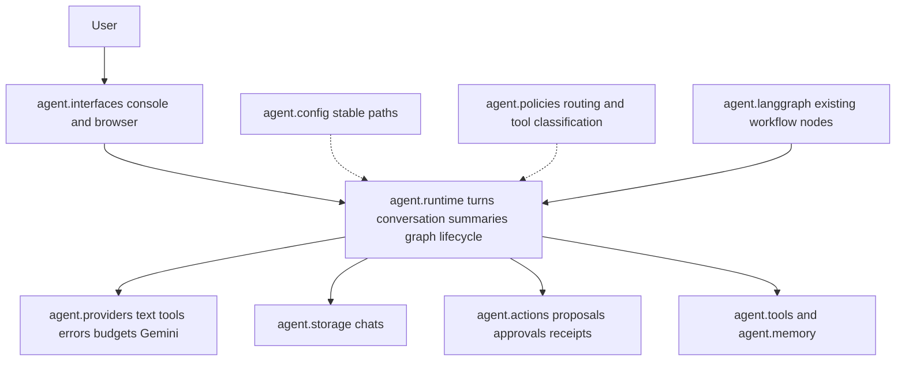

# Package migration map

Status I for analysis, X for migration. Prepared 18 October 2026. This is the proposed map; no Python modules moved.

## Caller evidence

Absolute-import callers and dotted-string references were collected across agent, rag, integrations, tests, evaluations, examples and the Streamlit entry point. See outputs/acceptance/project-package-callers.json. Dotted strings include monkeypatch targets, not just runtime imports. Relative imports, dynamic loading and external consumers still require review.

| Existing module | Static import callers | Dotted string references | Proposed module | Constraint |
|---|---:|---:|---|---|
| agent.llm_client | 17 | 1 | agent.providers.text | Configuration is captured at import time; preserve provider settings and stable project-root lookup. |
| agent.tool_llm | 10 | 1 | agent.providers.tools | Depends on provider constants imported from llm_client; preserve patch/config behavior and schemas. |
| agent.provider_errors | 18 | 1 | agent.providers.errors | HTTP retry/error classes must retain identity and sanitized messages. |
| agent.model_budget | 2 | 0 | agent.providers.budget | Local import of ProviderError forms a runtime import edge; preserve before-network preflight. |
| agent.chat_runtime | 4 | 1 | agent.runtime.turns | Keep shared lock identity, exception behavior and current persistence paths. |
| agent.context_summary | 6 | 2 | agent.runtime.summaries | Pure summary validation versus model adapter remains separate. |
| agent.chat_catalog | 11 | 0 | agent.storage.chats | Preserve user/space/session keys, table schema and explicit database paths. |
| agent.local_action_receipts | 9 | 0 | agent.actions.receipts | Preserve database schema, canonical root/args identity and uncertain blocking. |
| agent.browser_actions | 5 | 0 | agent.actions.browser | Keep proposal expiry, exact approval and scoped execution. |
| agent.browser_backend | 2 | 3 | agent.interfaces.browser | Avoid depending on CLI import side effects after graph factory is introduced. |
| agent.conversation | 17 | 0 | agent.runtime.conversation | Keep tool registry guards, budget exits and citation correction behavior. |
| agent.langgraph.langgraph_agent | 2 | 0 | agent.runtime.graph plus agent.interfaces.console | Split graph construction from CLI only after state and initialization are audited; keep legacy launcher. |

## Proposed parent and child packages

```text
agent/
  interfaces/    console and browser adapters
  runtime/       graph assembly, turn execution, conversation and summary logic
  providers/     text/tool adapters, errors and context budgets
  storage/       conversation catalog and persistence adapters
  actions/       proposals, approvals and receipts
  memory/        existing fact storage and retrieval
  tools/         existing read/controlled tool implementations
  config/        stable project paths and validated settings
rag/             existing optional knowledge implementation, retained initially
integrations/    existing optional adapters, retained initially
tests/           regression and integration fixtures, retained
examples/        learning examples, separate from active entry points
```

Use the existing repository layout first. A src layout is not required for meaningful packaging and would add risk to current module commands. Add pyproject metadata after the core/optional dependency profiles and package data are mapped. Do not add empty packages merely to match this tree.

## Dependency direction

Interfaces call runtime services. Runtime receives provider, storage and tool dependencies through explicit initialization where appropriate. Providers do not import UI or graph assembly. Storage does not call a model. Action approval adapters invoke common policy and receipts. Configuration/path resolution is a small shared foundation rather than a module that imports the agent graph.

## Initialization and state risks verified in source

The browser backend currently imports graph/session_config from the main langgraph module inside initialization. The main module creates a SQLite connection and compiles the graph at module scope. llm_client loads .env and captures provider constants at import time. Moving files changes parents derived from __file__; all such paths must use a stable repository/data-root contract before relocation.

agent_memory.db, outputs/memory and outputs/local_actions.sqlite3 must remain at their current locations. Existing receipts bind absolute project roots. A module move must not modify those identities or interpret old receipts as new permission.

Simple from-new-module-import wrappers are not automatically transparent: monkeypatching old module attributes may no longer affect functions whose globals belong to the new module. Preserve callable behavior, exception identity and tested patch boundaries, or update internal tests with separate compatibility tests proving old public entry points still work. Do not claim a wrapper is compatible solely because import succeeds.

## Migration sequence

1. Verify full stopped-writer backup and restore before any source changes. Record original paths and all persistent stores; no provider/state reset.
2. Establish stable project-path/configuration access with explicit tests, preserving current defaults and environment precedence.
3. Start with a small pure helper group, keeping legacy imports and identity checks. Run affected tests before moving another group.
4. Group provider helpers and runtime/storage adapters incrementally, checking caller/string references and all four provider behaviors.
5. Separate graph factory/lifecycle from CLI and browser construction last; test initialization, shutdown, checkpoints and shared locking.
6. Final full regression, core clean-install acceptance and sampled console/browser actions. Update diagrams and developer guide. Retain backup through acceptance.

## Current next step

Prepare a concrete full backup manifest and detect running agent writers. If the user has active console/Streamlit processes, coordinate a brief stop before copying SQLite state. Do not kill user processes or copy live databases as a supposedly consistent backup. Package migration has not started.

## Incremental migration acceptance

First pure-helper group completed: agent.policies.routing and agent.policies.tool_registry, with legacy module aliases retained. Full offline suite 346/346 passed. Existing package-map candidates remain proposals until their own migration checks pass. No graph/provider/state relocation yet.

## Path foundation accepted

The core application now uses agent.config.paths.APPLICATION_ROOT for its existing source-root defaults. The anchor stays at agent/config/paths.py during migration; no new environment override or data relocation. 348 offline tests passed. Provider/runtime moves can now avoid __file__ depth changes in those migrated modules.

## Provider group accepted

Implemented agent.providers.text/tools/errors/budget/gemini with legacy module aliases. Five modules moved; settings and root paths unchanged. 350 offline tests passed. Runtime/storage/action candidates and graph factory remain unstarted until their own validation; final clean core installation remains pending.

## Runtime helper group accepted

agent.runtime.turns/summaries/summary_model/context/conversation now own their implementations; legacy modules remain aliases. 352 offline tests passed. No graph assembly/factory move yet; storage/actions and final installation verification remain pending.

## Storage and actions accepted

Implemented agent.storage.chats and agent.actions.receipts/browser with legacy aliases. 354 offline tests pass. Database locations, schemas and root-bound receipt identities remain unchanged. Graph lifecycle and interface separation are next; final package/install validation remains pending.

## Current completed layout



Console adapter extraction is implemented and passed 31 focused checks. No further code moves planned for this bounded scope. Existing node definitions remain in agent.langgraph deliberately; meaningful package boundaries do not require moving every existing file. Original commands and legacy import aliases remain.

The Word roadmap now includes this responsibility grouping as an added diagram; its three previous diagrams and existing tables were preserved. Word page-layout rendering is unavailable (missing LibreOffice); the standalone diagram itself was visually inspected. Latest final test/interface reports determine closing status; a timeout is not a pass.
