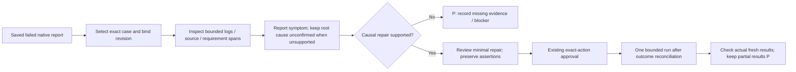

# WS9 9.6 — Failure investigation and reviewed repair

**Overall: P — partial. Read-only investigation component: Y. Verified causal repair and bounded live rerun: P.**

Implemented on 24 October 2026 in the existing `agent/tools` package. Existing API/web/mobile adapters, controlled-action approvals and provider configuration are retained.

| Status | Completion checklist |
| --- | --- |
| **Y** | One selected failed JUnit/TestNG XML or classic Cucumber JSON case can be inspected through `ProjectTools.investigate_test_failure` and the project-agent action registry. |
| **Y** | Exact case/class selection, report revision digest, parsed-error citations and optional bounded log/source/requirement spans are returned. Missing or duplicate cases, unsafe paths, changed revisions and excessive inputs are rejected. |
| **Y** | Observed symptoms are separated from root cause. The selected Appium startup signatures identify a session/infrastructure symptom; ordinary assertions and ambiguous failures remain unknown. No application defect is inferred from an assertion alone. |
| **Y** | Saved execution metadata exposes timeout/unknown outcome. No automatic rerun, patch, Jira operation or approval occurs. Existing source-read, exact-action approval and uncertain-receipt controls still apply. |
| **Y** | 107 focused offline regressions passed, including project dispatch, schemas, approval/receipt behavior and existing API/web/mobile adapters. Both actual saved Appium failures were investigated locally. |
| **P** | Confirm the underlying mobile startup cause and review a specific causal repair. The investigation emits missing-evidence checks, not an invented patch. |
| **P** | Obtain one separately approved bounded live rerun after a meaningful reviewed correction and outcome reconciliation. No unchanged mobile retry was performed. |
| **P** | Hosted-model console/browser acceptance for this new action; current integration acceptance uses scripted model decisions and the real local tool. |

## Tool contract

`investigate_test_failure(relative_path, case_name, case_class="", evidence_spans=[], run_file="")`

- Select one failed case from a native results report. Report count/freshness describes that saved file; it does not prove a new execution or combine multiple reports.
- Each optional span contains `relative_path`, `role` (`log`, `source` or `requirement`), `start_line`, `max_lines` and optional `sha256`. At most four spans, 12 lines and 1,600 characters per span; each input file is at most 5 MB. Read additional source through the normal file tools when needed.
- Optional `run_file` is a saved JSON execution result with boolean `timed_out` and integer/null `exit_code`. It is a user-selected artifact, not independent proof that this exact report belongs to that execution. An absent run, timeout or unknown exit keeps outcome reconciliation mandatory.
- Relative paths must remain inside the selected project root; private/credential directories, traversal, alternate streams and binary files are rejected. Reports in build output directories are supported without widening ordinary source-file access.
- Citations identify parsed report error fields, or exact selected source/log lines, with the inspected bytes' SHA256. Membership/digests do not prove authenticity, semantic correctness, causality, run association or human approval.
- Tool output is data. Instructions embedded in reports or logs cannot generate executable repair arguments. Changes and execution still need the existing controlled actions. A source span is a partial review, not permission to modify that file.
- Screenshots/traces require their own inspection. Their absence is explicit; the tool does not infer visual state from filenames.

## Actual saved-failure acceptance

Evidence directory: `outputs/acceptance/ws9-failure-investigation-20261024/`.

| Saved attempt | Evidence-based observation | Limit / next gate |
| --- | --- | --- |
| `native-run` | Reported `SessionNotCreatedException`: Appium Settings did not run after 30,000 ms; matching server-log excerpt. Session creation failed before the input assertions. | The initial host/display correction was tried later and did not produce a passing Java run. Do not recommend it as a newly verified fix. Root cause remains unconfirmed. |
| `native-run-v2` | TestNG method timeout with `ProtocolHandshake.createSession` stack; matching server log reports socket hang-up. Saved command result has `timed_out: true` and null exit code. | Existing uncertain receipt remains unchanged. Reconcile its outcome/process lifecycle before any separately approved rerun. No input assertion passed or failed independently of startup. |

The proposed-source excerpt has the driver constructor at line 82, matching the reported stack location. This investigation does not establish byte identity with the source executed in those historical runs. The current isolated Java source later gained explicit HTTP deadlines and passed compilation/source-isolation checks; **that is not a live-verified repair**. No Java-failure screenshot exists because the session constructor did not return.

Acceptance artifacts record arguments, exact report/span digests, uncertainty, next checks and tested code revisions. No hosted API payload, emulator/Appium launch, Gradle test, target-project edit, receipt replay or external issue was performed for this investigation.

## Flow

**Reporting handoff completed:** 9.7 now links the reviewed failure facts into its selected local evidence report; see [reporting status](workstream-9-reporting.md). Mobile startup and iOS execution remain parked. Complete the repair/rerun gate only with new causal evidence and an actual bounded result; do not repeat unchanged checks just to turn P into Y.
