# WS9 9.4 — selected native web pilot

**Y — selected TI-TC-001 native pilot (23 October) and browser inspection approval/result (24 October).** Console approval, chat-driven native execution and export remain P; mobile blockers stay recorded.

The AI application is D:/JeshlaAutoAI. The automation target is D:/PlayWrightDemoGradle, retaining its Java/Gradle/Playwright/TestNG stack. One new test was added under src/test/java/tests/web/TextInputAgentPilotTest.java. The inspected build, suite, requirement and existing source files retain their recorded hashes.

**Latest sampled browser status — Y:** saved-JSON read, correct source-based field interpretation and a context-only follow-up passed on 24 October. Earlier dated P descriptions below are historical and superseded for these checks. Console/native-execution/export and full release gates remain separate.

```mermaid
flowchart LR
    R[Requirement excerpt] --> M[Groq reads and requests inspection]
    M --> I[Controlled public browser inspection]
    I --> P[Exact observed label and source-backed value]
    P --> V[Validate inspection and requirement hashes]
    V --> G[Reviewed configurable Java template]
    G --> A[Existing action receipts]
    A --> T[Isolated native Gradle task]
    T --> E[Fresh report + screenshots + trace]
```

## Actual result

| Check | Evidence |
|---|---|
| Live model planning | OpenRouter quota fallback to Groq; read the authorized lines 15-29, request actual inspection, choose unique label Text Input |
| Source/element binding | Exact quote and source hash, inspection-file hash, observed index, label, public address and cookie Decline control checked |
| Native execution | Playwright Java / TestNG, release 17 compilation, Chromium 151.0.7922.34; one test passed; build completed in 59 seconds |
| Actual field values | Empty -> Hello World -> empty after select-all and Backspace |
| Placeholder observations | Hidden while filled; visible after clearing |
| Artifacts | initial.png, entered.png, cleared.png, observations.json, trace.zip and a fresh one-test XML report |
| Regression | 94 offline checks passed, zero failures/errors/skips, network blocked |
| Preservation | Inspected existing target sources/configuration unchanged; default mixed suite and ReportPortal not run |

The source review and exact action callbacks were performed by the coding agent within the user's authorized WS9 continuation. This is not a separate human review of each generated line. The model chose the locator and data; a deterministic reviewed template produced Java. No claim is made that the LLM generated arbitrary Java correctly or that a live console/browser approval button was exercised in this run.

## Browser inspection approval/result — Y, 24 October 2026

User-approved browser receipt `f84168fd1a594c54843b3f4726ec99bc` returned actual inspected field metadata. Original inspection JSON independently matches SHA-256 `327e6312c7282cbb5640434c4e9618ab3ade8d84939418750ed06fec4972338c`; screenshot visually reviewed. Text Input is an enabled editable text input: ID text-input, name textInput, placeholder Enter your name. No form submission recorded. The repeated pasted output has the same receipt/capture/hash and counts as one check; no receipt-database audit or duplicate execution is claimed.

Evidence: `outputs/acceptance/ws9-browser-inspection-20261024/` contains original-byte user text/inspection/screenshot copies, manifest.json, acceptance.json and review.md. This closes browser inspection approval and stored-result delivery only. Natural-language follow-up, console approval, agent-chat native test execution and export remain P; full WS9/mobile/repair/core limits are unchanged. No application code, provider setting, native test, commit/push or Word snapshot changed.

The initial same-chat summary request failed; the dated saved-result correction below supersedes this earlier next-step instruction. After restarting/recovering the old chat, summarize the saved inspection and recommend an exact locator without reopening the site or executing any action. Expected facts: Text Input / Enter your name / text-input, enabled and editable. A suitable Java locator is `page.getByLabel("Text Input", new Page.GetByLabelOptions().setExact(true))`; generation is not execution.

## Saved-result follow-up — local fix Y; live recheck P, 24 October 2026

The user reported a failed follow-up: the browser agent asked them to provide inspection results that had already been returned. This does not revoke the earlier approval/inspection Y; interpreting the saved result is a separate P gate.

Three code paths were diagnosed: browser approval updated history but left the latest structured exchange/outcome stale; project context kept only a short history tail and lost early field metadata; negated action phrases routed the discussion into the project-action loop, whose fresh-tool guard refused a no-tool finish. The correction publishes approved results as the latest exchange, keeps that exchange complete within the existing total input budget, and routes explicit saved-result discussion through conversation with no tools. Positive reads/edits/execution/Jira and fresh documentation/verification retain normal routes. The fresh-read and approval/replay guards remain intact. Field answers are not hardcoded.

**140 affected offline checks pass, zero failures/errors/skips**, including browser approval/replay/UI, routing, complete context, source budgets, summaries, restart/session isolation, continuations and package aliases. Evidence: `outputs/acceptance/ws9-approved-result-context-20261024/{acceptance.json,before.json,before.log,after.json,after.log,expanded-initial-tests.json,expanded-initial-tests.log,final-tests.json,final-tests.log,review.md}`. Initial diagnostic failures and fixture errors are retained separately; tests are not pooled as extra passes. No external provider/website call, dependency change, receipt/checkpoint migration, commit/push, CI dispatch or Word update occurred.

**Live follow-up stays P until the restarted app returns a correct source-based answer.** Restart the Streamlit server so the cached backend/graph uses the correction. For this already-failed chat, read only lines 1–30 of the existing selected-project `test-output/agent-web/4e8420942b494fd386ea36914b2afffa/inspection.json` and identify the field from saved data. Then retry the saved-inspection-only question. No website reopening, reapproval, test or command is needed. The original JSON still hashes to 327e6312c7282cbb5640434c4e9618ab3ade8d84939418750ed06fec4972338c. Expected facts: Text Input, ID text-input, enabled and editable. A locator recommendation is not execution. Broader console/execution/export/mobile/release gates retain P.

## Project proposal format — local fix/live fixture Y; browser recheck P, 24 October 2026

The saved-file recovery prompt reached project routing but stopped before execution with “Use exactly one registered submit_project_action function.” The browser log shows OpenRouter selected. Raw generated proposals were not recorded, so the exact wrong name/count is unknown. The decoder error means its required single-wrapper call shape was absent; it is not a successful source read.

Existing native-registry correction was Groq-only. Extended that bounded second request to other providers when the first wrapper response calls a wrong function or proposes multiple calls. The invalid first response is discarded; only a new response to actually registered native functions can be validated. Correct wrapper requests keep their existing path. Unregistered functions, multiple corrective calls, extra/missing arguments, quotas and authentication errors retain their existing rejection/stop behavior; no execution or approval is inferred. At most two proposal attempts remain.

**143 affected offline checks passed, zero failures/errors/skips.** One bounded **actual OpenRouter compatibility check passed** on synthetic/public field data: an explicitly injected malformed-wrapper fixture led to a real registered-native read_file proposal, then an evidence-based finish. Three actual provider requests completed in 14.37 seconds. The answer identified Text Input as enabled/editable and recommended `page.locator("#text-input")`. The fixture executed no local handler or browser and sent no private project context. Gemini/Groq were not newly live-certified. Evidence: `outputs/acceptance/ws9-project-proposal-format-20261024/{before.json,before.log,decision-tests.json,decision-tests.log,public-fixture-payload.json,live-compatibility.json,tests.json,tests.log,acceptance.json,review.md}`.

**Actual browser follow-up remains P.** Restart the Streamlit server and resubmit the same saved-inspection JSON read prompt. No new website inspection/approval/test is needed. Only existing `agent/runtime/project_decisions.py` and `tests/test_project_decisions.py` changed in this correction; provider adapters/settings, target files, user stores, earlier accepted CI and Word remain untouched.

## Browser saved-file read and interpretation — Y, 24 October 2026

After restart the user pasted a successful browser answer citing the existing inspection.json lines 1–30. Its fields match the independently checked original inspection: index 1, Text Input, id text-input, type text, placeholder Enter your name, disabled=false, read_only=false and required=false. Enabled/editable interpretation is correct. The ID and label locator candidates match observed metadata; neither was executed or separately checked for DOM uniqueness. The response offered two locator alternatives although one was requested; this minor format deviation does not invalidate the saved-read/interpretation check.

**Y — user-verified saved-file read and answer.** Evidence: `outputs/acceptance/ws9-browser-saved-read-20261024/{acceptance.json,user-browser-response.txt}`. Original inspection hash remains 327e6312c7282cbb5640434c4e9618ab3ade8d84939418750ed06fec4972338c. This supersedes the pending actual saved-file recovery read, not the entire interface/release gate. **P — context-only follow-up without another read:** ask in the same chat what disabled=false/read_only=false mean and request exactly one locator, using the previous result only. No new website inspection or native test is needed. Console approval, chat-driven native execution/export, mobile/repair and full release remain separate.

## Same-chat saved-result follow-up — Y, 24 October 2026

The user supplied the browser reply after the context-only prompt. It correctly explained disabled=false as enabled and read_only=false as editable, and returned exactly one locator: `page.locator("#text-input")`. The most recent browser completion log records route direct (11.082 seconds), following the earlier project-route saved-file read. No new source inspection/read is reported in this response. No locator execution or wire-level call audit is claimed.

**Y — sampled saved-JSON read → source-based answer → context-only follow-up.** Evidence: `outputs/acceptance/ws9-browser-context-followup-20261024/{acceptance.json,user-browser-response.txt}`. The earlier approval/result-delivery check also remains Y, but a new uninterrupted post-fix approval-to-follow-up run was not performed; this sample followed explicit recovery from the already saved JSON. This closes the pending read/interpretation/context-only sample without repeating the website inspection or native/CI tests. It does not prove universal model recall or complete WS2/WS9 acceptance.

Console acceptance, chat-driven native execution/export, mobile/repair and earlier core release gates remain separate P items. Native application case counts and the historical reporting matrix are unchanged. Next independent interface check is the console's selected saved-file workflow, if continued; no additional browser recall checks are required for this sample. No code/provider settings/user-store repair/commit/push/Word update occurred in this review.

## Console saved-file read and context-only follow-up — Y, 24 October 2026

The user ran the documented console entrypoint in dedicated session ws9-console-check using OpenRouter/nvidia nemotron-3.5-lightning free. First turn routed project and executed exactly one read_file step for saved inspection.json lines 1–30. All selected Text Input metadata was present, even though the 188-line file was partially read. The final answer correctly identified enabled/editable and gave one Playwright CSS-ID locator. The parenthetical “By.id” is loose terminology; the actual code was `page.locator("#text-input")`, not a Selenium API call. No locator execution/uniqueness claim.

The second turn routed direct, used one model request and no tool step, explained both false flags correctly and returned exactly one locator. First workflow took 20.17 seconds with four model/proposal requests and one actual source read; second took 8.05 seconds. Multiple model requests are not multiple local tool executions. Original inspection SHA-256 remains unchanged.

**Y — sampled console saved-source read → answer → context-only follow-up**, complementing the already accepted browser sample. Evidence: `outputs/acceptance/ws9-console-saved-read-20261024/{acceptance.json,user-console-run.txt,review.md}`. No new browser inspection, application test or CI run is required for this check. Console action approval/native execution/export and failure-investigation interface acceptance remain separately pending; no full-console or full-release certification. Application case counts remain 3 accepted API + 1 accepted web; other 11 Text Input cases remain not run. Next independent work is controlled native test execution through the agent chat and traceable result/export acceptance. Mobile/iOS/causal repair and earlier core gates remain P.

## Package ownership

- integrations/web: bounded public inspection worker, inspection/requirement plan binding, configurable Java template and isolated Gradle recipe.
- agent/tools/project_tools.py: registered controlled inspect_browser_page action. It inspects metadata without typing, submitting forms or reading field values.
- agent/runtime/project_decisions.py: project-action schema now advertises the actual registered handler argument names; existing approval protocol remains in place.
- Existing agent/actions receipts and browser dispatcher: exact action/root/argument approval, decline and replay protection; regressions cover the new controlled kind.
- evaluations/web_pilot_planning.py: explicit bounded live planning harness; no automatic invocation or persistent provider-setting change.

The browser uses a fresh isolated context. Requests are restricted to GET/HEAD on the selected public HTTPS origin, DNS is pinned, private/embedded-private addresses are rejected, and downloads, service workers and WebSockets are blocked. Only ordinary editable text input is supported by this execution template. URLs, locators, values and evidence directories are runtime inputs, not hardcoded project roots or website selectors.

## Fixed issues and preserved diagnostics

The first live model attempts supplied read_file parameters inside files because the generic project-action schema advertised only that nested field. The schema now derives parameter names from the actual registered handlers; the successful live plan uses the correct arguments. A regression checks this behavior.

Inspection SHA initially used pre-write LF text while Windows saved CRLF bytes. The saved artifact content was verified unchanged, production hashing now uses actual saved bytes, and execution-plan.json records the reassessed hash. Raw model responses and original receipts remain untouched. These are concrete fixes, not repeated attempts at unchanged provider errors.

## Evidence and boundaries

Evidence root: outputs/acceptance/ws9-web-pilot-20261023/.

- completion.json: scoped completion and artifact hashes.
- planning-after-schema-fix/planning.json: successful actual provider plan.
- execution-plan.json and inspection-hash-reassessment.json: bound execution inputs and newline reassessment.
- native-run/acceptance.json, run.json, run.log and TEST-tests.web.TextInputAgentPilotTest.xml: native result and fresh report.
- native-run/browser/: actual screenshots, observations and valid trace archive.
- target-source-before.json / target-source-after.json and action-receipts.sqlite3: preservation and controlled action records.
- offline-tests.json: 94-check result.

Other 11 Text Input cases remain not run. Other controls, websites, full target suite, live interface approval clicks, mobile, CI and general WS9 release remain separate gates. No GitHub/Jira/Ollama operation was performed. The Markdown roadmap is current; the Word roadmap remains its earlier snapshot.
