# WS9 9.4 — selected native web pilot

**Y — TI-TC-001 completed on 23 October 2026. Next: 9.5 mobile prerequisites and pilot selection.**

The AI application is D:/JeshlaAutoAI. The automation target is D:/PlayWrightDemoGradle, retaining its Java/Gradle/Playwright/TestNG stack. One new test was added under src/test/java/tests/web/TextInputAgentPilotTest.java. The inspected build, suite, requirement and existing source files retain their recorded hashes.

```mermaid
flowchart LR
    R[Requirement excerpt] --> M[Groq reads and requests inspection]
    M --> I[Controlled public browser inspection]
    I --> P[Exact observed label and source-backed value]
    P --> V[Validate inspection and requirement hashes]
    V --> G[Reviewed configurable Java template]
    G --> A[Existing action receipts]
    A --> T[Isolated native Gradle task]
    T --> E[Fresh report + screenshots + trace]
```

## Actual result

| Check | Evidence |
|---|---|
| Live model planning | OpenRouter quota fallback to Groq; read the authorized lines 15-29, request actual inspection, choose unique label Text Input |
| Source/element binding | Exact quote and source hash, inspection-file hash, observed index, label, public address and cookie Decline control checked |
| Native execution | Playwright Java / TestNG, release 17 compilation, Chromium 151.0.7922.34; one test passed; build completed in 59 seconds |
| Actual field values | Empty -> Hello World -> empty after select-all and Backspace |
| Placeholder observations | Hidden while filled; visible after clearing |
| Artifacts | initial.png, entered.png, cleared.png, observations.json, trace.zip and a fresh one-test XML report |
| Regression | 94 offline checks passed, zero failures/errors/skips, network blocked |
| Preservation | Inspected existing target sources/configuration unchanged; default mixed suite and ReportPortal not run |

The source review and exact action callbacks were performed by the coding agent within the user's authorized WS9 continuation. This is not a separate human review of each generated line. The model chose the locator and data; a deterministic reviewed template produced Java. No claim is made that the LLM generated arbitrary Java correctly or that a live console/browser approval button was exercised in this run.

## Package ownership

- integrations/web: bounded public inspection worker, inspection/requirement plan binding, configurable Java template and isolated Gradle recipe.
- agent/tools/project_tools.py: registered controlled inspect_browser_page action. It inspects metadata without typing, submitting forms or reading field values.
- agent/runtime/project_decisions.py: project-action schema now advertises the actual registered handler argument names; existing approval protocol remains in place.
- Existing agent/actions receipts and browser dispatcher: exact action/root/argument approval, decline and replay protection; regressions cover the new controlled kind.
- evaluations/web_pilot_planning.py: explicit bounded live planning harness; no automatic invocation or persistent provider-setting change.

The browser uses a fresh isolated context. Requests are restricted to GET/HEAD on the selected public HTTPS origin, DNS is pinned, private/embedded-private addresses are rejected, and downloads, service workers and WebSockets are blocked. Only ordinary editable text input is supported by this execution template. URLs, locators, values and evidence directories are runtime inputs, not hardcoded project roots or website selectors.

## Fixed issues and preserved diagnostics

The first live model attempts supplied read_file parameters inside files because the generic project-action schema advertised only that nested field. The schema now derives parameter names from the actual registered handlers; the successful live plan uses the correct arguments. A regression checks this behavior.

Inspection SHA initially used pre-write LF text while Windows saved CRLF bytes. The saved artifact content was verified unchanged, production hashing now uses actual saved bytes, and execution-plan.json records the reassessed hash. Raw model responses and original receipts remain untouched. These are concrete fixes, not repeated attempts at unchanged provider errors.

## Evidence and boundaries

Evidence root: outputs/acceptance/ws9-web-pilot-20261023/.

- completion.json: scoped completion and artifact hashes.
- planning-after-schema-fix/planning.json: successful actual provider plan.
- execution-plan.json and inspection-hash-reassessment.json: bound execution inputs and newline reassessment.
- native-run/acceptance.json, run.json, run.log and TEST-tests.web.TextInputAgentPilotTest.xml: native result and fresh report.
- native-run/browser/: actual screenshots, observations and valid trace archive.
- target-source-before.json / target-source-after.json and action-receipts.sqlite3: preservation and controlled action records.
- offline-tests.json: 94-check result.

Other 11 Text Input cases remain not run. Other controls, websites, full target suite, live interface approval clicks, mobile, CI and general WS9 release remain separate gates. No GitHub/Jira/Ollama operation was performed. The Markdown roadmap is current; the Word roadmap remains its earlier snapshot.
